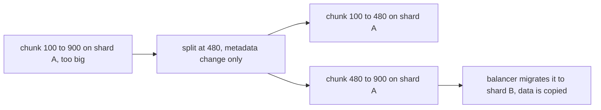

# Chunks, the balancer and sharding administration

> **Before this lesson:** you should know the components of a sharded cluster and what a chunk is ([Sharded cluster components and query routing](#/lesson/mongodb/sharding-components)) and the properties of a good shard key, including jumbo chunks and hot shards ([Choosing a shard key: ranged, hashed and zoned](#/lesson/mongodb/shard-keys)).

## In plain words

Data does not arrive evenly. One range of the shard key fills up faster than another, a new shard is added and starts empty, an old one is retired. Left alone, a sharded cluster would drift out of balance until one machine was full and another idle.

Return to the library branches. Two routine jobs keep them workable. When one shelf section becomes overfull, the librarian puts a new divider in the middle and treats it as two sections; no books move, only the labels change. And when one branch holds far more sections than another, a van carries a few sections across town overnight, and the chart at the information desks is updated.

MongoDB does both automatically. Dividing a range in two is a **split**. Moving a range of data from one shard to another is a **migration**. The background process that decides which migrations to perform is the **balancer**.

Why it matters for a job: people who run sharded clusters spend their time on exactly these mechanics - reading the cluster's status, knowing when the balancer may run, adding and removing shards. In interviews, the question "what happens when you add a shard?" checks whether you understand them.

## Chunks and splits

Recall that a **chunk** is a contiguous range of shard key values, with an inclusive lower bound and an exclusive upper bound, assigned to one shard. When a collection is first sharded, it may have a single chunk covering everything from `MinKey` to `MaxKey`.

As documents are inserted, a range grows. Each range has a target maximum size, 128 megabytes by default in current versions (64 megabytes before version 6.0). When a range exceeds it, the range is **split**: a key value near the middle is chosen and the one range becomes two.

A split is cheap. No documents are copied or moved. The only thing that changes is the metadata on the config servers: one entry "from 100 up to 900 on shard A" becomes two entries, "from 100 up to 480 on shard A" and "from 480 up to 900 on shard A".



A split needs a key value to split *at*. If every document in the range has the same shard key value, there is no such value, and the range cannot be divided however large it gets. This is the **jumbo chunk** from the previous lesson, the direct consequence of a low-cardinality key.

## The balancer

The **balancer** is a background process that runs on the primary of the config server replica set. Its goal is that each shard holds a fair share of every sharded collection.

In versions before 6.0 the balancer compared the *number of chunks* per shard and acted when the difference between the fullest and emptiest shard passed a threshold. From 6.0 onward it compares the *amount of data* per shard and acts when the difference exceeds three times the configured range size (384 megabytes by default). The principle is the same in both: find the most loaded and least loaded shards, and if the gap is large enough, move a range from the first to the second. Repeat until the gap is small.

### What a migration involves

Moving a range between shards must not lose writes or return wrong results while it happens. The procedure, simplified:

1. **Start.** The balancer tells the source shard to move a particular range to a target shard.
2. **Copy.** The target requests the range's documents and inserts them, building the same indexes.
3. **Catch up.** Writes that reached the source during the copy are forwarded to the target, until the two agree.
4. **Commit.** For a brief moment writes to that range are paused. The config servers' metadata is updated to say the range belongs to the target. Routers learn of the change and send that range's traffic to the new owner.
5. **Clean up.** The source deletes its now-redundant copy of the range, in the background.

Throughout steps 1 to 3 the source continues serving the range. Applications notice nothing but some extra load.

Between steps 4 and 5 the old copy still physically exists on the source shard. Documents on a shard that does not own their range are called **orphaned documents**. Queries routed through `mongos` filter them out automatically, which is one more reason applications must never connect straight to a shard.

### The cost of balancing

A migration reads a large amount of data on one machine, sends it across the network and writes it on another. That competes with the application for disk, memory and bandwidth. Two controls keep it in check.

**The balancer can be stopped and started.**

```javascript
mongos> sh.getBalancerState()
true
mongos> sh.stopBalancer()
mongos> sh.startBalancer()
mongos> sh.isBalancerRunning()
```

`getBalancerState` says whether the balancer is enabled. `isBalancerRunning` says whether a balancing round is in progress this instant. Stop the balancer before taking a backup of a sharded cluster, so that no range is caught in mid-move and backed up twice or not at all.

**A balancing window** restricts it to quiet hours:

```javascript
mongos> use config
mongos> db.settings.updateOne(
...   { _id: "balancer" },
...   { $set: { activeWindow: { start: "01:00", stop: "05:00" } } },
...   { upsert: true }
... )
```

This stores a setting in the `config` database: migrations may start only between one and five in the morning. Make the window long enough for the balancer to keep pace with the daily growth of data, or imbalance accumulates.

Balancing can also be disabled for one collection with `sh.disableBalancing("db.collection")`.

> [!WARNING]
> Balancing moves data that has already been written. It cannot rescue a monotonically increasing shard key: every insert still lands on the same shard and then has to be migrated away, so that shard does the writing *and* the copying. A cluster whose balancer is constantly busy is usually a cluster with a shard key problem, not a balancer problem.

## Adding and removing shards

**Adding** a shard is one command, `sh.addShard(...)`. The new shard starts empty. The balancer notices the imbalance and begins migrating ranges to it. This takes time - hours or days for a large data set - and the cluster carries the migration load meanwhile. The lesson: add capacity *before* the existing shards are saturated, because a saturated shard has no spare resources for copying data out.

**Removing** a shard reverses the process:

```javascript
mongos> db.adminCommand({ removeShard: "shardC" })
{ msg: 'draining started successfully', state: 'started', shard: 'shardC', ok: 1 }

mongos> db.adminCommand({ removeShard: "shardC" })
{ msg: 'draining ongoing', state: 'ongoing', remaining: { chunks: 42, dbs: 1 }, ok: 1 }
```

The first call marks the shard as **draining**: the balancer moves all its ranges elsewhere. Running the same command again reports progress. `dbs: 1` warns that one database uses this shard as its primary shard; its unsharded collections must be moved with the `movePrimary` command before removal can finish. When nothing remains, a final call reports `state: 'completed'`.

## Pre-splitting

Suppose you are about to load a billion documents into a new, empty sharded collection. It starts as one range on one shard. All the initial data lands there, and the balancer then has to migrate most of it. The load would be much faster if the ranges existed, spread over the shards, before any data arrived.

Creating empty ranges in advance is called **pre-splitting**. With hashed sharding it is built in: sharding an empty collection on a hashed key creates several ranges per shard immediately. With ranged sharding you can define the split points yourself with `sh.splitAt(namespace, { key: value })` when you know how the key values will be distributed. Zones are another way to place ranges before loading.

## Reading the state of a cluster

Three views answer most questions.

**`sh.status()`** is the overview: the shards, whether the balancer is enabled and active, recent migration results, and for each sharded collection its key and how many ranges each shard owns.

**`db.collection.getShardDistribution()`** reports, for one collection, the data size and document count on each shard, with percentages. This shows real imbalance more faithfully than counts of ranges, since ranges differ in size.

```javascript
mongos> db.events.getShardDistribution()
Shard shardA at shardA/a1:27018,a2:27018,a3:27018
{ data: '41.2GiB', docs: 88213004, chunks: 331, 'estimated data per chunk': '127.4MiB' }
Shard shardB at shardB/b1:27018,b2:27018,b3:27018
{ data: '40.7GiB', docs: 87102771, chunks: 327, 'estimated data per chunk': '127.5MiB' }
Totals
{ data: '81.9GiB', docs: 175315775, chunks: 658,
  'Shard shardA': [ '50.3 % data', '50.31 % docs in cluster' ],
  'Shard shardB': [ '49.7 % data', '49.69 % docs in cluster' ] }
```

Each block gives one shard's share; the totals show a healthy, near-even split.

**The `config` database** is where all of this is stored, as ordinary collections you can query: `config.shards` (the shards), `config.collections` (sharded collections and their keys), `config.chunks` (every range and its owner) and `config.changelog` (a history of splits and migrations, useful when asking "what was the balancer doing at three o'clock?").

Treat `config` as read-only. Change the cluster through the `sh.*` helpers and administrative commands, never by editing these collections by hand.

### Operational habits specific to clusters

- **Run several `mongos` routers** and list them all in the application's connection string, so that losing one does not cut the application off.
- **Watch each shard as a replica set** in its own right: lag, oplog window and elections apply to every shard and to the config servers.
- **Back up consistently.** A backup must capture all shards and the config servers at matching moments, with the balancer stopped. Managed backup tools coordinate this; doing it by hand is error-prone.
- **Count connections.** Every `mongos` opens connections to every shard. Many application servers, each with its own `mongos` and a large connection pool, can add up to more connections than the shards handle well.
- **Upgrade in order.** For a new version: config servers first, then the shards, then the `mongos` routers, each replica set by the rolling method.

> [!TIP]
> After adding a shard, do not expect immediate relief. Check progress with `sh.status()` and `getShardDistribution()` over the following hours. If the cluster was already overloaded, consider temporarily widening the balancing window and reducing application load, so that migrations can complete.

> [!INTERVIEW]
> **"What happens when you add a new shard to a cluster?"** The shard joins empty. The balancer, running on the config server primary, detects that data is unevenly distributed and starts migrating ranges from the fullest shards to the new one. Each migration copies the range's documents to the target, forwards writes made during the copy, briefly pauses writes to commit the ownership change in the config metadata, and then deletes the old copy in the background. Routers refresh their cached metadata and send traffic to the new owner. The application keeps running, but migrations consume I/O, so capacity should be added before shards are saturated.

## The same from Python

```python
from pymongo import MongoClient

client = MongoClient("mongodb://router1.example.net:27017,router2.example.net:27017/")
admin, config = client["admin"], client["config"]

print(admin.command("balancerStatus")["mode"])                                   # 1

per_shard = config["chunks"].aggregate([                                         # 2
    {"$group": {"_id": "$shard", "ranges": {"$sum": 1}}}, {"$sort": {"_id": 1}}])
print({row["_id"]: row["ranges"] for row in per_shard})

jumbo = config["chunks"].count_documents({"jumbo": True})                        # 3
print("jumbo chunks:", jumbo)

recent = config["changelog"].find({"what": {"$regex": "^moveChunk"}}).sort("time", -1).limit(3)   # 4
for event in recent:
    print(event["time"], event["what"], event["ns"])

admin.command("balancerStop")                                                    # 5
try:
    pass   # take the backup here
finally:
    admin.command("balancerStart")                                               # 6
```

1. Prints `full` when the balancer is enabled and `off` when it is stopped.
2. Counts ranges per shard straight from the metadata.
3. Counts ranges flagged as jumbo. Anything above zero points at a cardinality problem with the shard key.
4. The three most recent migration events from the cluster's change log.
5. Stops the balancer, waiting for any migration in progress to finish.
6. The `finally` block guarantees the balancer is restarted even if the backup step raises an error. A balancer left off by accident is a well-known cause of slowly growing imbalance.

## Simulate it yourself

The simulation loads data into a one-shard cluster, splits ranges that grow too large, adds two shards and lets a balancer even things out, counting how many documents had to be copied. It finishes with a jumbo range that cannot be split.

```python-run
import random

random.seed(2)
MAX_DOCS = 400                         # stand-in for the 128 MB range size

def split_all(chunks):
    """Split every range holding more than MAX_DOCS keys; return the number of splits."""
    splits, i = 0, 0
    while i < len(chunks):
        keys = chunks[i]["keys"]
        middle = keys[len(keys) // 2]
        if len(keys) > MAX_DOCS and keys[0] != keys[-1] and middle != keys[0]:
            left = [k for k in keys if k < middle]          # a split is a metadata change: no data moves
            chunks[i:i + 1] = [{"shard": chunks[i]["shard"], "keys": left},
                               {"shard": chunks[i]["shard"], "keys": keys[len(left):]}]
            splits += 1
        else:
            i += 1
    return splits

def load(shard_names):
    return {s: sum(len(c["keys"]) for c in chunks if c["shard"] == s) for s in shard_names}

def balance(chunks, shard_names, threshold=3 * MAX_DOCS):
    moved_docs, migrations = 0, 0
    while True:
        size = load(shard_names)
        source = max(shard_names, key=lambda s: (size[s], s))
        target = min(shard_names, key=lambda s: (size[s], s))
        if size[source] - size[target] <= threshold:
            return migrations, moved_docs
        chunk = next(c for c in chunks if c["shard"] == source)
        chunk["shard"] = target                             # a migration copies every document of the range
        migrations += 1
        moved_docs += len(chunk["keys"])

chunks = [{"shard": "A", "keys": sorted(random.sample(range(1_000_000), 12_000))}]
print("start: 1 range holding", len(chunks[0]["keys"]), "documents on shard A")
print("splits performed:", split_all(chunks), "-> ranges:", len(chunks),
      "| largest range:", max(len(c["keys"]) for c in chunks), "docs | documents moved by splitting: 0")

shards = ["A", "B", "C"]
print("shards B and C added (empty). load before balancing:", load(shards))
migrations, moved = balance(chunks, shards)
print("balancer: %d migrations, %d documents copied (%d%% of the data)" % (migrations, moved, moved * 100 // 12_000))
print("load after balancing:", load(shards))
print("ranges per shard:", {s: sum(c["shard"] == s for c in chunks) for s in shards})

# A low-cardinality shard key: 3,000 documents share the key value 7.
jumbo = [{"shard": "A", "keys": [7] * 3000 + list(range(8, 60))}]
print()
print("range with 3,000 identical keys: splits =", split_all(jumbo),
      "| sizes after splitting:", [len(c["keys"]) for c in jumbo], "<- still one range: a jumbo chunk (limit %d)" % MAX_DOCS)
```

Reading the output:

- One range of 12,000 documents is divided repeatedly until no range holds more than 400. Dozens of splits happen and not one document is moved, because splitting only changes metadata.
- After shards B and C join, shard A holds everything. The balancer migrates ranges until the three shards hold roughly a third each. Roughly 60 per cent of all documents had to be copied across the network - the real price of adding shards.
- In the final case, 3,000 documents share the key value 7. The key in the middle of the range is 7, the same as the first key, so there is no value at which to cut. No split happens and the range stays at 3,052 documents, more than seven times the limit. That is a jumbo chunk.

Try lowering the `threshold` argument of `balance` and observe the extra migrations needed for a tighter balance.

## Pitfalls

- **Expecting the balancer to fix a bad shard key.**
- **Adding shards when the cluster is already overloaded**, leaving no headroom for migrations.
- **Leaving the balancer stopped** after a backup or maintenance.
- **A balancing window too short** for the rate of data growth.
- **Backing up shards separately with the balancer running.**
- **Editing the `config` database by hand.**
- **Connecting to shards directly** and seeing orphaned documents or missing data.
- **Forgetting `movePrimary`** when removing a shard that is some database's primary shard.
- **Bulk-loading into a single initial range** when pre-splitting was possible.

## Cheat sheet

| task | command |
|---|---|
| overview | `sh.status()` |
| per-shard data for a collection | `db.coll.getShardDistribution()` |
| is the balancer enabled / running | `sh.getBalancerState()` / `sh.isBalancerRunning()` |
| stop / start the balancer | `sh.stopBalancer()` / `sh.startBalancer()` |
| stop balancing one collection | `sh.disableBalancing("db.coll")` |
| split a range at a key | `sh.splitAt("db.coll", { key: value })` |
| add / remove a shard | `sh.addShard(...)` / `db.adminCommand({ removeShard: name })` |
| move a database's primary shard | `db.adminCommand({ movePrimary: "db", to: "shard" })` |
| find jumbo chunks | `db.getSiblingDB("config").chunks.find({ jumbo: true })` |

| fact | value |
|---|---|
| default range size | 128 MB (64 MB before 6.0) |
| what a split moves | nothing; metadata only |
| what a migration moves | all documents of the range |
| where the balancer runs | primary of the config server replica set |
| upgrade order | config servers, shards, then mongos |

## Summary

- A split divides an over-large range in two by changing metadata only; it requires a key value to split at, which a jumbo chunk lacks.
- The balancer runs on the config servers' primary and migrates ranges from the most loaded shard to the least loaded until the difference is small.
- A migration copies the range, forwards concurrent writes, commits the ownership change and then deletes the old copy; leftover copies are orphaned documents that `mongos` filters out.
- Balancing costs I/O; it can be stopped, started and limited to a time window, and must be stopped for backups.
- Adding a shard triggers a long rebalancing; removing one drains it first. Pre-splitting avoids migrating freshly loaded data.
- `sh.status()`, `getShardDistribution()` and the `config` database show the state of the cluster.

## Glossary

- **Chunk (range)** - a contiguous span of shard key values owned by one shard.
- **Split** - dividing one range into two; a metadata-only operation.
- **Migration** - moving a range's documents from one shard to another.
- **Balancer** - the background process that schedules migrations to even out the shards.
- **Jumbo chunk** - an over-large range that cannot be split because its documents share one key value.
- **Orphaned document** - a document left on a shard that no longer owns its range.
- **Balancing window** - the daily period during which migrations may start.
- **Draining** - emptying a shard of all its ranges before removing it.
- **Pre-splitting** - creating empty ranges across shards before loading data.
- **`config` database** - the database holding the cluster's metadata.
- **`movePrimary`** - the command that moves a database's unsharded collections to another shard.

## Check yourself

```quiz
[
  {"q": "What moves when a chunk is split?",
   "options": ["Half of its documents go to another shard", "Nothing; only the metadata on the config servers changes", "All its indexes are rebuilt", "The whole collection is rewritten"],
   "answer": 1,
   "explain": "A split replaces one range entry with two on the same shard. Moving data is the job of a migration."},
  {"q": "Where does the balancer run?",
   "options": ["On every mongos", "On the primary of the config server replica set", "On each shard's secondaries", "In the application driver"],
   "answer": 1,
   "explain": "The balancer is a background process of the config servers' primary."},
  {"q": "Why can a jumbo chunk not be split?",
   "options": ["It is locked by a transaction", "All its documents have the same shard key value, so there is no value to split at", "It is larger than 16 MB", "It lives on the config servers"],
   "answer": 1,
   "explain": "A split needs a key value in the middle of the range; identical keys offer none."},
  {"q": "A new shard is added to a three-shard cluster. What happens next?",
   "options": ["The data is instantly redistributed", "The balancer gradually migrates ranges to the new shard, which costs I/O for hours or days", "The new shard receives only new inserts", "Nothing until the cluster is restarted"],
   "answer": 1,
   "explain": "The shard starts empty and is filled by migrations, each of which copies documents across the network."},
  {"q": "Why should the balancer be stopped before backing up a sharded cluster?",
   "options": ["Backups are faster", "So that no range is in mid-migration and captured twice or not at all", "The balancer deletes backups", "It is not necessary"],
   "answer": 1,
   "explain": "A migration during the backup could leave a range present on two shards' backups or on neither."},
  {"q": "What are orphaned documents?",
   "options": ["Documents without an _id", "Copies left on a shard that no longer owns their range after a migration", "Documents in unsharded collections", "Documents rejected by a validator"],
   "answer": 1,
   "explain": "They are cleaned up in the background, and mongos filters them out, which is why applications must not query shards directly."},
  {"q": "A collection is ranged-sharded on a timestamp and the balancer is busy all day. What is the real problem?",
   "options": ["The balancer threshold is too low", "The monotonic shard key sends every insert to one shard, which must then migrate the data away", "There are too many mongos routers", "The range size is too large"],
   "answer": 1,
   "explain": "Balancing moves data after it is written; it cannot spread the inserts themselves."},
  {"q": "What is pre-splitting used for?",
   "options": ["Making backups smaller", "Creating empty ranges across shards before a bulk load, so the data lands spread out", "Removing jumbo chunks", "Speeding up elections"],
   "answer": 1,
   "explain": "Without it, a new collection starts as one range on one shard and most loaded data must later be migrated."}
]
```

> **Source:** MongoDB: The Definitive Guide 3e, ch. 16-17 (topics only; wording and examples are original). MongoDB Manual: https://www.mongodb.com/docs/manual/core/sharding-data-partitioning/ , https://www.mongodb.com/docs/manual/core/sharding-balancer-administration/ , https://www.mongodb.com/docs/manual/tutorial/manage-sharded-cluster-balancer/ , https://www.mongodb.com/docs/manual/tutorial/remove-shards-from-cluster/
