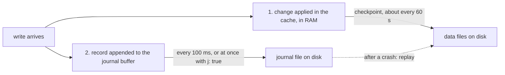

# Data administration, durability and journaling

> **Before this lesson:** you should know what write concern is, including `w` and `j` ([Inserting, deleting and write concern](#/lesson/mongodb/insert-delete)), how replication and majority acknowledgement work ([The oplog, write concern, read concern and read preference](#/lesson/mongodb/oplog-concerns)) and how indexes are created ([Single-field and compound indexes: the ESR rule](#/lesson/mongodb/index-basics)).

## In plain words

**Durability** is the promise that once the database has said "saved", the data is still there after a crash or a power cut. It sounds like the least a database should do. It is harder than it looks, because the fast place to keep data (memory) forgets everything when the power goes, and the safe place (disk) is slow.

Think of a waiter taking orders in a busy restaurant. Running to the kitchen after every order would be safe and slow. Remembering everything and visiting the kitchen once an hour would be fast and risky: if the waiter slips, an hour of orders is lost. The sensible middle is a notepad. Each order is scribbled on the pad at once, which takes a second, and the kitchen is visited at intervals. If the waiter is called away, a colleague can read the pad and nothing is lost.

MongoDB works the same way. Memory is the waiter's head, the data files are the kitchen, and the notepad is the **journal**.

The first part of this lesson explains that machinery. The second part covers everyday care of the data itself: building indexes on live systems, reclaiming disk space and managing collections.

Why it matters for a job: "can this write be lost?" is a question you must be able to answer for any system you build. Interviewers ask how journaling and checkpoints work and what exactly `j: true` and `w: "majority"` guarantee.

## How a write reaches the disk

MongoDB's storage engine is called **WiredTiger**. A storage engine is the component responsible for holding data in memory and reading and writing it on disk. Three places are involved in every write.

**The cache.** WiredTiger keeps recently used data in **RAM** (the computer's fast working memory), in an area called the **cache**. By default it uses about half of the machine's memory. A write first changes the data in the cache. This takes microseconds. A piece of cached data that has been changed but not yet written to the data files is called **dirty**.

**The journal.** At almost the same moment, a description of the change is added to the **journal**, a file to which records are only ever appended at the end. Appending to the end of a file is the fastest kind of disk write. Journal records are collected in a memory buffer and written to disk every 100 milliseconds by default, or immediately when a write asks for it with `j: true`. A log written before the data files are changed, so that it can be replayed after a crash, is called a **write-ahead log**; the journal is MongoDB's.

**The data files.** About every 60 seconds WiredTiger performs a **checkpoint**: it writes all the dirty data from the cache into the data files, producing a complete and consistent picture of the database on disk as of that moment. Journal records older than the checkpoint are no longer needed and are removed.



Why two destinations on disk? Writing every change straight into the data files would mean a slow, scattered disk write per change. The journal turns that into one fast sequential write, and the expensive rewriting of the data files is done in bulk once a minute.

## Recovery after a crash

Suppose the power fails. Everything in memory is gone. On disk are the data files as of the last checkpoint, up to 60 seconds old, and the journal holding the changes made since.

When `mongod` starts again, it:

1. opens the data files as they were at the last checkpoint;
2. reads the journal and re-applies every change recorded after that checkpoint;
3. begins serving clients.

This happens automatically and usually takes seconds. What is lost is only what had not reached the journal *file* at the instant of the crash: at most about 100 milliseconds of writes, and only those that had not asked for more.

## What each write concern guarantees

With this picture, the guarantees can be stated precisely. They form a ladder; each step up survives one more kind of failure.

| write concern | acknowledged when | survives a process crash | survives a power loss | survives permanent loss of the primary |
|---|---|---|---|---|
| `{ w: 1, j: false }` | applied in the primary's cache | usually (up to 100 ms at risk) | no (up to 100 ms lost) | no |
| `{ w: 1, j: true }` | in the primary's journal on disk | yes | yes | no |
| `{ w: "majority" }` | in the journals of a majority of members | yes | yes | yes |

With `w: "majority"` the journal wait is implied by default (a setting called `writeConcernMajorityJournalDefault`). So the default write concern of modern MongoDB already gives the strongest row of the table.

The first two rows protect against a machine restarting. Only the third protects against a machine that never comes back - a dead disk, a destroyed server. For that, the data must exist somewhere else, and replication is what puts it there.

> [!WARNING]
> Durability is only as good as the hardware's honesty. When the operating system asks a disk to make data permanent, some disks and virtual disks report success while the data is still in a volatile cache of their own. On such a device even `j: true` can lose data in a power cut. This is why production systems use storage with power-loss protection, and why replication to independent machines matters more than any single-machine setting.

A related word of caution concerns **backups**. Durability protects against crashes. It does not protect against a mistaken `deleteMany({})` or a bug that corrupts documents: those are faithfully journaled and replicated everywhere within milliseconds. Only a backup, covered in the server administration module, protects against mistakes.

## What MongoDB does not guarantee

A clear list of limits is as useful as the ladder of guarantees above, because most data-loss stories begin with an assumption that was never promised.

- **An acknowledged write can still be rolled back.** With `w: 1` the primary says "done" once it alone has the write. If it fails before a secondary copies the write and a new primary is elected, the old primary later rejoins and *undoes* that write to match the new history. Only `w: "majority"` writes are safe from rollback, because a majority member always survives into the new primary.
- **An unacknowledged write is a hope, not a promise.** With `w: 0` the client does not even wait to learn whether the server received the write. A full queue, a dropped connection or a validation failure all pass silently.
- **A network error does not tell you what happened.** If the connection breaks after you send a write but before the reply arrives, the write may or may not have been applied. Drivers offer *retryable writes* so that the retry is applied at most once, but your own code must still expect the ambiguity.
- **Several documents do not change together by default.** Atomicity is per document. Updating an order and its stock count in two operations means a crash can leave one done and one not, unless you wrap both in a multi-document transaction.
- **Reads do not automatically see only durable data.** A default read from the primary can return data that has not reached a majority and may yet be rolled back. Read concern `"majority"` returns only data that cannot be rolled back, at a small cost in freshness.
- **Hardware that lies breaks every promise.** As the warning above explains, a disk that acknowledges flushes it has not performed defeats `j: true`.
- **Nothing here protects against people.** A mistaken delete is a perfectly durable write.

Keeping these limits in mind makes the design choices clear: use majority write concern for data you cannot lose, make writes idempotent so retries are safe, keep related facts in one document where you can, and keep real backups for everything else.

## Compression and checksums

WiredTiger compresses data before writing it. Collections use a fast algorithm called **snappy** by default; indexes use **prefix compression**, which stores the part that neighbouring keys have in common only once. Stronger options, `zlib` and `zstd`, squeeze data further at the cost of more processor time. This is why `storageSize` in a collection's statistics is normally smaller than `size`, often by half or more.

Every block written to disk carries a **checksum**: a short value computed from the block's contents. When the block is read back, the checksum is recomputed and compared. A mismatch means the block was damaged on disk, and WiredTiger reports the error instead of returning corrupt data. The `validate` command checks a whole collection in this way on demand.

## Data administration

The rest of the lesson covers the routine care of collections and indexes.

### Building indexes on a live system

Creating an index means reading every document of the collection. On a large collection that takes minutes or hours. Modern versions (4.2 and later) use one build process that takes a strict lock only briefly at the beginning and end, and lets reads and writes continue in between. On a replica set the build runs on all members at the same time, and it is committed only when a majority of voting members have finished.

Practical advice for production:

- build at a quiet time, since the build competes for disk and cache;
- build **one index at a time**;
- make sure the query that needs the index has actually been tested with it, on realistic data, before paying for the build;
- for the very largest collections some teams use a **rolling index build**: take each secondary out of the set in turn, build the index on it as a standalone, return it to the set, and finally step down the primary and do the same there.

To remove an index, `dropIndex` is immediate. If you are unsure whether an index is still needed, hide it first:

```javascript
shop> db.orders.hideIndex("created_1")
shop> db.orders.unhideIndex("created_1")
```

A **hidden index** is still maintained on every write but is ignored by the query planner. If nothing slows down over a week or two, the index was not needed and can be dropped. If something does slow down, unhiding it is instant, whereas rebuilding a dropped index is not.

### Where the disk space goes

A common surprise: you delete half the documents of a collection and the files on disk do not shrink. When documents are deleted, WiredTiger marks their space as free for **reuse** by that collection, but does not hand it back to the operating system. For a collection that keeps receiving new data this is ideal - the space is refilled.

If a large amount of data has been removed for good, space can be given back:

```javascript
shop> db.runCommand({ compact: "orders" })
```

`compact` rewrites a collection's data and indexes more tightly and releases unused space. It is resource-intensive; run it on one secondary at a time, then step down the primary and run it there. The alternative with the same effect is to resynchronise a member from scratch, which writes fresh, compact files.

To see how much space is reusable, look at the collection's statistics: `db.orders.stats().wiredTiger["block-manager"]["file bytes available for reuse"]`.

### Managing collections

| task | command | note |
|---|---|---|
| create with options | `db.createCollection("log", { capped: true, size: 104857600 })` | options such as capped, validator, time-series |
| rename | `db.orders.renameCollection("orders_2025")` | fast within one database; not allowed on sharded collections |
| remove a collection | `db.orders.drop()` | removes data and indexes, immediately |
| empty a collection | `db.orders.deleteMany({})` or drop and recreate | dropping is far faster but loses the indexes |
| change options | `db.runCommand({ collMod: "orders", validator: {...} })` | add or change a validator, TTL duration and more |
| check integrity | `db.orders.validate()` | verifies data and indexes; heavy on large collections |

For archiving old data, two approaches are common. A TTL index removes documents automatically after an age. Alternatively, a scheduled job copies old documents to an archive collection or to cheaper storage and then deletes them in batches. Deleting in batches of a few thousand, with pauses, avoids one enormous delete that floods the oplog and causes replication lag.

> [!TIP]
> Before dropping an index, hide it for a while. Before dropping a collection, rename it (for example to `orders_to_delete_2026_07`) and wait. Both tricks turn an irreversible action into a reversible one for the price of a short delay.

> [!INTERVIEW]
> **"How does MongoDB make sure a write survives a crash?"** A write is applied in WiredTiger's in-memory cache and recorded in the journal, a write-ahead log flushed to disk every 100 ms or immediately with `j: true`. Every 60 seconds a checkpoint writes a consistent snapshot of the data files. After a crash, the server loads the last checkpoint and replays the journal from that point. So with `j: true` a write survives a restart of that machine; with `w: "majority"` it is journaled on a majority of replica-set members and also survives the permanent loss of the primary. Mention that neither protects against a mistaken delete - that requires backups.

## The same from Python

```python
from pymongo import MongoClient, WriteConcern

client = MongoClient("mongodb://localhost:27017/?replicaSet=rs0")
db = client["shop"]

metrics = db.get_collection("metrics", write_concern=WriteConcern(w=1, j=False))        # 1
orders = db.get_collection("orders", write_concern=WriteConcern(w="majority", wtimeout=5000))   # 2
metrics.insert_one({"page": "/home", "ms": 41})
orders.insert_one({"total": 48})

stats = db.command("collStats", "orders", scale=1024 * 1024)                           # 3
print(stats["size"], stats["storageSize"], stats["totalIndexSize"])                    # 4

cache = db.command("serverStatus")["wiredTiger"]["cache"]                              # 5
used = cache["bytes currently in the cache"] / cache["maximum bytes configured"]
dirty = cache["tracked dirty bytes in the cache"] / cache["maximum bytes configured"]
print("cache %.0f%% full, %.1f%% dirty" % (used * 100, dirty * 100))                   # 6

db.command("collMod", "orders", index={"name": "created_1", "hidden": True})           # 7
print(db.command("validate", "orders")["valid"])                                       # 8
```

1. A handle for low-value data: acknowledged from memory, at most 100 ms at risk.
2. A handle for data that must not be lost. One collection can be reached through handles with different write concerns.
3. Collection statistics with sizes in megabytes.
4. Prints uncompressed size, size on disk and total index size. The second is normally well below the first, thanks to compression.
5. The cache section of `serverStatus`.
6. A cache constantly near full with a high dirty share means the server needs more memory or faster disks.
7. Hides an index through `collMod`.
8. Prints `True` when the collection's data and indexes pass the integrity check.

## Simulate it yourself

The simulation models the cache, the journal with its 100 ms flush and the 60-second checkpoint. It writes for a while, crashes at a chosen moment and performs recovery, for three different write concerns.

```python-run
JOURNAL_FLUSH_MS = 100
CHECKPOINT_MS = 60_000

class Engine:
    def __init__(self):
        self.cache = {}            # in RAM: lost in a crash
        self.journal_buffer = []   # in RAM: lost in a crash
        self.journal_file = []     # on disk: survives
        self.data_files = {}       # on disk: survives, as of the last checkpoint
        self.acked = []            # ids of writes the client was told had succeeded

    def tick(self, now):
        if now % JOURNAL_FLUSH_MS == 0:
            self.journal_file += self.journal_buffer          # periodic journal flush
            self.journal_buffer = []
        if now % CHECKPOINT_MS == 0:
            self.data_files = dict(self.cache)                # checkpoint: consistent snapshot to disk
            self.journal_file = []                            # older journal records are no longer needed

    def write(self, key, value, j):
        self.cache[key] = value
        self.journal_buffer.append((key, value))
        if j:
            self.journal_file += self.journal_buffer          # j: true forces the flush before the reply
            self.journal_buffer = []
        self.acked.append(key)

    def crash_and_recover(self):
        recovered = dict(self.data_files)                     # 1. the last checkpoint
        for key, value in self.journal_file:                  # 2. replay the journal
            recovered[key] = value
        return recovered

def run(j, crash_at, write_every=7):
    engine = Engine()
    for now in range(1, crash_at + 1):
        engine.tick(now)
        if now % write_every == 0:
            engine.write("w%06d" % now, now, j)
    survived = engine.crash_and_recover()
    lost = [k for k in engine.acked if k not in survived]
    return len(engine.acked), len(survived), lost, len(engine.data_files), len(engine.journal_file)

CRASH = 150_050                                               # 2.5 minutes and 50 ms in
print("one write every 7 ms; power lost at t = %d ms" % CRASH)
for label, j in [("w:1, j:false", False), ("w:1, j:true ", True)]:
    acked, survived, lost, in_data, in_journal = run(j, CRASH)
    print("  %s  acknowledged %5d | in data files %5d + replayed from journal %5d | LOST %d %s" %
          (label, acked, in_data, in_journal, len(lost), lost[:2] + ["..."] if len(lost) > 2 else lost))

acked, survived, lost, _, _ = run(False, CRASH)
window = (int(lost[-1][1:]) - int(lost[0][1:])) if lost else 0
print("  the lost writes span %d ms: never more than one journal flush interval (%d ms)" % (window, JOURNAL_FLUSH_MS))

print()
print("the same crash, but the primary's disk is destroyed (nothing on it survives):")
for label, copies in [("w:1, j:true", 1), ("w:majority", 2)]:
    print("  %-12s -> data exists on %d member(s): %s" %
          (label, copies, "LOST" if copies == 1 else "safe on a secondary, which is elected primary"))
```

Reading the output:

- With `j: false`, about 21,400 writes were acknowledged. The last checkpoint at 120 seconds put some 17,100 of them in the data files, and recovery replayed the rest from the journal file - except the handful written since the last journal flush. Those were acknowledged and are gone.
- The lost writes span less than 100 milliseconds, the journal flush interval. That is the precise meaning of "up to 100 ms at risk".
- With `j: true`, every acknowledged write had been forced into the journal file before the reply, so nothing is lost. The price in a real system is that each write waits for a disk flush.
- The last two lines step up a level: if the disk itself is destroyed, the journal does not help. Only a copy on another member does, which is what `w: "majority"` waits for.

Change `CRASH` to `120_000` (exactly at a checkpoint) and to `179_999` (far from one) and watch how the split between "data files" and "replayed from journal" changes while the loss stays bounded.

## Pitfalls

- **Assuming an acknowledged `w: 1` write is on disk.** It may be in memory for up to 100 ms.
- **Treating `j: true` as protection against losing the machine.** It protects against restarts only.
- **Relying on durability or replication instead of backups** for protection against mistaken deletes.
- **Storage that does not honour flush requests.**
- **Expecting disk files to shrink after deletes.**
- **Running `compact` or large index builds on a primary at peak time.**
- **Dropping an index or collection without a reversible trial** (hide, rename).
- **One giant delete** of millions of documents, flooding the oplog.
- **A cache too small for the working data**, visible as a cache that is always full and a server that is always reading from disk.

## Cheat sheet

| mechanism | interval | purpose |
|---|---|---|
| cache | continuous | fast reads and writes in RAM |
| journal flush | every 100 ms, or per write with `j: true` | recover changes made since the last checkpoint |
| checkpoint | about every 60 s | consistent snapshot in the data files |
| crash recovery | at start-up | last checkpoint plus journal replay |

| task | command |
|---|---|
| sizes and space | `db.coll.stats({ scale: 1048576 })` |
| reclaim disk space | `db.runCommand({ compact: "coll" })` |
| hide / unhide an index | `db.coll.hideIndex(name)` / `db.coll.unhideIndex(name)` |
| integrity check | `db.coll.validate()` |
| change collection options | `db.runCommand({ collMod: "coll", ... })` |
| cache fill | `db.serverStatus().wiredTiger.cache` |

## Summary

- A write is applied in WiredTiger's cache and recorded in the journal, a write-ahead log flushed every 100 ms; checkpoints write consistent data files about every 60 seconds.
- After a crash the server restores the last checkpoint and replays the journal.
- `w: 1` without journaling can lose up to 100 ms of acknowledged writes; `j: true` survives restarts; `w: "majority"` also survives the loss of the primary.
- Durability and replication do not protect against mistakes; backups do.
- WiredTiger compresses data and checks every block with a checksum.
- Index builds, `compact` and bulk deletes are heavy operations to be scheduled with care; hiding indexes and renaming collections make risky clean-ups reversible.

## Glossary

- **Durability** - the guarantee that acknowledged data survives a crash.
- **Storage engine** - the component managing data in memory and on disk; MongoDB's is WiredTiger.
- **Cache** - the in-memory area where the storage engine holds data.
- **Dirty data** - cached data changed but not yet written to the data files.
- **Journal** - an append-only on-disk record of changes, used for crash recovery.
- **Write-ahead log** - a log written before the data files are changed, so it can be replayed.
- **Checkpoint** - the periodic writing of a consistent snapshot of the data to the data files.
- **Crash recovery** - restoring the last checkpoint and replaying the journal at start-up.
- **Compression** - storing data in fewer bytes; snappy, zlib and zstd are the available algorithms.
- **Checksum** - a value computed from a block's contents, used to detect corruption.
- **Hidden index** - an index maintained on writes but ignored by the query planner.
- **`compact`** - a command that rewrites a collection to release unused disk space.
- **Rolling index build** - building an index on one member at a time, outside the set.
- **Rollback** - Undoing writes on a former primary that were never copied to a majority, so its history matches the new primary's
- **Retryable writes** - A driver feature that re-sends a failed write safely so it is applied at most once
- **Read concern** - A setting that chooses how durable the data must be before a read may return it, e.g. `"majority"`

## Check yourself

```quiz
[
  {"q": "In which order does a write reach its destinations?",
   "options": ["Data files, then journal, then cache", "Cache and journal buffer first; journal file within 100 ms; data files at the next checkpoint", "Journal only", "Data files immediately"],
   "answer": 1,
   "explain": "The cache is changed and a journal record buffered; the journal is flushed frequently and the data files are written at checkpoints."},
  {"q": "What happens when mongod restarts after a power failure?",
   "options": ["All data since the last backup is lost", "It loads the last checkpoint and replays the journal", "It rebuilds every index", "It asks an administrator what to do"],
   "answer": 1,
   "explain": "Crash recovery is automatic: last consistent checkpoint plus the journaled changes after it."},
  {"q": "A write is acknowledged with {w: 1, j: false} and the power fails 30 ms later. What may happen?",
   "options": ["The write is certainly safe", "The write may be lost, because the journal buffer had not yet been flushed", "The whole collection is lost", "The write is duplicated"],
   "answer": 1,
   "explain": "The journal is flushed every 100 ms; a write in the buffer at the moment of a power loss is gone."},
  {"q": "What does {w: 1, j: true} NOT protect against?",
   "options": ["A restart of the mongod process", "A power cut on the primary", "The permanent destruction of the primary's disk", "A crash of the operating system"],
   "answer": 2,
   "explain": "The journal lives on the primary's disk. Only a copy on another member survives the loss of that disk."},
  {"q": "You delete half the documents in a collection, but the files on disk stay the same size. Why?",
   "options": ["The delete failed", "WiredTiger keeps the freed space for reuse by the collection instead of returning it to the operating system", "Indexes cannot shrink", "The journal holds the deleted data forever"],
   "answer": 1,
   "explain": "Freed space is reused by later inserts; compact or a resync returns it to the operating system."},
  {"q": "What is a hidden index useful for?",
   "options": ["Speeding up writes", "Testing whether an index is still needed before dropping it, with instant reversal", "Encrypting data", "Covering queries"],
   "answer": 1,
   "explain": "The planner ignores a hidden index while it is still maintained, so unhiding it is immediate if something slows down."},
  {"q": "Why does replication not replace backups?",
   "options": ["Secondaries hold no data", "A mistaken delete or corrupting bug is replicated to every member within moments", "Replication is slower than backup", "Backups are required for elections"],
   "answer": 1,
   "explain": "Replication protects against hardware failure, not against operations that were carried out correctly but should not have been."},
  {"q": "What is the purpose of a checkpoint?",
   "options": ["To elect a new primary", "To write a consistent snapshot of the data to the data files, after which older journal records can be discarded", "To compress the oplog", "To validate indexes"],
   "answer": 1,
   "explain": "Checkpoints bound how much journal must be replayed and keep the data files reasonably current."},
  {"q": "A client writes with w: 1 and receives an acknowledgement. The primary then fails before any secondary has the write. What may happen?", "options": ["The write is always preserved", "The write may be rolled back when the old primary rejoins", "The secondaries ask the client to resend", "The write is merged into the new primary automatically"], "answer": 1, "explain": "Only the old primary had the write. The newly elected primary never saw it, so on rejoining the old primary undoes it. A majority write concern prevents this."},
  {"q": "Which statement about atomicity is true by default?", "options": ["Updates across many documents are all-or-nothing", "A single-document write is atomic; several documents need a transaction", "Nothing in MongoDB is atomic", "Only writes with j: true are atomic"], "answer": 1, "explain": "Atomicity is guaranteed within one document. Multi-document atomicity needs an explicit transaction."}
]
```

> **Source:** MongoDB: The Definitive Guide 3e, ch. 18 and 20 (topics only; wording and examples are original). MongoDB Manual: https://www.mongodb.com/docs/manual/core/journaling/ , https://www.mongodb.com/docs/manual/core/wiredtiger/ , https://www.mongodb.com/docs/manual/reference/command/compact/ , https://www.mongodb.com/docs/manual/core/index-creation/
