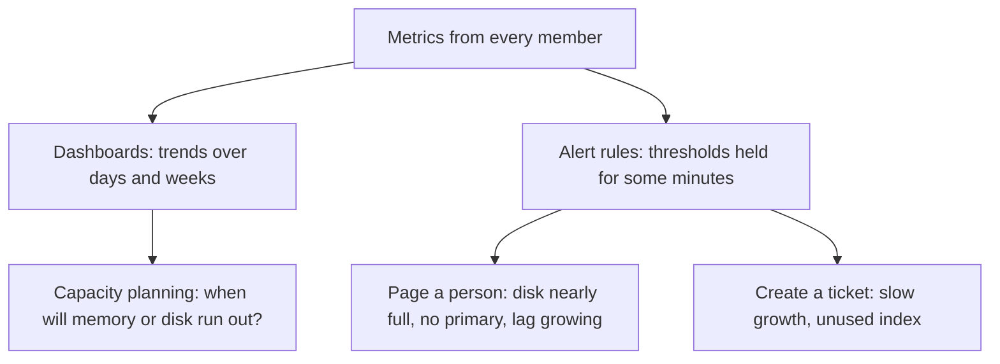

# Starting, stopping and monitoring MongoDB

> **Before this lesson:** you should know how a write reaches disk through the cache, journal and checkpoints ([Data administration, durability and journaling](#/lesson/mongodb/durability)), what replication lag and the oplog window are ([The oplog, write concern, read concern and read preference](#/lesson/mongodb/oplog-concerns)) and how to inspect operations ([Seeing what the application is doing: currentOp and the profiler](#/lesson/mongodb/seeing-operations)).

## In plain words

So far MongoDB has been something that is "there". Somebody has to start it, give it its settings, shut it down safely and notice when it is getting into trouble. That somebody may be you, even if a hosting service does most of the work, because you still have to read its charts.

Think of driving a car. Starting and stopping are the ignition and the handbrake: there is a right way to do each, and doing it wrong (switching off the engine at speed) causes damage. Monitoring is the dashboard: speed, fuel, engine temperature, warning lights. You do not stare at it constantly, but you glance at it, and you want a light to come on *before* the engine seizes, not after.

Why it matters for a job: even with a fully managed database, developers are asked "why is the database slow?" and must interpret memory, disk and connection graphs. Interviews for back-end and platform roles commonly ask which metrics you would watch on a MongoDB deployment and what each one tells you.

## Starting mongod

`mongod` is the server program (the name is short for "MongoDB daemon"; a **daemon** is a program that runs in the background waiting for requests). It can be configured by options on the command line:

```javascript
// typed in a terminal, shown here as comments:
// mongod --dbpath /var/lib/mongodb --port 27017 --bind_ip 127.0.0.1 --logpath /var/log/mongodb/mongod.log --replSet rs0
```

| option | meaning |
|---|---|
| `--dbpath` | the folder where data files are stored; each `mongod` needs its own |
| `--port` | the network port to listen on (27017 by default) |
| `--bind_ip` | which of the machine's network addresses to accept connections on |
| `--logpath` | write log messages to this file instead of the screen |
| `--replSet` | the name of the replica set this process belongs to |

Long command lines are hard to review and easy to mistype. Production systems use a **configuration file** instead, written in **YAML** (a plain-text format in which structure is shown by indentation):

```yaml
# /etc/mongod.conf
storage:
  dbPath: /var/lib/mongodb
systemLog:
  destination: file
  path: /var/log/mongodb/mongod.log
  logAppend: true
net:
  port: 27017
  bindIp: 127.0.0.1,10.0.4.12
replication:
  replSetName: rs0
security:
  authorization: enabled
```

Each indented group configures one area. `storage.dbPath` is the data folder. `systemLog` sends log output to a file and appends to it across restarts. `net` sets the port and the addresses to listen on: here the local machine itself and one private network address. `replication.replSetName` names the replica set. `security.authorization: enabled` requires users to log in, which the next lesson covers.

The server is then started with `mongod --config /etc/mongod.conf`. On most Linux systems it is installed as a **service**, a program the operating system starts at boot and restarts if it fails, controlled with `sudo systemctl start mongod`, `stop` and `status`.

> [!WARNING]
> `bindIp` decides who can even attempt to connect. Listening on all addresses (`0.0.0.0`) on a machine reachable from the internet, without authentication, has caused many real data leaks. Bind only to the addresses that need it, keep the database on a private network, and enable authorization.

### What happens at start-up

When `mongod` starts, it reads its configuration, opens the data folder and performs crash recovery if the last shutdown was not clean (loading the last checkpoint and replaying the journal). It then starts listening for connections and, if it is a replica-set member, contacts the other members. The log records each step; a line saying it is waiting for connections on the configured port means it is ready.

Common start-up failures are all visible in the log: the data folder does not exist or cannot be written by the user running `mongod`; another process is already using the port; or the folder contains data from an incompatible version.

## Stopping mongod

Stopping cleanly matters because the server holds data in memory. A clean shutdown lets it finish current operations, write a final checkpoint, close its files and, on a replica set, hand over the primary role first.

The safe ways:

```javascript
admin> db.shutdownServer()
// or, from a terminal:  sudo systemctl stop mongod
// or:                   kill <process id>        (this sends the polite "please terminate" signal)
```

`db.shutdownServer()` is run from a shell connected to the `admin` database. On a primary it first steps down, waiting briefly for a secondary to catch up so that no writes are left unreplicated.

The unsafe way is to end the process forcibly, with `kill -9` on Linux or by cutting the power. The process stops instantly without tidying up. Thanks to the journal, data that had been journaled is still recovered at the next start, so this is not usually catastrophic - but writes in the last moments may be lost, recovery takes longer, and on a primary the set must notice the failure by timeout instead of being told.

> [!TIP]
> Before stopping a primary for maintenance, run `rs.stepDown()` yourself and confirm that another member has become primary. A planned hand-over takes a few seconds; an unplanned one takes ten or more while the others wait for the election timeout.

## What to monitor

A server has hundreds of counters. A manageable approach is to watch four resources and a few database-specific signals. For each, know what "healthy" looks like, so that change stands out.

### Memory and the working set

MongoDB is fast when the data it needs is in memory and slow when it must read from disk. The portion of data and indexes that the application touches regularly is called its **working set**. The most important capacity question for any deployment is: **does the working set fit in RAM?**

If it does, most reads are answered from the cache. If it does not, the server constantly evicts data it will need again shortly and reads other data back from disk, and performance falls sharply - often suddenly, when growing data crosses the limit.

Signals to watch, from `db.serverStatus().wiredTiger.cache`:

- **cache used** as a share of its maximum. WiredTiger aims to stay around 80 per cent; a cache pinned higher is under pressure.
- **dirty share**, the part of the cache waiting to be written. Sustained values above about 20 per cent mean the disks cannot keep up with writes.
- **pages read into the cache** per second. A rising rate with steady traffic means the working set no longer fits.

### Page faults: how a too-large working set shows itself

Operating systems manage memory in fixed-size blocks called **pages**, commonly 4 KB. A program sees a large, tidy address space, but only some pages are in physical RAM at any moment. When the program touches a page that is not in RAM, the processor raises a **page fault**: the operating system pauses the program, finds the page (in a file or on swap space), loads it, and lets the program carry on. Think of a desk and a filing cabinet. Papers on the desk are instant to use; a trip to the cabinet is a page fault.

Not all faults hurt. A *minor* fault is resolved without touching the disk, for instance because the page is already in the operating system's file cache. A *major* fault needs a real disk read and costs thousands of times more than a memory access, so a stream of them makes the database crawl.

Here is how this connects to the working set. If the working set fits in RAM, then after a warm-up period almost every access finds its page in memory and major faults stay near zero. If the working set is larger than the memory available, every request has some chance of touching a cold page, and the system keeps swapping pages in and out: the same pages are read, evicted and read again. Operators call this **thrashing**. The visible symptoms are rising disk reads, rising query latency, and page-fault counters that climb during slow periods. MongoDB reports a page-fault counter in `serverStatus` (under `extra_info`), and on Linux `vmstat` and the `pgmajfault` line of `/proc/vmstat` show the system-wide picture. The server's manual notes that a few sporadic faults are normal; the sign of trouble is a sustained rise that lines up with slowness.

What to do when you see it:

1. **Confirm the cause.** Compare the WiredTiger cache figures and disk read rate with the latency graph. Faults without slowness are harmless.
2. **Shrink the working set.** Add or fix indexes so queries touch fewer documents; use projections so only needed fields are read; remove indexes nobody uses, because they compete for cache; archive or expire old data that is never read.
3. **Grow the memory** of the machine, or spread data across more machines by sharding.
4. **Keep the database out of swap.** Swapping out database memory is far worse than a slow query. Production guides recommend setting the kernel's `vm.swappiness` very low.

### Disk

- **Free space.** A full disk stops the database. Alert early, for example at 70 per cent used, because adding storage takes time.
- **I/O activity**: operations per second and how long they wait. Long waits mean the disk is the bottleneck.
- **Growth rate**, to predict when action will be needed.

### Processor

High processor use with little disk activity usually means work done in memory that should not be necessary: collection scans, in-memory sorts, or very many small operations. Check the slow-query log.

### Connections

Each open connection costs the server some memory. `db.serverStatus().connections` shows `current` and `available`. A steadily climbing count that never falls suggests an application that opens connections without reusing them: a missing connection pool, or a new client object per request.

### Operations and queues

- **Operation counters** (`opcounters`): inserts, queries, updates and deletes per second. The absolute numbers matter less than changes: a sudden doubling or a sudden drop to zero both demand attention.
- **Queued operations** (`globalLock.currentQueue`): operations waiting their turn. Persistent queues mean the server is receiving more work than it can perform.
- **Documents examined versus returned**, summed over all queries. A high ratio across the server points at missing indexes.

### Replication

- **Replication lag** per secondary: normally under a second. Lag that grows steadily means a secondary cannot keep up.
- **Oplog window**: how long a member could be offline and still catch up. Alert if it falls below a day, or below your longest maintenance.
- **Elections**: each one is a short outage for writes. Frequent elections indicate network or resource problems.



## Tools

**Built-in commands.** `db.serverStatus()` returns all the counters above as one large document. `rs.status()` and `rs.printSecondaryReplicationInfo()` cover replication. `db.stats()` covers sizes.

**`mongostat`.** A command-line program that prints one line per second:

```
insert query update delete getmore command dirty used flushes vsize   res qrw arw net_in net_out conn  set repl                time
   112  1840    96      3      41    220|0  2.1% 79.8%       0 5.91G 3.42G 0|0 2|0   412k  2.31m  184  rs0  PRI  Jun  2 10:14:09.120
```

Reading left to right: operations per second by type; `dirty` and `used`, the cache figures discussed above; `res`, the process's memory in use; `qrw`, operations queued for reading and writing; `conn`, open connections; and the member's replica-set role. One glance shows whether the server is busy, memory-bound or queuing.

**`mongotop`.** Shows, per collection, how much time the server spent reading and writing during each interval - the quick answer to "which collection is hot?".

**Monitoring services.** Checking by hand does not scale and does not work at night. Real deployments send metrics to a system that stores history, draws charts and raises alerts: MongoDB's own Atlas (hosted) and Ops Manager (self-hosted), or general tools such as Prometheus with Grafana fed by a MongoDB exporter.

### Designing alerts

An alert should mean "a person needs to act". Three practices keep alerts useful:

1. **Alert on symptoms that affect users or threaten data**: no primary, disk nearly full, replication lag growing, error rate rising.
2. **Require the condition to persist**, for example "lag above 30 seconds for 5 minutes", so that brief spikes do not wake anyone.
3. **Separate urgency levels.** Something that will be a problem next week is a ticket, not a 3 a.m. call.

Establish a **baseline** first: record how the metrics behave during a normal week. "Processor at 70 per cent" means nothing in isolation; "processor at 70 per cent when it is normally 25" means a great deal.

> [!INTERVIEW]
> **"Which metrics would you monitor on a MongoDB replica set?"** Group them: *resources* - memory (WiredTiger cache used and dirty percentages, whether the working set fits), disk (free space, I/O wait), processor, connections; *workload* - operation counters, queued operations, the ratio of documents examined to returned, slow-query counts; *replication* - lag per secondary, oplog window, elections and member health. Add that alerts should be based on deviations from a baseline held for some minutes, with disk space and loss of the primary as the highest-priority pages.

## The same from Python

```python
from pymongo import MongoClient

client = MongoClient("mongodb://localhost:27017/?replicaSet=rs0&appName=health-check")
status = client.admin.command("serverStatus")                                    # 1

cache = status["wiredTiger"]["cache"]
limit = cache["maximum bytes configured"]
report = {
    "cache_used_pct": round(100 * cache["bytes currently in the cache"] / limit, 1),       # 2
    "cache_dirty_pct": round(100 * cache["tracked dirty bytes in the cache"] / limit, 1),
    "connections": status["connections"]["current"],                             # 3
    "queued": status["globalLock"]["currentQueue"]["total"],                     # 4
    "ops": {k: v for k, v in status["opcounters"].items() if k in ("insert", "query", "update", "delete")},
}

rs = client.admin.command("replSetGetStatus")                                    # 5
primary = next(m for m in rs["members"] if m["stateStr"] == "PRIMARY")
report["lag_seconds"] = {m["name"]: (primary["optimeDate"] - m["optimeDate"]).total_seconds()
                         for m in rs["members"] if m["stateStr"] == "SECONDARY"}  # 6

alerts = []
if report["cache_dirty_pct"] > 20: alerts.append("disks are not keeping up with writes")
if report["queued"] > 50: alerts.append("operations are queuing")
if any(lag > 30 for lag in report["lag_seconds"].values()): alerts.append("a secondary is lagging")
print(report, alerts or "all clear")                                             # 7
```

1. One command returns every server-wide counter.
2. Cache fill and dirty share as percentages of the configured maximum.
3. Currently open connections.
4. Operations waiting for a turn.
5. Replica-set state as seen by this member.
6. Lag is the difference between the primary's last applied time and each secondary's.
7. A small rule set turns numbers into statements. Real monitoring does the same continuously and keeps the history.

Operation counters are totals since start-up. To get a rate, take two readings some seconds apart and divide the difference by the interval.

## Simulate it yourself

The first part shows why "does the working set fit in RAM?" is the key capacity question, by measuring how often a cache of a given size already holds the data a request needs. The second part evaluates alert rules over a simulated day of metrics.

```python-run
import random
from collections import OrderedDict

random.seed(17)

def hit_rate(cache_pages, working_set_pages, requests=60_000, warm_up=30_000):
    """A least-recently-used cache. 90% of requests go to the working set, 10% anywhere in 100,000 pages."""
    cache, hits = OrderedDict(), 0
    for n in range(requests):
        page = random.randrange(working_set_pages) if random.random() < 0.9 else random.randrange(100_000)
        if page in cache:
            hits += n >= warm_up                    # count only after the cache has warmed up
            cache.move_to_end(page)                 # recently used: keep it
        else:
            cache[page] = True                      # a disk read brings the page into the cache
            if len(cache) > cache_pages:
                cache.popitem(last=False)           # evict the least recently used page
    return 100 * hits / (requests - warm_up)

WORKING_SET = 5_000
print("working set = %d pages; 90%% of requests touch it" % WORKING_SET)
print("cache size   served from memory   disk reads per 1,000 requests")
for cache_pages in (500, 2_500, 4_000, 5_000, 6_000, 10_000):
    rate = hit_rate(cache_pages, WORKING_SET)
    note = "  <- working set fits" if cache_pages >= WORKING_SET else ""
    print("%8d %15.1f%% %22d%s" % (cache_pages, rate, round((100 - rate) * 10), note))

print()
# ---- alert rules over a day of metrics (one sample per 10 minutes) -------------------
samples = []
for i in range(144):
    hour = i / 6
    lag = 0.4 + (max(0, hour - 14) ** 2 * 3 if hour < 18 else 0.5)      # a secondary falls behind in the afternoon
    samples.append({"hour": hour,
                    "disk_used_pct": 61 + hour * 0.5,                  # steady growth
                    "lag_s": lag + random.random(),
                    "queued": 90 if i == 40 else random.randint(0, 6)})  # one brief spike at 06:40

RULES = [   # name, metric, threshold, how many consecutive samples the condition must hold
    ("disk above 70%",          "disk_used_pct", 70, 3),
    ("replication lag > 30 s",  "lag_s",         30, 3),
    ("operations queued > 50",  "queued",        50, 3),
]
for name, metric, threshold, needed in RULES:
    streak, fired_at, peaks = 0, None, 0
    for s in samples:
        over = s[metric] > threshold
        peaks += over
        streak = streak + 1 if over else 0
        if streak == needed and fired_at is None:
            fired_at = s["hour"]
    when = "FIRES at %04.1f h" % fired_at if fired_at is not None else "does not fire"
    print("%-26s samples over threshold: %3d -> %s" % (name, peaks, when))

growth_per_hour = (samples[-1]["disk_used_pct"] - samples[0]["disk_used_pct"]) / 24
print("disk grows %.2f points an hour: full in about %.0f hours at this rate" %
      (growth_per_hour, (100 - samples[-1]["disk_used_pct"]) / growth_per_hour))
```

Reading the output:

- With a cache a tenth the size of the working set, more than nine requests in ten need a disk read. The share served from memory climbs steeply as the cache grows and reaches about 90 per cent once the cache has some headroom above the working set. A cache exactly the size of the working set is not quite enough, because the occasional requests for other data compete for the same space. Read the table from the bottom upwards to see the cliff: shrinking memory below the working set multiplies the disk reads.
- The disk rule fires in the evening, once usage has been above 70 per cent for three samples in a row.
- The lag rule fires late in the afternoon, when the secondary has been more than 30 seconds behind for half an hour.
- The queue rule does **not** fire. There was one sample over the threshold, a brief spike, and the rule requires three in a row. That is the persistence condition preventing a false alarm.
- The last line is capacity planning in miniature: from the growth rate, estimate when the limit will be reached.

## Pitfalls

- **Stopping `mongod` with `kill -9`** as a habit.
- **Listening on all network addresses without authentication.**
- **Monitoring averages only.** A fine average can hide a secondary that is badly behind or a disk that is nearly full.
- **Alerting on every spike**, until people ignore alerts.
- **No baseline**, so that nobody knows whether a number is normal.
- **Ignoring disk growth** until the disk is full.
- **Treating high memory use as a problem.** A database is supposed to use its memory for caching; the concern is a working set that does not fit.
- **Watching only the primary.**
- **Reading operation counters as rates.** They are totals since start-up.

## Cheat sheet

| task | command |
|---|---|
| start with a config file | `mongod --config /etc/mongod.conf` |
| start / stop as a service | `sudo systemctl start mongod` / `sudo systemctl stop mongod` |
| clean shutdown from the shell | `use admin; db.shutdownServer()` |
| all counters | `db.serverStatus()` |
| live one-line-per-second view | `mongostat` |
| time per collection | `mongotop` |
| replication health | `rs.status()`, `rs.printSecondaryReplicationInfo()` |

| metric | healthy sign | warning sign |
|---|---|---|
| cache used | around 80% or below | pinned well above 80% |
| cache dirty | a few per cent | sustained above 20% |
| disk used | room to grow | above 70 to 80% |
| queued operations | near zero | persistently above zero |
| connections | stable | climbing without limit |
| replication lag | under a second | growing steadily |
| oplog window | more than a day | shorter than your maintenance |

## Summary

- `mongod` is configured by command-line options or, better, a YAML configuration file covering storage, logging, network, replication and security.
- Shut down cleanly with `db.shutdownServer()` or the service manager; forced termination relies on journal recovery and loses the latest unjournaled writes.
- The central capacity question is whether the working set fits in memory; watch the cache's used and dirty shares.
- Also watch disk space and I/O, processor, connections, operation counters and queues, and replication lag, oplog window and elections.
- `serverStatus`, `mongostat` and `mongotop` give the numbers; a monitoring service keeps history and raises alerts.
- Good alerts are based on a baseline, require a condition to persist, and distinguish urgent from non-urgent.

## Glossary

- **`mongod`** - the MongoDB server process.
- **Daemon** - a program that runs in the background serving requests.
- **Configuration file** - a file of settings read at start-up.
- **YAML** - a text format that expresses structure by indentation.
- **Service** - a program managed by the operating system: started at boot, restarted on failure.
- **`bindIp`** - the setting that selects which network addresses the server listens on.
- **Clean shutdown** - stopping after finishing operations, checkpointing and closing files.
- **Working set** - the data and indexes an application accesses regularly.
- **Eviction** - removing data from the cache to make room.
- **I/O** - input and output; here, reading from and writing to disk.
- **Operation counters** - running totals of each kind of operation since start-up.
- **`mongostat` / `mongotop`** - command-line tools showing live server and per-collection activity.
- **Baseline** - a record of normal metric values against which changes are judged.
- **Alert** - an automatic notification that a condition needs attention.
- **Page** - A fixed-size block (often 4 KB) in which an operating system manages memory
- **Page fault** - An access to a page that is not in physical RAM, forcing the operating system to load it first
- **Major fault** - A page fault that needs a real disk read, which is far slower than a minor one
- **Thrashing** - A state in which the system spends its time moving pages in and out of memory instead of doing useful work

## Check yourself

```quiz
[
  {"q": "What is the advantage of a configuration file over command-line options?",
   "options": ["It makes the server faster", "Settings are kept in one reviewable, repeatable place", "It is required for replica sets", "It disables logging"],
   "answer": 1,
   "explain": "A file can be version-controlled and reused, and avoids long, error-prone command lines."},
  {"q": "Why is db.shutdownServer() preferred to kill -9?",
   "options": ["It is faster", "It lets the server finish operations, write a checkpoint and, on a primary, step down first", "kill -9 deletes the data files", "There is no difference"],
   "answer": 1,
   "explain": "A clean shutdown avoids losing the newest writes, shortens recovery and gives the set an orderly hand-over."},
  {"q": "What is the working set?",
   "options": ["All data on disk", "The data and indexes the application accesses regularly", "The oplog", "The list of open connections"],
   "answer": 1,
   "explain": "Performance depends on whether this frequently used portion fits in memory."},
  {"q": "The cache's dirty share stays above 20% for long periods. What does that indicate?",
   "options": ["Too many indexes are unused", "The disks cannot write changed data as fast as it is produced", "Replication is disabled", "The working set is tiny"],
   "answer": 1,
   "explain": "Dirty data accumulates when checkpoints and eviction cannot flush it quickly enough."},
  {"q": "The number of open connections climbs steadily and never falls. What is the likely cause?",
   "options": ["A missing index", "An application creating new clients or connections instead of reusing a pool", "A full disk", "An election"],
   "answer": 1,
   "explain": "Connection leaks come from the application side, typically one client object per request."},
  {"q": "Why should an alert require a condition to hold for several minutes?",
   "options": ["To save disk space", "To avoid notifying people about brief spikes that resolve on their own", "Because metrics are only collected hourly", "It should not; every spike matters"],
   "answer": 1,
   "explain": "Persistence filters out transient noise so that alerts keep their meaning."},
  {"q": "Which setting most directly controls who can attempt to connect over the network?",
   "options": ["storage.dbPath", "net.bindIp", "systemLog.path", "replication.replSetName"],
   "answer": 1,
   "explain": "bindIp chooses the addresses the server listens on; binding to everything on a public machine is dangerous."},
  {"q": "High processor use with very little disk activity most likely points to what?",
   "options": ["A failing disk", "In-memory work such as collection scans or sorts that an index would avoid", "Replication lag", "A full oplog"],
   "answer": 1,
   "explain": "The data is in memory, so the cost is computation; the slow-query log will show the scans."},
  {"q": "What is a major page fault?", "options": ["A fault resolved entirely from memory", "An access that needs a page to be read from disk", "A crash of the mongod process", "A full cache flush"], "answer": 1, "explain": "A major fault requires disk I/O. Minor faults are resolved without touching disk."},
  {"q": "Page-fault counters climb steadily while query latency rises. What is the most likely explanation?", "options": ["The working set no longer fits in memory", "Too many connections are idle", "Journaling is disabled", "The oplog is too large"], "answer": 0, "explain": "When the working set exceeds available RAM, requests keep touching cold pages and the system reads them from disk repeatedly."}
]
```

> **Source:** MongoDB: The Definitive Guide 3e, ch. 21-22 (topics only; wording and examples are original). MongoDB Manual: https://www.mongodb.com/docs/manual/reference/configuration-options/ , https://www.mongodb.com/docs/manual/tutorial/manage-mongodb-processes/ , https://www.mongodb.com/docs/manual/administration/monitoring/ , https://www.mongodb.com/docs/database-tools/mongostat/
