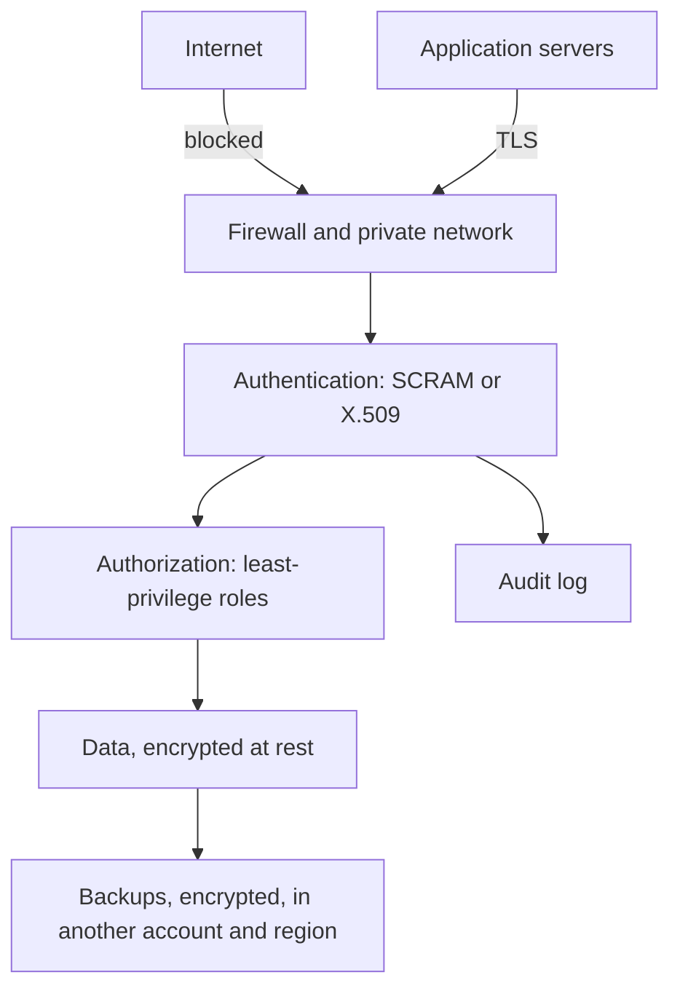

# Backups, security and production deployment

> **Before this lesson:** you should know how to start and configure `mongod` and what to monitor ([Starting, stopping and monitoring MongoDB](#/lesson/mongodb/running-monitoring)), how journaling and checkpoints work ([Data administration, durability and journaling](#/lesson/mongodb/durability)), and what the oplog and a replica set are ([The oplog, write concern, read concern and read preference](#/lesson/mongodb/oplog-concerns)).

## In plain words

This lesson answers three questions that decide whether a database is fit for real use.

**"What if the data is destroyed or ruined?"** - backups. A replica set is like having three colleagues who each keep an identical copy of a shared notebook, updated instantly. If one loses the notebook, the others still have it. But if someone writes a wrong instruction in it - "tear out pages 10 to 90" - all three copies obey within a second. A **backup** is a photocopy of the notebook locked in a safe yesterday. It is the only thing that helps when the mistake has been faithfully copied everywhere.

**"Who is allowed in, and to do what?"** - security. Think of an office building: a badge at the door proves who you are, the badge opens only the rooms your job needs, the corridors have cameras, and the safe has its own lock even for people already inside.

**"What does a sensible production setup look like?"** - deployment: the hardware, operating-system and layout choices that keep the first two promises possible.

Why it matters for a job: data loss and data leaks are the two database failures that end up in the news. Interviewers ask how you would back up a replica set, what your recovery targets mean, and how you would secure a MongoDB deployment.

## Backups

### Two numbers that drive every backup decision

Before choosing a method, a team should agree on two targets.

- **RPO, recovery point objective**: how much recent data you can afford to lose, measured in time. An RPO of 24 hours accepts losing up to a day's changes. An RPO of one minute does not.
- **RTO, recovery time objective**: how long you can afford to be down while restoring. An RTO of four hours means the restore must finish within four hours.

A nightly backup gives an RPO of up to 24 hours. Whether it meets a four-hour RTO depends on how long the restore of that much data takes, which nobody knows until it has been tried.

### Method 1: logical backup with mongodump

A **logical backup** reads the documents out of the database through the normal query interface and writes them to files.

```javascript
// in a terminal:
// mongodump --uri "mongodb://backup_user@db2.example.net:27017/?replicaSet=rs0&readPreference=secondary" --oplog --gzip --out /backups/2026-06-02
// mongorestore --uri "mongodb://admin@db-new.example.net:27017" --oplogReplay --gzip /backups/2026-06-02
```

- `mongodump` connects like any client and writes one BSON file per collection, plus index definitions, into the output folder.
- `readPreference=secondary` takes the backup from a secondary so that the primary is not burdened.
- `--oplog` also records the oplog entries written while the dump was running. Without it, a dump of a busy database captures different collections at different moments and is not a consistent picture of any single instant.
- `--gzip` compresses the files.
- `mongorestore` loads the files into a server; `--oplogReplay` applies the recorded oplog entries at the end, bringing the data to one consistent moment.

Logical backups are flexible: one database or one collection can be dumped or restored, and the files work across versions and platforms. They are **slow** for large data sets, because every document passes through the query layer on the way out and every index is rebuilt on the way in. They suit databases up to perhaps tens of gigabytes, and exports of selected collections.

### Method 2: physical backup by snapshot

A **physical backup** copies the underlying data files themselves. The practical way to do this is a **snapshot**: a feature of the storage system (a cloud disk, or a volume manager such as LVM on Linux) that captures the complete state of a disk at one instant, in seconds, whatever its size.

Because WiredTiger keeps a consistent checkpoint on disk and a journal of later changes, a snapshot that includes the data files and the journal together can be restored and started; the server performs ordinary crash recovery, as if the power had failed at the instant of the snapshot.

Snapshots are fast to take and fast to restore. They capture a whole `mongod`, not single collections, and they are tied to the storage platform.

The crude alternative, copying the files with ordinary tools while the server is running, does **not** work: the files change during the copy and the result is corrupt. Files may be copied only from a stopped server, or after `db.fsyncLock()` has flushed everything to disk and blocked writes (followed by `db.fsyncUnlock()`). Do that on a hidden secondary, never on the primary.

### Method 3: continuous backup and point-in-time recovery

A nightly backup cannot undo a mistake made at 14:07 without also discarding everything since midnight. **Point-in-time recovery** restores to an exact moment, such as 14:06:59. It combines a base backup with the oplog: restore last night's snapshot, then replay the oplog entries up to the chosen instant and stop.

Doing this yourself requires archiving the oplog continuously. Managed services (Atlas, Ops Manager) provide it as a feature, with an RPO of about a minute.

| method | speed | granularity | consistency | typical use |
|---|---|---|---|---|
| `mongodump` / `mongorestore` | slow on large data | database or collection | needs `--oplog` | small data sets, selective export |
| storage snapshot | fast | whole member | consistent if journal is included | most self-managed deployments |
| continuous (snapshot + oplog) | fast restore, any moment | whole deployment | consistent | when minutes of loss matter |

### Rules that apply to every method

1. **Back up from a secondary**, ideally a hidden one, to keep load off the primary.
2. **Keep copies elsewhere**: another region and another account, so that one incident cannot destroy both the data and its backups.
3. **For sharded clusters, stop the balancer** and capture all shards and the config servers at matching moments.
4. **Keep several generations**, such as daily for two weeks and monthly for a year. A problem noticed late needs an older backup.
5. **Test restores regularly.** A backup that has never been restored is a hope, not a backup. A scheduled test restore also measures your real RTO.

> [!WARNING]
> A delayed secondary and a replica set are not backups. They protect against hardware failure and, briefly, against operator error. They do not protect against a problem noticed after the delay has passed, against corruption, or against an attacker with administrative access who deletes data everywhere. Backups must be separate copies, stored somewhere the production credentials cannot reach.

## Security

Security is built in layers, so that the failure of one does not expose everything.

### Layer 1: network exposure

The first defence is not being reachable. Run the database on a private network; let only the application servers connect, enforced by a **firewall** (a filter that allows or blocks network traffic by address and port); set `net.bindIp` to specific addresses. A database should never be directly reachable from the public internet.

### Layer 2: authentication - who are you?

**Authentication** is proving identity. With `security.authorization: enabled` in the configuration, every client must log in. Users are created in a database, usually `admin`:

```javascript
admin> db.createUser({
...   user: "shop_app",
...   pwd: passwordPrompt(),
...   roles: [ { role: "readWrite", db: "shop" } ]
... })
{ ok: 1 }
```

- `passwordPrompt()` asks for the password interactively, so it does not appear on screen or in the shell's history.
- `roles` grants permissions, explained in the next layer.

The default mechanism, **SCRAM**, verifies the password without ever sending it across the network. Larger organisations connect MongoDB to central identity systems using X.509 certificates, LDAP, Kerberos or cloud identities.

The members of a replica set or cluster must also authenticate to *each other*, using a shared **keyfile** or, better, X.509 certificates. Without this, any machine able to reach the port could join the set as a member and receive all the data.

### Internal authentication: keyfile or x.509

Clients prove who they are with a username and password, but the *members* of a replica set or sharded cluster also talk to each other: secondaries pull changes from the primary, and routers talk to shards. Internal authentication is how one member proves it belongs. There are two methods, and the difference is between a shared password and individual identity cards.

**Keyfile.** All members read the same secret from a file. A member that presents that secret is trusted. In outline:

1. Generate a long random string (the manual suggests a base64 value of reasonable length) and save it in a file.
2. Copy the identical file to every member and restrict it so only the account running `mongod` can read it. On Unix the server refuses to start if the permissions are too loose.
3. Set the `security.keyFile` option to that path on every member and restart them, one at a time with the primary last.

Setting a keyfile also switches on access control for clients, so create your first administrator before you do it (or use the localhost exception). The method is simple and suits a small deployment or a test cluster. Its weaknesses: every member holds the same secret, so one stolen file lets an attacker impersonate any member, and changing it means touching all members.

**X.509 certificates.** Here each member has its *own* certificate, signed by a **certificate authority** (CA), an issuer that both sides trust. Members connect over TLS and present their certificates; the other side checks the signature and confirms the certificate is one it accepts. In outline:

1. Create or choose a CA, and issue one certificate per member that lists the member's hostname, so name checks succeed.
2. Make sure the certificates' subject names are compatible with the cluster rules (members' certificates need matching organisation-style attributes in their distinguished names; check the manual's exact requirement for your version).
3. Enable TLS on every member (certificate file, CA file) and set `security.clusterAuthMode` to `x509`.
4. Roll the change through the cluster. MongoDB provides intermediate modes (the cluster first *sends* its keyfile but *accepts* either, then sends certificates, then requires them) so that an existing keyfile cluster can migrate without downtime.
5. Plan certificate renewal. Certificates expire, and an expired member certificate means a member that cannot join, so monitor expiry dates like any other alert.

The benefits are per-member identity (a single member's certificate can be revoked or replaced), no shared secret to leak, and the same TLS setup you want for encryption in transit anyway. The cost is certificate management. As a rule of thumb: keyfile for learning and small private clusters; x.509 for anything serious or regulated.

### Layer 3: authorization - what may you do?

**Authorization** decides what an authenticated user may do. MongoDB uses **role-based access control**: permissions are grouped into **roles**, and users are given roles.

| built-in role | allows |
|---|---|
| `read` | reading a database |
| `readWrite` | reading and writing a database |
| `dbAdmin` | administrative tasks on a database: indexes, statistics |
| `userAdmin` | creating users and roles on a database |
| `clusterMonitor` | read-only access to monitoring commands |
| `backup` / `restore` | what backup tools need |
| `root` | everything |

The guiding rule is the **principle of least privilege**: give each user the smallest set of permissions its job requires. The application gets `readWrite` on its own database and nothing else; the reporting tool gets `read`; the monitoring agent gets `clusterMonitor`; people receive personal accounts, not a shared administrator password. Custom roles can narrow permissions down to single collections and actions.

Least privilege limits damage. If the application is compromised through a bug, an attacker holding `readWrite` on one database cannot drop other databases, create users or read the rest of the cluster.

### Layer 4: encryption

**Encryption** scrambles data so that only holders of a key can read it. There are three places to apply it.

- **In transit**: **TLS** (Transport Layer Security, the protocol behind "https") encrypts the traffic between clients and servers and between members, so that nobody on the network path can read or alter it. Enable it everywhere.
- **At rest**: the data files on disk are encrypted, so that a stolen disk or a leaked backup file is unreadable. This is available through the storage engine's encryption in Enterprise and Atlas, or through encrypted disks from the operating system or cloud provider.
- **Field level, on the client**: the driver encrypts chosen fields - an identity number, a card number - before sending them. The server stores and returns values it cannot read. Even a database administrator or someone holding a full backup sees only scrambled bytes. This is called **client-side field level encryption**.

### Layer 5: auditing and hygiene

**Auditing** records who did what: logins, changes to users and roles, and optionally reads and writes. It is how you answer "who dropped that collection?" and is often required by regulations.

A few habits matter as much as any feature. Keep credentials out of source code, in a secrets manager. Rotate passwords and keys. Apply security updates. And validate input: the querying module showed how an unchecked value from a web form can smuggle an operator such as `$ne` into a filter.



> [!TIP]
> When creating a user for an application, start from zero and add what it needs, not from `root` and intending to trim later. "Later" seldom arrives, and an over-privileged application account is the most common way a small bug becomes a serious breach.

## Production deployment

The remaining choices are about giving the database a stable place to run.

**Topology.** A three-member replica set is the minimum, with members in three separate failure zones. Use an odd number of voting members. Add a hidden member for backups and analytics if needed.

**Memory.** Enough RAM for the working set is the most valuable resource. Remember that the WiredTiger cache uses about half the machine's memory by default, and the operating system uses the rest for its own file cache.

**Storage.** Solid-state disks: database workloads consist of many small random reads and writes, at which SSDs are far better than spinning disks. Use local or well-provisioned network storage with predictable I/O performance. On Linux, the XFS file system is the recommended choice for WiredTiger.

**Operating-system settings.** A handful are well-known sources of trouble: the limit on open files and processes must be raised well above its default (to 64,000 or more), because each connection and each data file uses one; Transparent Huge Pages, a Linux memory feature, has traditionally been disabled for database workloads; and all servers must keep their clocks synchronised with a time service, since replication and sessions rely on roughly consistent time. Avoid swapping: a database pushed out of memory onto swap space becomes extremely slow.

**Separation.** Give the database its own machines. A database sharing a server with application code competes for memory with unpredictable results.

**Managed or self-run.** A managed service such as Atlas takes over provisioning, patching, backups, monitoring and scaling. Running it yourself gives full control and requires real expertise and on-call staff. For most teams, the managed option is the better use of time.

> [!INTERVIEW]
> **"How would you secure and back up a production MongoDB deployment?"** Security in layers: private network and firewall with a restricted `bindIp`; authentication enabled, with keyfile or X.509 between members; role-based access with least privilege per application and per person; TLS in transit and encryption at rest, plus client-side field level encryption for the most sensitive fields; auditing; secrets kept out of code. Backups: define RPO and RTO first; take snapshots (or `mongodump --oplog` for small data) from a hidden secondary; add continuous oplog archiving for point-in-time recovery if minutes matter; store copies in another region and account; and test restores on a schedule, because that is the only proof the backups work.

## The same from Python

```python
import os
from pymongo import MongoClient
from pymongo.errors import OperationFailure

app = MongoClient(                                                           # 1
    "mongodb://db1.example.net,db2.example.net,db3.example.net/?replicaSet=rs0",
    username="shop_app", password=os.environ["SHOP_DB_PASSWORD"],            # 2
    authSource="admin", tls=True, tlsCAFile="/etc/ssl/company-ca.pem",       # 3
)
shop = app["shop"]
shop.orders.insert_one({"total": 48})                                        # 4

try:
    app["admin"].command("createUser", "intruder", pwd="x", roles=["root"])  # 5
except OperationFailure as err:
    print("denied:", err.code)                                               # 6

try:
    app["hr"]["salaries"].find_one()                                         # 7
except OperationFailure as err:
    print("denied:", err.code)

roles = app["admin"].command("connectionStatus")["authInfo"]["authenticatedUserRoles"]
print(roles)                                                                 # 8
```

1. The application connects as its own low-privilege user.
2. The password comes from an environment variable set by a secrets manager, not from the source code.
3. `authSource` names the database holding the user; `tls=True` encrypts the connection; `tlsCAFile` is the certificate used to check that the server is the one it claims to be.
4. Allowed: the user has `readWrite` on `shop`.
5. An attempt to create an administrator.
6. Prints `denied: 13`. Error code 13 means "not authorised".
7. Reading another database is refused in the same way.
8. Prints the roles this connection holds, for example `[{'role': 'readWrite', 'db': 'shop'}]`.

## Simulate it yourself

The first part models a backup schedule and an accident, and computes how much data each strategy loses and how long recovery takes. The second part is a miniature role-based access check.

```python-run
# ---- backups: what do we lose, and how long are we down? ------------------------------
DATA_GB = 400
ACCIDENT_AT = 14 + 7 / 60          # 14:07 - a script deletes a collection; replicated in under a second

strategies = {
    # name: (hours between backups, restore speed in GB per hour, can replay oplog to an exact moment?)
    "replica set only, no backup":      (None, None, False),
    "nightly mongodump at 00:00":       (24, 25, False),
    "snapshot every 6 hours":           (6, 400, False),
    "snapshot every 6 h + oplog archive": (6, 400, True),
}

print("accident at 14:07 on a %d GB database" % DATA_GB)
print("%-36s %-22s %s" % ("strategy", "data lost (RPO)", "time to restore (RTO)"))
for name, (interval, speed, point_in_time) in strategies.items():
    if interval is None:
        print("%-36s %-22s %s" % (name, "EVERYTHING deleted", "cannot restore"))
        continue
    last_backup = (ACCIDENT_AT // interval) * interval
    lost_hours = 0.0 if point_in_time else ACCIDENT_AT - last_backup
    restore_hours = DATA_GB / speed + (0.5 if point_in_time else 0)       # replaying the oplog takes extra time
    lost = "about 1 minute" if point_in_time else "%.1f hours of changes" % lost_hours
    print("%-36s %-22s %.1f hours" % (name, lost, restore_hours))

print()
# ---- role-based access control ---------------------------------------------------------
ROLES = {
    "read":           {"find"},
    "readWrite":      {"find", "insert", "update", "remove"},
    "dbAdmin":        {"createIndex", "collStats", "dropCollection"},
    "userAdmin":      {"createUser", "grantRole"},
}
USERS = {
    "shop_app":   [("readWrite", "shop")],
    "reporting":  [("read", "shop")],
    "dba_maria":  [("readWrite", "shop"), ("dbAdmin", "shop"), ("userAdmin", "admin")],
}

def allowed(user, action, database):
    return any(action in ROLES[role] for role, db in USERS.get(user, []) if db == database)

attempts = [
    ("shop_app",  "insert",         "shop"),
    ("shop_app",  "dropCollection", "shop"),
    ("shop_app",  "find",           "hr"),
    ("reporting", "find",           "shop"),
    ("reporting", "update",         "shop"),
    ("dba_maria", "createIndex",    "shop"),
    ("dba_maria", "createUser",     "admin"),
    ("stranger",  "find",           "shop"),
]
for user, action, database in attempts:
    print("%-10s %-15s on %-6s -> %s" % (user, action, database, "allowed" if allowed(user, action, database) else "DENIED"))

print()
compromised = [a for a in ("find", "insert", "update", "remove", "dropCollection", "createUser")
               if allowed("shop_app", a, "shop") or allowed("shop_app", a, "admin")]
print("if the application account is stolen, the attacker can only:", compromised)
```

Reading the output:

- **Replica set only**: the deletion was replicated to every member at once. There is nothing to restore from.
- **Nightly dump**: 14.1 hours of changes are lost, and restoring 400 GB through the logical route takes 16 hours. Both numbers are probably unacceptable for a business system.
- **Snapshots every six hours**: the loss falls to about two hours (the last snapshot was at 12:00) and the restore to one hour.
- **Snapshots plus the oplog archive**: the data is restored to the moment before the accident, losing about a minute, for a little extra restore time.
- In the access checks, the application can insert but cannot drop a collection or read another database; the reporting user can read but not change; an unknown user can do nothing.
- The last line shows what least privilege buys: a stolen application account can read and change the shop's data, which is bad enough, but it cannot drop collections or create users.

## Pitfalls

- **Believing replication is a backup.**
- **Never testing a restore**, and discovering during an incident that it takes three days or does not work.
- **Backups stored beside the data**, reachable with the same credentials.
- **`mongodump` without `--oplog`** on a live database, giving an inconsistent backup.
- **Copying data files from a running server.**
- **A database reachable from the internet**, or running without authentication.
- **One shared administrator account** for people and applications.
- **Credentials committed to source control.**
- **No TLS inside the private network**, on the assumption that the network is safe.
- **Default operating-system limits**, causing "too many open files" under load.

## Cheat sheet

| need | tool |
|---|---|
| small or selective backup | `mongodump --oplog --gzip` / `mongorestore --oplogReplay` |
| large data set | storage snapshot of data files and journal, from a secondary |
| restore to an exact moment | snapshot + archived oplog (continuous backup) |
| freeze writes to copy files | `db.fsyncLock()` ... `db.fsyncUnlock()` on a hidden secondary |
| require logins | `security.authorization: enabled` |
| create a user | `db.createUser({ user, pwd: passwordPrompt(), roles: [...] })` |
| encrypt traffic | `net.tls.mode: requireTLS` |
| see your own roles | `db.runCommand({ connectionStatus: 1 })` |

| term | question it answers |
|---|---|
| RPO | how much recent data may be lost? |
| RTO | how long may recovery take? |
| authentication | who are you? |
| authorization | what may you do? |
| least privilege | what is the minimum this account needs? |

## Summary

- Backups protect against mistakes and disasters that replication copies everywhere; choose a method from your RPO and RTO.
- `mongodump` is flexible but slow; storage snapshots are fast and whole-member; a snapshot plus the archived oplog allows point-in-time recovery.
- Back up from a secondary, store copies elsewhere, keep several generations and test restores.
- Security is layered: limited network exposure, authentication, role-based authorization with least privilege, encryption in transit, at rest and per field, and auditing.
- A production deployment is at least a three-member replica set across failure zones, with enough RAM for the working set, SSD storage, tuned operating-system limits and synchronised clocks - or a managed service that handles these.

## Glossary

- **Backup** - a separate copy of data from which it can be restored.
- **RPO (recovery point objective)** - the maximum acceptable amount of recent data loss.
- **RTO (recovery time objective)** - the maximum acceptable time to restore service.
- **Logical backup** - a backup made by reading documents out through the database, as with `mongodump`.
- **Physical backup** - a backup of the underlying data files.
- **Snapshot** - an instantaneous copy of a disk's state made by the storage system.
- **Point-in-time recovery** - restoring to an exact moment by replaying the oplog onto a base backup.
- **Firewall** - a filter that permits or blocks network traffic.
- **Authentication** - verifying the identity of a client.
- **SCRAM** - the default password-based authentication mechanism.
- **Keyfile** - a shared secret that cluster members use to authenticate to each other.
- **Authorization** - deciding what an authenticated client may do.
- **Role-based access control** - granting permissions through roles assigned to users.
- **Principle of least privilege** - giving each account only the permissions it needs.
- **TLS** - the protocol that encrypts network connections.
- **Encryption at rest** - encrypting data stored on disk.
- **Client-side field level encryption** - encrypting chosen fields in the driver before they reach the server.
- **Auditing** - recording who performed which actions.
- **Internal authentication** - How members of a replica set or cluster prove their identity to one another
- **Certificate authority (CA)** - A trusted issuer whose signature on a certificate lets others accept it
- **X.509** - The standard format of the digital certificates used with TLS and for member or client authentication
- **`security.clusterAuthMode`** - The setting that chooses keyfile or x509 for internal authentication, with transition modes for migration

## Check yourself

```quiz
[
  {"q": "A script deletes a collection on the primary of a healthy three-member replica set. What do the secondaries contain a second later?",
   "options": ["The original data", "The same deletion, replicated", "A backup copy", "Nothing changes on secondaries"],
   "answer": 1,
   "explain": "Replication faithfully copies every operation, including mistakes. Only a backup helps."},
  {"q": "What does RPO measure?",
   "options": ["How long a restore takes", "How much recent data may be lost, expressed as time", "The number of replica set members", "The size of the oplog"],
   "answer": 1,
   "explain": "Recovery point objective is about data loss; recovery time objective is about downtime."},
  {"q": "Why is --oplog used with mongodump on a live database?",
   "options": ["To compress the output", "To capture changes made during the dump so the restore reflects one consistent moment", "To back up users", "To speed up the dump"],
   "answer": 1,
   "explain": "Without it, collections are captured at different moments while writes continue."},
  {"q": "Which backup method allows restoring to 14:06:59 exactly?",
   "options": ["A nightly mongodump", "A snapshot every six hours", "A base snapshot combined with an archived oplog", "A delayed secondary"],
   "answer": 2,
   "explain": "Point-in-time recovery replays oplog entries on top of a base backup and stops at the chosen instant."},
  {"q": "What is the difference between authentication and authorization?",
   "options": ["They are the same", "Authentication proves who a client is; authorization decides what it may do", "Authentication encrypts data; authorization compresses it", "Authorization happens before authentication"],
   "answer": 1,
   "explain": "Identity first, then permissions granted through roles."},
  {"q": "Which role should a web application's database user normally have?",
   "options": ["root", "readWrite on its own database only", "userAdmin on admin", "clusterAdmin"],
   "answer": 1,
   "explain": "Least privilege: the smallest set of permissions the application needs."},
  {"q": "What does client-side field level encryption protect against that encryption at rest does not?",
   "options": ["Disk theft", "A database administrator or anyone with server access reading the sensitive fields", "Network congestion", "Slow queries"],
   "answer": 1,
   "explain": "Fields are encrypted in the driver, so the server only ever stores and returns ciphertext."},
  {"q": "What is the only reliable evidence that backups work?",
   "options": ["The backup job reports success", "A regularly performed test restore", "The files exist", "The monitoring dashboard is green"],
   "answer": 1,
   "explain": "Only restoring proves the backup is complete and usable, and it also measures the real recovery time."},
  {"q": "What is the main security weakness of keyfile authentication compared with x.509?", "options": ["Keyfiles are not supported by replica sets", "Every member shares one secret, so a single leak lets an attacker impersonate any member", "Keyfiles disable TLS", "Keyfiles expire every day"], "answer": 1, "explain": "A keyfile is a shared secret. X.509 gives each member its own certificate that can be replaced or revoked individually."},
  {"q": "Why must certificate expiry dates be monitored in an x.509 cluster?", "options": ["Expired certificates are silently ignored", "An expired member certificate prevents that member from authenticating and joining", "Expiry deletes the data files", "Expiry changes the replica set name"], "answer": 1, "explain": "Certificates have a validity period. After it ends, peers reject the member."}
]
```

> **Source:** MongoDB: The Definitive Guide 3e, ch. 19 and 23-24 (topics only; wording and examples are original). MongoDB Manual: https://www.mongodb.com/docs/manual/core/backups/ , https://www.mongodb.com/docs/manual/administration/security-checklist/ , https://www.mongodb.com/docs/manual/core/authorization/ , https://www.mongodb.com/docs/manual/administration/production-notes/
