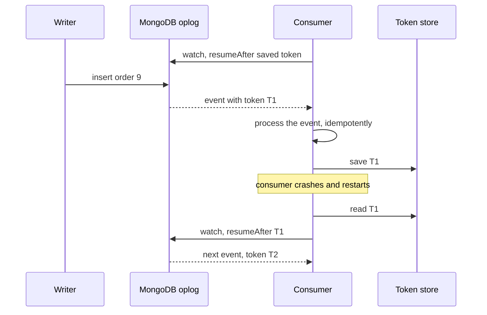
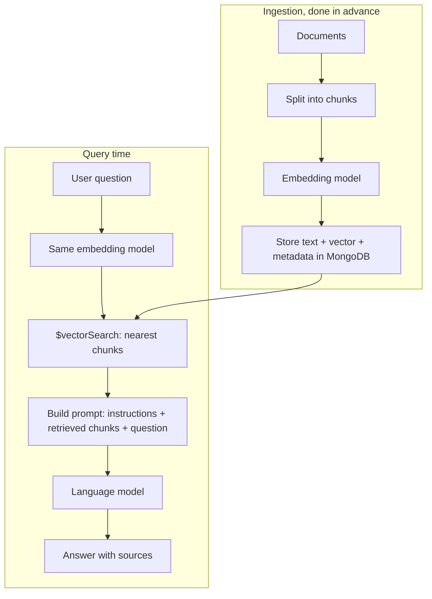

# Change streams and Atlas Vector Search for RAG

> **Before this lesson:** you should know the oplog and the oplog window ([The oplog, write concern, read concern and read preference](#/lesson/mongodb/oplog-concerns)), aggregation pipelines ([Pipelines: $match, $project, $group and $unwind](#/lesson/mongodb/pipeline-stages)) and how to use PyMongo ([PyMongo, Motor and Pydantic models](#/lesson/mongodb/pymongo-motor)). No machine-learning background is assumed; embeddings and similarity are explained from the beginning.

## In plain words

This lesson covers two features that have become central to applications built around AI models.

**Change streams** let a program be told the moment data changes. Without them, a program that wants to react to new orders has to keep asking "anything new? anything new?" every few seconds, which is called **polling**. A change stream is the opposite arrangement, like subscribing to a newspaper: you sign up once, and each new edition is delivered to your door.

**Vector search** finds things by meaning instead of by exact words. A normal search for "how do I reset my password" finds documents containing those words. It misses the help article titled "Recovering access to your account", which is exactly what the person wants. Vector search would find it, because the two sentences mean nearly the same thing. Picture a library in which books are shelved by subject so finely that standing at any book, the nearest books are the ones most similar to it. Vector search places every text at a position in such a space and then looks for the nearest neighbours.

The two come together in **RAG**, retrieval-augmented generation: before asking a language model a question, the application first retrieves relevant passages from its own data and hands them to the model as reference material.

Why it matters for a job: RAG is the most common way companies connect language models to their own documents, and "design a RAG pipeline" is now a standard interview exercise for machine-learning and back-end engineers. MongoDB Atlas is a popular choice for it because the documents, their metadata and their vectors live in one place.

## Change streams

### Watching a collection

A change stream is opened with `watch()`. It returns a cursor that never finishes: instead of ending, it waits for the next change.

```javascript
shop> const stream = db.orders.watch()
shop> // in another shell: db.orders.insertOne({ _id: 9, item: "lamp", status: "new" })
shop> stream.next()
{
  _id: { _data: '8266A1F3C2000000012B022C0100296E5A1004...' },
  operationType: 'insert',
  ns: { db: 'shop', coll: 'orders' },
  documentKey: { _id: 9 },
  fullDocument: { _id: 9, item: 'lamp', status: 'new' },
  clusterTime: Timestamp({ t: 1767431000, i: 1 })
}
```

Each delivered item is a **change event**, a document describing one change:

- `_id` is the **resume token**, an opaque bookmark identifying this event's position. Its importance is explained below.
- `operationType` says what happened: `insert`, `update`, `replace`, `delete`, and a few administrative types such as `drop`.
- `ns` is the namespace in which it happened.
- `documentKey` holds the `_id` of the affected document.
- `fullDocument` contains the document, for inserts and replaces.

An update event looks different:

```javascript
{
  operationType: 'update',
  documentKey: { _id: 9 },
  updateDescription: { updatedFields: { status: 'shipped' }, removedFields: [] }
}
```

By default an update event carries only **what changed**, in `updateDescription`, not the whole document. If the consumer needs the complete document, open the stream with `{ fullDocument: "updateLookup" }`; the server then looks up the current version of the document and attaches it. A delete event carries only the `documentKey`, since the document no longer exists.

Streams can be opened at three levels: on one collection (`db.orders.watch()`), on a whole database (`db.watch()`) or on the entire deployment (`db.getMongo().watch()`).

### Filtering events

`watch` accepts an aggregation pipeline that runs on the events, so that the server sends only what you care about:

```javascript
shop> db.orders.watch([
...   { $match: { operationType: { $in: ["insert", "update"] }, "fullDocument.status": "shipped" } },
...   { $project: { "fullDocument._id": 1, "fullDocument.item": 1 } }
... ], { fullDocument: "updateLookup" })
```

The `$match` keeps inserts and updates whose resulting document has status `shipped`; the `$project` trims each event to two fields. Filtering on the server saves network traffic and work in the consumer.

### How it works, and what that implies

Change streams are built on the **oplog**, the log of changes that drives replication. The server reads the oplog and converts its entries into change events. Three consequences follow.

1. **A replica set is required.** A standalone server has no oplog. (A one-member replica set is enough for development.)
2. **Only durable changes are reported.** An event is delivered once the change has been acknowledged by a majority of members, so a consumer never sees a change that is later rolled back.
3. **Order is preserved.** Events arrive in the order the changes were applied, across shards as well.

### Resuming after a crash

A consumer process will eventually restart: a deployment, a crash, a network failure. It must then continue from where it stopped, not from the beginning and not from "now", which would silently skip everything that happened while it was down.

This is the purpose of the resume token. The consumer stores the token of the last event it has finished processing. On restart it passes that token back:

```javascript
shop> const stream = db.orders.watch([], { resumeAfter: savedToken })
```

The server finds that position in the oplog and delivers the events that follow it.

Two details are essential.

**The oplog window is the limit.** The token points into the oplog, and the oplog is a fixed-size log whose oldest entries are overwritten. If the consumer was down for longer than the oplog window, its position no longer exists and the server answers with a `ChangeStreamHistoryLost` error. The consumer must then rebuild its state from the collection itself. Monitor the oplog window if change streams matter to you.

**Delivery is at-least-once.** If the consumer crashes after processing an event but before saving its token, the same event is delivered again after the restart. So the processing must be **idempotent**: handling an event twice must leave the same result as handling it once. "Set the search entry for order 9 to this content" is idempotent. "Send a confirmation email" is not, unless you record that it was sent.



### What change streams are used for

- **Keeping another system in step**: a search index, a cache, a data warehouse.
- **Notifications**: tell a user when their order ships.
- **Triggering work**: start a workflow when a document reaches a certain state.
- **Keeping embeddings fresh**: when a document's text changes, recompute its vector - which is where the second half of this lesson begins.

> [!WARNING]
> A change stream consumer is a small distributed system. It needs a durable place to keep its resume token, idempotent processing, handling for `ChangeStreamHistoryLost`, and monitoring of how far behind it is. A consumer that keeps the token only in memory loses every event that occurs while it is restarting.

## Vector search

### Embeddings: turning meaning into numbers

A computer compares numbers easily and meanings not at all. An **embedding** bridges the two. It is a list of numbers, called a **vector**, produced by a machine-learning model from a piece of text (or an image, or audio). The model is trained so that texts with similar meanings receive vectors that are close together.

```
"How do I reset my password?"         -> [ 0.12, -0.48, 0.33, ... ]   (hundreds or thousands of numbers)
"Recovering access to your account"   -> [ 0.10, -0.51, 0.30, ... ]   close to the first
"Opening hours of the Leeds depot"    -> [-0.62,  0.07, 0.44, ... ]   far from both
```

The count of numbers in the vector is its number of **dimensions**; models commonly produce between 384 and 3,072. You do not interpret the individual numbers. What matters is distance.

### Measuring closeness

The usual measure is **cosine similarity**: it compares the *directions* in which two vectors point and ignores their lengths. For vectors $a$ and $b$:

$$\text{cosine}(a, b) = \frac{a \cdot b}{\lVert a \rVert \, \lVert b \rVert}$$

The top is the **dot product**: multiply the two vectors position by position and add up the results. The bottom is the product of the two vectors' lengths. The result is 1 when the vectors point the same way, 0 when they are unrelated, and negative when they point in opposite directions. Two alternatives are offered as well: `dotProduct` (the top line alone, appropriate when vectors are already scaled to length 1) and `euclidean` (straight-line distance).

### Finding neighbours quickly

Comparing a query vector with every stored vector gives exact answers and is far too slow for millions of documents. A **vector index** makes the search fast by accepting a small loss of accuracy. This is **approximate nearest neighbour** search, abbreviated ANN. Atlas uses a method called **HNSW** (hierarchical navigable small world), which links each vector to some of its neighbours in a layered graph. A search enters the graph at a coarse layer, hops towards the query through ever closer neighbours, and descends to finer layers - much like finding an address by going country, city, street, house.

### Creating a vector index in Atlas

Vector search is a feature of **MongoDB Atlas**, the hosted service (recent self-managed releases are gaining it too). Documents store the vector as an ordinary array field next to the text and metadata:

```javascript
{ _id: 41, source: "handbook.pdf", section: "Accounts", lang: "en",
  text: "To recover access to your account, choose Forgot password on the sign-in page...",
  embedding: [ 0.10, -0.51, 0.30, /* ... 1,533 more numbers */ ] }
```

The index is created on that field:

```javascript
kb> db.chunks.createSearchIndex("chunks_vec", "vectorSearch", {
...   fields: [
...     { type: "vector", path: "embedding", numDimensions: 1536, similarity: "cosine" },
...     { type: "filter", path: "lang" },
...     { type: "filter", path: "section" }
...   ]
... })
```

- `"chunks_vec"` is the index's name and `"vectorSearch"` its type.
- The `vector` entry names the field, the number of dimensions - which must match the embedding model exactly - and the similarity measure.
- The `filter` entries declare ordinary fields that queries may use to narrow the search *before* the vector comparison.

### Querying with $vectorSearch

The search itself is an aggregation stage, and it must be the first stage of the pipeline:

```javascript
kb> db.chunks.aggregate([
...   { $vectorSearch: {
...       index: "chunks_vec",
...       path: "embedding",
...       queryVector: [ 0.12, -0.48, 0.33, /* ... the embedding of the user's question */ ],
...       numCandidates: 200,
...       limit: 5,
...       filter: { lang: "en" }
...   } },
...   { $project: { _id: 0, text: 1, source: 1, score: { $meta: "vectorSearchScore" } } }
... ])
[ { text: 'To recover access to your account, choose Forgot password...', source: 'handbook.pdf', score: 0.93 }, ... ]
```

- `queryVector` is the embedding of the question, produced by the **same model** that embedded the stored texts.
- `numCandidates` is how many approximate neighbours the index examines; `limit` is how many are returned. Examining more candidates improves accuracy and costs time. A common starting point is 10 to 20 times the limit.
- `filter` restricts the search to documents matching ordinary conditions on the declared filter fields.
- `{ $meta: "vectorSearchScore" }` exposes the similarity score, between 0 and 1 for cosine.

Because it is a pipeline stage, anything can follow: a `$lookup` to fetch the parent document, a `$group`, a further `$match`.

## RAG: retrieval-augmented generation

A **large language model** (LLM) generates text from what it learned in training. It knows nothing about your company's handbook, yesterday's tickets or anything written after its training ended, and when asked about them it may produce confident nonsense, a failure known as **hallucination**. RAG addresses this by giving the model the relevant material at question time.



**Ingestion** happens ahead of time. Documents are split into **chunks**, passages of perhaps a few hundred words, because a whole manual is too long to embed as one vector and too long to hand to a model. Each chunk is embedded and stored with its text and metadata.

**At query time** the question is embedded, the nearest chunks are retrieved, and a **prompt** - the text sent to the model - is assembled: instructions ("answer only from the context below; say so if the answer is not there"), the retrieved chunks, and the question. The model writes an answer grounded in those passages, and the application can cite their sources.

Change streams close the loop. A consumer watches the source collection; when a document's text is inserted or changed, it recomputes the chunks and embeddings and writes them back. Without this, answers are drawn from stale passages.

Practical points that decide quality:

- **Chunk size.** Too small and a chunk lacks context; too large and its vector blurs several topics together. A few hundred tokens with a little overlap between neighbours is a usual starting point.
- **One model, everywhere.** Query and documents must be embedded by the same model and version. Changing the model means re-embedding everything.
- **Metadata filters.** Restrict by language, product, date or, critically, by what the user is permitted to see.
- **Hybrid search.** Vector search is weak on exact identifiers such as error codes and part numbers. Combining it with keyword search and merging the two rankings handles both kinds of query.
- **Evaluation.** Keep a set of test questions with known good passages, and measure how often retrieval finds them, before and after each change.

> [!TIP]
> Store the name and version of the embedding model in every chunk document, for example `embed_model: "text-embed-v3"`. When you later move to a new model, you can re-embed gradually and query only the chunks of one model at a time, instead of mixing incompatible vectors.

> [!INTERVIEW]
> **"Design a RAG system on MongoDB."** Ingestion: split documents into chunks, embed each with a chosen model, store `{text, embedding, metadata, embed_model}`; create an Atlas `vectorSearch` index with the right `numDimensions` and `similarity`, plus `filter` fields for tenant, language and access control. Query: embed the question with the same model, run `$vectorSearch` with a `filter`, `numCandidates` around 10 to 20 times `limit`, project text, source and `vectorSearchScore`, then build a prompt that instructs the model to answer only from the retrieved context and cite sources. Freshness: a change stream consumer with a persisted resume token re-embeds changed documents idempotently. Then name the risks: stale or mismatched embeddings, chunk size, leaking documents across tenants without a filter, and the need for an evaluation set.

## The same from Python

```python
from pymongo import MongoClient
from pymongo.errors import OperationFailure

client = MongoClient("mongodb+srv://cluster0.example.mongodb.net/?appName=kb-sync")
kb = client["kb"]

def embed(text: str) -> list[float]:
    ...   # call your embedding model here; it returns a list of floats

# ---- keep embeddings fresh with a change stream ---------------------------------------
state = kb["sync_state"].find_one({"_id": "articles"}) or {}                    # 1
pipeline = [{"$match": {"operationType": {"$in": ["insert", "update", "replace", "delete"]}}}]
try:
    with kb["articles"].watch(pipeline, full_document="updateLookup",
                              resume_after=state.get("token")) as stream:       # 2
        for event in stream:                                                    # 3
            key = event["documentKey"]["_id"]
            if event["operationType"] == "delete":
                kb["chunks"].delete_many({"article_id": key})
            else:
                doc = event["fullDocument"]
                kb["chunks"].replace_one(                                       # 4
                    {"_id": f"{key}:0"},
                    {"article_id": key, "text": doc["body"], "lang": doc["lang"],
                     "embedding": embed(doc["body"]), "embed_model": "text-embed-v3"},
                    upsert=True)
            kb["sync_state"].replace_one({"_id": "articles"},
                                         {"token": event["_id"]}, upsert=True)  # 5
except OperationFailure as err:
    if err.code == 286:                                                         # 6
        print("history lost: rebuild all chunks from the articles collection")

# ---- answer a question -----------------------------------------------------------------
def retrieve(question: str, lang: str, k: int = 5):
    return list(kb["chunks"].aggregate([
        {"$vectorSearch": {"index": "chunks_vec", "path": "embedding",
                           "queryVector": embed(question),                      # 7
                           "numCandidates": k * 20, "limit": k,
                           "filter": {"lang": lang}}},
        {"$project": {"_id": 0, "text": 1, "article_id": 1,
                      "score": {"$meta": "vectorSearchScore"}}},
    ]))
```

1. The last saved resume token is read from a small state collection. On the first run there is none.
2. `watch` opens the stream. `full_document="updateLookup"` supplies the whole document on updates; `resume_after` continues from the saved position (`None` means start from now).
3. Iterating the stream blocks until the next event arrives.
4. `replace_one` with `upsert=True` and a deterministic `_id` is idempotent: processing the same event twice writes the same chunk. (A real system would split the body into several chunks.)
5. The token is saved only after the event has been fully processed.
6. Error code 286 is `ChangeStreamHistoryLost`: the saved position has fallen out of the oplog.
7. The question is embedded with the same function used for the documents.

## Simulate it yourself

The simulation implements both halves with plain Python. The "embedding" is a toy: it counts occurrences of a small vocabulary of topic words, which is enough to show how nearest-neighbour retrieval behaves. Real embeddings capture meaning far better, but the mechanics around them are the same.

```python-run
import math

# ---- a toy embedding: one dimension per topic, synonyms share a dimension -------------
TOPICS = {
    "account":  ["password", "login", "sign", "account", "access", "reset", "recover", "locked"],
    "delivery": ["delivery", "shipping", "parcel", "courier", "arrive", "tracking", "dispatch"],
    "billing":  ["invoice", "refund", "payment", "charge", "card", "billing", "vat"],
    "hours":    ["open", "opening", "hours", "closed", "weekend", "holiday"],
}
def embed(text):
    words = text.lower().replace("?", " ").replace(".", " ").replace(",", " ").split()
    return [sum(any(w.startswith(stem) for stem in stems) for w in words) for stems in TOPICS.values()]

def cosine(a, b):
    dot = sum(x * y for x, y in zip(a, b))
    norm = math.sqrt(sum(x * x for x in a)) * math.sqrt(sum(y * y for y in b))
    return dot / norm if norm else 0.0

articles = {            # the source collection
    1: {"lang": "en", "body": "To recover access to your account choose Forgot password on the sign in page."},
    2: {"lang": "en", "body": "Parcels are handed to the courier within a day. A tracking link is sent on dispatch."},
    3: {"lang": "en", "body": "Refunds go back to the original card. An invoice with VAT is attached to each payment."},
    4: {"lang": "de", "body": "Passwort vergessen? Account access can be reset from the login page."},
}
chunks = {}             # the chunk collection with vectors
oplog = []              # (token, operation, article id)

def write(op, key, doc=None):
    if op == "delete": articles.pop(key, None)
    else: articles[key] = doc
    oplog.append((len(oplog) + 1, op, key))

def consume(resume_token, crash_after=None):
    """Process events after the token. Returns the new token. Idempotent: uses upserts keyed by article id."""
    handled = 0
    for token, op, key in oplog:
        if token <= resume_token:
            continue
        if op == "delete" or key not in articles:
            chunks.pop(key, None)
        else:
            a = articles[key]
            chunks[key] = {"text": a["body"], "lang": a["lang"], "embedding": embed(a["body"])}
        handled += 1
        if crash_after == handled:
            return resume_token                     # crashed before saving the token: it stays where it was
        resume_token = token                        # token saved only after successful processing
    return resume_token

for key in list(articles):
    oplog.append((len(oplog) + 1, "insert", key))
token = consume(0)
print("after initial sync: token", token, "| chunks", sorted(chunks))

def vector_search(question, k=2, lang=None):
    q = embed(question)
    pool = [(key, c) for key, c in chunks.items() if lang is None or c["lang"] == lang]     # pre-filter
    scored = sorted(((cosine(q, c["embedding"]), key, c["text"]) for key, c in pool), reverse=True)
    return [(round(score, 2), key, text) for score, key, text in scored[:k]]

question = "I am locked out, how do I reset my login?"
print("\nquestion:", question, "| query vector:", embed(question))
for score, key, text in vector_search(question, lang="en"):
    print("  score %.2f  article %d  %s" % (score, key, text[:60]))
print("  none of the question's words 'locked', 'reset', 'login' appear in article 1, yet it ranks first")

# ---- the data changes: the stream keeps the vectors fresh ------------------------------
write("update", 2, {"lang": "en", "body": "Refunds for late parcels are paid to your card after the courier confirms."})
write("delete", 3)
write("insert", 5, {"lang": "en", "body": "We are open on weekdays. Closed at the weekend and on public holidays."})
token_after_crash = consume(token, crash_after=2)
print("\nconsumer crashed while finishing the 2nd of 3 events; the last SAVED token is", token_after_crash)
token = consume(token_after_crash)
print("restarted from the saved token; event 6 was processed a second time. token now", token, "| chunks", sorted(chunks))

top = vector_search("When are you open at the weekend?", k=1, lang="en")[0]
context = "\n".join("- " + text for score, _, text in vector_search("How do refunds work?", k=2, lang="en")
                    if score >= 0.3)                       # a minimum score keeps unrelated passages out
print("\nweekend question ->", top)
print("\nprompt sent to the language model:\nAnswer using only the context. If the answer is not there, say so.\nContext:\n%s\nQuestion: How do refunds work?" % context)
```

Reading the output:

- After the initial sync all four articles have chunks, each with a four-number vector.
- The password question produces a vector with weight only on the "account" topic. Article 1 scores 1.00 and ranks first, although it shares none of the question's key words: retrieval went by topic, not by matching strings. The German-language article 4 would also have scored highly; the `lang` filter kept it out.
- Three changes are written, with tokens 5, 6 and 7. The consumer "crashes" after applying the second one but before saving its token, so the last saved position is 5. On restart it resumes after 5 and applies event 6 a second time. Because each event is applied as an upsert or delete keyed by article id, the repetition does no harm, and the chunk collection ends up correct: article 3 gone, article 5 present, article 2 re-embedded.
- The final lines show the assembled prompt: instructions, the passage retrieved for the refund question (the updated article 2) and the question itself. The search returned two neighbours, but the second had a score of zero and was dropped by the minimum-score check: the nearest neighbour is not always a relevant one. That text is what a language model would receive.

## Pitfalls

- **Change stream on a standalone server.** It needs a replica set.
- **Keeping the resume token only in memory**, losing events across restarts.
- **Non-idempotent event handling**, causing duplicates after a redelivery.
- **Ignoring `ChangeStreamHistoryLost`**, or an oplog window shorter than a realistic outage.
- **Expecting the full document on updates** without `fullDocument: "updateLookup"`.
- **Different embedding models** for documents and queries, or `numDimensions` that does not match the model.
- **No metadata filter**, so one customer's question retrieves another customer's documents.
- **Filtering on a field not declared as a `filter` field** in the vector index.
- **`numCandidates` equal to `limit`**, giving poor accuracy.
- **Stale embeddings** after the source text changes.
- **Relying on vector search for exact codes and identifiers.** Add keyword search.

## Cheat sheet

| change streams | |
|---|---|
| open | `db.coll.watch(pipeline, options)` |
| include the document on updates | `{ fullDocument: "updateLookup" }` |
| continue after a restart | `{ resumeAfter: token }` |
| event fields | `operationType`, `documentKey`, `fullDocument`, `updateDescription`, `_id` (token) |
| delivery guarantee | at least once, in order, majority-committed |
| limit | the oplog window |

| vector search | |
|---|---|
| index | `createSearchIndex(name, "vectorSearch", { fields: [ { type: "vector", path, numDimensions, similarity } ] })` |
| pre-filter fields | `{ type: "filter", path: "field" }` in the same index |
| query | `{ $vectorSearch: { index, path, queryVector, numCandidates, limit, filter } }` as the first stage |
| score | `{ $meta: "vectorSearchScore" }` |
| similarity options | `cosine`, `dotProduct`, `euclidean` |

| RAG step | what happens |
|---|---|
| chunk | split documents into passages |
| embed | convert each passage to a vector |
| store | text + vector + metadata in one document |
| retrieve | embed the question, `$vectorSearch` with a filter |
| generate | prompt = instructions + retrieved passages + question |
| refresh | change stream re-embeds changed documents |

## Summary

- A change stream delivers an ordered feed of majority-committed changes; each event carries a resume token.
- Persist the token after processing each event and resume from it; processing must be idempotent because delivery is at-least-once, and the oplog window limits how long a consumer may be away.
- An embedding is a vector representing meaning; similar texts have nearby vectors, usually compared by cosine similarity.
- Atlas Vector Search indexes vectors for approximate nearest-neighbour search and is queried with the `$vectorSearch` stage, with optional metadata filters.
- RAG retrieves relevant chunks for a question and supplies them to a language model as context.
- Change streams keep embeddings in step with the source documents.

## Glossary

- **Polling** - repeatedly asking whether anything has changed.
- **Change stream** - a continuous feed of change events from a collection, database or deployment.
- **Change event** - a document describing one insert, update, replace or delete.
- **Resume token** - an opaque bookmark identifying an event's position, used to continue a stream.
- **At-least-once delivery** - every event is delivered, and some may be delivered more than once.
- **Idempotent** - producing the same result whether applied once or several times.
- **Embedding** - a vector of numbers representing the meaning of a text or other item.
- **Vector** - an ordered list of numbers.
- **Dimensions** - the number of values in a vector.
- **Cosine similarity** - a measure of how closely two vectors point in the same direction.
- **Approximate nearest neighbour (ANN)** - fast search for close vectors that accepts a small loss of accuracy.
- **HNSW** - a graph-based index structure used for ANN search.
- **Atlas** - MongoDB's hosted database service.
- **Large language model (LLM)** - a model that generates text.
- **Hallucination** - a model stating something false with confidence.
- **RAG (retrieval-augmented generation)** - retrieving relevant passages and giving them to a model along with the question.
- **Chunk** - a passage into which a document is split for embedding.
- **Prompt** - the text sent to a language model.
- **Hybrid search** - combining vector search with keyword search.

## Check yourself

```quiz
[
  {"q": "What does a change stream need in order to work?",
   "options": ["A sharded cluster with at least three shards", "A replica set, because it is built on the oplog", "A text index", "Profiling level 2"],
   "answer": 1,
   "explain": "Change events are derived from the oplog, which exists only on replica-set members."},
  {"q": "By default, what does an update event contain?",
   "options": ["The full document before and after", "Only the changed fields, in updateDescription", "Nothing but the timestamp", "The whole collection"],
   "answer": 1,
   "explain": "The complete document is attached only when the stream is opened with fullDocument: updateLookup."},
  {"q": "A consumer crashes after processing an event but before saving its resume token. What happens on restart?",
   "options": ["The event is lost", "The event is delivered again, so processing must be idempotent", "The stream cannot be reopened", "All events since the beginning are replayed"],
   "answer": 1,
   "explain": "Resuming from the older token redelivers the event: at-least-once delivery."},
  {"q": "A consumer was offline for longer than the oplog window. What does resuming with its saved token produce?",
   "options": ["All missed events", "A ChangeStreamHistoryLost error", "An empty stream forever", "A rollback"],
   "answer": 1,
   "explain": "The position no longer exists in the oplog; the consumer must rebuild its state from the collection."},
  {"q": "What is an embedding?",
   "options": ["A compressed copy of a document", "A vector of numbers placed so that similar meanings are close together", "An index on a text field", "An encrypted field"],
   "answer": 1,
   "explain": "An embedding model maps content to a vector; distance between vectors reflects similarity of meaning."},
  {"q": "In $vectorSearch, what is numCandidates?",
   "options": ["The number of results returned", "How many approximate neighbours the index examines before the best limit results are returned", "The number of dimensions", "The number of shards"],
   "answer": 1,
   "explain": "Examining more candidates than the limit improves accuracy at some cost in time."},
  {"q": "Why must the question and the stored chunks be embedded with the same model?",
   "options": ["It is cheaper", "Vectors from different models live in unrelated spaces, so distances between them are meaningless", "MongoDB rejects other models", "To save disk space"],
   "answer": 1,
   "explain": "Similarity is only meaningful between vectors produced by the same model and version, with the same dimensions."},
  {"q": "What does RAG add to a language model?",
   "options": ["More training", "Relevant passages retrieved from your own data, supplied as context with the question", "A faster processor", "A new tokenizer"],
   "answer": 1,
   "explain": "Retrieval grounds the answer in current, private data and allows sources to be cited."}
]
```

> **Source:** beyond the book; original material. MongoDB Manual: https://www.mongodb.com/docs/manual/changeStreams/ , https://www.mongodb.com/docs/manual/reference/change-events/ . Atlas Vector Search: https://www.mongodb.com/docs/atlas/atlas-vector-search/vector-search-overview/ , https://www.mongodb.com/docs/atlas/atlas-vector-search/vector-search-stage/ , https://www.mongodb.com/docs/atlas/atlas-vector-search/rag/
