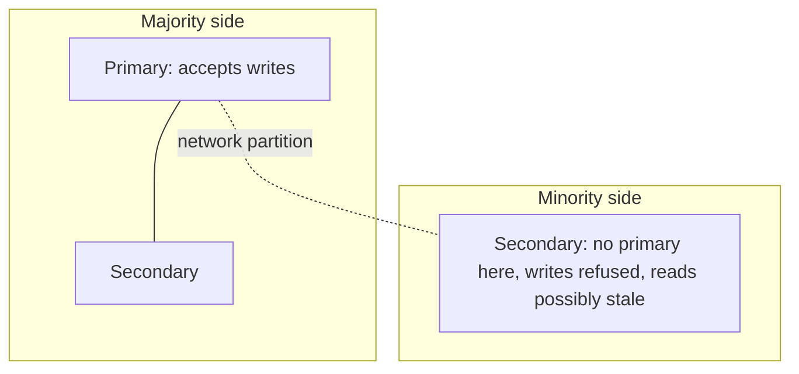

# SQL vs NoSQL: choosing a document store and CAP positioning

> **Before this lesson:** this lesson draws the track together. You should know the document model ([Documents, collections and why a document database](#/lesson/mongodb/document-model)), embedding versus referencing ([Embedding vs referencing, cardinality and normalisation trade-offs](#/lesson/mongodb/embed-vs-reference)), transactions ([Transactions: ACID in MongoDB and its limits](#/lesson/mongodb/transactions)), replica sets and elections ([Replica sets, members and elections](#/lesson/mongodb/replica-sets-elections)) and the read and write settings ([The oplog, write concern, read concern and read preference](#/lesson/mongodb/oplog-concerns)). No SQL knowledge is assumed; the few SQL statements shown are explained.

## In plain words

Choosing a database is like choosing a vehicle. A lorry, a sports car and a bicycle are all good; asking which is "best" makes no sense until you say what you need to carry, how far and on what roads. The useful skill is knowing what each is built for and matching that to the job.

For decades the default vehicle was the **relational database**, which stores data in tables and is queried with **SQL** (Structured Query Language). In the late 2000s a family of alternatives appeared under the loose label **NoSQL** ("not only SQL"), of which MongoDB is the best-known member.

This lesson compares the two approaches fairly, gives a procedure for choosing, and explains the **CAP theorem**, a short statement about what any database spread over several machines can and cannot promise, with MongoDB's place in it.

Why it matters for a job: "SQL or NoSQL for this system, and why?" opens a large share of system-design interviews. Interviewers are not looking for a favourite. They are looking for someone who reasons from requirements and names the trade-offs.

## The relational model in five sentences

A relational database stores data in **tables**. Each table has fixed **columns**, each with a declared type, and every **row** has a value for every column. The structure, called the **schema**, is declared before any data is stored and enforced by the database. Related data is kept in separate tables linked by keys, and reassembled at query time with a **join**. The design principle is **normalisation**: record each fact in exactly one place.

A customer with two orders looks like this:

```
customers                     orders
 id | name    | city           id  | customer_id | total
----+---------+------          ----+-------------+------
  1 | Renata  | Porto          501 |           1 |    20
  2 | Jonas   | Graz           502 |           1 |     8
                               503 |           2 |    35
```

The SQL to show each customer's total spending:

```sql
SELECT c.name, SUM(o.total) AS spent
FROM customers c
JOIN orders o ON o.customer_id = c.id
GROUP BY c.name;
```

Read it as: take customers (calling the table `c`), match each with its orders (`o`) where the order's `customer_id` equals the customer's `id`, make one group per name, and add up the totals in each group.

## The NoSQL families

"NoSQL" is an umbrella over four quite different designs. It helps to know all four, because interviewers sometimes ask "which NoSQL?".

| family | data looks like | strong at | examples |
|---|---|---|---|
| **document** | nested, JSON-like documents | flexible records read and written as a whole; rich queries | MongoDB, Couchbase |
| **key-value** | a key and an opaque value | extremely fast lookups by key; caches, sessions | Redis, DynamoDB |
| **wide-column** | rows with huge numbers of sparse columns, grouped in families | enormous write volumes, time-series at scale | Cassandra, HBase |
| **graph** | nodes and the relationships between them | many-step relationship queries: social networks, fraud rings | Neo4j |

They share two starting points: a less rigid schema, and a design that spreads over many machines from the outset.

## Head-to-head

| aspect | relational (PostgreSQL, MySQL, ...) | document (MongoDB) |
|---|---|---|
| unit of data | row in a table | document in a collection |
| schema | fixed, enforced by the database | flexible; optional validator |
| related data | separate tables, joined at query time | embedded in one document, or referenced |
| joins | central and highly optimised | available (`$lookup`), not the default approach |
| transactions | multi-row, multi-table by default | single-document always atomic; multi-document available |
| integrity between records | foreign keys enforced by the database | the application's responsibility |
| query language | SQL, standardised | query documents and aggregation pipelines |
| scaling writes | mainly a bigger machine; sharding is an add-on | sharding built in |
| changing the schema | a migration (`ALTER TABLE`) | gradual; old and new shapes can coexist |
| ad hoc questions | excellent: join anything to anything | good within a collection; weaker across collections |

Two entries deserve a sentence each. A **foreign key** is a rule in a relational database saying "this column must contain the id of an existing row in that table"; the database then refuses an order for a customer that does not exist. MongoDB has no such rule, so an order can refer to a missing customer unless your code prevents it. And **ad hoc** means "not planned in advance": relational databases answer unanticipated questions well, because normalised tables can be joined in any combination, while a document schema is shaped around the questions foreseen at design time.

### Myths to drop

- **"MongoDB has no schema."** It has no *enforced* schema by default. Your application always has one, and validators can enforce it.
- **"MongoDB has no transactions."** Single-document operations have always been atomic; multi-document transactions have existed since version 4.0.
- **"MongoDB cannot join."** `$lookup` joins. It is a tool for the occasional report, not the foundation of every query.
- **"NoSQL scales, SQL does not."** Relational databases serve very large systems, and can be sharded with extra tooling. Document databases make horizontal scaling a built-in feature, which is easier, not magic.
- **"NoSQL is faster."** A read that fetches one self-contained document is faster than the equivalent multi-table join. A report across loosely related data is usually faster in a relational database.

## When to choose which

Work through these questions in order. They are ranked by how decisive they tend to be.

**1. What do the reads and writes look like?** List the main operations. If most of them fetch or save one self-contained object - a product page, a user profile, an order with its lines, a game state - the document model fits naturally. If the system's value lies in combining many kinds of record in unforeseen ways - reporting, analytics over a business's whole data - the relational model fits.

**2. How uniform is the data?** Records that all share the same fields suit tables. Records that vary - a product catalogue where each category has different attributes, content with optional sections, events of many types - suit documents.

**3. How strict are the cross-record rules?** If the essence of the system is rules spanning many records - double-entry accounting, where every transfer debits one account and credits another and the totals must always balance - a relational database's transactions and foreign keys are the natural home. MongoDB's transactions can do it; you would be using its secondary mode as your primary one.

**4. How large will it get, and how?** Data or write volume beyond one machine favours a database with built-in sharding. Be honest: most applications never reach that size.

**5. How fast does the shape change?** Early-stage products whose data model changes weekly benefit from a flexible schema. Mature systems benefit from enforcement.

**6. What does the team know?** A database the team can operate well beats a theoretically better one it cannot.

| the workload | leaning |
|---|---|
| product catalogue with varying attributes | document |
| content management, user profiles, shopping baskets | document |
| event and IoT data at high volume | document (or wide-column) |
| mobile or web back end reading whole objects | document |
| accounting ledger, banking core | relational |
| reporting over many related entities | relational |
| heavy many-to-many relationships queried from every side | relational (or graph) |
| cache or session store | key-value |

Large systems commonly use more than one: a relational database for billing, MongoDB for the catalogue, Redis as a cache. Using several kinds of database, each for what it does best, is called **polyglot persistence**. It buys fit at the price of more systems to run.

> [!WARNING]
> The wrong reasons to choose MongoDB are "we do not want to think about a schema" and "it scales". Skipping schema design produces the unbounded arrays and table-shaped collections described in the schema lessons. And a system that will never outgrow one machine gains nothing from built-in sharding. Choose from the access patterns.

## The CAP theorem

### The situation it describes

Put a database on several machines and connect them with a network. Networks fail: a cable is cut, a switch dies. When the machines are split into groups that cannot talk to each other, there is a **network partition**. Imagine two bank branches whose telephone line has gone dead, and a customer who walks into each branch wanting to withdraw the full balance of the same account.

Each branch has two options. It can **refuse** to act until the line is restored, which keeps the books correct and turns customers away. Or it can **serve** the customer using its own possibly outdated copy of the books, which keeps the doors open and risks paying the balance out twice.

### The three letters

The **CAP theorem** names three properties of a distributed data store:

- **C - Consistency**: every read returns the most recent write (or an error). All clients see the same data at the same time. (This is a different meaning from the C in ACID, which is about data obeying its rules.)
- **A - Availability**: every request to a working node receives a non-error answer.
- **P - Partition tolerance**: the system keeps operating even though the network between its nodes is broken.

The theorem states that when a partition occurs, a system cannot provide both consistency and availability. It must give up one of them.

The common summary "pick two of three" is misleading. Partitions are not optional - networks do fail - so P is not something you may decline. The real choice is what to do **during a partition**: refuse some requests to stay consistent (**CP**), or answer everything and accept that answers may be stale or conflicting (**AP**). When there is no partition, a system can offer both.

### Where MongoDB stands

By default MongoDB is **CP**. Recall the replica set's majority rule: a member may act as primary only while it can reach a majority of voting members. During a partition:

- the side with the majority keeps or elects a primary and continues normally;
- on the minority side there is no primary, so **writes are refused**. That side has given up availability for writes in order to prevent two primaries from accepting conflicting data.



MongoDB lets each operation shift along the spectrum:

| setting | effect | moves towards |
|---|---|---|
| write concern `majority`, read concern `majority`, read preference `primary` | never see or lose unreplicated data | consistency |
| read concern `linearizable` | reads confirmed against a majority; strictest | consistency |
| read preference `secondaryPreferred` or `nearest` | reads still answered on the minority side, possibly stale | availability |
| write concern `w: 1` | writes acknowledged without waiting for replication; can be rolled back | availability and speed |

Data that may be briefly out of date but converges once the system settles is said to be **eventually consistent**. Secondary reads in MongoDB are eventually consistent.

Systems such as Cassandra and DynamoDB sit on the AP side by default: every node accepts writes even during a partition, and conflicts are reconciled afterwards.

### PACELC: the rest of the story

Partitions are rare. A refinement called **PACELC** adds what happens the rest of the time: **if** there is a **P**artition, choose between **A**vailability and **C**onsistency; **E**lse, choose between **L**atency (how quickly a request is answered) and **C**onsistency. Even with a healthy network, waiting for a majority to confirm a write is slower than acknowledging at once. MongoDB with majority settings is "PC/EC": it favours consistency in both situations. With `w: 1` and secondary reads it leans towards "PA/EL". This everyday latency-versus-consistency trade is the one you make most often.

> [!TIP]
> When asked about CAP, avoid labelling a whole database with two letters and stopping. Say what happens during a partition under the default settings, then say which settings change it. That shows you understand the mechanism and not only the acronym.

## Interview questions with worked answers

> [!INTERVIEW]
> **"When would you choose MongoDB over a relational database?"** When the application's main operations read and write self-contained objects that map naturally to documents; when the records' structure varies or changes often; when the data or write volume is expected to exceed one machine, so built-in sharding matters; and when the dominant queries are known in advance, so the schema can be shaped around them. I would stay relational when the core of the system is multi-record integrity (ledgers), when ad hoc reporting across many entities is central, or when relationships are highly interconnected in many directions.

**"Is MongoDB CP or AP?"** CP by default. During a partition only the side holding a majority of voting members can have a primary, so the minority side rejects writes instead of risking divergent data. It is tunable per operation: reading from secondaries keeps reads available on the minority side at the cost of staleness, and `w: 1` trades durability under failover for lower latency.

**"How do you model a many-to-many relationship without joins?"** Store an array of ids on the side where the array stays small, and index it. For "students take courses": `course_ids` in each student, with a multikey index, so "who takes course X" is one indexed query. If the relationship carries data of its own (grade, date), use a separate collection with one document per pair - which is the same shape as a relational link table, and perfectly acceptable.

**"Your MongoDB application needs a `$lookup` on every page. What does that tell you?"** That the schema was designed like tables. Data that is always displayed together is stored apart. The fix is to embed it, or to copy the few needed fields beside the reference (the extended reference pattern), accepting a small duplication in return for a single-read page.

**"What do you lose by denormalising?"** A single source of truth. Each copied value must be updated in several places, by code you write, and may be briefly inconsistent. It is worthwhile when the value is read far more often than it changes.

**"Can MongoDB replace a relational database for a banking system?"** It can be made to work, using multi-document transactions with majority write concern and snapshot read concern. But the workload's defining feature - invariants spanning many records - is what relational databases are designed around, with foreign keys and constraints enforced by the database. I would pick the relational database for the ledger and consider MongoDB for surrounding services such as customer profiles or notifications.

## Translating between the two

For people arriving from SQL, a phrasebook helps.

| SQL | MongoDB |
|---|---|
| `CREATE TABLE` | implicit on first insert, or `db.createCollection` |
| `INSERT INTO t VALUES (...)` | `db.t.insertOne({...})` |
| `SELECT * FROM t WHERE a = 1` | `db.t.find({ a: 1 })` |
| `SELECT a, b FROM t` | `db.t.find({}, { a: 1, b: 1 })` |
| `WHERE a > 5 AND b IN (1, 2)` | `{ a: { $gt: 5 }, b: { $in: [1, 2] } }` |
| `ORDER BY a DESC LIMIT 10` | `.sort({ a: -1 }).limit(10)` |
| `UPDATE t SET a = 1 WHERE id = 7` | `db.t.updateOne({ _id: 7 }, { $set: { a: 1 } })` |
| `DELETE FROM t WHERE a = 1` | `db.t.deleteMany({ a: 1 })` |
| `GROUP BY a` with `COUNT(*)` | `{ $group: { _id: "$a", n: { $sum: 1 } } }` |
| `JOIN` | `$lookup`, or embedding |
| `CREATE INDEX` | `db.t.createIndex({ a: 1 })` |
| `EXPLAIN` | `.explain("executionStats")` |
| `BEGIN ... COMMIT` | `session.startTransaction()` ... `commitTransaction()` |

The same question in both worlds, from Python:

```python
import sqlite3
from pymongo import MongoClient

sql = sqlite3.connect("shop.db")                                             # 1
rows = sql.execute("""
    SELECT c.name, SUM(o.total)
    FROM customers c JOIN orders o ON o.customer_id = c.id
    GROUP BY c.name ORDER BY 2 DESC
""").fetchall()                                                              # 2
print(rows)

orders = MongoClient()["shop"]["orders"]
docs = orders.aggregate([                                                    # 3
    {"$group": {"_id": "$customer.name", "spent": {"$sum": "$total"}}},
    {"$sort": {"spent": -1}},
])
print([(d["_id"], d["spent"]) for d in docs])                                # 4
```

1. SQLite is a small relational database included with Python.
2. The join-and-group query from earlier, ordered by the second column.
3. The MongoDB version assumes each order document carries an extended reference `customer: { _id, name }`. Because the name travels with the order, no join is needed: the pipeline groups directly on it.
4. Both print `[('Jonas', 35), ('Renata', 28)]`. The difference is where the work was done: the relational design joins at read time, the document design copied the name at write time.

## Simulate it yourself

The first part answers one question against a normalised layout and a document layout, counting the lookups each needs, and then performs a rename to show the other side of the trade. The second part puts a three-node cluster through a network partition under a CP policy and an AP policy.

```python-run
# ---- normalised tables versus documents -----------------------------------------------
customers = {1: {"name": "Renata", "city": "Porto"}, 2: {"name": "Jonas", "city": "Graz"}}
products = {10: {"name": "fern", "price": 12}, 11: {"name": "cactus", "price": 8}, 12: {"name": "ficus", "price": 35}}
orders = {501: {"customer_id": 1}, 502: {"customer_id": 1}, 503: {"customer_id": 2}}
order_lines = [(501, 10, 1), (501, 11, 1), (502, 11, 1), (503, 12, 1)]          # (order, product, quantity)

def order_page_relational(order_id):
    lookups = 1                                             # the order row
    customer = customers[orders[order_id]["customer_id"]]; lookups += 1
    lines = [(p, q) for o, p, q in order_lines if o == order_id]; lookups += 1      # one index range scan
    items = []
    for product_id, qty in lines:
        items.append((products[product_id]["name"], qty, products[product_id]["price"])); lookups += 1
    return {"customer": customer["name"], "items": items}, lookups

documents = {                                               # the same data, shaped for the order page
    501: {"customer": {"_id": 1, "name": "Renata"}, "items": [{"name": "fern", "qty": 1, "price": 12},
                                                              {"name": "cactus", "qty": 1, "price": 8}]},
    502: {"customer": {"_id": 1, "name": "Renata"}, "items": [{"name": "cactus", "qty": 1, "price": 8}]},
    503: {"customer": {"_id": 2, "name": "Jonas"}, "items": [{"name": "ficus", "qty": 1, "price": 35}]},
}
page, lookups = order_page_relational(501)
print("order page, relational:", page, "| lookups:", lookups)
print("order page, document  :", {"customer": documents[501]["customer"]["name"],
                                   "items": [(i["name"], i["qty"], i["price"]) for i in documents[501]["items"]]},
      "| lookups: 1")

customers[1]["name"] = "Renata Sousa"                       # a rename
touched = 0
for doc in documents.values():
    if doc["customer"]["_id"] == 1:
        doc["customer"]["name"] = "Renata Sousa"; touched += 1
print("rename a customer -> relational: 1 row updated | document: %d order documents updated" % touched)
print("product price changes to 9 -> relational: every past order now shows 9 unless prices were copied;")
print("                              document: past orders keep the price that was charged (%d)" %
      documents[501]["items"][1]["price"])

# ---- a network partition under two policies -------------------------------------------
print()
def run(policy):
    nodes = {"n1": {"balance": 100}, "n2": {"balance": 100}, "n3": {"balance": 100}}
    groups = [{"n1", "n2"}, {"n3"}]                          # the partition: n3 is cut off
    log = []
    for node, amount in [("n1", -70), ("n3", -70)]:          # two withdrawals of 70 from a balance of 100
        group = next(g for g in groups if node in g)
        has_majority = len(group) > len(nodes) / 2
        if policy == "CP" and not has_majority:
            log.append("%s: REFUSED (no majority reachable)" % node)
            continue
        if nodes[node]["balance"] + amount < 0:
            log.append("%s: declined, insufficient funds" % node)
            continue
        for member in group:                                 # the write reaches only the nodes in this group
            nodes[member]["balance"] += amount
        log.append("%s: withdrew %d" % (node, -amount))
    balances = {n: d["balance"] for n, d in nodes.items()}
    paid_out = sum(int(entry.split()[-1]) for entry in log if "withdrew" in entry)
    return log, balances, paid_out

for policy in ("CP", "AP"):
    log, balances, paid_out = run(policy)
    print(policy, "policy during the partition:")
    for entry in log:
        print("   ", entry)
    print("    balances seen by each node:", balances, "| total paid out:", paid_out,
          "of 100" + ("  <- overdrawn: every node believes 30 remains" if paid_out > 100 else ""))
```

Reading the output:

- The relational order page needs five lookups: the order, the customer, the order lines and one per product. The document version needs one. Multiply by thousands of page views a second and the difference is the reason document databases exist.
- The rename costs one row in the relational layout and two documents in the document layout. That is denormalisation's bill.
- The price change shows a case where the copy is the *correct* design: an order should keep the price that was charged.
- Under the **CP** policy, the withdrawal on the majority side succeeds and the one on the cut-off node is refused. One customer is turned away; the books are right, with 70 paid out.
- Under the **AP** policy both withdrawals succeed, because each side acts on its own copy. 140 has been paid from an account holding 100, yet every node believes 30 remains, because each side applied only its own withdrawal. The system stayed available, and when the network heals it will hold two conflicting histories that must be reconciled.

Neither policy is wrong in general. For a bank balance, CP is clearly right. For "likes" on a post, where a temporarily inaccurate count harms nobody, AP is a sensible choice.

## Pitfalls

- **Choosing by fashion or familiarity** instead of by access patterns.
- **Designing MongoDB collections as tables** and joining in application code.
- **"No schema" as a reason.** There is always a schema; decide where it is enforced.
- **Reading CAP as "pick any two".** Partitions happen; the choice is between consistency and availability while one lasts.
- **Confusing the C of CAP with the C of ACID.**
- **Calling MongoDB "AP" or "CP" without mentioning the settings** that move it.
- **Assuming relational databases cannot scale**, or that sharding makes scale free.
- **Ignoring integrity.** Without foreign keys, dangling references are the application's problem.
- **Adopting several databases** before one is proven insufficient.

## Cheat sheet

| question | points towards documents | points towards relational |
|---|---|---|
| unit of work | whole objects | combinations of many entities |
| structure | varied, evolving | uniform, stable |
| cross-record rules | few | central |
| queries | known in advance | ad hoc |
| scale | beyond one machine | fits one machine |

| CAP term | meaning |
|---|---|
| consistency | every read sees the latest write |
| availability | every request to a live node gets an answer |
| partition tolerance | operation continues despite a broken network |
| CP | refuse some requests during a partition to stay consistent (MongoDB by default) |
| AP | answer everything during a partition, reconcile later |
| PACELC | during a partition: A or C; otherwise: latency or C |

## Summary

- Relational databases store normalised tables with an enforced schema and join at read time; document databases store self-contained documents with a flexible schema and embed at write time.
- NoSQL covers four families: document, key-value, wide-column and graph.
- Choose from the workload: the shape of reads and writes, uniformity of data, strictness of cross-record rules, expected scale, pace of change and team skills.
- MongoDB has optional schema enforcement, joins and multi-document transactions; the common myths to the contrary are out of date.
- The CAP theorem says a distributed store must choose between consistency and availability during a network partition; MongoDB is CP by default because of its majority rule, and tunable per operation.
- PACELC adds the everyday trade between latency and consistency.

## Glossary

- **Relational database** - a database storing data in tables linked by keys and queried with SQL.
- **SQL** - Structured Query Language, the standard language of relational databases.
- **NoSQL** - an umbrella term for non-relational databases.
- **Table / row / column** - the relational equivalents of collection, document and field.
- **Join** - combining rows from several tables by matching key values.
- **Normalisation** - storing each fact in exactly one place.
- **Foreign key** - a rule requiring a column to refer to an existing row in another table.
- **Ad hoc query** - a question not anticipated when the database was designed.
- **Key-value / wide-column / graph store** - the three other NoSQL families.
- **Polyglot persistence** - using several kinds of database in one system.
- **Network partition** - a network failure splitting nodes into groups that cannot communicate.
- **CAP theorem** - during a partition a distributed store cannot be both consistent and available.
- **CP / AP** - favouring consistency / availability during a partition.
- **Eventual consistency** - copies may differ briefly but converge when updates stop.
- **PACELC** - an extension of CAP adding the latency-versus-consistency choice in normal operation.
- **Latency** - the time taken to answer a request.

## Check yourself

```quiz
[
  {"q": "Which workload is the most natural fit for a document database?",
   "options": ["A double-entry accounting ledger", "A product catalogue in which each category has different attributes", "Ad hoc reporting across twenty related tables", "A graph of friendships queried six levels deep"],
   "answer": 1,
   "explain": "Varied, self-contained records read as a whole are what documents are designed for."},
  {"q": "What does the CAP theorem say?",
   "options": ["A database can have only two of three features at any time", "During a network partition, a distributed store must choose between consistency and availability", "Consistency is impossible in distributed systems", "Availability always costs performance"],
   "answer": 1,
   "explain": "Partitions cannot be avoided, so the real choice arises during a partition: C or A."},
  {"q": "A three-member MongoDB replica set is partitioned 2 and 1. What happens on the side with one member?",
   "options": ["It elects itself primary and accepts writes", "It has no primary, so writes are refused", "It deletes its data", "It keeps accepting writes and merges later"],
   "answer": 1,
   "explain": "A primary needs a majority. Refusing writes on the minority side is the CP behaviour."},
  {"q": "Which setting moves MongoDB towards availability at the cost of possibly stale reads?",
   "options": ["Read concern linearizable", "Read preference secondaryPreferred", "Write concern majority", "A unique index"],
   "answer": 1,
   "explain": "Secondaries can answer reads even without a primary, but they may lag behind."},
  {"q": "Which statement about MongoDB is true today?",
   "options": ["It has no transactions", "It cannot join collections", "It supports multi-document ACID transactions and joins through $lookup", "It requires a fixed schema"],
   "answer": 2,
   "explain": "Multi-document transactions arrived in 4.0 and $lookup provides joins; neither is the default way of working."},
  {"q": "What is the main thing lost when data is denormalised?",
   "options": ["Indexes", "A single source of truth: copies must be kept in step by the application", "The ability to sort", "Replication"],
   "answer": 1,
   "explain": "Each copied value must be updated in several places and may briefly disagree."},
  {"q": "What does PACELC add to CAP?",
   "options": ["A fourth property called performance", "That even without a partition there is a trade-off between latency and consistency", "That partitions never happen", "A rule for choosing shard keys"],
   "answer": 1,
   "explain": "Else (no partition): Latency versus Consistency, for example waiting for a majority acknowledgement."},
  {"q": "An application needs a $lookup on every page view. What is the most likely diagnosis?",
   "options": ["The server needs more memory", "The schema separates data that is always read together; it should be embedded or partly duplicated", "The collection needs a text index", "Transactions are disabled"],
   "answer": 1,
   "explain": "A join on the hottest path is the sign of a table-style design in a document database."}
]
```

> **Source:** beyond the book; original material, drawing on topics from MongoDB: The Definitive Guide 3e, ch. 1, 8, 9 and 10. MongoDB documentation: https://www.mongodb.com/docs/manual/reference/sql-comparison/ , https://www.mongodb.com/docs/manual/data-modeling/ , https://www.mongodb.com/docs/manual/core/read-isolation-consistency-recency/
