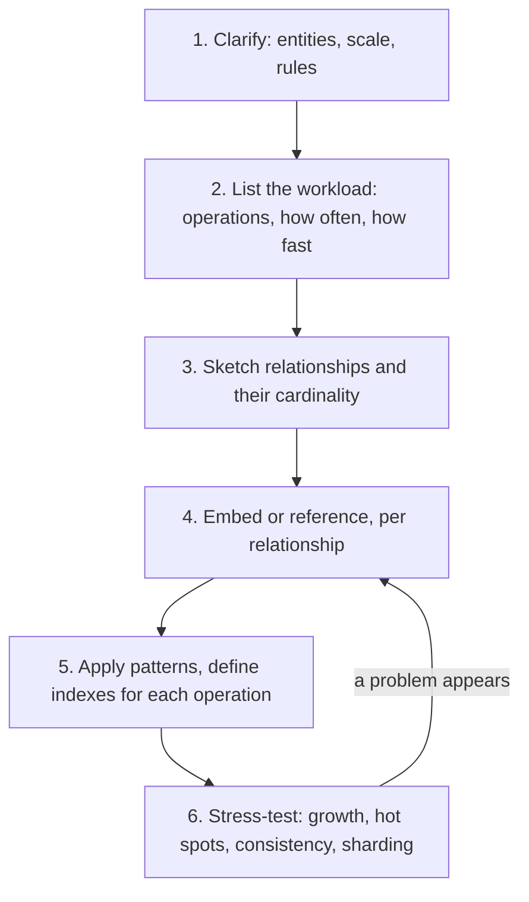

# Data-modelling interview exercises, worked end to end

> **Before this lesson:** this is the capstone of the track. You should know embedding versus referencing ([Embedding vs referencing, cardinality and normalisation trade-offs](#/lesson/mongodb/embed-vs-reference)), the named patterns ([Schema design patterns and anti-patterns](#/lesson/mongodb/schema-patterns)), compound indexes and the ESR rule ([Single-field and compound indexes: the ESR rule](#/lesson/mongodb/index-basics)), keyset pagination ([Cursors, sorting and pagination done right](#/lesson/mongodb/cursors-pagination)) and shard keys ([Choosing a shard key: ranged, hashed and zoned](#/lesson/mongodb/shard-keys)).

## In plain words

Knowing the rules of chess is different from playing a game. The earlier lessons taught the rules of MongoDB one at a time. This lesson plays three complete games: an interviewer hands over a vague request, and you turn it into collections, documents, indexes and queries, explaining each choice as you go.

Think of an architect meeting a client. A good architect does not start by drawing walls. They first ask who will live in the house, how many people, what they do all day. Only then do the rooms take shape, and every room can be justified by something the client said. A data model is designed the same way: from how the data will be **used**, never from a list of nouns.

Why it matters for a job: "design the data model for X" is the most common MongoDB interview task, and schema design is the decision that is hardest to change once a system is live. Interviewers grade the reasoning far more than the final diagram. A candidate who asks about access patterns and states trade-offs beats one who produces a clever schema in silence.

## A method you can reuse

Follow the same six steps every time. Saying them aloud in an interview shows structure even before you have an answer.



1. **Clarify.** What are the things involved? Roughly how many of each? Which rules must never be broken?
2. **List the workload.** Write each important read and write, with how often it happens and how fast it must be. An **access pattern** is one such operation. This list drives everything else.
3. **Sketch the relationships** and note the **cardinality** of each: one-to-one, one-to-few, one-to-many, unbounded, many-to-many.
4. **Decide embed or reference** for each relationship, using the questions from the embedding lesson: read together? how many? still growing? needed alone? how often changed versus read?
5. **Apply patterns and define indexes.** For each operation in the workload, name the index that serves it. An operation without an index is a design gap.
6. **Stress-test.** What grows without bound? What is written most? What can become inconsistent, and does it matter? If it had to be sharded, on what key?

Two rules of thumb carry most of the weight: **data that is accessed together should be stored together**, and **no array may grow without limit**.

## Exercise 1: an online bookshop

> "Design the data model for an online bookshop: a catalogue, customer reviews and orders."

### Step 1 - clarify

Questions worth asking, with the answers assumed here: about 2 million books; a popular book can have 50,000 reviews, most have fewer than 20; 5 million customers; an order holds 1 to 10 items; prices change a few times a year; stock changes constantly; overselling the last copy must not happen.

### Step 2 - the workload

| # | operation | frequency | target |
|---|---|---|---|
| R1 | show a book page: details, rating, a few recent reviews | very high | under 50 ms |
| R2 | list all reviews of a book, newest first, paged | medium | under 100 ms |
| R3 | show a customer's order history, newest first | medium | under 100 ms |
| R4 | show one order in full | medium | under 50 ms |
| W1 | place an order, reducing stock | medium | must be correct |
| W2 | add a review | low | - |
| W3 | change a price | rare | - |

R1 dominates. The design should make it a single read.

### Steps 3 and 4 - relationships and decisions

- **Book to reviews: one-to-many, sometimes huge.** Unbounded for bestsellers, so reviews go in their own collection. But R1 needs a few reviews and the average rating on the book page, so apply the **subset pattern** (five most recent reviews embedded) and the **computed pattern** (count and average stored on the book).
- **Order to items: one-to-few**, always read together, never grows after creation. Embed.
- **Order to customer and to books: references**, since both exist independently. But R4 must display the title and the price paid, and R3 the customer's orders, so use **extended references**: copy title and unit price into each order item. Here the copy is not merely a convenience; an order must record the price that was *charged*, even after the catalogue price changes.
- **Customer to addresses: one-to-few.** Embed. The order copies the shipping address used.

### The documents

```javascript
// books
{ _id: "bk-1007", title: "Salt Harbour", authors: ["Noor Haddad"], price_cents: 1499, stock: 12,
  tags: ["fiction", "sea"],
  rating: { count: 3214, sum: 13820 },                    // computed: average = sum / count
  recent_reviews: [ { user: "Ines", stars: 5, text: "Could not put it down", at: ISODate("2026-05-30") } ] }

// reviews
{ _id: ObjectId("..."), book_id: "bk-1007", customer_id: "c-88", user: "Ines", stars: 5,
  text: "Could not put it down", at: ISODate("2026-05-30") }

// orders
{ _id: "o-55021", customer_id: "c-88", placed: ISODate("2026-06-01T10:12:00Z"), status: "paid",
  ship_to: { name: "Ines Prat", city: "Girona", postcode: "17001" },
  items: [ { book_id: "bk-1007", title: "Salt Harbour", unit_cents: 1499, qty: 1 } ],
  total_cents: 1499 }
```

Money is stored as integer cents, following the BSON lesson.

### Step 5 - indexes and queries, one per operation

```javascript
// R1: one read by _id; no extra index
db.books.findOne({ _id: "bk-1007" })

// R2: equality on book, sort by time with _id as tie-breaker (keyset pagination)
db.reviews.createIndex({ book_id: 1, at: -1, _id: -1 })
db.reviews.find({ book_id: "bk-1007" }).sort({ at: -1, _id: -1 }).limit(20)

// R3: equality on customer, sort by time
db.orders.createIndex({ customer_id: 1, placed: -1 })
db.orders.find({ customer_id: "c-88" }).sort({ placed: -1 }).limit(20)

// one review per customer per book
db.reviews.createIndex({ book_id: 1, customer_id: 1 }, { unique: true })
```

Each index follows the ESR rule: the equality field first, then the sort field.

**W1, placing an order without overselling**, uses a conditional update, which is atomic on a single document:

```javascript
db.books.updateOne({ _id: "bk-1007", stock: { $gte: 1 } }, { $inc: { stock: -1 } })
```

If `modifiedCount` is 0, the book is sold out and the order is refused. For an order with several different books, either run the decrements and the order insert in one multi-document transaction, or decrement one book at a time and put back the ones already taken if a later one fails.

**W2, adding a review**, writes to two collections: an insert into `reviews`, and an update of the book that adjusts the computed values and the embedded subset.

```javascript
db.books.updateOne({ _id: "bk-1007" }, {
  $inc: { "rating.count": 1, "rating.sum": 5 },
  $push: { recent_reviews: { $each: [ newReview ], $sort: { at: -1 }, $slice: 5 } }
})
```

### Step 6 - stress-test

- *Growth:* the only arrays are `items` (at most 10) and `recent_reviews` (capped at 5 by `$slice`). Nothing is unbounded.
- *Consistency:* if the process crashes between the review insert and the book update, the rating is off by one review. That is acceptable for a rating; a nightly job can recompute it from `reviews`. Had it been unacceptable, a transaction would wrap the two writes.
- *Hot spots:* `stock` on a bestseller is written often, but each write is a small `$inc`.
- *Sharding, if ever needed:* `orders` on `{ customer_id: 1, _id: 1 }` keeps R3 targeted and spreads writes across customers; `reviews` on `{ book_id: 1, _id: 1 }`, accepting that one bestseller's reviews form a busy range.

## Exercise 2: a social feed

> "Design the data model for a micro-blogging service: users follow each other, write short posts and read a home timeline."

### Steps 1 and 2 - clarify and list the workload

Assume 10 million users; an ordinary user has a few hundred followers; a few celebrities have 5 million; reads outnumber writes by about a hundred to one.

| # | operation | frequency |
|---|---|---|
| R1 | home timeline: recent posts from everyone I follow | extremely high |
| R2 | profile page: one user's own posts | high |
| W1 | write a post | medium |
| W2 | follow or unfollow | low |

### Steps 3 and 4

**Users to followers: many-to-many and unbounded.** An array of follower ids inside the user document would hold 5 million entries for a celebrity - the textbook unbounded array. Use a link collection with one document per relationship:

```javascript
// follows:  "follower follows followee"
{ _id: { follower: "u-12", followee: "u-900" }, since: ISODate("2026-01-15") }
```

Using the pair as `_id` makes each relationship unique with no extra index. A second index on `{ "_id.followee": 1 }` answers "who follows this user?".

**Posts** are a separate collection, since they are unbounded per user. Each post copies the author's display name and avatar (extended reference), because every post on screen shows them and they rarely change.

```javascript
// posts
{ _id: ObjectId("..."), author: { _id: "u-900", name: "Lia", avatar: "lia.png" },
  text: "First light over the harbour", at: ISODate("2026-06-02T05:40:00Z"), likes: 0 }
```

R2 is served by the index `{ "author._id": 1, at: -1 }`.

### The hard part: the home timeline

There are two classic designs, and naming both is what the interviewer is waiting for.

**Fan-out on read.** Store nothing extra. When a user opens the timeline, fetch the list of people they follow, then query posts by those authors, sorted by time:

```javascript
db.posts.find({ "author._id": { $in: followeeIds } }).sort({ at: -1 }).limit(30)
```

Writes are cheap: a post is one insert. Reads are expensive: the query spans as many index ranges as the user follows, and the results must be merged. With hundreds of followees and the system's most frequent operation, this is too slow.

**Fan-out on write.** Precompute. When a user posts, add a small entry to the timeline of every follower. Reading a timeline is then one indexed range read:

```javascript
// timelines: one entry per (reader, post)
{ _id: ObjectId("..."), owner: "u-12", post_id: ObjectId("..."), author_id: "u-900", at: ISODate("2026-06-02T05:40:00Z") }

db.timelines.createIndex({ owner: 1, at: -1 })
db.timelines.find({ owner: "u-12" }).sort({ at: -1 }).limit(30)
```

Reads are cheap, which matches a read-heavy system. Writes are expensive in proportion to the number of followers: a celebrity's single post would produce 5 million timeline entries.

**The hybrid** used by real systems treats celebrities as outliers - the **outlier pattern**. Ordinary users' posts are fanned out on write. Celebrities' posts are not; at read time the user's precomputed timeline is merged with a fan-out-on-read query over the handful of celebrities they follow. A flag on the user document, `is_celebrity: true`, selects the path.

Further refinements worth mentioning: do the fan-out in a background worker fed by a change stream, so that posting stays fast; keep each timeline to the newest thousand entries, with a TTL index or by trimming; and page with keyset pagination on `(at, _id)`.

### Step 6 - stress-test

- *Consistency:* a new post reaches followers' timelines after a short delay. That is eventual consistency and is fine for a feed. The author's own profile reads from `posts` directly, so they see their post at once.
- *Counters:* `likes` is a computed value incremented with `$inc`. For a post receiving thousands of likes a second, exact per-like updates are costly; batching increments is acceptable, since nobody needs the exact figure this instant.
- *Sharding:* `timelines` on `{ owner: 1, at: 1 }` keeps a timeline read on one shard. `posts` on `{ "author._id": 1, _id: 1 }`.

## Exercise 3: sensor readings from a fleet

> "Fifty thousand vehicles each report position and engine data every ten seconds. Dashboards show the last hour per vehicle and daily averages. Raw data is kept for 30 days."

### Clarify and workload

Fifty thousand vehicles times 8,640 readings a day is about 432 million readings a day. Writes dominate overwhelmingly.

| # | operation | frequency |
|---|---|---|
| W1 | insert a reading | 5,000 per second |
| R1 | one vehicle's readings for the last hour | high |
| R2 | daily average per vehicle, last 30 days | medium |
| D1 | delete data older than 30 days | continuous |

### Design

One document per reading means 13 billion documents a month, each with its own index entries. Apply the **bucket pattern**: one document per vehicle per hour, containing up to 360 readings and running summaries. On a current server, a **time-series collection** does the bucketing for you:

```javascript
db.createCollection("readings", {
  timeseries: { timeField: "ts", metaField: "vehicle", granularity: "seconds" },
  expireAfterSeconds: 2592000
})
db.readings.insertOne({ ts: new Date(), vehicle: { id: "v-0417", depot: "leeds" }, speed_kmh: 62, rpm: 2100 })
```

- `timeField` names the timestamp; `metaField` names the field that identifies the source and seldom changes, which the server uses to group readings into buckets.
- `expireAfterSeconds: 2592000` is 30 days, in seconds: D1 is handled automatically, by dropping whole buckets, which is much cheaper than deleting documents one by one.

R1 is a range query on vehicle and time, served by the collection's built-in ordering on `(vehicle, ts)`. R2 would be expensive to compute from raw data on every dashboard load, so apply the **computed pattern**: a scheduled aggregation writes one summary per vehicle per day with `$merge`:

```javascript
db.readings.aggregate([
  { $match: { ts: { $gte: startOfYesterday, $lt: startOfToday } } },
  { $group: { _id: { vehicle: "$vehicle.id", day: { $dateTrunc: { date: "$ts", unit: "day" } } },
              avg_speed: { $avg: "$speed_kmh" }, max_rpm: { $max: "$rpm" }, n: { $sum: 1 } } },
  { $merge: { into: "daily_stats", whenMatched: "replace" } }
])
```

The dashboard then reads 30 small documents per vehicle from `daily_stats`.

### Stress-test

- *Write concern:* a lost reading is replaced ten seconds later, so `w: 1` is a reasonable trade for throughput here. Contrast with the bookshop's orders, where `majority` is required. Matching durability to the value of the data is part of the design.
- *Sharding:* at this volume it is likely. `{ "vehicle.id": 1, ts: 1 }` spreads inserts across vehicles and keeps each vehicle's time ranges together. `ts` alone would be monotonic and send every insert to one shard.
- *Summaries outlive raw data:* `daily_stats` has no TTL, so long-term trends survive the 30-day deletion.

## The reasoning, compressed

Across the three exercises the same moves recur.

| situation | move |
|---|---|
| a page reads several things together | embed them, or embed a subset |
| a child list is unbounded | own collection, child holds the parent's id |
| a list screen needs two fields from another entity | extended reference |
| a total or average is shown often | computed pattern |
| one rare entity breaks the design | outlier pattern |
| billions of tiny time-stamped records | bucket pattern or a time-series collection |
| a read is far more frequent than the write that feeds it | precompute at write time (fan-out on write) |
| a precondition must hold when writing | put it in the update's filter |
| several documents must change together | first try to make them one document; otherwise a transaction |
| each operation in the workload | name the index that serves it |

> [!TIP]
> In an interview, write the workload table before any document. When you later make a choice, point at a row: "I embed recent reviews because of R1." If the interviewer changes a requirement - "what if reviews must be searchable across all books?" - you can show exactly which decision moves and which stays.

> [!WARNING]
> The most common way to fail this exercise is to begin with "we need a users collection, a books collection, a reviews collection and an orders collection" and connect them with ids. That is a relational design in MongoDB syntax. It is produced without asking a single question about usage, and it makes the busiest read need three queries.

> [!INTERVIEW]
> **"What questions do you ask before designing a MongoDB schema?"** What are the entities and roughly how many of each? What are the most frequent reads and writes, and what latency do they need? For each relationship, what is the cardinality and can it grow without bound? Which data is always shown together? Which values change often and which almost never? Which rules must hold with no exception, such as never overselling? How long is data kept? What is the expected growth, and would it need sharding? Then I design for the dominant operation first and check every other operation has an index.

## The same from Python

A compact implementation of the bookshop's two write paths, with the consistency reasoning visible in the code:

```python
from datetime import datetime, timezone
from pymongo import MongoClient, WriteConcern
from pymongo.errors import DuplicateKeyError

client = MongoClient("mongodb://localhost:27017/?replicaSet=rs0")
db = client.get_database("bookshop", write_concern=WriteConcern("majority"))      # 1

def place_order(order_id, customer_id, book_id, ship_to):
    book = db.books.find_one_and_update(                                          # 2
        {"_id": book_id, "stock": {"$gte": 1}},
        {"$inc": {"stock": -1}},
        projection={"title": 1, "price_cents": 1},
    )
    if book is None:
        return "sold out"                                                         # 3
    try:
        db.orders.insert_one({                                                    # 4
            "_id": order_id, "customer_id": customer_id, "status": "paid",
            "placed": datetime.now(timezone.utc), "ship_to": ship_to,
            "items": [{"book_id": book_id, "title": book["title"],
                       "unit_cents": book["price_cents"], "qty": 1}],
            "total_cents": book["price_cents"],
        })
    except DuplicateKeyError:
        db.books.update_one({"_id": book_id}, {"$inc": {"stock": 1}})              # 5
        return "already placed"
    return "ok"

def add_review(book_id, customer_id, user, stars, text):
    review = {"book_id": book_id, "customer_id": customer_id, "user": user,
              "stars": stars, "text": text, "at": datetime.now(timezone.utc)}
    try:
        db.reviews.insert_one(review)                                             # 6
    except DuplicateKeyError:
        return "already reviewed"
    db.books.update_one({"_id": book_id}, {                                       # 7
        "$inc": {"rating.count": 1, "rating.sum": stars},
        "$push": {"recent_reviews": {"$each": [{k: review[k] for k in ("user", "stars", "text", "at")}],
                                     "$sort": {"at": -1}, "$slice": 5}},
    })
    return "ok"
```

1. Orders matter, so the whole database handle uses majority write concern.
2. One atomic step checks that stock remains, takes one copy and returns the title and price needed for the order.
3. `None` means the filter did not match: no stock.
4. The order copies title and unit price: an extended reference that is also a historical record.
5. If the same order id arrives twice, for instance after a client retry, the unique `_id` rejects the second insert and the stock taken for it is put back. The order id makes the operation idempotent.
6. The unique index on `(book_id, customer_id)` allows one review per customer per book.
7. The computed rating and the embedded subset are updated in one atomic update of the book.

## Simulate it yourself

The first part measures the two timeline strategies on a generated social graph that includes a celebrity. The second part runs concurrent purchases of the last copies of a book with a naive check-then-write and with a conditional update.

```python-run
import random

random.seed(9)
USERS = 2000
followers = {u: set() for u in range(USERS)}                # followers[x] = who follows x
following = {u: set() for u in range(USERS)}
for u in range(USERS):
    for target in random.sample(range(USERS), 30):          # everyone follows 30 random users ...
        if target != u:
            followers[target].add(u); following[u].add(target)
    followers[0].add(u); following[u].add(0)                # ... and everyone follows user 0, the celebrity
followers[0].discard(0); following[0].discard(0)

POSTS = 4000
authors = [0 if random.random() < 0.02 else random.randrange(1, USERS) for _ in range(POSTS)]
READS = 400_000                                             # timeline views: reads dominate

def cost(strategy):
    write_entries, read_ranges = 0, 0
    for author in authors:
        if strategy == "fan-out on read":
            write_entries += 1                              # one post document
        elif strategy == "fan-out on write":
            write_entries += 1 + len(followers[author])     # plus one timeline entry per follower
        else:                                               # hybrid: celebrities are not fanned out
            write_entries += 1 + (0 if author == 0 else len(followers[author]))
    avg_following = sum(len(f) for f in following.values()) / USERS
    if strategy == "fan-out on read":
        read_ranges = READS * avg_following                 # one index range per followed author, then merge
    elif strategy == "fan-out on write":
        read_ranges = READS * 1                             # one contiguous range of the reader's timeline
    else:
        read_ranges = READS * 2                             # the timeline plus one query for the celebrity
    return write_entries, read_ranges

print("celebrity has %d followers; an ordinary user about %d" % (len(followers[0]), len(followers[1])))
print("%-18s %16s %20s %14s" % ("strategy", "entries written", "index ranges read", "total work"))
for strategy in ("fan-out on read", "fan-out on write", "hybrid"):
    w, r = cost(strategy)
    print("%-18s %16s %20s %14s" % (strategy, f"{w:,}", f"{int(r):,}", f"{int(w + r):,}"))
celebrity_posts = authors.count(0)
print("posts by the celebrity: %d -> %s timeline entries under pure fan-out on write"
      % (celebrity_posts, f"{celebrity_posts * len(followers[0]):,}"))

# ---- selling the last copies ------------------------------------------------------------
print()
def sell(strategy, stock=3, buyers=8):
    book = {"stock": stock}
    sold = 0
    if strategy == "check then write":
        saw = [book["stock"] for _ in range(buyers)]        # all buyers read before anyone writes
        for seen in saw:
            if seen >= 1:                                   # each decides on a stale value
                book["stock"] -= 1; sold += 1
    else:                                                   # conditional update: filter stock >= 1, then $inc -1
        for _ in range(buyers):
            if book["stock"] >= 1:                          # check and change are one atomic step on the server
                book["stock"] -= 1; sold += 1
    return sold, book["stock"]

for strategy in ("check then write", "conditional update"):
    sold, left = sell(strategy)
    print("%-20s 8 buyers, 3 copies -> sold %d, stock now %d%s" %
          (strategy, sold, left, "  <- oversold" if left < 0 else ""))
```

Reading the output:

- **Fan-out on read** writes the least, one document per post, and reads the most: each timeline view touches about 31 index ranges, some twelve million in total.
- **Fan-out on write** makes each read a single range, but writes far more. The celebrity's posts alone account for well over a hundred thousand timeline entries.
- **The hybrid** cuts the entries written by about 60 per cent by not fanning out the celebrity's posts, and pays for it with a second range on every read. In this small model, where the celebrity has only 2,000 followers, pure fan-out on write still has the lowest total. Now scale the celebrity up in your head: with 5 million followers, those 94 posts would cost 470 million timeline entries under pure fan-out on write, while the hybrid's extra read cost stays exactly where it is. That is the point at which the outlier needs its own path.
- In the stock example, check-then-write sells eight copies of a book that had three, because every buyer decided from a value read before the others wrote. The conditional update sells exactly three and refuses the rest.

Change `READS` to `4_000` to model a write-heavy system and see fan-out on read become the cheapest: the right design depends on the workload, which is the lesson of this whole module.

## Pitfalls

- **Starting from entities** instead of from access patterns.
- **Asking no clarifying questions** about scale, frequency and rules.
- **An unbounded array** somewhere in the design: followers, reviews, events.
- **No index named for an operation** in the workload.
- **Copies with no stated owner or refresh path**, or copying volatile values.
- **Check-then-write** where a conditional update or unique index is required.
- **One write concern for everything**, either risking orders or throttling telemetry.
- **Ignoring the outlier**: the celebrity, the bestseller, the giant tenant.
- **Reaching for transactions first** where a single-document design would do.
- **Presenting one design as the only option** instead of comparing two and choosing.

## Cheat sheet

| step | deliverable |
|---|---|
| clarify | entities, counts, hard rules |
| workload | table of reads and writes with frequency and latency |
| relationships | cardinality of each, bounded or not |
| embed or reference | one decision per relationship, with its reason |
| patterns and indexes | sample documents; one index per operation |
| stress-test | growth, hot spots, consistency, shard key |

| phrase to use | when |
|---|---|
| "what are the main access patterns?" | first, always |
| "is that list bounded?" | at every array |
| "this is read far more than it is written, so I precompute" | computed, subset, fan-out on write |
| "I copy these two fields; they rarely change and here is who updates them" | extended reference |
| "the precondition goes in the filter, so the check and the write are atomic" | stock, seats, unique claims |
| "that one is an outlier; I handle it separately" | celebrities, bestsellers |
| "the trade-off is ..." | every decision |

## Summary

- Design from the workload: clarify, list operations with their frequency, sketch relationships with cardinality, decide embed or reference, apply patterns with an index per operation, then stress-test.
- The bookshop embeds order items and a subset of reviews, stores computed ratings, copies title and price into orders as a historical record, and prevents overselling with a conditional update.
- The social feed stores follows in a link collection and chooses fan-out on write for a read-heavy timeline, with celebrities handled as outliers by fan-out on read.
- The vehicle fleet uses a time-series collection with automatic expiry and precomputed daily summaries, and accepts a weaker write concern for low-value, high-volume data.
- In every case the answer was justified by a row of the workload table and by a stated trade-off.

## Glossary

- **Access pattern** - one way the application reads or writes data, with its frequency and speed requirement.
- **Workload** - the full set of access patterns a system must serve.
- **Cardinality** - how many items stand on each side of a relationship.
- **Subset pattern** - embedding the frequently used few of a large set.
- **Computed pattern** - storing a derived value when its inputs change.
- **Extended reference** - an id accompanied by copies of a few fields of the referenced document.
- **Link collection** - one document per related pair, for many-to-many relationships.
- **Fan-out on read** - assembling a feed at read time from the authors a user follows.
- **Fan-out on write** - adding an entry to each follower's feed when a post is written.
- **Outlier** - a rare entity far outside the typical size, handled by a separate path.
- **Time-series collection** - a collection type that buckets time-stamped data automatically.
- **Conditional update** - an update whose filter contains the precondition, making check and change atomic.
- **Eventual consistency** - derived data catches up with its source after a short delay.
- **Idempotent** - having the same effect whether performed once or several times.

## Check yourself

```quiz
[
  {"q": "What should you establish before drawing any collection in a modelling interview?",
   "options": ["The list of nouns in the problem", "The main access patterns, their frequency and the scale", "The shard key", "The number of indexes allowed"],
   "answer": 1,
   "explain": "A document schema is shaped by how the data is read and written, so the workload comes first."},
  {"q": "In the bookshop, why do order items copy the book's title and unit price?",
   "options": ["To avoid creating a books collection", "So the order shows without a join and permanently records the price that was charged", "Because references are not allowed in arrays", "To make the order document larger"],
   "answer": 1,
   "explain": "It is an extended reference that is also a historical fact: later catalogue price changes must not alter past orders."},
  {"q": "A popular book can have 50,000 reviews. Where do reviews live?",
   "options": ["All embedded in the book document", "In their own collection, with the newest few and the computed rating embedded in the book", "In the orders collection", "In an array of ids on the book"],
   "answer": 1,
   "explain": "Unbounded lists get their own collection; subset and computed patterns keep the book page to one read."},
  {"q": "Which update prevents selling a book that is out of stock?",
   "options": ["Read stock, check it in code, then $set the new value", "updateOne({_id: id, stock: {\\$gte: 1}}, {\\$inc: {stock: -1}}) and check modifiedCount", "updateOne({_id: id}, {$inc: {stock: -1}})", "deleteOne({_id: id})"],
   "answer": 1,
   "explain": "The precondition in the filter makes the check and the decrement one atomic single-document operation."},
  {"q": "Why not store a user's followers as an array in the user document?",
   "options": ["Arrays cannot hold ids", "A celebrity's array would be unbounded and exceed the document size limit", "It would make queries too fast", "MongoDB forbids many-to-many relationships"],
   "answer": 1,
   "explain": "Followers can number in the millions; a link collection with one document per relationship scales."},
  {"q": "A feed is read a hundred times more often than it is written. Which timeline strategy fits ordinary users?",
   "options": ["Fan-out on read", "Fan-out on write", "A collection scan per view", "A transaction per view"],
   "answer": 1,
   "explain": "Precomputing each follower's timeline at write time makes the dominant operation, reading, a single range read."},
  {"q": "How does the hybrid timeline design treat a celebrity's posts?",
   "options": ["They are deleted", "They are not fanned out; they are merged in at read time, as an outlier", "They are fanned out twice", "They are stored in the admin database"],
   "answer": 1,
   "explain": "Fanning out to millions of followers per post is too costly, so the rare outlier is fetched on read."},
  {"q": "For fleet telemetry at 5,000 inserts per second, which choice is reasonable?",
   "options": ["One document per reading with w: majority, kept forever", "A time-series collection with a 30-day expiry, w: 1, and precomputed daily summaries", "All readings embedded in the vehicle document", "A text index on every field"],
   "answer": 1,
   "explain": "Bucketing cuts document and index counts, expiry handles retention, summaries serve dashboards, and a lost reading is tolerable."}
]
```

> **Source:** beyond the book; original worked exercises applying topics from MongoDB: The Definitive Guide 3e, ch. 5, 9 and 16. MongoDB documentation: https://www.mongodb.com/docs/manual/data-modeling/schema-design-process/ , https://www.mongodb.com/docs/manual/data-modeling/design-patterns/ , https://www.mongodb.com/docs/manual/core/timeseries-collections/
