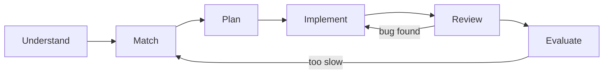

# How to approach an interview problem

> **Before this lesson:** you should be able to read and write basic Python — variables, `if`, `for` loops, functions and lists. Nothing else is assumed. If "O(n)" means nothing to you yet, that is fine: it is explained below, and in full in [Big-O, Big-Omega and Big-Theta](#/lesson/dsa-foundations/asymptotic-notation).

## In plain words

A coding interview is a conversation in which you are given a small programming puzzle and about 45 minutes to solve it while someone watches. This lesson is a **checklist for that conversation** — the same way a pilot runs the same checklist before every flight, whatever the weather.

An everyday comparison: a driving test. The examiner is not only checking that you arrive; they watch whether you check the mirrors, signal, and react calmly when something unexpected happens. In a coding interview the "mirrors and signals" are asking questions, explaining your plan, and testing your code.

Why it matters for a job: almost every software company uses this kind of interview, and the habits it rewards — understand first, plan, check your work — are the habits of a reliable engineer.

Terms used throughout, defined once here:

- An **algorithm** is a step-by-step recipe for solving a problem.
- The **input size**, written `n`, is how much data the algorithm receives — for example the length of a list.
- **Big-O notation**, written like `O(n)` or `O(n²)` and read "order n", describes how the number of steps grows as `n` grows. `O(n)` means "roughly proportional to n": double the data, double the work. `O(n²)` means double the data, four times the work. `O(1)` means the work does not depend on `n` at all. Smaller growth is better.
- A **brute-force** solution is the most direct one: try every possibility. It is usually correct but slow.
- An **edge case** is an unusual input — an empty list, a single item, all items equal — where code often breaks.
- A **hash set** / **hash map** (Python `set` / `dict`) is a collection that can answer "is this item here?" almost instantly; the next lesson explains them.

Most candidates who fail coding interviews don't fail because they have never seen the algorithm. They fail
because they start typing too early, solve a slightly different problem from the one asked, freeze when
the first idea doesn't work, or finish with code that crashes on an empty list. The good news is that all
of those are *process* failures, and process can be practised like a sword stroke: the same motion,
repeated until it is automatic.

This lesson gives you that motion. Every problem in this track — and every problem you meet in an
interview — can be attacked with the same six steps. We'll use the **UMPIRE** method (popularised by
CodePath), add the habits interviewers actually grade, and finish with a full worked example.

## Why a method at all?

An interview is not a test of whether you can produce a correct program in silence. Interviewers usually
score four things:

1. **Problem solving** — did you find a reasonable approach, and improve it?
2. **Coding** — is the code correct, clean and idiomatic?
3. **Communication** — could they follow your thinking? Did you take hints well?
4. **Verification** — did you test your code and find your own bugs?

A candidate who silently writes a perfect solution scores well on (2) and badly on (3) and (4). A candidate
who talks through a clear plan, writes a solid O(n log n) solution and tests it carefully often beats one who
mumbles their way to the O(n) trick. A method makes sure you collect points in all four columns.

> [!INTERVIEW]
> The interviewer wants to see how you'd behave as a colleague. "Thinking out loud" is not a performance —
> it is the only way they can give you credit for ideas that never make it into the final code.

## The UMPIRE method



| Step | Question you're answering | Typical time (45-min interview) |
|---|---|---|
| **U**nderstand | What exactly is being asked? What are the edge cases? | 3–5 min |
| **M**atch | Which known pattern does this resemble? | 2–5 min |
| **P**lan | What's the algorithm, step by step, and its complexity? | 5 min |
| **I**mplement | Turn the plan into clean code | 10–15 min |
| **R**eview | Trace the code on examples; fix bugs | 5 min |
| **E**valuate | State complexity, trade-offs, possible improvements | 2–3 min |

### U — Understand

Restate the problem in your own words and ask clarifying questions. You are looking for the hidden
assumptions that change the algorithm:

- **Input size.** `n ≤ 20` invites exponential search; `n ≤ 10^5` demands O(n log n) or better.
- **Value ranges.** Negative numbers? Zeros? Values bounded by 100 (→ counting array)?
- **Duplicates.** Can values repeat? Should the output contain duplicates?
- **Sortedness.** Is the input sorted? (If yes, think binary search or two pointers immediately.)
- **Output format.** Indices or values? 0- or 1-indexed? Any order allowed? In place or new list?
- **Guarantees.** "Exactly one answer exists" removes a lot of error handling.
- **Empty / tiny input.** What should `[]` return?

Then build **two or three examples by hand**, including one edge case. Writing examples is not busywork:
you will reuse them in the Review step, and constructing them often reveals the algorithm.

There is a useful table to keep in your head that converts constraints into a target complexity:

| n up to | Feasible complexity (≈10⁸ simple ops/sec in C, ~10⁷ in Python) |
|---|---|
| 10–12 | O(n!) — permutations |
| 20–25 | O(2ⁿ) — subsets, bitmasks |
| 100–500 | O(n³) |
| 10³–10⁴ | O(n²) |
| 10⁵–10⁶ | O(n log n) or O(n) |
| 10⁹ and up | O(log n) or O(1) — math / binary search |

### M — Match

Ask: *what does this remind me of?* The NeetCode roadmap is organised around patterns precisely so that
this step becomes a lookup. A few triggers you will learn in this track:

| If you see… | Think… |
|---|---|
| "Have I seen this before?", "count occurrences", "group by" | hash set / hash map |
| "pair / triple summing to a target" | complement lookup in a dict, or sort + two pointers |
| sorted array, "in place", "palindrome", "from both ends" | two pointers |
| "sum of a subarray / rectangle", many range queries | prefix sums |
| values in a small bounded range, "top k by frequency" | counting / bucket sort |
| values in `1..n` and O(1) space | use the array index as a hash key |
| contiguous window with a condition | sliding window (next track) |

If nothing matches, fall back on brute force and ask what work it repeats. *Removing repeated work* is
how nearly every optimisation is discovered.

### P — Plan

Before writing code, describe the algorithm in a few bullet points or pseudocode and **state its
complexity**. Always say the brute-force solution out loud first, even if you immediately reject it:

> "The naive way is to check every pair, which is O(n²). Since we only need to know whether the
> complement exists, I can keep a dict of values I've seen and get O(n) time with O(n) extra space."

That sentence earns credit for problem solving and communication at once, and it gives the
interviewer a chance to redirect you before you invest ten minutes in the wrong idea.

Ask for agreement: *"Does that sound reasonable, or should I aim for O(1) space?"* Interviewers often
have a specific target in mind and will tell you.

### I — Implement

Now write the code, still narrating at the level of intent ("now I handle the case where the pointer
reaches the end"). Habits that make code easy to judge correct:

- **Meaningful names**: `seen`, `left_max`, `write` beat `d`, `m`, `j`.
- **Helper functions** for sub-steps (`reverse(l, r)`), even if you inline them later.
- **Pythonic built-ins** where they don't hide the algorithm: `enumerate`, `zip`, `collections.Counter`,
  `defaultdict`. If the problem *is* the built-in (e.g. "implement sort"), don't call it.
- **Don't optimise prematurely.** Get a correct version first, then improve.

If you get stuck, say what's blocking you. A precise statement ("I need the index of the complement, but
my set only stores values") often contains its own fix (store a dict instead).

### R — Review

This is where most points are lost. When you finish typing, **don't** say "I think that's it". Instead:

1. Re-read the code line by line for typos and off-by-one errors.
2. **Dry-run** one normal example by hand, tracking variables in a small table.
3. Run the edge cases you collected in step U: empty input, one element, all duplicates, negatives,
   answer at the very beginning or very end.

A dry-run table looks like this (for Two Sum on `[3, 2, 4]`, target 6):

| i | x | need | seen before | action |
|---|---|---|---|---|
| 0 | 3 | 3 | {} | store 3→0 |
| 1 | 2 | 4 | {3:0} | store 2→1 |
| 2 | 4 | 2 | {3:0, 2:1} | found → [1, 2] |

Finding your own bug during review is a *positive* signal — it is what good engineers do.

### E — Evaluate

Finish with a crisp summary: time complexity, space complexity, and the trade-offs. Mention what you
would do differently with other constraints ("if the array were sorted, two pointers would give O(1)
space"; "if the input didn't fit in memory, I'd stream it and…"). This is your chance to show breadth.

## Talking through a problem

Communication is a skill on its own. A few concrete techniques:

- **Narrate decisions, not keystrokes.** "I'm iterating from the right because I need the maximum of
  everything after i" is useful; "now I type for i in range" is noise.
- **Think in examples.** When stuck, say "let me try a small case" and work it on the whiteboard. Patterns
  jump out of concrete numbers.
- **Signpost.** "First I'll handle the general case, then come back to empty input." The interviewer
  relaxes when they know you haven't forgotten something.
- **Accept hints gracefully.** A hint is not a failure; ignoring one is. Repeat it back and act on it.
- **Silence is OK in short bursts.** "Give me thirty seconds to think about this" is perfectly
  professional.

> [!TIP]
> Practise solving problems *out loud* alone, or record yourself. It feels awkward the first ten times and
> natural by the thirtieth. In this guide, write your plan as a comment at the top of the editor before
> you code — the judge ignores it, and it trains the habit.

## Testing like an engineer

The judge on this site runs your code against hidden tests, but in an interview you are the judge. Build
test cases systematically:

| Category | Examples for an array problem |
|---|---|
| Typical | a small random-looking case from the statement |
| Minimal | `[]`, `[x]`, two elements |
| Duplicates | all equal, many repeats, duplicates at the ends |
| Extremes | very large / very small values, negatives, zeros |
| Structure | already sorted, reverse sorted, answer at index 0 or n−1 |
| Scale | n at the upper constraint — does your complexity survive? |

The scale category matters on this site: most problems include a test with 10⁴–10⁵ elements. An O(n²)
solution will still produce the right answer — eventually — but you'll see it take seconds instead of
milliseconds. Treat that as a failed test.

Here is a tiny harness you can use to test your own solutions against a brute force on random inputs —
this technique, called **stress testing** or **differential testing**, finds bugs that hand-written
examples miss:

```python-run
import random

def brute_two_sum(nums, target):
    for i in range(len(nums)):
        for j in range(i + 1, len(nums)):
            if nums[i] + nums[j] == target:
                return sorted([i, j])

def fast_two_sum(nums, target):
    seen = {}
    for i, x in enumerate(nums):
        if target - x in seen:
            return sorted([seen[target - x], i])
        seen[x] = i

random.seed(1)
for trial in range(2000):
    nums = [random.randint(-5, 5) for _ in range(random.randint(2, 8))]
    i, j = random.sample(range(len(nums)), 2)
    target = nums[i] + nums[j]
    a, b = brute_two_sum(nums, target), fast_two_sum(nums, target)
    # several pairs may be valid; check the fast answer is *a* valid pair
    assert nums[b[0]] + nums[b[1]] == target and b[0] != b[1], (nums, target, b)
print("2000 random cases passed")
```

Try breaking `fast_two_sum` — move `seen[x] = i` above the `if` — and run it again. The stress test
finds the bug within a few cases.

## Measuring "noticeably slow"

You can feel the difference between complexities directly. Run this and compare:

```python-run
import time, random

def has_dup_quadratic(nums):
    for i in range(len(nums)):
        for j in range(i + 1, len(nums)):
            if nums[i] == nums[j]:
                return True
    return False

def has_dup_linear(nums):
    seen = set()
    for x in nums:
        if x in seen:
            return True
        seen.add(x)
    return False

for n in [500, 1000, 2000, 4000]:
    nums = random.sample(range(10**9), n)   # all distinct: worst case
    t = time.perf_counter(); has_dup_quadratic(nums); tq = time.perf_counter() - t
    t = time.perf_counter(); has_dup_linear(nums);    tl = time.perf_counter() - t
    print(f"n={n:5d}  O(n^2): {tq*1000:8.1f} ms   O(n): {tl*1000:6.2f} ms")
```

Each doubling of `n` roughly **quadruples** the quadratic time but only doubles the linear one. At
`n = 10^5` the quadratic version would take minutes.

<div class="widget" data-widget="bigo"></div>

## A full worked example

**Problem.** Given a list of integers, return `True` if any value appears at least twice.

**U.** "So I return a boolean; values can be negative; can the list be empty? — let's say length ≥ 1.
What's the maximum length? 10⁵, so I want better than O(n²)." Examples: `[1,2,3,1] → True`,
`[1,2,3] → False`, `[7] → False`.

**M.** "Have I seen this value before?" → hash set. Alternative: sorting puts duplicates next to each other.

**P.** "Brute force compares all pairs, O(n²). Sorting then checking neighbours is O(n log n) and O(1)
extra space. A set gives O(n) time and O(n) space with early exit. I'll go with the set unless memory is
tight."

**I.**

```python
class Solution:
    def containsDuplicate(self, nums):
        seen = set()
        for x in nums:
            if x in seen:
                return True
            seen.add(x)
        return False
```

**R.** Trace `[1,2,3,1]`: seen grows {1}, {1,2}, {1,2,3}; at the second 1 → True. `[7]`: loop ends →
False. Large all-distinct list: one pass, fine.

**E.** "O(n) time average, O(n) space. If memory mattered I'd sort in place for O(n log n) time, O(1)
extra. If the values were bounded, say 0–1000, a boolean array of size 1001 would replace the set."

## Common process mistakes

> [!WARNING]
> - Coding before agreeing on the approach — you may solve the wrong problem.
> - Skipping brute force — you lose an easy chance to show structured thinking.
> - Ignoring constraints — they tell you the target complexity.
> - "Testing" by re-reading the code instead of tracing it on an input.
> - Going silent for minutes when stuck instead of reasoning out loud.
> - Forgetting to state complexity at the end.

## Summary

- Use **UMPIRE**: Understand → Match → Plan → Implement → Review → Evaluate.
- Constraints map to a target complexity; patterns map problems to known techniques.
- Always say the brute force, then optimise by removing repeated work.
- Dry-run your code on a normal case and on edge cases; stress-test against brute force when practising.
- Communicate decisions, accept hints, and end with complexity and trade-offs.

> **Source:** UMPIRE problem-solving framework (CodePath); NeetCode roadmap pattern ordering; Goodrich, Tamassia & Goldwasser, *Data Structures and Algorithms in Python*, ch. 3 (algorithm analysis) for the growth-rate reasoning.

## Glossary

| Term | Meaning |
|---|---|
| **Algorithm** | a step-by-step procedure that solves a problem. |
| **Big-O notation** | a way of describing how running time or memory grows with the input size n, e.g. O(n), O(n²). |
| **Brute force** | the most direct solution: try every possibility. |
| **Constraint** | a stated limit on the input, such as n ≤ 10⁵. |
| **Edge case** | an unusual input (empty, single item, all equal) that often exposes bugs. |
| **Dry run** | executing code by hand on a small input while writing down the variables. |
| **Pattern** | a reusable solution idea, such as hashing or two pointers. |
| **Stress test** | comparing a fast solution with a slow, trusted one on many random inputs. |
| **Trade-off** | gaining one thing (speed) by giving up another (memory). |
| **UMPIRE** | Understand, Match, Plan, Implement, Review, Evaluate. |

## Check yourself

```quiz
[
  {"q": "The constraints say n ≤ 10^5. Which complexity should you aim for?", "options": ["O(n^3)", "O(n^2)", "O(n log n) or O(n)", "O(2^n)"], "answer": 2,
   "explain": "10^10 operations for O(n^2) is far too many; O(n log n) is about 1.7·10^6."},
  {"q": "What is the main purpose of the 'Match' step?", "options": ["Matching your code style to the interviewer's", "Recognising a known pattern the problem resembles", "Matching test outputs", "Choosing a programming language"], "answer": 1,
   "explain": "Matching maps the problem to a familiar technique such as hashing or two pointers."},
  {"q": "Why say the brute-force solution out loud even if it's too slow?", "options": ["Interviewers require it by rule", "It shows structured thinking and gives a baseline to optimise from", "It is always the final answer", "It avoids writing code"], "answer": 1,
   "explain": "It earns problem-solving credit and you can optimise it by spotting repeated work."},
  {"q": "Which is the most effective review technique?", "options": ["Re-reading the problem statement", "Tracing the code on concrete examples, including edge cases", "Asking the interviewer if it's correct", "Adding print statements everywhere"], "answer": 1,
   "explain": "A dry run with a variable table catches off-by-one errors and missed cases."},
  {"q": "Doubling n makes an O(n^2) algorithm roughly…", "options": ["2× slower", "4× slower", "8× slower", "no slower"], "answer": 1,
   "explain": "(2n)^2 = 4n^2."},
  {"q": "What is stress (differential) testing?", "options": ["Running code on the largest input only", "Comparing a fast solution against a trusted brute force on many random inputs", "Testing under low memory", "Timing code repeatedly"], "answer": 1,
   "explain": "Random inputs plus a slow reference that is easy to trust expose bugs hand-picked examples miss."}
]
```
