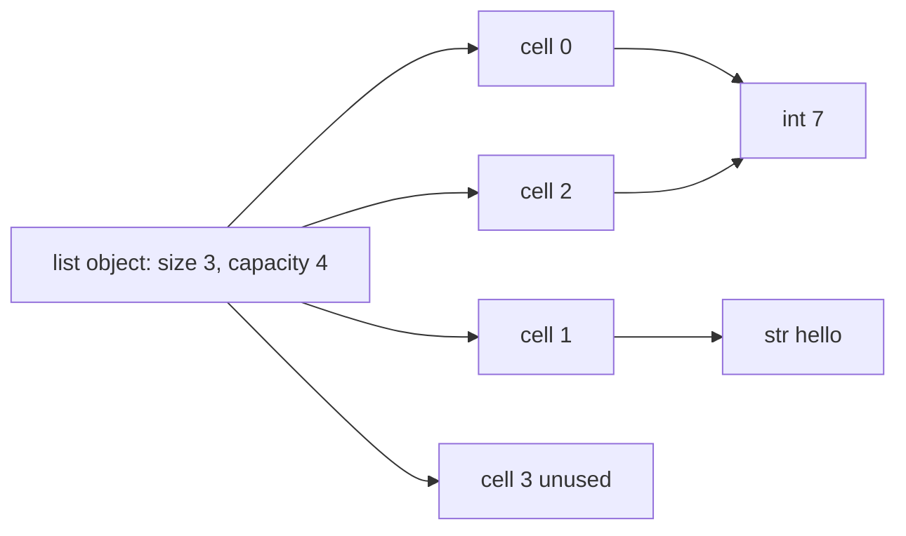
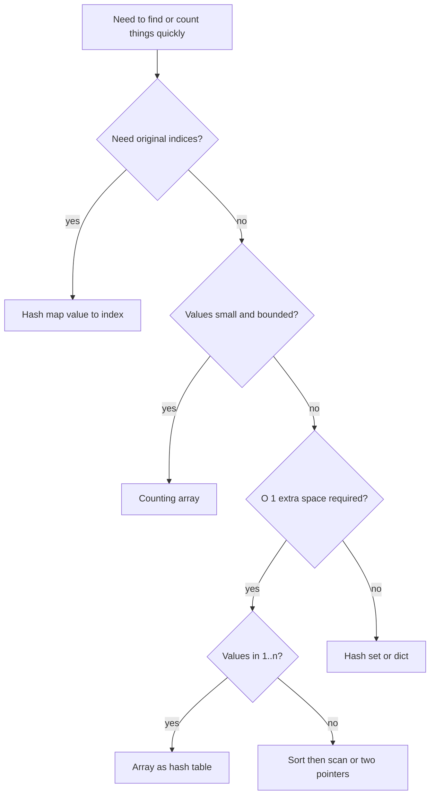

# The Arrays & Hashing pattern

> **Before this lesson:** you should know Python lists, loops and functions, and have read [How to approach an interview problem](#/lesson/neet-arrays/approach), which introduces Big-O notation (`O(n)` = work proportional to the input size `n`). A deeper treatment of Big-O is in [Big-O, Big-Omega and Big-Theta](#/lesson/dsa-foundations/asymptotic-notation).

## In plain words

An **array** is a row of numbered boxes, like a street of houses with house numbers: if you know the number, you can walk straight to the house. A Python **list** is an array.

A **hash map** (in Python: a `dict`, short for dictionary) is like the index at the back of a book. Instead of reading every page to find "giraffe", you look the word up and it tells you the page immediately. A **hash set** (Python `set`) is the same idea when you only care *whether* something is present — like a guest list at a door.

The pattern in this lesson is one sentence long: **when your program keeps searching through a list for something, build an index (a set or dict) once and look things up instead.** You pay with some extra memory and get a large speed-up.

Why it matters for a job: this is the single most common trick in interview questions, and real programs use it constantly — caches, databases and de-duplication all rest on it.

Terms used below, defined once:

- **Index**: the position number of an item in a list; Python counts from 0, so `a[0]` is the first item.
- **Key / value**: in a dict, the *key* is what you look up (the word) and the *value* is what you get back (the page number).
- **Time complexity** and **space complexity**: how the running time and the extra memory grow with the input size, written in Big-O.
- **Amortised**: averaged over a long run of operations — a few may be slow as long as the average is fast.
- **In place**: changing the list you were given instead of building a new one.
- **Reference** (or pointer): a note saying where an object lives in memory, as opposed to the object itself.

The first group on the NeetCode roadmap is called *Arrays & Hashing*, and it is the foundation for almost
everything after it. The core trade is simple: **spend memory to avoid repeated searching**. Instead of
scanning the array again and again to answer "is X here?", "how many X's?" or "where was X?", you build a
hash set or hash map once and answer each question in O(1) average time.

To use this pattern well you need two kinds of knowledge: what Python's arrays (lists) actually cost, and
the handful of hash-map templates that solve dozens of problems. This lesson covers both.

## Part 1 — Arrays in Python

### Low-level arrays

In memory, an **array** is a contiguous block of equally sized cells. Because every cell has the same
size, the address of cell `i` is `start + i * cell_size` — that's why indexing is **O(1)** no
matter how long the array is. Goodrich et al. (ch. 5) stress that this constant-time address arithmetic
is the defining property of array-based sequences.

Python's `list` is a **referential array**: each cell holds a *reference* (pointer) to an object stored
elsewhere, not the object itself. That's why a single list can hold ints, strings and other lists at the
same time — every cell is a pointer of the same size.



Two consequences you'll meet in interviews:

- `[[0] * 3] * 3` creates **three references to the same inner list**. Changing one row changes all three.
  Build 2-D grids with a comprehension: `[[0] * 3 for _ in range(3)]`.
- Copying a list with `nums[:]` or `list(nums)` is a **shallow copy** — the new list points to the same
  element objects.

For compact numeric storage Python also has `array.array` and (outside the standard library) NumPy
arrays, which store raw values rather than references — that's why NumPy is so much faster for numeric
work.

### Dynamic arrays and amortised appends

A raw array has a fixed capacity. Python lists grow automatically using the **dynamic array** strategy:
keep some spare capacity; when it runs out, allocate a bigger block (CPython grows by roughly 1/8 plus a
constant; textbook versions double), copy everything over, and free the old one.

A single resize costs O(n), but it happens rarely. Goodrich et al. prove with an amortisation argument
that a sequence of `n` appends costs O(n) total when the capacity grows geometrically, so each `append`
is **O(1) amortised**. If the array grew by a constant amount instead (say +10 cells), n appends would cost
O(n²) in total.

You can watch CPython's over-allocation happen:

```python-run
import sys
data = []
last = sys.getsizeof(data)
print(f"len=0  bytes={last}")
for k in range(40):
    data.append(None)
    size = sys.getsizeof(data)
    if size != last:
        print(f"len={len(data):3d}  bytes={size}  (resized)")
        last = size
```

The byte count jumps only occasionally — between jumps, appends fill slots that were already allocated.

### Cost of common list operations

| Operation | Cost | Why |
|---|---|---|
| `a[i]`, `a[i] = x`, `len(a)` | O(1) | address arithmetic / stored size |
| `a.append(x)` | O(1) amortised | spare capacity, occasional resize |
| `a.pop()` | O(1) | remove from the end |
| `a.pop(0)`, `a.insert(0, x)` | **O(n)** | every element shifts by one |
| `a.insert(i, x)`, `del a[i]` | O(n − i) | elements after `i` shift |
| `x in a`, `a.index(x)`, `a.count(x)` | **O(n)** | linear scan |
| `a[i:j]` | O(j − i) | builds a new list |
| `a + b` | O(len(a) + len(b)) | new list |
| `a.sort()`, `sorted(a)` | O(n log n) | Timsort |
| `min(a)`, `max(a)`, `sum(a)` | O(n) | full scan |
| `a.reverse()`, `a[::-1]` | O(n) | |

> [!WARNING]
> The silent killers are `x in some_list` and `some_list.pop(0)` inside a loop: each is O(n), so the loop
> becomes O(n²). Replace the first with a `set`, the second with `collections.deque`.

Strings are immutable arrays of characters. `s += c` in a loop may copy the whole string each time
(CPython sometimes optimises it, but don't rely on that); collect pieces in a list and `"".join(...)` once.

## Part 2 — Hash sets and hash maps

A Python `set` stores unique hashable values; a `dict` maps hashable keys to values. Both are hash
tables (the next lesson opens them up). For pattern purposes, remember:

| Operation | set | dict | Average | Worst |
|---|---|---|---|---|
| membership `x in s` | ✓ | ✓ (keys) | O(1) | O(n) |
| insert `s.add(x)` / `d[k] = v` | ✓ | ✓ | O(1) | O(n) |
| delete | ✓ | ✓ | O(1) | O(n) |
| iterate | ✓ | ✓ | O(n) | O(n) |

The worst case only happens with pathological collisions; in interviews you quote O(1) average.

Keys must be **hashable** — immutable built-ins such as `int`, `str`, `tuple` (of hashables) and
`frozenset`. Lists, sets and dicts can't be keys; convert with `tuple(...)` or `frozenset(...)`.

Useful helpers from `collections`:

- `Counter(iterable)` — a dict of counts; `most_common(k)`; supports `+`, `-`, `==`.
- `defaultdict(list)` / `defaultdict(int)` — missing keys spring into existence with a default.
- `OrderedDict` — mostly unnecessary now (plain dicts keep insertion order since Python 3.7) but has
  `move_to_end`, handy for LRU caches.

## Part 3 — The templates

Almost every Arrays & Hashing problem is one of six templates. Learn them as reflexes.

### Template 1: "Have I seen this before?" (set)

```python
seen = set()
for x in nums:
    if x in seen:
        ...            # duplicate found
    seen.add(x)
```

Line by line, since this is the first template:

- `seen = set()` creates an empty set — the "guest list" of values met so far.
- `for x in nums:` visits each value of the list once, left to right.
- `if x in seen:` asks the set whether `x` was met earlier. For a set this takes about the same time whether it holds ten values or ten million.
- `seen.add(x)` records `x`, so later items can find it.

For `nums = [1, 2, 3, 1]` the set grows `{1}`, `{1, 2}`, `{1, 2, 3}`; at the last item, `1 in seen` is true, so a duplicate has been found.

Problems: *Contains Duplicate*, *Longest Consecutive Sequence* (membership of `x - 1` / `x + 1`),
*Valid Sudoku* (one set per row/col/box), cycle detection in *Happy Number*.

### Template 2: Complement lookup (dict value → index)

```python
pos = {}
for i, x in enumerate(nums):
    if target - x in pos:          # check BEFORE inserting
        return [pos[target - x], i]
    pos[x] = i
```

Line by line:

- `pos = {}` creates an empty dict that will map a value to the index where it was seen.
- `enumerate(nums)` hands out pairs `(i, x)`: the index and the value at that index.
- `target - x` is the **complement** — the only value that could pair with `x`.
- `if target - x in pos:` asks whether that complement has already been seen; if so, `pos[target - x]` is its index and the pair is complete.
- `pos[x] = i` runs only if no pair was found: remember `x` for the items still to come.

The key insight: for each element, the partner you need is *determined*. Instead of searching for it,
look it up. Problems: *Two Sum*, *Subarray Sum Equals K* (complement of a prefix sum), *4Sum II*.

### Template 3: Frequency counting

```python
count = {}
for x in nums:
    count[x] = count.get(x, 0) + 1
# or: count = collections.Counter(nums)
```

Problems: *Valid Anagram*, *Top K Frequent Elements*, *Majority Element*, *Ransom Note*, *First Unique
Character*. When the alphabet is small and known (26 lowercase letters), a `[0] * 26` list is faster and
O(1) space.

### Template 4: Grouping by a canonical key

```python
groups = collections.defaultdict(list)
for item in items:
    groups[canonical(item)].append(item)
return list(groups.values())
```

The design work is choosing `canonical` so that items which "belong together" produce *equal* keys and
others don't. For anagrams: sorted letters, or a tuple of 26 counts. For shifted strings: the tuple of
letter differences. For points on a line: the reduced slope.

### Template 5: Index map / last-seen position

```python
last = {}
for i, x in enumerate(nums):
    if x in last and i - last[x] <= k:
        return True                 # nearby duplicate
    last[x] = i
```

Problems: *Contains Duplicate II*, the "start of window" bookkeeping in *Longest Substring Without
Repeating Characters* (sliding window track).

### Template 6: The array as its own hash table

When values lie in `1..n` (or `0..n-1`) and the problem demands O(1) extra space, the **index** can act as
the key: put value `v` at index `v - 1` (cyclic sort), or mark presence by negating `nums[v - 1]`.
Problems: *First Missing Positive*, *Find All Numbers Disappeared*, *Find the Duplicate Number*.

```python-run
# Template 6 demo: mark presence by negation (values in 1..n)
nums = [4, 3, 2, 7, 8, 2, 3, 1]
for x in nums:
    i = abs(x) - 1
    if nums[i] > 0:
        nums[i] = -nums[i]
missing = [i + 1 for i, v in enumerate(nums) if v > 0]
print("missing values:", missing)   # [5, 6]
```

## Choosing between hashing and sorting

Many problems can be solved either by hashing (O(n) time, O(n) space) or by sorting first (O(n log n)
time, O(1) extra space if you may sort in place). Sorting is the better answer when:

- memory is constrained, or
- you need ordered output anyway, or
- the next step is two pointers (pairs/triples summing to a target with *unique* results).

Hashing is better when you need original indices (sorting destroys them) or a strict O(n) bound.



## Decision checklist

Before coding an array problem, run through these questions:

1. **Does the brute force re-scan the array for each element?** → a set/dict lookup can replace the scan.
2. **Is the partner of each element determined by a formula** (target − x, x − 1, prefix − k)? → complement lookup.
3. **Do I need counts?** → `Counter` or a fixed-size count array.
4. **Do items need to be bucketed by some property?** → canonical key + `defaultdict(list)`.
5. **Do I need sums of ranges?** → prefix sums (lesson 4).
6. **Are values bounded by n and is O(1) space required?** → index-as-key tricks.
7. **Is the input sorted, or can I sort it?** → maybe two pointers instead (module 2).

## Worked example: Two Sum, three ways

```python-run
import time, random

def two_sum_brute(nums, target):          # O(n^2)
    for i in range(len(nums)):
        for j in range(i + 1, len(nums)):
            if nums[i] + nums[j] == target:
                return [i, j]

def two_sum_sort(nums, target):           # O(n log n), keeps indices by sorting pairs
    pairs = sorted((x, i) for i, x in enumerate(nums))
    l, r = 0, len(pairs) - 1
    while l < r:
        s = pairs[l][0] + pairs[r][0]
        if s == target:
            return sorted([pairs[l][1], pairs[r][1]])
        if s < target: l += 1
        else: r -= 1

def two_sum_hash(nums, target):           # O(n)
    seen = {}
    for i, x in enumerate(nums):
        if target - x in seen:
            return [seen[target - x], i]
        seen[x] = i

n = 3000
nums = list(range(n))
target = (n - 1) + (n - 2)
for f in (two_sum_brute, two_sum_sort, two_sum_hash):
    t = time.perf_counter()
    res = f(nums, target)
    print(f"{f.__name__:14s} {res}  {1000*(time.perf_counter()-t):8.2f} ms")
```

All three are correct; their running times differ by orders of magnitude.

## Common bugs

> [!WARNING]
> - **Inserting before checking** in complement lookups (pairs an element with itself).
> - **Mutable keys**: `d[[1,2]] = ...` raises `TypeError`; use `tuple`.
> - **`[[0]*m]*n`** aliasing rows.
> - **Counting with a set** — sets forget multiplicity (`"aab"` vs `"abb"`).
> - **`x in list` inside a loop** — accidental O(n²).
> - **Modifying a dict while iterating** over it — `RuntimeError`; iterate over `list(d)` instead.
> - **Weak keys**: sums or sets of characters as "fingerprints" collide.

## Summary

- Python lists are dynamic referential arrays: O(1) indexing and amortised O(1) `append`, but O(n)
  insertion/removal at the front and O(n) membership tests.
- Sets and dicts give O(1) average membership, insert and delete — the essence of this pattern.
- Six templates cover most problems: seen-set, complement lookup, counting, canonical-key grouping,
  last-seen index, and array-as-hash-table.
- Sorting is the main alternative: slower by a log factor but lighter on memory.

> **Source:** Goodrich, Tamassia & Goldwasser, *Data Structures and Algorithms in Python*, ch. 5
> (§5.2 low-level and referential arrays, §5.3 dynamic arrays and amortisation, §5.4 efficiency of
> Python's sequence types) and ch. 10 (§10.1 maps). NeetCode roadmap, Arrays & Hashing.

## Glossary

| Term | Meaning |
|---|---|
| **Array** | a contiguous row of equal-sized cells addressed by index. |
| **Referential array** | an array whose cells hold references (pointers) to objects, like a Python list. |
| **Dynamic array** | an array that grows automatically by copying into a larger block when full. |
| **Amortised O(1)** | constant time on average over many operations, even if a few are slow. |
| **Hash set / hash map** | collections giving O(1) average membership tests and key lookups (`set`, `dict`). |
| **Hashable** | usable as a dict key or set member; in practice, immutable. |
| **Complement** | the value that completes a pair, e.g. target − x. |
| **Canonical key** | one agreed form shared by all items that belong in the same group. |
| **Shallow copy** | a new list that refers to the same element objects. |
| **Frequency count** | a table of how many times each value occurs. |

## Check yourself

```quiz
[
  {"q": "Why is indexing a Python list O(1)?", "options": ["Python caches recent lookups", "Cell i's address is computed directly from the start address and i", "Lists are hash tables", "Lists are sorted"], "answer": 1,
   "explain": "Arrays store equally sized cells contiguously, so address = start + i × cell size."},
  {"q": "What is the cost of nums.pop(0) on a list of n elements?", "options": ["O(1)", "O(log n)", "O(n)", "O(n log n)"], "answer": 2,
   "explain": "All remaining elements shift left by one. Use collections.deque.popleft() for O(1)."},
  {"q": "Why is list.append O(1) amortised rather than O(1) worst case?", "options": ["Occasionally the list must be copied into a larger array", "Python checks for duplicates", "It sorts the list", "Garbage collection"], "answer": 0,
   "explain": "Resizes cost O(n) but happen geometrically rarely, so the average per append is constant."},
  {"q": "Which can be a dict key?", "options": ["[1, 2]", "{1, 2}", "(1, 2)", "{1: 2}"], "answer": 2,
   "explain": "Only hashable (immutable) objects can be keys; tuples of hashables qualify."},
  {"q": "In Two Sum's dict solution, why check for the complement before inserting the current value?", "options": ["It's faster", "Otherwise an element could pair with itself", "Dicts can't hold duplicates", "To keep indices sorted"], "answer": 1,
   "explain": "If target = 2x, inserting x first would immediately 'find' x at the same index."},
  {"q": "What does grid = [[0]*3]*3; grid[0][0] = 1 produce?", "options": ["Only grid[0][0] is 1", "The first column is all 1", "Every row's first cell is 1 because rows are the same object", "An error"], "answer": 2,
   "explain": "The outer * copies references to one inner list."},
  {"q": "You need pairs summing to a target with original indices, in O(n). Best tool?", "options": ["Sort + two pointers", "Dict value → index", "Counting array", "Binary search"], "answer": 1,
   "explain": "Sorting loses indices (unless you sort pairs) and costs O(n log n)."}
]
```
