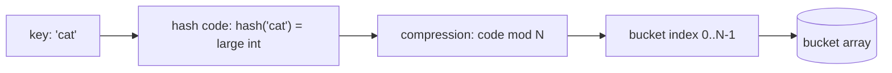
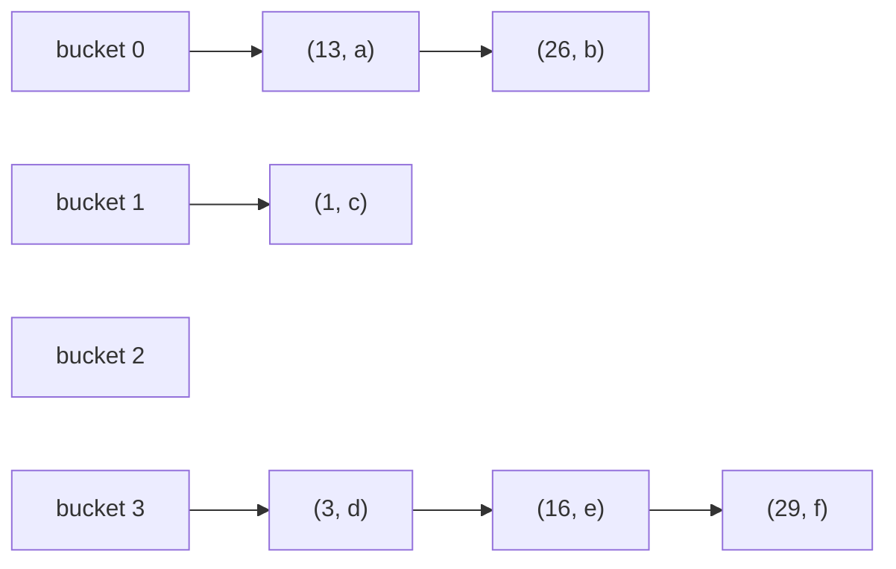

# Inside dict and set: hashing, collisions, resizing

> **Before this lesson:** you should have used Python `dict` and `set` and understand why looking something up in them is fast in practice — see [The Arrays & Hashing pattern](#/lesson/neet-arrays/arrays-hashing). You should also know what a list index is and what Big-O notation means ([How to approach an interview problem](#/lesson/neet-arrays/approach)).

## In plain words

A hash table is how `dict` and `set` are built inside. Picture a cloakroom with 100 numbered hooks. When you hand over your coat, the attendant does a quick calculation on your name — say, "add up the letters and keep the last two digits" — and hangs the coat on that hook number. When you come back, they redo the same calculation and walk straight to the hook. Nobody searches the whole room.

That calculation is a **hash function**: a rule that turns any piece of data into a number. The hooks are **buckets**: the slots of an ordinary array. Sometimes two names give the same hook number; that is a **collision**, and the cloakroom needs a rule for it — hang both coats on the same hook, or use the next free hook.

Why it matters for a job: interviewers often follow "use a dict" with "and how does a dict work?". Knowing the inside also explains everyday rules, such as why a list cannot be used as a dict key.

Terms used below, defined once:

- **Hash code**: the number a hash function produces for a piece of data.
- **Bucket array**: the underlying array of slots.
- **Load factor**: how full the table is — number of stored items divided by number of buckets.
- **Rehashing / resizing**: moving everything into a bigger bucket array when the table gets too full.
- **Immutable**: cannot be changed after creation (a Python `str` or `tuple`); **mutable** means it can (a `list`).
- **Modulo**, written `%` in Python and "mod" in maths: the remainder after division, e.g. `17 % 5` is `2`.
- **XOR** ("exclusive or", `^` in Python): a bit-by-bit operation giving 1 where two bits differ.
- **CPython**: the standard Python interpreter, the program that runs your Python code.

You can solve many problems treating `dict` and `set` as magic O(1) boxes. But interviewers love to ask
*why* they are O(1), *when* they are not, and *what makes a good hash function*. Knowing the internals
also explains practical rules — why lists can't be keys, why `hash(5) == hash(5.0)`, and why worst-case
complexity is O(n). This lesson builds a hash table from scratch and then compares it with CPython's.

## From lookup tables to hash tables

Suppose every key were an integer between 0 and N − 1. You could store the value for key `k` in cell `k`
of an array of length N — a **lookup table** — and every operation would be O(1) in the worst case.
Goodrich et al. start chapter 10 exactly here, then note the two obstacles:

1. The key range may be enormous (all 64-bit integers, all strings), far bigger than the number of items.
2. Keys need not be integers at all.

A **hash table** fixes both. It keeps an array of N **buckets** (N small, proportional to the number of
items) and uses a **hash function** `h(k)` to map any key to a bucket index in `[0, N − 1]`. Store the item
in bucket `h(k)`; to look it up later, compute `h(k)` again and look there.



When two different keys land in the same bucket we have a **collision**. Collisions are unavoidable
(infinitely many keys, finitely many buckets) — what matters is keeping them rare and handling them well.

## Hash functions: hash code + compression

It is convenient to split the hash function into two stages.

### Stage 1: the hash code

The **hash code** turns a key into an integer (any size, possibly negative). The requirement is
consistency: **equal keys must have equal hash codes**. The goal is spread: unequal keys should *usually*
get different codes.

Ideas for building hash codes, from simplest to best:

- **Use the bits directly.** An integer can be its own hash code. CPython does nearly this:
  `hash(42) == 42`.
- **Sum or XOR components.** For a tuple of parts, add or XOR their codes. Cheap, but *order-blind*:
  summing character codes makes `"stop"`, `"tops"`, `"pots"` and `"spot"` collide.
- **Polynomial hash codes.** Treat the components as coefficients of a polynomial evaluated at a
  constant `a`:

  $$h(x_0 x_1 \dots x_{n-1}) = x_0 a^{n-1} + x_1 a^{n-2} + \dots + x_{n-2} a + x_{n-1}$$

  computed efficiently by Horner's rule. Now position matters. Goodrich et al. report that choosing `a`
  as 33, 37, 39 or 41 produced fewer than 7 collisions over a list of 50,000 English words.
- **Cyclic-shift hash codes.** Replace the multiplication with a bitwise rotation of the running value
  (e.g. 5 bits) before adding the next character — similar mixing, very cheap in hardware.

```python-run
def sum_hash(s):
    return sum(ord(c) for c in s)

def poly_hash(s, a=33, mask=(1 << 32) - 1):
    h = 0
    for c in s:
        h = (h * a + ord(c)) & mask        # Horner's rule, truncated to 32 bits
    return h

def cyclic_hash(s, mask=(1 << 32) - 1):
    h = 0
    for c in s:
        h = ((h << 5) & mask) | (h >> 27)  # 5-bit cyclic shift
        h = (h + ord(c)) & mask
    return h

words = ["stop", "tops", "pots", "spot", "opts", "post"]
for f in (sum_hash, poly_hash, cyclic_hash):
    codes = [f(w) for w in words]
    print(f"{f.__name__:12s} distinct codes: {len(set(codes))} of {len(words)}")
```

### Stage 2: the compression function

The hash code may be huge or negative, so it is **compressed** into `[0, N − 1]`:

- **Division method:** `i mod N`. Choosing N prime helps break up patterns. Goodrich's example: codes
  {200, 205, 210, …, 600} in a table of size 100 collide heavily, but with size 101 they don't collide at
  all.
- **MAD (multiply-add-divide):** `((a·i + b) mod p) mod N` with a prime `p > N` and random `a`, `b`. It
  scrambles regular patterns so that keys behave almost as if thrown into buckets at random.
- **Power-of-two masking:** `i & (N − 1)` when N is a power of two. Very fast; it only uses the low bits,
  so it relies on the hash code having well-mixed low bits (CPython's approach, combined with a probing
  sequence that brings in the high bits).

Splitting the two stages has a practical advantage: the hash code doesn't depend on the table size, so
when the table is resized only the cheap compression step changes.

## Collision handling

### Separate chaining

Each bucket holds a small secondary container — a list of `(key, value)` pairs. Insert appends to the
bucket's list (after checking the key isn't already there); search scans that list.



If `n` items are spread over `N` buckets by a good hash function, the expected bucket length is the
**load factor** $\lambda = n / N$. Operations cost O(1 + λ), so keeping λ bounded by a constant (Goodrich
suggests below about 0.9 for chaining) makes them O(1) expected.

### Open addressing

Store items **directly in the array** — no secondary lists. On a collision, *probe* other cells in a
deterministic order until you find the key or an empty cell:

- **Linear probing:** try `j, j+1, j+2, …` (mod N). Simple and cache-friendly, but items clump into long
  runs (**primary clustering**), slowing everything near them.
- **Quadratic probing:** try `j + 1², j + 2², …`. Avoids primary clustering but creates *secondary*
  clustering; guaranteed to find a free slot only if N is prime and the table is less than half full.
- **Double hashing:** step size from a second hash function, `j + i·h'(k)`, with `h'(k) ≠ 0`.
- **Pseudo-random probing:** the next probe depends on the bits of the hash code through a fixed
  recurrence — CPython's choice.

Deletion is trickier with open addressing: emptying a cell would break the probe chain for keys
inserted after it. Instead the cell is marked with a special **tombstone** ("deleted/available") that
searches skip over but inserts may reuse.

Open addressing degrades sharply as λ → 1, so these tables keep λ lower — below 0.5 for linear probing
in Goodrich's recommendation, and **below 2/3** in CPython's dict.

## Resizing (rehashing)

When an insertion pushes λ above the threshold, the table allocates a bigger bucket array (at least
double) and reinserts every item using the new compression function. That single operation is O(n), but —
exactly like dynamic-array appends — it happens geometrically rarely, so insertions remain **O(1)
amortised**.

## Build one yourself

Here is a complete separate-chaining map with resizing. Run it, then experiment: shrink the table, use a
bad hash, and watch the longest chain grow.

```python-run
class ChainMap:
    def __init__(self, capacity=8, max_load=0.75):
        self._buckets = [[] for _ in range(capacity)]
        self._n = 0
        self._max_load = max_load

    def _index(self, key):
        return hash(key) % len(self._buckets)        # hash code + division compression

    def __setitem__(self, key, value):
        bucket = self._buckets[self._index(key)]
        for i, (k, _) in enumerate(bucket):
            if k == key:                              # equal key -> overwrite
                bucket[i] = (key, value)
                return
        bucket.append((key, value))
        self._n += 1
        if self._n / len(self._buckets) > self._max_load:
            self._resize(2 * len(self._buckets))

    def __getitem__(self, key):
        for k, v in self._buckets[self._index(key)]:
            if k == key:
                return v
        raise KeyError(key)

    def __contains__(self, key):
        try:
            self[key]
            return True
        except KeyError:
            return False

    def _resize(self, capacity):
        old = [item for bucket in self._buckets for item in bucket]
        self._buckets = [[] for _ in range(capacity)]
        self._n = 0
        for k, v in old:
            self[k] = v

    def stats(self):
        lengths = [len(b) for b in self._buckets]
        return f"n={self._n} buckets={len(lengths)} load={self._n/len(lengths):.2f} longest chain={max(lengths)}"

m = ChainMap()
for w in "the quick brown fox jumps over the lazy dog again and again".split():
    m[w] = m[w] + 1 if w in m else 1
print(m["again"], m["the"], "fox" in m, "cat" in m)
for i in range(10000):
    m[i] = i * i
print(m.stats())
```

## How CPython's dict really works

CPython's `dict` (since 3.6) uses **open addressing** with a compact layout:

- An **entries array** stores `(hash, key, value)` triples in **insertion order** — which is why dicts
  iterate in insertion order (guaranteed by the language since 3.7).
- A separate, sparse **index table** (a power-of-two size) holds small integers pointing into the
  entries array. Lookups hash into the index table, and on a collision follow a pseudo-random probe
  sequence: roughly `j = (5*j + 1 + perturb) mod 2^k`, where `perturb` starts as the full hash and is
  shifted right each step, gradually mixing in the high bits.
- The table is resized when it becomes about **2/3 full**.
- Each entry caches the full hash, so comparisons first check `hash == hash` (a cheap int compare) and
  only call `__eq__` if the hashes match.

`set` uses a similar open-addressing table (without values) with its own tuning, including a short
linear probe before jumping.

### Hash codes of built-in types

```python-run
print(hash(42), hash(-1), hash(2**61 - 1), hash(2**61))  # ints hash to themselves modulo a Mersenne prime (on 64-bit builds)
print(hash(5) == hash(5.0) == hash(True * 5))          # equal numbers hash equally
print(hash((1, 2)) == hash((1, 2)), hash((1, 2)) == hash((2, 1)))
print(hash(frozenset({1, 2})) == hash(frozenset({2, 1})))
try:
    hash([1, 2])
except TypeError as e:
    print("TypeError:", e)
```

Points worth knowing:

- **Integers** hash to themselves (reduced modulo $2^{61} - 1$ on 64-bit builds); `hash(-1)` is `-2`
  because `-1` is reserved as an error signal in the C API.
- **Numeric equality implies hash equality**: since `5 == 5.0 == True*5`, their hashes match, so `d[5]`
  and `d[5.0]` are the same key.
- **Strings and bytes** use SipHash with a **random per-process seed** (`PYTHONHASHSEED`). Your string
  hashes change between runs! This defends against *hash-flooding* attacks, where an adversary submits
  many keys crafted to collide and turns every O(1) operation into O(n).
- **Tuples** combine their elements' hashes in an order-sensitive way; **frozensets** combine them
  order-insensitively.
- **Mutable built-ins** (`list`, `dict`, `set`) are unhashable — if a key's contents (and thus hash)
  changed after insertion, it would sit in the wrong bucket forever.

### Hashing your own classes

User classes hash by identity by default. If you define `__eq__`, Python sets `__hash__` to `None`
(unhashable) unless you also define it. The contract is: **if `a == b` then `hash(a) == hash(b)`**.
Base the hash on the same immutable fields used for equality:

```python-run
class Point:
    def __init__(self, x, y):
        self.x, self.y = x, y
    def __eq__(self, other):
        return isinstance(other, Point) and (self.x, self.y) == (other.x, other.y)
    def __hash__(self):
        return hash((self.x, self.y))          # same fields as __eq__

seen = {Point(1, 2)}
print(Point(1, 2) in seen)   # True: equal objects, equal hashes
```

`@dataclass(frozen=True)` generates exactly this for you.

## When O(1) becomes O(n)

Average-case O(1) rests on the assumption that keys spread evenly. It fails when:

1. **The hash function is poor** (e.g. all keys hash to the same value).
2. **An adversary picks colliding keys** (hash flooding; mitigated by randomised string hashing — but
   *integers are not randomised*, which is why competitive-programming "anti-hash" tests target them in
   some languages).
3. **You hash expensive objects**: hashing a string of length L costs O(L) (CPython caches a string's hash
   after the first computation), and hashing a tuple of k items costs O(k). So "O(1)" dict operations on
   long keys are really O(L).

```python-run
import time

class BadKey:
    def __init__(self, v): self.v = v
    def __eq__(self, o): return self.v == o.v
    def __hash__(self): return 7               # every key collides!

for n in (500, 1000, 2000):
    t = time.perf_counter()
    s = set(BadKey(i) for i in range(n))
    bad = time.perf_counter() - t
    t = time.perf_counter()
    s2 = set(range(n))
    good = time.perf_counter() - t
    print(f"n={n:5d}  colliding: {bad*1000:8.1f} ms   normal: {good*1000:6.3f} ms")
```

Doubling `n` roughly quadruples the colliding time — a quadratic blow-up caused purely by the hash
function.

## Interview cheat sheet

| Question | Short answer |
|---|---|
| Why is dict lookup O(1)? | Hash the key to a bucket index; expected O(1) probes when the load factor is bounded. |
| Worst case? | O(n) if many keys collide. |
| How are collisions handled in CPython? | Open addressing with pseudo-random probing; resize at 2/3 full. |
| Chaining vs open addressing? | Chaining: simpler deletes, tolerates higher load. Open addressing: no extra lists, better cache locality, needs tombstones and lower load. |
| Why must keys be immutable? | The hash must not change while the key is in the table. |
| Why are string hashes different between runs? | Randomised seed to prevent hash-flooding DoS attacks. |
| Rule for custom `__hash__`? | Equal objects must have equal hashes; hash the same fields `__eq__` compares. |
| Is insertion O(1)? | Amortised O(1) — occasional O(n) resize. |

## Summary

- A hash function = hash code (key → integer) + compression (integer → bucket index).
- Good hash codes mix every part of the key and respect position (polynomial / cyclic shift).
- Collisions are handled by separate chaining or open addressing (linear, quadratic, double hashing,
  pseudo-random probing).
- The load factor λ = n/N controls performance; tables resize geometrically to keep λ small, giving O(1)
  amortised updates.
- CPython dicts: compact, insertion-ordered, open addressing, resize at 2/3; strings use randomised
  SipHash.

> **Source:** Goodrich, Tamassia & Goldwasser, *Data Structures and Algorithms in Python*, ch. 10
> (§10.2.1 hash functions, §10.2.2 collision handling, §10.2.3 load factors and rehashing, §10.2.4
> Python hash table implementation); CPython `Objects/dictobject.c` design notes; Python data model
> documentation for `__hash__`.

## Glossary

| Term | Meaning |
|---|---|
| **Hash function** | a rule mapping a key to a bucket index; made of a hash code plus a compression function. |
| **Hash code** | the integer computed from a key. |
| **Compression function** | the step that maps a hash code into the range 0..N−1. |
| **Bucket** | one slot of the table's underlying array. |
| **Collision** | two different keys landing in the same bucket. |
| **Separate chaining** | each bucket holds a small list of the items that landed there. |
| **Open addressing** | items live directly in the array; on a collision, other slots are probed. |
| **Probe** | one look at a slot while searching. |
| **Tombstone** | a marker left in a slot after deletion so later searches do not stop early. |
| **Load factor** | items ÷ buckets; how full the table is. |
| **Rehashing** | building a larger table and re-inserting every item. |
| **Hash flooding** | an attack that feeds many colliding keys to make a table slow. |

## Check yourself

```quiz
[
  {"q": "What is the load factor of a hash table?", "options": ["Number of collisions", "n / N: items divided by buckets", "Average key length", "Time per lookup"], "answer": 1,
   "explain": "λ = n/N; keeping it bounded keeps expected bucket sizes / probe lengths constant."},
  {"q": "Why does summing character codes make a poor string hash?", "options": ["It's too slow", "It ignores character order, so anagrams collide", "It can be negative", "It overflows"], "answer": 1,
   "explain": "'stop', 'tops', 'pots' all have the same sum. Polynomial hashing weights positions differently."},
  {"q": "Which collision strategy does CPython's dict use?", "options": ["Separate chaining with linked lists", "Open addressing with pseudo-random probing", "Balanced trees per bucket", "Cuckoo hashing"], "answer": 1,
   "explain": "It probes other slots following a perturbation-based recurrence."},
  {"q": "Why can't open addressing clear a cell on deletion and leave it empty?", "options": ["Memory leaks", "It breaks the probe chain for keys inserted later", "It changes the load factor", "Python forbids it"], "answer": 1,
   "explain": "A search would stop at the newly empty cell; tombstones keep chains intact."},
  {"q": "If a class defines __eq__ comparing (x, y), what should __hash__ return?", "options": ["id(self)", "hash((self.x, self.y))", "A random number", "0"], "answer": 1,
   "explain": "Equal objects must hash equally, so hash exactly the fields used for equality."},
  {"q": "Why do string hashes differ between Python runs?", "options": ["Bug", "Randomised seed to defend against hash-flooding attacks", "Strings are mutable", "Garbage collection"], "answer": 1,
   "explain": "PYTHONHASHSEED randomisation makes it hard to precompute colliding keys."},
  {"q": "Inserting n keys into a dict that doubles when full costs in total…", "options": ["O(n^2)", "O(n log n)", "O(n) expected", "O(1)"], "answer": 2,
   "explain": "Resizes cost n + n/2 + n/4 + … = O(n), so each insert is O(1) amortised."},
  {"q": "Which statement is true?", "options": ["hash(5) != hash(5.0)", "Lists are hashable if they contain ints", "d[5] and d[5.0] refer to the same entry", "Tuples are unhashable"], "answer": 2,
   "explain": "5 == 5.0, so Python guarantees equal hashes and treats them as the same key."}
]
```
