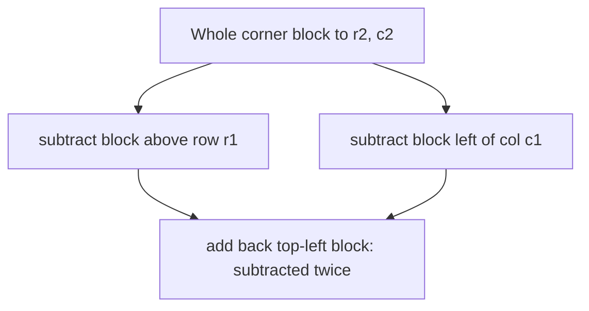

# Prefix sums, counting and bucket tricks

> **Before this lesson:** you should know how a dict is used to look values up and to count things — see [The Arrays & Hashing pattern](#/lesson/neet-arrays/arrays-hashing) — and what Big-O notation means ([How to approach an interview problem](#/lesson/neet-arrays/approach)).

## In plain words

Think of the distance markers along a motorway: each sign shows the total distance from the start. To find the distance between two towns you do not re-measure the road — you **subtract one sign from the other**. A **prefix sum** is that idea for a list of numbers: write down the running total after each item once, and any "sum of this stretch" becomes one subtraction.

The other two ideas in this lesson are about sorting things into pigeonholes. **Counting** means keeping a tally per possible value, like tally marks per candidate in an election. **Bucketing** means dropping each item into a numbered box according to some property (for example "how many times it occurs") so that the boxes are already in order.

Why it matters for a job: reports, dashboards and analytics constantly ask "what is the total between here and there?" and "what are the most common items?" — these tricks answer such questions fast.

Terms used below, defined once:

- **Subarray**: a run of neighbouring items in a list (no gaps), e.g. `[4, 1]` inside `[3, 4, 1, 5]`.
- **Prefix**: the first few items of a list; the *empty prefix* is "no items", whose sum is 0.
- **Range query**: a question about a stretch of the list, such as "the sum from index 2 to index 5".
- **Inclusive / exclusive**: whether the end position is counted. "2 to 5 inclusive" includes item 5.
- **Frequency**: how many times a value occurs.
- **Associative operation**: one where grouping does not matter, like `+` or `max`: `(a + b) + c == a + (b + c)`.

Hash maps trade memory for speed. This lesson covers three related trades that show up again and again in
array problems:

1. **Prefix sums** — precompute running totals once, then answer any range-sum question in O(1).
2. **Counting** — when values come from a small known range, a plain list of counters beats both sorting
   and hashing.
3. **Buckets** — group values by a bounded key (frequency, digit, value range) to sort or select in linear
   time.

All three replace "recompute from scratch for every query" with "compute once, look up many times".

## Part 1 — Prefix sums

### The idea

Given `nums = [a0, a1, …, a(n-1)]`, define the **prefix sum array** `P` of length `n + 1`:

$$P[0] = 0, \qquad P[i+1] = P[i] + a_i$$

so `P[i]` is the sum of the first `i` elements. Then the sum of any half-open slice is a difference of two
prefix sums:

$$\text{sum}(a_l, \dots, a_{r-1}) = P[r] - P[l]$$

and the inclusive range `l..r` is `P[r+1] - P[l]`.

| i | 0 | 1 | 2 | 3 | 4 | 5 |
|---|---|---|---|---|---|---|
| nums[i] | 3 | 1 | 4 | 1 | 5 | – |
| P[i] | 0 | 3 | 4 | 8 | 9 | 14 |

Sum of `nums[1..3]` (1 + 4 + 1) = `P[4] - P[1]` = 9 − 3 = 6.

The leading `0` (the **empty prefix**) is what makes ranges starting at index 0 work without special
cases. Forgetting it is the single most common prefix-sum bug.

```python-run
from itertools import accumulate

nums = [3, 1, 4, 1, 5, 9, 2, 6]
P = [0] + list(accumulate(nums))          # P[i] = sum(nums[:i])
print("P =", P)

def range_sum(l, r):                       # inclusive l..r
    return P[r + 1] - P[l]

for l, r in [(0, 0), (1, 3), (0, 7), (4, 6)]:
    assert range_sum(l, r) == sum(nums[l:r + 1])
    print(f"sum(nums[{l}..{r}]) = {range_sum(l, r)}")
```

Building `P` costs O(n); each query costs O(1). For q queries that's O(n + q) instead of O(n·q).

### Prefix sums + hash map: counting subarrays

The most important combination in this module. To count subarrays summing to `k`:

- A subarray `nums[i..j]` sums to `k` exactly when `P[j+1] − P[i] = k`, i.e. `P[i] = P[j+1] − k`.
- Walk left to right maintaining the current prefix `total`. The number of good subarrays **ending here**
  is the number of earlier prefixes equal to `total − k`.
- Keep those counts in a dict, **seeded with `{0: 1}`** for the empty prefix.

```python
def subarray_sum(nums, k):
    seen = {0: 1}
    total = count = 0
    for x in nums:
        total += x
        count += seen.get(total - k, 0)      # look up first
        seen[total] = seen.get(total, 0) + 1 # then record
    return count
```

This is *Two Sum* applied to prefix sums. It works with **negative numbers**, unlike a sliding window,
because it never assumes that extending a window increases the sum.

Variants of the same trick:

| Problem | What you store in the dict |
|---|---|
| Subarray Sum Equals K | count of each prefix sum |
| Continuous Subarray Sum (multiple of k) | earliest index of each `prefix % k` |
| Subarray Sums Divisible by K | count of each `prefix % k` |
| Contiguous Array (equal 0s and 1s) | earliest index of each prefix (0 counted as −1) |
| Longest subarray with sum k | earliest index of each prefix |

### Prefix products and prefix maxima

The idea isn't limited to addition. Any associative "running" operation works:

- **Prefix/suffix products** give *Product of Array Except Self*: answer = product of everything left ×
  product of everything right, with no division.
- **Prefix/suffix maxima** give *Trapping Rain Water*: water above bar i = min(max left, max right) −
  height. And a single suffix maximum gives *Replace Elements with Greatest Element on Right*.

```python-run
from itertools import accumulate
import operator

nums = [1, 2, 3, 4]
left = [1] + list(accumulate(nums, operator.mul))[:-1]          # product of elements before i
right = (list(accumulate(nums[::-1], operator.mul))[:-1][::-1]) + [1]
print("left :", left)
print("right:", right)
print("except self:", [a * b for a, b in zip(left, right)])
```

(Subtraction only "undoes" sums. Products, maxima and minima can't be undone in general, so for them you
combine a prefix with a *suffix* instead of subtracting two prefixes.)

### 2-D prefix sums

For a matrix, let `P[r][c]` be the sum of the rectangle from `(0, 0)` to `(r−1, c−1)`, with an extra row
and column of zeros. Inclusion–exclusion gives both the build rule and the query:

$$P[r+1][c+1] = M[r][c] + P[r][c+1] + P[r+1][c] - P[r][c]$$

$$\text{sum}(r_1..r_2, c_1..c_2) = P[r_2+1][c_2+1] - P[r_1][c_2+1] - P[r_2+1][c_1] + P[r_1][c_1]$$



```python-run
M = [[3, 0, 1, 4, 2],
     [5, 6, 3, 2, 1],
     [1, 2, 0, 1, 5],
     [4, 1, 0, 1, 7],
     [1, 0, 3, 0, 5]]
R, C = len(M), len(M[0])
P = [[0] * (C + 1) for _ in range(R + 1)]
for r in range(R):
    for c in range(C):
        P[r + 1][c + 1] = M[r][c] + P[r][c + 1] + P[r + 1][c] - P[r][c]

def region(r1, c1, r2, c2):
    return P[r2 + 1][c2 + 1] - P[r1][c2 + 1] - P[r2 + 1][c1] + P[r1][c1]

print(region(2, 1, 4, 3), region(1, 1, 2, 2), region(1, 2, 2, 4))   # 8 11 12
```

### Difference arrays (the inverse trick)

Prefix sums turn "many range *queries*" into O(1) each. The inverse — **difference arrays** — turns many
range *updates* into O(1) each. To add `v` to every element in `l..r`, do `D[l] += v; D[r+1] -= v`; after
all updates, the prefix sum of `D` gives the final array. This solves *Car Pooling*, *Corporate Flight
Bookings* and "how many intervals cover each point" problems.

```python-run
n = 8
D = [0] * (n + 1)
for l, r, v in [(1, 3, 5), (2, 6, 1), (0, 0, 2)]:
    D[l] += v
    D[r + 1] -= v
arr, run = [], 0
for i in range(n):
    run += D[i]
    arr.append(run)
print(arr)   # [2, 5, 6, 6, 1, 1, 1, 0]
```

## Part 2 — Counting

### Count arrays

When every value comes from a small known universe — 26 letters, digits 0–9, colours 0–2, ages 0–150 — a
list of counters indexed by value is the fastest possible "hash map": no hashing, no collisions, constant
space with respect to n.

```python
count = [0] * 26
for ch in s:
    count[ord(ch) - ord('a')] += 1
```

Uses: *Valid Anagram* (compare count arrays), *Group Anagrams* (count tuple as key), *Find All Anagrams*
(sliding count array), *Ransom Note*, *Sort Colors* (count then overwrite).

### Counting sort

If keys are integers in `0..K`, you can sort in **O(n + K)** — beating the O(n log n) lower bound for
comparison sorts, because counting sort never compares elements:

```python-run
def counting_sort(nums, K):
    count = [0] * (K + 1)
    for x in nums:
        count[x] += 1
    out = []
    for v, c in enumerate(count):
        out.extend([v] * c)
    return out

print(counting_sort([3, 0, 2, 3, 1, 0, 0, 2], 3))
```

This is only a good idea when `K` is not much larger than `n`. Sorting ten numbers in `0..10^9` with a
billion counters is absurd.

A *stable* version (needed when sorting records by a key, and for radix sort) turns the counts into
prefix sums giving each key's starting output position — another use of prefix sums!

### Boyer–Moore voting

Counting doesn't always need a table. If you know one value occupies **more than half** the array, a single
candidate plus a counter finds it in O(1) space: each non-matching element "cancels" one vote; the
majority can't be fully cancelled. Generalised, k − 1 candidates find all values with more than n/k
occurrences (with a verification pass). See *Majority Element*.

## Part 3 — Buckets

### Bucket by frequency: top-k in O(n)

Frequencies are integers between 1 and n. So after counting, place each value in `buckets[freq]` and scan
the buckets from high to low:

```python-run
from collections import Counter

def top_k(nums, k):
    count = Counter(nums)
    buckets = [[] for _ in range(len(nums) + 1)]
    for x, f in count.items():
        buckets[f].append(x)
    res = []
    for f in range(len(buckets) - 1, 0, -1):
        for x in buckets[f]:
            res.append(x)
            if len(res) == k:
                return res
    return res

print(top_k([1, 1, 1, 2, 2, 3, 4, 4, 4, 4], 2))   # [4, 1]
```

Compare the alternatives for top-k:

| Method | Time | Space | Notes |
|---|---|---|---|
| sort by count | O(n log n) | O(n) | simplest |
| heap of size k | O(n log k) | O(n) | best when k ≪ n, streaming |
| bucket by frequency | O(n) | O(n) | needs bounded frequencies |
| quickselect | O(n) average | O(n) | O(n²) worst case |

### Bucket by value range

Buckets also appear when you only care about *closeness*: putting each number in bucket `x // w` means two
numbers within distance `w − 1` are in the same or adjacent buckets (*Contains Duplicate III*, *Maximum
Gap*). And **radix sort** is repeated stable bucketing by digit.

### The array as its own buckets

When values are in `1..n` and O(1) space is required, the array's own indices serve as buckets: move value
`v` to index `v − 1` (cyclic sort) or flip the sign of `nums[v − 1]` to mark "seen". That's the core of
*First Missing Positive*: the answer must lie in `1..n+1`, so only those values matter.

```python-run
def first_missing_positive(nums):
    n = len(nums)
    for i in range(n):
        while 1 <= nums[i] <= n and nums[nums[i] - 1] != nums[i]:
            j = nums[i] - 1
            nums[i], nums[j] = nums[j], nums[i]
    for i in range(n):
        if nums[i] != i + 1:
            return i + 1
    return n + 1

for case in ([1, 2, 0], [3, 4, -1, 1], [7, 8, 9, 11, 12], [1, 1]):
    print(case, "->", first_missing_positive(list(case)))
```

Why is the nested loop O(n)? Every successful swap puts one value at its final home, where it never moves
again — so there are at most n swaps in total across all iterations of the outer loop.

## Decision checklist

- **Many range-sum queries on a fixed array?** → prefix sums (1-D or 2-D).
- **Count / find subarrays with a given sum, negatives allowed?** → prefix sums + dict of counts, seeded `{0: 1}`.
- **"Everything except i"?** → prefix × suffix.
- **Many range updates, then read everything?** → difference array.
- **Values in a small range?** → count array / counting sort.
- **Top-k by frequency?** → bucket by frequency (or heap).
- **Values in 1..n, O(1) space?** → array indices as buckets.
- **Guaranteed majority?** → Boyer–Moore voting.

## Common bugs

> [!WARNING]
> - Missing the empty prefix (`P[0] = 0`, or `{0: 1}` in the dict) — subarrays starting at index 0 vanish.
> - Inclusive/exclusive confusion: inclusive `l..r` is `P[r+1] − P[l]`.
> - Recording the current prefix *before* looking up `total − k` — with `k = 0` that counts empty subarrays.
> - Sliding windows on arrays with negative numbers — the window-shrinking logic is invalid.
> - Bucket arrays of size n instead of n + 1 (a value can occur n times).
> - Counting sort over a huge value range.
> - 2-D: forgetting to add back the doubly subtracted corner.

## Summary

- Prefix sums turn range sums into a subtraction of two precomputed values; with a hash map they count
  subarrays by sum in O(n), negatives included.
- The same "precompute running aggregates" idea gives prefix/suffix products and maxima, 2-D range sums,
  and (inverted) difference arrays for range updates.
- Small value universes invite count arrays and counting sort, which run in O(n + K).
- Bucketing by a bounded key (frequency, value range, index) gives linear-time selection and O(1)-space
  presence tests.

> **Source:** Goodrich, Tamassia & Goldwasser, *Data Structures and Algorithms in Python*, ch. 5
> (§5.6 multidimensional data sets) and ch. 12 (§12.4.2 linear-time sorting: bucket-sort and radix-sort); ch. 10.1.2
> (counting word frequencies with a map). NeetCode roadmap, Arrays & Hashing.

## Glossary

| Term | Meaning |
|---|---|
| **Prefix sum** | the running total of the first i items; P[0] = 0. |
| **Range sum** | the sum of a contiguous stretch, computed as a difference of two prefix sums. |
| **Empty prefix** | the prefix with no items, sum 0 — the reason for P[0] = 0 and {0: 1}. |
| **Suffix** | the last few items of a list; suffix products/maxima are computed right to left. |
| **Inclusion–exclusion** | add and subtract overlapping regions so each cell is counted exactly once. |
| **Difference array** | stores changes between neighbours so a range update takes two writes. |
| **Counting sort** | sorting by tallying how often each small integer value occurs. |
| **Bucket** | a container for all items sharing a key such as a frequency. |
| **Boyer–Moore voting** | a one-pass, O(1)-space method to find a majority element. |
| **Cyclic sort** | placing value v at index v − 1 by repeated swaps. |

## Check yourself

```quiz
[
  {"q": "With P[0] = 0 and P[i+1] = P[i] + nums[i], what is sum(nums[l..r]) inclusive?", "options": ["P[r] - P[l]", "P[r+1] - P[l]", "P[r+1] - P[l+1]", "P[r] - P[l-1]"], "answer": 1,
   "explain": "P[r+1] covers indices 0..r; subtract P[l] which covers 0..l-1."},
  {"q": "Why is the dict seeded with {0: 1} in Subarray Sum Equals K?", "options": ["To avoid KeyError", "To count subarrays that start at index 0", "To handle k = 0 only", "It isn't needed"], "answer": 1,
   "explain": "A subarray from index 0 to j sums to P[j+1] - P[0], and P[0] = 0 must be 'seen'."},
  {"q": "Why does a sliding window fail for subarray sums with negative numbers?", "options": ["Windows can't be empty", "Extending the window may decrease the sum, so shrink/grow decisions are unreliable", "It is too slow", "Python lists can't hold negatives"], "answer": 1,
   "explain": "The window technique relies on sums growing monotonically as the window grows."},
  {"q": "Counting sort on n values in 0..K runs in…", "options": ["O(n log n)", "O(n + K)", "O(K log K)", "O(nK)"], "answer": 1,
   "explain": "One pass to count and one pass over the K+1 counters."},
  {"q": "In 2-D prefix sums, why add P[r1][c1] back?", "options": ["It's the answer", "That block was subtracted twice", "To fix negative numbers", "To pad the matrix"], "answer": 1,
   "explain": "Inclusion–exclusion: the top-left block lies in both subtracted strips."},
  {"q": "Top-k frequent elements in O(n) uses buckets indexed by…", "options": ["value", "frequency", "position", "hash code"], "answer": 1,
   "explain": "Frequencies are bounded by n, so an array of n+1 buckets indexed by frequency works."},
  {"q": "A difference array is best for…", "options": ["many range-sum queries", "many range updates followed by reading the final array", "finding duplicates", "sorting"], "answer": 1,
   "explain": "Each range update is two O(1) writes; a final prefix sum materialises the array."}
]
```
