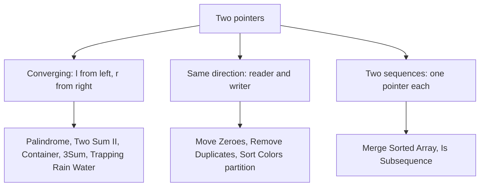

# The Two Pointers pattern

Two pointers is the second pattern on the NeetCode roadmap and one of the most reusable ideas in
interviews. The setup is almost embarrassingly simple — keep **two indices** into a sequence and move them
according to some rule — yet it turns many O(n²) "check every pair" algorithms into O(n) single passes,
usually with **O(1) extra space**. That last part is its edge over hashing: where a hash map spends O(n)
memory, two pointers often spends nothing.

## When to recognise it

Reach for two pointers when you see:

- the input is **sorted** (or sorting it is acceptable) and you want a pair/triple with some sum or
  difference;
- the answer involves **both ends** of a sequence — palindromes, reversing, "container" problems;
- you must modify an array **in place** — removing, compacting, partitioning, deduplicating;
- you are **merging** two sorted sequences;
- you need to walk two sequences in lockstep — subsequence checks, comparing strings with backspaces;
- an O(1)-space requirement rules out a hash set.

## The three shapes



### Shape 1 — Converging pointers (opposite ends)

Start `l = 0`, `r = n − 1` and move them toward each other until they meet. Each step **discards** at least
one index from consideration, so the loop runs at most n times.

```python
l, r = 0, len(a) - 1
while l < r:
    if condition_met(a[l], a[r]):
        ...                 # record / return
    if should_move_left(a[l], a[r]):
        l += 1
    else:
        r -= 1
```

**Example: Two Sum II (sorted input).** If `a[l] + a[r]` is too small, `a[l]` can't be in any solution:
its best possible partner is the largest remaining value `a[r]`, and even that wasn't enough. Discard `l`.
Symmetrically, if the sum is too large, discard `r`.

```python-run
def two_sum_sorted(a, target):
    l, r = 0, len(a) - 1
    steps = 0
    while l < r:
        steps += 1
        s = a[l] + a[r]
        if s == target:
            return [l + 1, r + 1], steps
        if s < target:
            l += 1
        else:
            r -= 1
    return None, steps

a = list(range(1, 100001, 2))     # 50,000 odd numbers
print(two_sum_sorted(a, a[123] + a[45678]))
```

Fifty thousand elements, and the loop takes at most fifty thousand steps — versus 1.25·10⁹ pairs for
brute force.

**Example: palindrome check.** Compare the outermost characters and move inward; skip characters that
don't count.

```python
l, r = 0, len(s) - 1
while l < r:
    while l < r and not s[l].isalnum(): l += 1
    while l < r and not s[r].isalnum(): r -= 1
    if s[l].lower() != s[r].lower():
        return False
    l, r = l + 1, r - 1
return True
```

**Example: reversing a range in place** — the building block of *Rotate Array*:

```python
def reverse(a, l, r):
    while l < r:
        a[l], a[r] = a[r], a[l]
        l, r = l + 1, r - 1
```

### Shape 2 — Same direction: reader and writer

Both pointers start at the left. The **reader** `r` visits every element; the **writer** `w` marks where
the next *kept* element goes. Everything before `w` is the finished output.

```python
w = 0
for r in range(len(a)):
    if keep(a[r]):
        a[w] = a[r]         # or swap, to preserve the discarded values
        w += 1
return w                    # length of the kept prefix
```

The invariant is the key to getting it right: **`a[:w]` is exactly the answer for `a[:r]`**. Each problem
only changes what "keep" means:

| Problem | keep(a[r]) when… | write or swap? |
|---|---|---|
| Remove Element | `a[r] != val` | write |
| Move Zeroes | `a[r] != 0` | **swap** (zeros must survive at the end) |
| Remove Duplicates (sorted) | `a[r] != a[w-1]` | write |
| Remove Duplicates II (≤ 2 copies) | `w < 2 or a[r] != a[w-2]` | write |

```python-run
def move_zeroes(a):
    w = 0
    for r in range(len(a)):
        if a[r] != 0:
            a[w], a[r] = a[r], a[w]
            w += 1
        print(f"r={r} w={w} {a}")
    return a

move_zeroes([0, 1, 0, 3, 12])
```

Watch how the non-zeros slide forward in order while zeros collect behind the writer.

A three-pointer cousin is the **Dutch national flag** partition (*Sort Colors*): `lo` grows a region of
0s at the front, `hi` grows a region of 2s at the back, and `mid` scans the unknown middle. The subtle rule
— after swapping with `hi`, **don't** advance `mid`, because the value that just arrived hasn't been
examined — is a classic interview trap.

### Shape 3 — One pointer per sequence

When two sequences are involved, give each its own index and advance whichever one the comparison tells
you to.

**Merging two sorted lists** (the heart of merge sort):

```python
i = j = 0
out = []
while i < len(a) and j < len(b):
    if a[i] <= b[j]:
        out.append(a[i]); i += 1
    else:
        out.append(b[j]); j += 1
out += a[i:] + b[j:]
```

*Merge Sorted Array* adds a twist: the result must be written into `nums1`, whose free space is at the
**end**. Merging from the front would overwrite values not yet read, so you merge **from the back**,
placing the larger tail element into the last free slot. Whenever an in-place algorithm threatens to
overwrite unread data, ask whether processing in the opposite direction avoids it.

**Subsequence check:** advance the pointer into `s` only when characters match; always advance the pointer
into `t`.

## Complexity

| Shape | Time | Extra space |
|---|---|---|
| Converging | O(n) — each step moves one pointer inward | O(1) |
| Reader/writer | O(n) — reader visits each element once | O(1) |
| Two sequences | O(n + m) | O(1) (plus output if not in place) |
| With a sort first | O(n log n) dominated by sorting | O(1)–O(n) depending on sort |
| Nested (3Sum, 4Sum) | O(n²), O(n³) — one fixed index per extra element | O(1) |

The O(n) argument is always the same: **some pointer moves at every step, and no pointer ever moves
backwards**, so the total number of steps is bounded by the total distance the pointers can travel.

## Two pointers vs hashing

| Situation | Prefer |
|---|---|
| Unsorted input, need original indices | hashing (Two Sum) |
| Sorted input, pair sum | two pointers (O(1) space) |
| All unique triples / quadruples | sort + two pointers (duplicates become adjacent and easy to skip) |
| Count pairs with a sum, unsorted, duplicates matter | hashing with counts |
| In-place modification required | two pointers |
| Strict O(1) extra space | two pointers (or index tricks) |

## Decision checklist

1. **Is the array sorted, or can I sort it without losing what I need?** → converging pointers become available.
2. **Am I comparing the two ends of something?** → converging.
3. **Must I filter/compact/partition in place?** → reader/writer (or 3-way partition).
4. **Are there two input sequences?** → one pointer each; consider merging from the back if writing in place.
5. **Can I justify each pointer move** — "this index can never be part of a better answer"? If you can't
   state why discarding is safe, the algorithm is probably wrong.
6. **What is the loop condition?** `l < r` for distinct indices, `l <= r` when a single middle element
   must also be processed (e.g. Dutch flag uses `mid <= hi`).

## Common bugs

> [!WARNING]
> - **Infinite loops** — a branch that moves neither pointer (e.g. after recording a match in 3Sum).
> - **Out-of-bounds in inner skip loops** — always guard `while l < r and …`.
> - **Off-by-one in the loop condition** — `<` vs `<=`.
> - **Forgetting leftovers** after a merge loop ends.
> - **Overwriting unread data** when writing in place from the wrong end.
> - **Moving the wrong pointer** in greedy problems (Container With Most Water: always move the shorter wall).
> - **Rebinding instead of mutating**: `nums = nums[k:] + nums[:k]` changes nothing for the caller; use `nums[:] = …`.
> - **Sorting when indices matter** — Two Sum on unsorted input asks for *original* positions.

## Worked example: Valid Palindrome, start to finish

**Understand.** Ignore non-alphanumeric characters; case-insensitive; empty after cleaning → `True`.

**Match.** Compare from both ends → converging pointers.

**Plan.** Brute force: build a cleaned lowercase string and compare it to its reverse — O(n) time but O(n)
extra memory. Two pointers: same time, O(1) space.

**Implement** (see Shape 1 above).

**Review.** `"race a car"`: `r/r`, `a/a`, `c/c`, `e` vs `a` → `False` ✓. `".,"`: skip loops meet → `True` ✓.
`"0P"`: `'0'` vs `'p'` → `False` ✓ (a classic trap if you only keep letters).

**Evaluate.** O(n) time, O(1) space; each index is visited by at most one pointer.

```python-run
def is_pal(s):
    l, r = 0, len(s) - 1
    while l < r:
        while l < r and not s[l].isalnum(): l += 1
        while l < r and not s[r].isalnum(): r -= 1
        if s[l].lower() != s[r].lower():
            return False
        l, r = l + 1, r - 1
    return True

for s in ["A man, a plan, a canal: Panama", "race a car", ".,", "0P", "No 'x' in Nixon"]:
    print(repr(s), is_pal(s))
```

## Summary

- Three shapes: **converging** (ends inward), **reader/writer** (same direction), and **one pointer per
  sequence**.
- Each step discards candidates that provably can't help, so the total work is linear.
- The pattern shines on sorted input, in-place edits and O(1)-space constraints.
- Always state the invariant (what's true of `a[:w]`, or why discarding `l` is safe) — it is both your
  correctness argument and your best debugging tool.

> **Source:** Goodrich, Tamassia & Goldwasser, *Data Structures and Algorithms in Python*, ch. 5 (§5.4
> efficiency of list operations, §5.5.2 in-place insertion sort) and ch. 12 (merging in merge-sort,
> in-place partitioning in quick-sort). NeetCode roadmap, Two Pointers.

## Check yourself

```quiz
[
  {"q": "In Two Sum II, the current sum is too small. What should you do?", "options": ["r -= 1", "l += 1", "Move both", "Restart from the middle"], "answer": 1,
   "explain": "a[l] paired with the largest remaining value is still too small, so a[l] can never be used."},
  {"q": "What invariant does the reader/writer template maintain?", "options": ["a[w:] is sorted", "a[:w] is the correct output for the elements read so far", "w == r always", "a[r] is never moved"], "answer": 1,
   "explain": "Everything before the writer is the finished answer for the prefix processed by the reader."},
  {"q": "Why does Merge Sorted Array fill nums1 from the back?", "options": ["It's faster in Python", "The free space is at the end, so writing there never overwrites unread values", "To sort descending", "To avoid comparing equal values"], "answer": 1,
   "explain": "Front-merging would clobber nums1's own unread elements."},
  {"q": "Why is a converging two-pointer loop O(n)?", "options": ["It uses a hash map", "Each iteration moves a pointer inward and they never move back", "It sorts first", "It stops at the first match"], "answer": 1,
   "explain": "The pointers together travel at most n positions."},
  {"q": "In Sort Colors (Dutch flag), after swapping nums[mid] with nums[hi], why not advance mid?", "options": ["mid must stay even", "The value swapped in from hi hasn't been examined yet", "It would skip a 1", "It's an optimisation only"], "answer": 1,
   "explain": "The new nums[mid] could be 0, 1 or 2 and still needs classification."},
  {"q": "Which problem is the best fit for the reader/writer shape?", "options": ["Container With Most Water", "Remove Duplicates from Sorted Array", "Two Sum (unsorted)", "Valid Palindrome"], "answer": 1,
   "explain": "Compacting kept elements to the front is exactly reader/writer."},
  {"q": "What's wrong with `nums = nums[-k:] + nums[:-k]` inside rotate()?", "options": ["Nothing", "It rebinds the local name; the caller's list is unchanged", "Slicing is O(1)", "It rotates left"], "answer": 1,
   "explain": "Use nums[:] = ... to mutate the original list (and reduce k modulo n first)."}
]
```
