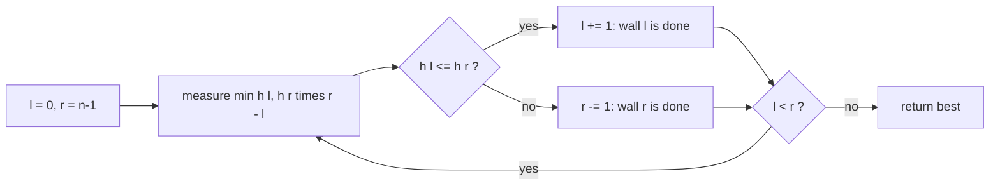

# k-Sum, greedy pointer moves and proofs

> **Before this lesson:** you need the three two-pointer shapes — especially *converging* pointers on a sorted list — from [The Two Pointers pattern](#/lesson/neet-arrays/two-pointers), and the hash-map version of Two Sum from [The Arrays & Hashing pattern](#/lesson/neet-arrays/arrays-hashing).

## In plain words

This lesson answers two questions.

First: you already know how to find **two** numbers that add up to a target. How do you find **three**, or four? The answer is to hold one number fixed, like holding one jigsaw piece in your hand, and search for the others that complete it. The whole family of such problems is called **k-Sum** ("k numbers that sum to a target").

Second: in problems like "which two walls hold the most water?", the solution moves one of two fingers inward at each step and never looks back. How can we be sure it did not walk past the best answer? A method that makes one locally sensible choice at each step and never reconsiders is called **greedy**, and a greedy method needs a short **proof** — an argument that the thing it threw away could not have been better.

Why it matters for a job: interviewers often accept the code and then ask "why is that correct?". Being able to give the two-sentence argument is what shows you understand the solution and did not memorise it.

Terms used below, defined once:

- **Triple / quadruple**: a group of three / four numbers.
- **Unique triples**: `[1, 2, -3]` and `[2, 1, -3]` count as the same triple; it must be reported once.
- **Duplicate**: a value that appears more than once in the input.
- **Greedy algorithm**: one that commits to the best-looking move at each step.
- **Induction**: a proof style — show something is true at the start, and that each step keeps it true.
- **Prune**: to skip work that cannot possibly lead to an answer.

The previous lesson introduced the shapes of two pointers. This one goes deeper into the problems that
make the pattern famous — *3Sum*, *4Sum*, *Container With Most Water* and *Trapping Rain Water* — and,
more importantly, into **why** the pointer moves are correct. Interviewers frequently ask "how do you know
you didn't skip the answer?", and a crisp argument is what separates a memorised solution from an
understood one.

## Part 1 — The k-Sum family

### From Two Sum to 3Sum

*3Sum* asks for all **unique** triples with sum 0. The brute force tries every triple — O(n³) — and needs a
set of sorted tuples to remove duplicates.

The reduction: **fix one element, solve Two Sum on the rest.** After sorting:

```python
nums.sort()
for i in range(n - 2):
    if i > 0 and nums[i] == nums[i - 1]:
        continue                       # same first value -> same triples
    if nums[i] > 0:
        break                          # all remaining values are positive
    l, r = i + 1, n - 1
    while l < r:
        s = nums[i] + nums[l] + nums[r]
        if s < 0:
            l += 1
        elif s > 0:
            r -= 1
        else:
            res.append([nums[i], nums[l], nums[r]])
            l += 1
            r -= 1
            while l < r and nums[l] == nums[l - 1]:
                l += 1                 # skip duplicate second values
```

Sorting buys two things at once: the inner Two Sum becomes an O(n) pointer scan, and **duplicates become
adjacent**, so deduplication becomes "skip a value equal to the one before it". Total: O(n log n) + n·O(n)
= **O(n²)**.

### Why the duplicate skipping is exactly right

Each unique triple `(a, b, c)` with `a ≤ b ≤ c` is produced from the **first** index holding `a` (later
equal `a`'s are skipped) and the **first** position the left pointer reaches holding `b` (after a match we
skip later equal `b`'s). Since `c = −a − b` is then determined, each triple appears exactly once.

Notice the asymmetry: we skip duplicates of `nums[i]` by comparing with `nums[i − 1]` — *not*
`nums[i + 1]`. Comparing forward would skip the first occurrence and lose triples like `[-1, -1, 2]`,
which need two copies of `-1`.

```python-run
def three_sum(nums):
    nums = sorted(nums)
    n, res = len(nums), []
    for i in range(n - 2):
        if nums[i] > 0:
            break
        if i > 0 and nums[i] == nums[i - 1]:
            continue
        l, r = i + 1, n - 1
        while l < r:
            s = nums[i] + nums[l] + nums[r]
            if s < 0:
                l += 1
            elif s > 0:
                r -= 1
            else:
                res.append([nums[i], nums[l], nums[r]])
                l += 1; r -= 1
                while l < r and nums[l] == nums[l - 1]:
                    l += 1
    return res

print(three_sum([-1, 0, 1, 2, -1, -4]))
print(three_sum([0, 0, 0, 0]))
print(three_sum([-2, 0, 1, 1, 2]))
```

### 4Sum and the general k-Sum

*4Sum* adds one more fixed index: two nested loops plus a two-pointer scan → O(n³). The duplicate rule for
the second loop is `j > i + 1 and nums[j] == nums[j - 1]` — compare only with values *inside the current
loop's range*, never with `nums[i]` itself.

The pattern generalises into a clean recursion: k-Sum fixes one value and calls (k−1)-Sum on the suffix,
bottoming out at a two-pointer Two Sum.

```python-run
def k_sum(nums, target, k, start=0):
    res = []
    if start == len(nums):
        return res
    # pruning: smallest possible / largest possible sums
    if nums[start] * k > target or nums[-1] * k < target:
        return res
    if k == 2:
        l, r = start, len(nums) - 1
        while l < r:
            s = nums[l] + nums[r]
            if s < target or (l > start and nums[l] == nums[l - 1]):
                l += 1
            elif s > target or (r < len(nums) - 1 and nums[r] == nums[r + 1]):
                r -= 1
            else:
                res.append([nums[l], nums[r]])
                l += 1; r -= 1
        return res
    for i in range(start, len(nums)):
        if i == start or nums[i] != nums[i - 1]:
            for rest in k_sum(nums, target - nums[i], k - 1, i + 1):
                res.append([nums[i]] + rest)
    return res

nums = sorted([1, 0, -1, 0, -2, 2])
print(k_sum(nums, 0, 4))
print(k_sum(sorted([2, 2, 2, 2, 2]), 8, 4))
print(k_sum(sorted([-1, 0, 1, 2, -1, -4]), 0, 3))
```

Complexity: O(n^(k−1)) — each extra level multiplies by n. (The pruning line is valid because the array is
sorted: if even k copies of the smallest available value exceed the target, nothing works.)

> [!NOTE]
> In Java or C++, `nums[i] + nums[j] + nums[l] + nums[r]` can overflow 32-bit integers in 4Sum (values up
> to 10⁹). Python integers are arbitrary-precision, but mention the issue if asked about other languages.

### Variants worth knowing

| Variant | Change to the template |
|---|---|
| 3Sum Closest | track `min(|s − target|)`; move pointers the same way |
| 3Sum Smaller (count triples with sum < t) | when `s < t`, **all** of `l+1..r` work with `l` → add `r − l`, then `l += 1` |
| Two Sum with counts / unsorted | hash map instead |
| 4Sum II (four separate arrays) | hash the n² sums of A+B, look up −(C+D) → O(n²) |

## Part 2 — Greedy pointer moves and how to prove them

Converging two-pointer algorithms are greedy: at each step they **permanently discard** one index. The
proof obligation is always the same:

> *The discarded index cannot be part of any solution better than one we have already seen.*

Let's apply that to the two classic problems.

### Container With Most Water

Area of walls `l < r` is `min(h[l], h[r]) · (r − l)`. Start with the widest pair `(0, n−1)`.

**Claim.** If `h[l] ≤ h[r]`, every pair `(l, k)` with `l < k < r` has area ≤ area(l, r). So after measuring
`(l, r)`, wall `l` can be discarded.

**Proof.** For such `k`: width `k − l < r − l`, and height `min(h[l], h[k]) ≤ h[l] = min(h[l], h[r])`.
Both factors are no larger, so the area is no larger. ∎

Pairs `(k, l)` with `k < l` were already discarded earlier by the same argument, so after removing `l` no
unexamined pair can beat our best. That's why we move the **shorter** wall. Moving the taller one is wrong:
the shorter wall still caps the height while the width shrinks, so you might skip the optimum.



```python-run
import random, itertools, time

def max_area(h):
    l, r, best = 0, len(h) - 1, 0
    while l < r:
        best = max(best, min(h[l], h[r]) * (r - l))
        if h[l] <= h[r]:
            l += 1
        else:
            r -= 1
    return best

def brute(h):
    return max(min(h[i], h[j]) * (j - i) for i, j in itertools.combinations(range(len(h)), 2))

random.seed(0)
for _ in range(500):
    h = [random.randint(0, 20) for _ in range(random.randint(2, 12))]
    assert max_area(h) == brute(h), h
print("greedy matches brute force on 500 random cases")

h = [random.randint(0, 10**4) for _ in range(2000)]
t = time.perf_counter(); a = brute(h); tb = time.perf_counter() - t
t = time.perf_counter(); b = max_area(h); tg = time.perf_counter() - t
print(a == b, f"brute {tb*1000:.0f} ms vs two pointers {tg*1000:.2f} ms")
```

### Trapping Rain Water

Water above bar `i` is

$$w_i = \min(\text{maxLeft}_i,\ \text{maxRight}_i) - h_i$$

where both maxima include bar `i` itself (so `w_i ≥ 0`).

**Approach A — prefix/suffix arrays (O(n) space).** Compute `maxLeft` with a left-to-right running max and
`maxRight` with a right-to-left one, then sum the formula. Easy to explain; a perfectly good first answer.

**Approach B — two pointers (O(1) space).** Keep `l`, `r`, and running maxima `left_max` (over `h[0..l]`)
and `right_max` (over `h[r..n−1]`). At each step settle the side whose current bar is **lower**:

```python
while l < r:
    if h[l] < h[r]:
        left_max = max(left_max, h[l])
        water += left_max - h[l]
        l += 1
    else:
        right_max = max(right_max, h[r])
        water += right_max - h[r]
        r -= 1
```

**Why it's correct.** Invariant: *the tallest bar among everything either pointer has visited,
`h[0..l]` and `h[r..n−1]`, sits under one of the two pointers.* It holds initially, and a pointer only moves
off a bar that is no taller than the bar under the other pointer, so the tallest bar is never left behind.

Now suppose `h[l] < h[r]`. The tallest visited bar can't be at `l`, so it is at `r`: `h[r] ≥ left_max`.
Hence the true right maximum for bar `l` is at least `h[r] ≥ left_max`, so
`min(maxLeft_l, maxRight_l) = left_max`, and the water at `l` is exactly `left_max − h[l]` — computable
*now*, without knowing the full right maximum. The right branch is symmetric.

The intuition in one sentence: **the lower side is the bottleneck, and its running maximum is already
known.**

```python-run
from itertools import accumulate

def trap_arrays(h):
    left = list(accumulate(h, max))
    right = list(accumulate(h[::-1], max))[::-1]
    return sum(min(a, b) - x for a, b, x in zip(left, right, h))

def trap_pointers(h):
    l, r = 0, len(h) - 1
    lm = rm = water = 0
    while l < r:
        if h[l] < h[r]:
            lm = max(lm, h[l]); water += lm - h[l]; l += 1
        else:
            rm = max(rm, h[r]); water += rm - h[r]; r -= 1
    return water

for h in ([0,1,0,2,1,0,1,3,2,1,2,1], [4,2,0,3,2,5], [5,0,0,0,0,5], [3,2,1]):
    print(h, trap_arrays(h), trap_pointers(h))
```

A third approach — a **monotonic stack** that fills water layer by layer when a taller bar closes a basin
— appears in the Stack track.

### A general recipe for proving a greedy pointer move

1. Write the objective for a pair (or state) in terms of the two indices.
2. Suppose the current condition holds (e.g. `h[l] ≤ h[r]`).
3. Show every unexamined pair involving the discarded index is **no better** than one already examined.
4. Conclude by induction: when the pointers meet, every pair was either measured or dominated.

If step 3 fails, the move is wrong — try the other pointer or a different strategy.

## Part 3 — Patterns at a glance

| Problem | Shape | Key move | Time / Space |
|---|---|---|---|
| Valid Palindrome | converging | skip junk, compare, move both | O(n) / O(1) |
| Two Sum II | converging | sum small → l++, large → r-- | O(n) / O(1) |
| 3Sum | sort + fixed + converging | skip equal i, skip equal l after a hit | O(n²) / O(1) |
| 4Sum | sort + 2 fixed + converging | dedupe at every level | O(n³) / O(1) |
| Container With Most Water | converging, greedy | move the shorter wall | O(n) / O(1) |
| Trapping Rain Water | converging, greedy | settle the lower side with its running max | O(n) / O(1) |
| Rotate Array | converging (3 reversals) | reverse all, first k, rest | O(n) / O(1) |
| Move Zeroes / Remove Duplicates | reader/writer | write kept values at w | O(n) / O(1) |
| Merge Sorted Array | two sequences, from the back | larger tail into last free slot | O(m+n) / O(1) |

## Common bugs

> [!WARNING]
> - 3Sum: comparing `nums[i]` with `nums[i + 1]` to skip duplicates (loses `[-1,-1,2]`).
> - 3Sum/4Sum: after a match, moving only one pointer or forgetting to skip duplicates → repeats or infinite loop.
> - 3Sum: stopping after the first match for a fixed `i`.
> - 4Sum: second-level duplicate check `j > 0` instead of `j > i + 1`.
> - Container: moving the taller wall; computing width as `r − l + 1`.
> - Trapping: using only one side's maximum; adding water before updating the running max (negative water).

## Summary

- k-Sum = sort, fix k − 2 values with loops (skipping duplicates), finish with a two-pointer Two Sum →
  O(n^(k−1)).
- Sorting makes duplicate removal a local "equal to the previous value?" check.
- Every converging greedy algorithm rests on a discard argument: the dropped index can't beat what's been
  measured. Container: move the shorter wall. Trapping water: settle the lower side.
- When a greedy move feels like magic, verify it against brute force on random inputs — and then try to
  prove it.

> **Source:** Goodrich, Tamassia & Goldwasser, *Data Structures and Algorithms in Python*, ch. 12
> (sorting as a preprocessing step, §12.1–12.2) and ch. 3 (justification techniques: induction and loop
> invariants, §3.4). NeetCode roadmap, Two Pointers.

## Glossary

| Term | Meaning |
|---|---|
| **k-Sum** | find k numbers summing to a target; solved by fixing k − 2 values and converging two pointers. |
| **Fixed index** | the position held constant by an outer loop while inner pointers search. |
| **Duplicate skipping** | ignoring a value equal to the previous one so each answer is reported once. |
| **Greedy algorithm** | commits to the locally best move and never reconsiders. |
| **Discard argument** | a proof that the index being dropped cannot belong to a better answer. |
| **Dominated** | no better than something already examined. |
| **Bottleneck** | the limiting side — the shorter wall or the lower running maximum. |
| **Running maximum** | the largest value seen so far in a scan. |
| **Pruning** | skipping branches that cannot produce an answer. |
| **Meet in the middle** | split the input in halves, precompute one half (often in a hash map), look up from the other. |

## Check yourself

```quiz
[
  {"q": "What is the time complexity of the standard 3Sum solution?", "options": ["O(n log n)", "O(n^2)", "O(n^3)", "O(n)"], "answer": 1,
   "explain": "Sorting is O(n log n); then n outer iterations each do an O(n) two-pointer scan."},
  {"q": "To skip duplicate first values in 3Sum, you compare nums[i] with…", "options": ["nums[i + 1]", "nums[i - 1]", "nums[l]", "nums[r]"], "answer": 1,
   "explain": "Comparing backwards keeps the first occurrence so triples using two equal values are still found."},
  {"q": "In Container With Most Water, why move the shorter wall?", "options": ["It's arbitrary", "Every narrower container using the shorter wall is no larger, so that wall is finished", "The taller wall is always optimal", "To keep the width constant"], "answer": 1,
   "explain": "Width shrinks and height stays capped by the shorter wall, so its pairs are dominated."},
  {"q": "General k-Sum with the sort + two pointers approach runs in…", "options": ["O(n^k)", "O(n^(k-1))", "O(k n)", "O(n log n)"], "answer": 1,
   "explain": "k-2 nested loops times an O(n) scan."},
  {"q": "In the two-pointer Trapping Rain Water, when h[l] < h[r], water at l equals…", "options": ["right_max - h[l]", "left_max - h[l] (after updating left_max)", "h[r] - h[l]", "0"], "answer": 1,
   "explain": "The left side is the bottleneck; its running maximum is the binding wall."},
  {"q": "4Sum II (four separate arrays, count tuples summing to 0) is best solved with…", "options": ["Sorting + two pointers, O(n^3)", "A hash map of A+B sums, looking up -(C+D), O(n^2)", "Brute force O(n^4)", "Binary search O(n log n)"], "answer": 1,
   "explain": "Splitting into two halves and hashing one half is the meet-in-the-middle trick."},
  {"q": "3Sum Smaller: when nums[i] + nums[l] + nums[r] < target, how many valid triples with this i and l?", "options": ["1", "r - l", "l - i", "n - r"], "answer": 1,
   "explain": "Any r' in (l, r] also gives a smaller sum because the array is sorted."}
]
```
