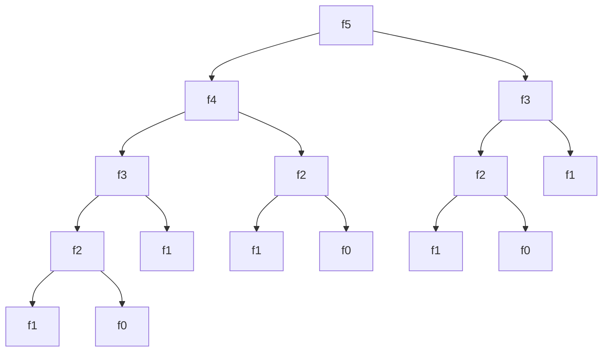

# From recursion to dynamic programming

> **Before this lesson:** you should be able to read a small Python function, a `for` loop and a list.
> It helps to have met recursion (a function that calls itself) in
> [Thinking recursively: four classic examples](#/lesson/dsa-foundations/recursion-examples) and Big-O notation in
> [Big-O, Big-Omega and Big-Theta](#/lesson/dsa-foundations/asymptotic-notation) — but both are re-explained below.

## In plain words

**Dynamic programming** (shortened to **DP** everywhere in this track) is a way of solving a big
problem by solving smaller versions of the same problem **once each**, writing the answers down, and
reusing them instead of working them out again.

An everyday picture: you are asked "what is 1 + 1 + 1 + 1 + 1 + 1 + 1 + 1?" You count: eight. Now
someone adds "+ 1" on the end. You do not count from the start again — you remember "eight" and say
"nine". Remembering the earlier answer is the whole idea. A program that does *not* remember will
recount everything, every time, and for some problems that recounting takes longer than the age of
the universe.

Why it matters for a job: DP questions are among the most common in coding interviews, and the same
idea runs real systems — spell checkers ("how many edits between these two words?"), `git diff`,
route planning, and text prediction all reuse stored sub-answers.

Four words appear constantly, so here they are before anything else:

- **Recursion** — a function that calls itself on a smaller input. Example: "the 5th number in a
  sequence is the 4th plus the 3rd", where the 4th and 3rd are found the same way.
- **Subproblem** — one of those smaller inputs (finding the 4th number is a subproblem of finding the
  5th).
- **Cache** — a place where finished answers are stored so they can be looked up later. In Python it
  is usually a dictionary (a lookup table from a key to a value) or a list.
- **Big-O**, written like `O(n)` — a rough count of how many steps a program takes as its input size
  `n` grows. `O(n)` means "about `n` steps"; `O(n²)` means "about `n × n` steps"; `O(2ⁿ)` means the
  steps **double** every time `n` grows by one, which becomes impossibly slow very quickly. We call
  that last kind **exponential**.

Dynamic programming (DP) has a reputation for being the scariest interview topic. It doesn't deserve
it. DP is not a separate kind of algorithm so much as a **disciplined way of making a recursive
solution fast**. If you can write a correct recursive function, you are most of the way to a DP
solution. This lesson walks the full road on one tiny example — Fibonacci numbers — so that in later
lessons you can focus on the interesting part (finding the recursion) instead of the mechanics.

The road has four stops:

1. **Plain recursion** — correct, but exponentially slow.
2. **Memoization (top-down DP)** — the same recursion, plus a cache.
3. **Tabulation (bottom-up DP)** — fill a table in an order where every dependency is ready.
4. **Space optimisation** — keep only the part of the table you still need.

## Why the name?

Richard Bellman coined "dynamic programming" in the 1950s. "Programming" meant *planning* (as in a
TV programme schedule or linear programming), not writing code, and "dynamic" referred to decisions
unfolding over time. The name tells you little about the technique; the thing to remember is that DP solves
problems by **combining answers to overlapping subproblems that are each solved once**.

Goodrich, Tamassia and Goldwasser describe DP as resembling divide-and-conquer, with the crucial
difference that the subproblems **share** sub-subproblems. That sharing is what makes plain
recursion wasteful, and what DP exploits.

## Stop 1: plain recursion

The Fibonacci numbers are defined by `F(0) = 0`, `F(1) = 1` and `F(n) = F(n-1) + F(n-2)`. The
definition translates directly into code:

Read the code below line by line before running it:

- `calls = 0` creates a counter so we can see how much work is done.
- `def fib(n):` defines a function named `fib` that takes one number `n`.
- `global calls` and `calls += 1` add one to the counter every time the function starts.
- `if n < 2: return n` is the **base case**: the two smallest inputs (0 and 1) are answered directly,
  with no further calls. Every recursive function needs a base case, or it would call itself forever.
- `return fib(n - 1) + fib(n - 2)` is the **recursive case**: the function calls *itself* twice, on
  the two smaller inputs, and adds the results.
- The loop at the bottom runs `fib` for three inputs and prints the answer and the number of calls.

```python-run
calls = 0

def fib(n):
    global calls
    calls += 1
    if n < 2:
        return n
    return fib(n - 1) + fib(n - 2)

for n in (10, 20, 25):
    calls = 0
    print(n, fib(n), "calls:", calls)
```

The answer is correct, but look at the call counts: 177 calls for `n = 10`, 21,891 for `n = 20` and
242,785 for `n = 25`. The count itself grows like the Fibonacci numbers, roughly by a factor of
$\varphi \approx 1.618$ per step. `fib(50)` would need about 40 billion calls.

### The recursion tree

Drawing the calls as a tree shows the waste immediately. Here is `fib(5)`:



`f3` is computed twice, `f2` three times, `f1` five times. Every repeated node is a whole subtree of
repeated work. Two properties make this a DP problem:

- **Optimal substructure** ("the big answer is built from smaller answers") — the answer for `n` is built from answers for
  smaller inputs.
- **Overlapping subproblems** — the same smaller inputs appear again and again.

Merge sort, by contrast, has substructure but no overlap: the left half and the right half never
share work. That is why merge sort is divide-and-conquer and not DP.

> [!NOTE]
> Goodrich et al. list three ingredients for a DP solution: *simple subproblems* (describable by a
> few indices like `i, j`), *subproblem optimization* (an optimal answer is composed of optimal
> sub-answers), and *subproblem overlap*. Keep these three in mind as a checklist.

## Stop 2: memoization (top-down)

If the same call happens repeatedly, remember its answer the first time and look it up afterwards.
That is **memoization**. In Python the cleanest way is `functools.cache` (Python 3.9+), or
`functools.lru_cache(maxsize=None)` on older versions:

The only change from the first program is one line, `@cache`, placed directly above the function.
A line starting with `@` is called a **decorator**: it wraps the function with extra behaviour. This
one keeps a hidden dictionary. Each time `fib(n)` is called it first looks in the dictionary; if the
answer for that `n` is already there it is returned immediately, and the function body does not run.
Otherwise the body runs once and the result is stored.

```python-run
from functools import cache

calls = 0

@cache
def fib(n):
    global calls
    calls += 1
    if n < 2:
        return n
    return fib(n - 1) + fib(n - 2)

print(fib(90), "calls:", calls)
```

Now `fib(90)` takes 91 calls — one per distinct argument. The recursion tree collapses into a chain:
once `f(n-1)` has been computed (which computes everything below it), the call `f(n-2)` is a cache
hit.

What memoization really does is turn the recursion **tree** into a **DAG** (directed acyclic graph)
of distinct subproblems. The running time becomes:

$$\text{time} = (\text{number of distinct states}) \times (\text{work per state, excluding recursive calls})$$

For Fibonacci: $n$ states × $O(1)$ work = $O(n)$. This formula is the single most useful tool for
analysing any DP, and we will use it in every problem.

### Doing it by hand

`@cache` hides a dictionary. Writing the dictionary yourself is good practice and is what you'd do in
languages without decorators:

```python-run
def fib(n, memo=None):
    if memo is None:          # never use a mutable default like memo={} directly
        memo = {}
    if n < 2:
        return n
    if n not in memo:
        memo[n] = fib(n - 1, memo) + fib(n - 2, memo)
    return memo[n]

print([fib(i) for i in range(15)])
```

> [!WARNING]
> Python's default recursion limit is about 1000 frames. A memoized recursion whose depth is
> proportional to `n` will crash with `RecursionError` for `n` in the thousands. You can raise it
> with `sys.setrecursionlimit`, but in interviews and in this site's judge the safer route is the
> bottom-up version below.

### Pros and cons of top-down

| Top-down (memoization) | |
|---|---|
| ✅ | Mirrors the recurrence, so it's easy to write correctly. |
| ✅ | Only computes states that are actually reachable (great for sparse state spaces). |
| ✅ | You never have to think about the evaluation order. |
| ❌ | Function-call overhead; Python calls are slow. |
| ❌ | Recursion depth limits. |
| ❌ | Harder to optimise space. |

## Stop 3: tabulation (bottom-up)

In the memoized version, every call to `fib(n)` waited for `fib(n-1)` and `fib(n-2)`. So if we
compute values in **increasing** order of `n`, every dependency is already available when we need
it. Store them in a list — the "table":

What each line does:

- `table = [0] * (n + 1)` makes a list of `n + 1` zeros, one slot for each of `F(0)` … `F(n)`.
- `table[1] = 1` fills in the base case `F(1) = 1` (`table[0]` is already 0).
- `for i in range(2, n + 1):` visits the slots 2, 3, …, n from left to right.
- `table[i] = table[i - 1] + table[i - 2]` is the recurrence, reading two slots that were filled
  earlier in the loop.
- `return table[n]` — the last slot holds the answer.

There is no recursion at all: a loop and a list.

```python-run
def fib(n):
    if n < 2:
        return n
    table = [0] * (n + 1)
    table[1] = 1
    for i in range(2, n + 1):
        table[i] = table[i - 1] + table[i - 2]
    return table[n]

print(fib(90))
```

Tabulation forces you to answer one extra question: **in what order do I fill the table?** The rule
is simple: a cell must be computed after all the cells it depends on. In 1-D problems this is usually
left-to-right; for grids it's row by row; for interval problems it's by increasing interval length.
We'll see all of these.

Here is the table for `n = 8`:

| i | 0 | 1 | 2 | 3 | 4 | 5 | 6 | 7 | 8 |
|---|---|---|---|---|---|---|---|---|---|
| F(i) | 0 | 1 | 1 | 2 | 3 | 5 | 8 | 13 | 21 |

Bottom-up is typically 2–5× faster in Python than memoized recursion (plain loops, list indexing,
no hashing), and it has no recursion-depth problems.

## Stop 4: space optimisation

Look at the loop body: `table[i]` reads only `table[i-1]` and `table[i-2]`. Everything older is dead
weight. Keep only the last two values:

In the code, `a, b = b, a + b` is Python's way of changing two variables **at the same moment**: the
right-hand side (`b` and `a + b`) is worked out first using the old values, and only then stored into
`a` and `b`. After one step `(a, b)` goes from `(0, 1)` to `(1, 1)`, then `(1, 2)`, `(2, 3)`, `(3, 5)`…

```python-run
def fib(n):
    a, b = 0, 1          # a = F(i), b = F(i+1)
    for _ in range(n):
        a, b = b, a + b
    return a

print([fib(i) for i in range(12)])
```

Memory drops from $O(n)$ to $O(1)$. The general trick: **if row/step `i` depends only on a bounded
window of previous rows/steps, keep only that window.** In 2-D problems this typically turns an
$O(nm)$ table into an $O(m)$ row. In knapsack problems it turns a 2-D table into a 1-D array whose
iteration *direction* encodes whether items can be reused — a subtle point we'll study carefully.

> [!TIP]
> Space optimisation should always be the **last** step. First get a correct table, then check which
> cells each update reads, then shrink. Trying to be clever too early is the number-one source of
> DP bugs.

## Putting the four stops side by side

```python-run
import time
from functools import cache

def naive(n):
    return n if n < 2 else naive(n - 1) + naive(n - 2)

@cache
def memo(n):
    return n if n < 2 else memo(n - 1) + memo(n - 2)

def table(n):
    t = [0, 1] + [0] * max(0, n - 1)
    for i in range(2, n + 1):
        t[i] = t[i - 1] + t[i - 2]
    return t[n]

def rolling(n):
    a, b = 0, 1
    for _ in range(n):
        a, b = b, a + b
    return a

for f in (naive, memo, table, rolling):
    t0 = time.perf_counter()
    v = f(24)
    print(f"{f.__name__:8} F(24)={v}  {1000*(time.perf_counter()-t0):.2f} ms")
```

Notice that all four give the same answer; only cost differs. This is the general story: **design
the recurrence once, then choose the implementation that fits the constraints.**

## A second example: climbing stairs

To see that the same machinery applies beyond Fibonacci, consider: *you can climb 1 or 2 steps at a
time; how many ways reach step n?* Ask "what was the **last** move?" Either a 1-step from `n-1` or a
2-step from `n-2`. These cases don't overlap and cover everything, so
`ways(n) = ways(n-1) + ways(n-2)`, with `ways(0) = 1` (one way to climb nothing: do nothing) and
`ways(1) = 1`.

```python-run
from functools import cache

@cache
def ways(n):
    if n <= 1:
        return 1
    return ways(n - 1) + ways(n - 2)

print([ways(n) for n in range(1, 11)])
```

"Classify by the last decision" is the most common way to find a recurrence. You'll use it in House
Robber (rob the last house or not), Decode Ways (last code has one or two digits), Coin Change (which
coin was last), LCS (do the last characters match), and many more.

## How to recognise a DP problem

Interview problems that turn out to be DP usually show several of these signals:

- They ask for a **count** ("how many ways"), an **optimum** ("minimum cost", "maximum profit",
  "longest"), or **feasibility** ("is it possible") — not for listing all solutions.
- The input is a sequence, string, grid, tree, or a capacity/amount.
- A brute force would try **choices** at each step (take/skip, which coin, which split), producing an
  exponential tree.
- The future only depends on a small summary of the past (an index, a remaining amount, whether you
  hold a stock) — not the whole history. That summary is the **state**.

If the problem asks you to *list* every solution (all subsets, all permutations), DP rarely helps:
the output itself is exponential, so you need backtracking.

## Pitfalls to remember

- **Missing or wrong base cases.** Most DP bugs live in the first one or two cells.
- **Mutable default arguments** (`memo={}`) persist across calls and across test cases.
- **Recursion depth** for memoized solutions on long inputs.
- **Wrong fill order** in bottom-up: reading a cell before it's computed silently uses 0.
- **Premature space optimisation** that overwrites a value you still needed.

## Summary

- DP = recursion + reuse of overlapping subproblems.
- Memoization is top-down: write the recursion, add `@cache`.
- Tabulation is bottom-up: fill a table in dependency order.
- Space optimisation keeps only the window of the table that future steps read.
- Running time = number of states × work per state.

## Glossary

| Term | Meaning in plain words |
|---|---|
| **Dynamic programming (DP)** | Solving a problem by solving each smaller version once, storing the answer and reusing it. |
| **Recursion** | A function that calls itself on a smaller input. |
| **Base case** | The smallest input, answered directly without any further calls. |
| **Subproblem** | A smaller instance of the same problem. |
| **Overlapping subproblems** | The same subproblem is needed again and again by different parts of the computation. |
| **Optimal substructure** | The best answer to the whole problem is built from best answers to its subproblems. |
| **Recursion tree** | A drawing of every call a recursive function makes, with each call's own calls drawn beneath it. |
| **Memoization (top-down)** | Keeping the recursive function but caching each result the first time it is computed. |
| **Tabulation (bottom-up)** | Filling a list or grid of answers with loops, smallest subproblems first. |
| **State** | The inputs that identify one subproblem (here, the number `n`). |
| **Space optimisation** | Keeping only the few stored answers that later steps still need. |
| **DAG** | Directed acyclic graph: boxes joined by one-way arrows with no way to walk in a circle. |
| **Exponential time** | The number of steps multiplies by a constant each time the input grows by one — unusable beyond small inputs. |

## Check yourself

```quiz
[
  {"q": "Why is naive recursive Fibonacci exponential?", "options": ["Each call does O(n) work", "The same subproblems are recomputed many times in different branches", "Python recursion is slow", "Additions of big integers are expensive"], "answer": 1, "explain": "The recursion tree contains many copies of the same subproblem (f3, f2, ...), so total calls grow like φ^n even though there are only n+1 distinct subproblems."},
  {"q": "Which property distinguishes a DP problem from a plain divide-and-conquer problem like merge sort?", "options": ["Optimal substructure", "Overlapping subproblems", "Recursion", "Sorting"], "answer": 1, "explain": "Merge sort's halves never share work. DP pays off precisely because subproblems overlap."},
  {"q": "A memoized recursion has n·m distinct states and does O(k) work per state outside its recursive calls. What is its running time?", "options": ["O(n + m + k)", "O(n·m·k)", "O(2^(n+m))", "O(k^(n·m))"], "answer": 1, "explain": "Time = number of states × work per state, because each state is computed exactly once."},
  {"q": "What must you decide in bottom-up DP that top-down memoization decides for you?", "options": ["The base cases", "The recurrence", "The order in which table cells are filled", "The return type"], "answer": 2, "explain": "Recursion naturally evaluates dependencies first; with a table you must choose an order where every cell's dependencies are already filled."},
  {"q": "In the rolling-variable Fibonacci, why can we drop the table?", "options": ["Python garbage collects it anyway", "Each step reads only the previous two values", "Fibonacci numbers are small", "Tables are always unnecessary in DP"], "answer": 1, "explain": "When step i depends on a bounded window of earlier steps, only that window needs to be stored."},
  {"q": "What is wrong with `def f(n, memo={}):` as a memoization pattern?", "options": ["Dictionaries are slow", "The default dict is created once and shared across all calls, leaking state between test cases", "It causes a syntax error", "Nothing"], "answer": 1, "explain": "Default argument values are evaluated once at definition time, so the same dict persists. Use functools.cache or a None default."},
  {"q": "Which of these requests is usually NOT a good fit for DP?", "options": ["Count the ways to decode a string", "Find the minimum number of coins", "List every permutation of an array", "Decide whether a string can be segmented into words"], "answer": 2, "explain": "If the output itself is exponential in size, you must generate it — backtracking, not DP."}
]
```

> **Source:** Goodrich, Tamassia & Goldwasser, *Data Structures and Algorithms in Python*, §13.3
> (Dynamic Programming — components of a DP solution); NeetCode 150 roadmap, 1-D DP.
