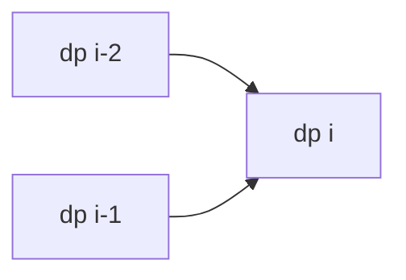

# The DP framework: state, recurrence, base, order, answer

> **Before this lesson:** read [From recursion to dynamic programming](#/lesson/neet-dp/dp-from-recursion), which
> explains recursion, memoization (caching a recursive function) and tabulation (filling a table with
> loops). This lesson assumes those three words.

## In plain words

Solving a dynamic programming (DP) problem is like filling in a form with **five boxes**. If every
box has a clear answer, writing the program is mostly copying the form into code. If a box is empty
or vague, the program will be wrong no matter how carefully you type.

An everyday analogy: planning the cheapest train journey across a country. (1) You decide what to
write on each line of your notebook — "cheapest cost to reach city X". (2) You decide how one line is
worked out from others — "cheapest to X = cheapest to a neighbouring city + the ticket between them".
(3) You know one line for free — "reaching the start city costs 0". (4) You fill lines in an order
where the lines you need are already filled. (5) You read the answer off the line for your
destination. Those are the five boxes: **state, recurrence, base case, order, answer**.

Why it matters for a job: interviewers mark the *explanation* as much as the code. Saying these five
things out loud is the clearest way to show you understand a DP solution, and the same habit makes
your own bugs easy to find.

Words used from here on:

- **State** — the small set of values that identifies one subproblem (for example "the first `i`
  houses"). `dp[i]` or `best[i]` is the stored answer for that state.
- **Recurrence** — the formula that computes one state's answer from the answers of smaller states.
- **Index** — a position number in a list or string; Python counts from 0.
- **Prefix** — the first part of a sequence. `s[:i]` is the prefix of length `i`. A **suffix** is the
  last part, `s[i:]`.

Every DP solution in this track — from Climbing Stairs to Burst Balloons — is specified by answering
the same five questions. If you can write down all five before coding, the code is usually ten lines
and correct on the first try. If you can't, no amount of coding will fix it.

| # | Question | Example: House Robber |
|---|---|---|
| 1 | **State** — what does `dp[...]` mean, in one precise sentence? | `best[i]` = max loot using houses `0..i` |
| 2 | **Recurrence** — how is a state computed from smaller states? | `best[i] = max(best[i-1], best[i-2] + nums[i])` |
| 3 | **Base cases** — which states are known without recursion? | `best[-1] = best[-2] = 0` |
| 4 | **Order** — in which order are states computed (bottom-up)? | `i = 0, 1, …, n-1` |
| 5 | **Answer** — which state (or combination) is the final answer? | `best[n-1]` |

We'll look at each in turn, then practise the full framework on several problems.

## 1. The state: what must I remember?

A state is the **minimal summary of the past that determines the best possible future**. Finding it is
the creative step. A good method:

1. Imagine a brute-force recursive search that makes one decision at a time.
2. Ask: *what are the arguments of that recursive function?* — the information the remaining
   decisions depend on.
3. Remove anything that doesn't affect the future (e.g. the exact list of houses robbed so far — only
   whether the previous house was robbed matters).

Typical states:

| Problem shape | Usual state |
|---|---|
| One sequence | an index `i` (prefix `[:i]` or suffix `[i:]`) |
| Two sequences | a pair `(i, j)` of prefix lengths |
| Grid | a cell `(r, c)` |
| Capacity / amount | `(item index, remaining capacity)` |
| Contiguous ranges | an interval `(l, r)` |
| Modes / phases | `(index, mode)` such as holding / not holding a stock |
| Small set of items | a bitmask of used items |

> [!TIP]
> Write the state definition as a full English sentence in a comment, e.g. `# ways[a] = number of
> combinations of coins summing to a`. Vague definitions ("dp of i") lead to wrong recurrences.

### Prefix vs suffix states

You can define states on prefixes (`dp[i]` = answer for `s[:i]`) or suffixes (`dp[i]` = answer for
`s[i:]`). They are mirror images. Top-down code usually reads naturally with suffixes ("solve the rest
starting at `i`"); bottom-up code often uses prefixes. Pick one and **stick to it** — mixing the two
in one solution is a classic off-by-one generator.

## 2. The recurrence: make one decision

The recurrence comes from **one decision** at the boundary of the state:

- *the last element*: is it taken? (House Robber, knapsack)
- *the last move*: which step/coin/word was last? (Climbing Stairs, Coin Change, Word Break)
- *the last characters*: do they match? (LCS, Edit Distance)
- *the split point*: where's the last multiplication / last balloon? (Matrix chain, Burst Balloons)

Then combine the options with the right operator:

| The question asks for... | Combine with |
|---|---|
| a minimum / maximum | `min` / `max` |
| a count of ways | `+` (options must be disjoint and exhaustive!) |
| feasibility | `or` |

> [!WARNING]
> For counting, options must not overlap, or you'll count the same object twice. Coin Change II is
> the classic trap: "which coin is last?" counts `1+2` and `2+1` separately. Fix it by deciding coins
> in a fixed order.

### Proving the recurrence (informally)

Two checks are enough for interviews:

- **Completeness** — every valid solution falls into one of your cases.
- **Optimal substructure** — within each case, the leftover part must itself be solved optimally.
  Goodrich's argument for matrix chains is the template: if a sub-part weren't optimal, swapping in a
  better sub-solution would improve the whole, a contradiction.

## 3. Base cases

Base cases are the smallest states, where the recurrence would reach outside the table. Common forms:

- Empty prefix: `dp[0] = 1` for counting (one way to do nothing), `0` for min-cost or max-value,
  `True` for feasibility.
- Single element: `dp[i][i]` in interval DP.
- Impossible states: `+∞` for minimisation, `-∞` for maximisation, `0` for counting, `False` for
  feasibility.

The "one way to do nothing" convention surprises people, but it's what makes the arithmetic work:
in Climbing Stairs, `ways(2) = ways(1) + ways(0)` must equal 2, so `ways(0) = 1`.

## 4. Order of evaluation

Draw the dependency arrows of a single cell and make sure your loops visit cells **after** everything
they point to.



| Dependency pattern | Loop order |
|---|---|
| `dp[i]` ← `dp[i-1], dp[i-2]` | `i` increasing |
| `dp[i][j]` ← top, left, top-left | rows increasing, columns increasing |
| `dp[i][j]` ← `dp[i+1][j+1]`, `dp[i][j+2]` (suffix states) | `i` decreasing, `j` decreasing |
| `dp[l][r]` ← shorter intervals | by increasing length `r - l` |
| arbitrary DAG (e.g. increasing paths in a grid) | topological order, or memoized DFS |

When the order is awkward to figure out, **top-down memoization sidesteps the question entirely**.
That's a legitimate interview strategy: get the memoized solution working, then convert.

## 5. The answer

Not always the last cell! Examples:

- LIS: `max(lis[i] for all i)` — the best subsequence can end anywhere.
- Maximum Product Subarray: max over all "ending here" values.
- House Robber II: max of two separate DP runs.
- Stock with cooldown: `max(sold, rest)` on the last day.

## Top-down vs bottom-up: the same five answers

Once the five answers exist, both implementations are mechanical. Here is Min Cost Climbing Stairs
both ways:

(The problem: `cost[i]` is the toll for leaving step `i`; you may climb 1 or 2 steps at a time and
may start on step 0 or 1; find the cheapest way to get past the last step.)

How to read the first function: `best(i)` is defined **inside** `min_cost_top_down` so that it can
see the list `cost`. `@cache` stores each result. The `if i <= 1: return 0` line is the base case
box; the `return min(...)` line is the recurrence box; `return best(n)` at the bottom is the answer
box. The second function has the same three boxes, but the recursion is replaced by a list `best`
and a `for` loop — that loop is the "order" box.

```python-run
from functools import cache

def min_cost_top_down(cost):
    n = len(cost)

    @cache
    def best(i):                 # cheapest way to stand on position i
        if i <= 1:
            return 0             # base: start on step 0 or 1 for free
        return min(best(i - 1) + cost[i - 1], best(i - 2) + cost[i - 2])

    return best(n)               # answer: the top is position n

def min_cost_bottom_up(cost):
    n = len(cost)
    best = [0] * (n + 1)
    for i in range(2, n + 1):    # order: increasing i
        best[i] = min(best[i - 1] + cost[i - 1], best[i - 2] + cost[i - 2])
    return best[n]

c = [1, 100, 1, 1, 1, 100, 1, 1, 100, 1]
print(min_cost_top_down(c), min_cost_bottom_up(c))
```

> [!INTERVIEW]
> Saying the five parts aloud before coding is a strong interview signal. "My state is …, the
> recurrence comes from deciding …, base cases are …, I'll fill in … order, and the answer is …" —
> then write the code. Interviewers grade the reasoning as much as the code.

## Reconstructing the solution, not only its value

DP tables usually store only values (lengths, counts, costs). To recover *which* choices achieve the
optimum, either store a parent pointer per cell or **walk backwards** re-checking which option
produced each value. Goodrich describes this for LCS: start at the bottom-right cell and step
diagonally when the characters match, otherwise move toward the larger neighbour.

```python-run
def lcs(x, y):
    n, m = len(x), len(y)
    L = [[0] * (m + 1) for _ in range(n + 1)]
    for j in range(n):
        for k in range(m):
            if x[j] == y[k]:
                L[j + 1][k + 1] = L[j][k] + 1
            else:
                L[j + 1][k + 1] = max(L[j][k + 1], L[j + 1][k])
    # walk back
    out, j, k = [], n, m
    while j and k:
        if x[j - 1] == y[k - 1]:
            out.append(x[j - 1]); j -= 1; k -= 1
        elif L[j - 1][k] >= L[j][k - 1]:
            j -= 1
        else:
            k -= 1
    return "".join(reversed(out))

print(lcs("GTTCCTAATA", "CGATAATTGAGA"))
```

Reconstruction requires the full table (or Hirschberg's divide-and-conquer trick), which is one reason
not to space-optimise until you know you only need the value.

## Worked example: applying the framework from scratch

**Problem.** Given `nums`, count the ways to choose a subset (any size) whose sum is exactly `T`.

1. *Brute force*: for each element, include or exclude → arguments `(i, remaining)`.
2. **State**: `ways[i][s]` = number of subsets of `nums[:i]` with sum `s`.
3. **Recurrence**: exclude `nums[i-1]` → `ways[i-1][s]`; include it → `ways[i-1][s - nums[i-1]]`.
   Disjoint and exhaustive → add.
4. **Base**: `ways[0][0] = 1`, `ways[0][s>0] = 0`.
5. **Order**: `i` increasing. **Answer**: `ways[n][T]`.

```python-run
def count_subsets(nums, T):
    ways = [1] + [0] * T
    for x in nums:
        for s in range(T, x - 1, -1):   # downwards: each element at most once
            ways[s] += ways[s - x]
    return ways[T]

print(count_subsets([1, 2, 3, 4, 5], 5))   # {5}, {1,4}, {2,3}
```

Running time: $n \cdot T$ states × $O(1)$ = $O(nT)$. Compare $2^n$ for brute force.

## Common framework mistakes

| Symptom | Likely cause |
|---|---|
| Off by one everywhere | Mixing prefix-length and index meanings of `i` |
| Count too large | Overlapping cases in a counting recurrence |
| Item used twice | 1-D knapsack loop in the wrong direction |
| Reads zeros that should be values | Fill order doesn't respect dependencies |
| Correct on small, wrong on large | Missed an impossible-state sentinel (`inf`) |
| `RecursionError` | Memoized recursion depth > ~1000 |

## Summary

- Answer five questions: **state, recurrence, base, order, answer**.
- The state is the minimal information the future depends on.
- The recurrence comes from a single decision; combine with min/max, `+`, or `or`.
- Top-down and bottom-up are two implementations of the same five answers.
- Reconstruct choices by walking the table backwards.

## Glossary

| Term | Meaning in plain words |
|---|---|
| **State** | The values that identify one subproblem; the 'label' of a table cell. |
| **Recurrence (transition)** | The formula giving a state's answer from smaller states' answers. |
| **Base case** | A state whose answer is known directly. |
| **Evaluation order** | The order in which table cells are filled so that needed cells are ready. |
| **Prefix / suffix** | The first `i` items of a sequence / the items from position `i` to the end. |
| **Top-down** | Recursion plus a cache (memoization). |
| **Bottom-up** | Loops filling a table (tabulation). |
| **Sentinel** | A special stored value such as infinity meaning 'impossible'. |
| **Reconstruction** | Recovering *which* choices gave the best value by walking back through the table. |
| **Disjoint and exhaustive** | Cases that never overlap and together cover every possibility — required when adding counts. |

## Check yourself

```quiz
[
  {"q": "Which is the best definition of a DP state?", "options": ["Everything that happened so far", "The minimal information about the past that determines the best possible future", "The current loop index", "The final answer"], "answer": 1, "explain": "A state should be as small as possible while still letting you solve the remaining problem without knowing the history."},
  {"q": "For a counting DP, how should the options in a recurrence be combined?", "options": ["max", "min", "sum, provided the cases are disjoint and exhaustive", "logical or"], "answer": 2, "explain": "Counts add, but only if no object is counted in two cases and every object appears in some case."},
  {"q": "In Climbing Stairs, why is ways(0) = 1?", "options": ["Convention with no effect", "It is the single empty sequence of moves, and it makes ways(2) = ways(1) + ways(0) = 2 correct", "Because arrays start at 1", "To avoid division by zero"], "answer": 1, "explain": "The empty route is one way to stand on step 0; the arithmetic of the recurrence depends on it."},
  {"q": "dp[i][j] depends on dp[i+1][j+1] and dp[i][j+2]. Which loop order is valid?", "options": ["i increasing, j increasing", "i decreasing, j decreasing", "i increasing, j decreasing", "Any order"], "answer": 1, "explain": "Dependencies point to larger i and larger j, so both must be computed first: iterate both indices downward."},
  {"q": "In LIS (dp[i] = longest increasing subsequence ending at i), what is the answer?", "options": ["dp[n-1]", "dp[0]", "max(dp)", "sum(dp)"], "answer": 2, "explain": "The best subsequence may end at any index, so take the maximum over all states."},
  {"q": "When is top-down memoization especially convenient?", "options": ["When the evaluation order is hard to determine or few states are reachable", "When recursion depth is in the millions", "When you need O(1) space", "Never"], "answer": 0, "explain": "Recursion resolves dependencies automatically and only visits reachable states."},
  {"q": "To reconstruct an optimal LCS string, what do you need?", "options": ["Only the final length", "Only the last row", "The full table (or parent pointers) to walk back from the bottom-right", "A second DP"], "answer": 2, "explain": "Walking backwards re-checks which option produced each cell, which requires the stored values."}
]
```

> **Source:** Goodrich, Tamassia & Goldwasser, *Data Structures and Algorithms in Python*, §13.3
> (subproblem optimality, LCS reconstruction); NeetCode 150 roadmap.
