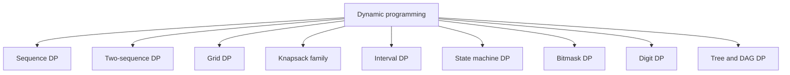
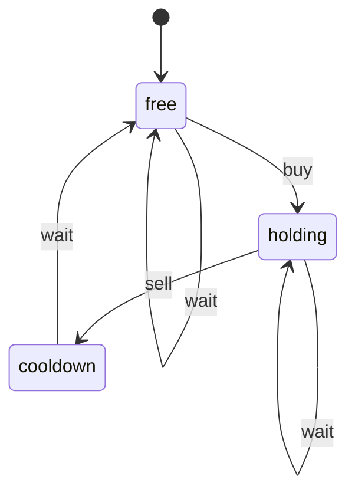

# A field guide to DP families

Thousands of DP problems exist, but they cluster into a handful of **families** that share a state
shape and a recurrence template. Recognising the family is often 80% of the solution: once you know
"this is an interval DP", you already know the state (`l, r`), the recurrence (try every split), and
the loop order (by length). This lesson is a map; later lessons explore each region in depth.



## 1. Sequence (1-D) DP

**State:** an index into one sequence — "best answer for the prefix ending at / up to `i`".
**Recurrence:** look back a fixed number of steps (Fibonacci-like) or over all earlier indices
(LIS-like).

| Look-back | Examples | Time |
|---|---|---|
| Constant (1–2 steps) | Climbing Stairs, House Robber, Decode Ways | O(n) |
| Over a dictionary / small set | Word Break, Coin Change | O(n·k) |
| Over all `j < i` | LIS (basic), Partition DP | O(n²) |

Two flavours of "prefix" state are worth distinguishing:

- **"up to i"** (`best[i]` uses elements `0..i`, may or may not include `i`) — House Robber.
- **"ending at i"** (must include element `i`) — LIS, Maximum Subarray, Maximum Product Subarray.
  The answer is then a maximum over all `i`.

```python-run
# Kadane = 1-D "ending here" DP for max subarray sum
def max_subarray(nums):
    best = cur = nums[0]
    for x in nums[1:]:
        cur = max(x, cur + x)        # extend the run ending at the previous index, or restart
        best = max(best, cur)
    return best

print(max_subarray([-2, 1, -3, 4, -1, 2, 1, -5, 4]))
```

## 2. Two-sequence DP

**State:** `(i, j)` = prefixes `a[:i]`, `b[:j]` (or suffixes).
**Recurrence:** compare `a[i-1]` with `b[j-1]`; match → diagonal; mismatch → drop one side.
**Order:** row-major. **Examples:** LCS, Edit Distance, Distinct Subsequences, Interleaving String,
Regular Expression Matching. Goodrich's DNA-alignment discussion is exactly this family: comparing
two strands of DNA or two versions of a file (like the Unix `diff` tool) reduces to LCS.

| | ∅ | b₁ | b₂ | … |
|---|---|---|---|---|
| ∅ | base | base | base | |
| a₁ | base | ↖ ↑ ← | | |
| a₂ | base | | | |

Each cell looks up, left and diagonally up-left, so two rows suffice for the value.

## 3. Grid DP

**State:** a cell `(r, c)`. When moves are only right/down, the dependency arrows point up/left and a
row-major fill works (Unique Paths, Minimum Path Sum, Maximal Square). When moves go in all four
directions, you need a different argument for acyclicity — e.g. Longest Increasing Path, where strict
increase guarantees a DAG, and memoized DFS or topological order replaces row-major loops.

## 4. Knapsack family

**State:** `(item index, remaining capacity)`, collapsed to a 1-D array over capacity.

| Variant | Each item | 1-D capacity loop | Examples |
|---|---|---|---|
| 0/1 knapsack | at most once | **downward** | Partition Equal Subset Sum, Target Sum, 0/1 Knapsack |
| Unbounded knapsack | any number | **upward** | Coin Change, Coin Change II |
| Bounded | up to `k_i` times | binary splitting or sliding window | (advanced) |

The objective changes the combine operator: max value (classic), min count (Coin Change), number of
ways (Coin Change II), feasibility (subset sum). Lesson 5 derives all of these carefully.

## 5. Interval DP

**State:** a contiguous range `(l, r)`. **Recurrence:** choose a split point `k` inside the range —
the last operation performed — and combine `(l, k)` and `(k, r)`.
**Order:** by increasing length. **Time:** typically O(n³).

Goodrich opens the DP chapter with the **matrix chain-product** problem. Multiplying a `d × e` matrix
by an `e × f` matrix costs `d·e·f` scalar multiplications, and the order of a chain of products
changes the cost dramatically. Let `N[i][j]` be the cheapest way to compute `A_i … A_j`; the final
multiplication splits at some `k`:

$$N_{i,j} = \min_{i \le k < j} \left( N_{i,k} + N_{k+1,j} + d_i\, d_{k+1}\, d_{j+1} \right), \qquad N_{i,i} = 0.$$

```python-run
def matrix_chain(d):
    """d[k] x d[k+1] is the shape of matrix k. Returns min scalar multiplications."""
    n = len(d) - 1
    N = [[0] * n for _ in range(n)]
    for length in range(1, n):                 # j - i
        for i in range(n - length):
            j = i + length
            N[i][j] = min(N[i][k] + N[k + 1][j] + d[i] * d[k + 1] * d[j + 1]
                          for k in range(i, j))
    return N[0][n - 1]

# B: 2x10, C: 10x50, D: 50x20  -> (BC)D costs 3000, B(CD) costs 10400
print(matrix_chain([2, 10, 50, 20]))
```

Other members: Burst Balloons, Longest Palindromic Subsequence, Minimum Cost to Cut a Stick,
Optimal BST.

## 6. State-machine DP

**State:** `(index, mode)` where the mode is a small finite set: holding / not holding a stock, in a
cooldown, number of transactions used. Each step applies a few transitions between modes. Drawing the
state machine first makes the code obvious:



**Examples:** Best Time to Buy and Sell Stock with Cooldown / with Fee / III / IV, House Robber
(modes: robbed previous or not), Maximum Product Subarray (keep max and min).

## 7. Bitmask DP (overview)

When the state must record **which items of a small set (n ≤ ~20) have been used**, encode the set as
an integer bitmask. `dp[mask][last]` for the Travelling Salesman Problem has $2^n \cdot n$ states and
$O(n)$ transitions each, i.e. $O(2^n n^2)$ — exponential, but vastly better than $n!$.

```python-run
from functools import cache

def tsp(dist):
    n = len(dist)
    FULL = (1 << n) - 1

    @cache
    def go(mask, last):                      # visited set = mask, currently at `last`
        if mask == FULL:
            return dist[last][0]             # return to the start
        return min(dist[last][nxt] + go(mask | 1 << nxt, nxt)
                   for nxt in range(n) if not mask & (1 << nxt))

    return go(1, 0)

d = [[0, 10, 15, 20], [10, 0, 35, 25], [15, 35, 0, 30], [20, 25, 30, 0]]
print(tsp(d))   # 80
```

Typical clues: `n ≤ 16` or `n ≤ 20`, "assign each person to a task", "visit all nodes", "partition
into k equal subsets".

## 8. Digit DP (overview)

"Count integers in `[0, N]` whose digits satisfy property P" (no two equal adjacent digits, digit sum
divisible by k, …). Enumerating up to `N = 10^18` is impossible, but you can build numbers **digit by
digit** from the most significant end. State: `(position, tight, extra)` where `tight` says whether
the prefix so far equals `N`'s prefix (so the next digit is capped by `N`'s digit) and `extra` holds
the property-specific summary (e.g. digit sum mod k).

```python-run
from functools import cache

def count_digit_sum_mult(N, k):
    """How many x in [0, N] have digit sum divisible by k?"""
    digits = list(map(int, str(N)))

    @cache
    def go(pos, tight, rem):
        if pos == len(digits):
            return 1 if rem == 0 else 0
        limit = digits[pos] if tight else 9
        return sum(go(pos + 1, tight and d == limit, (rem + d) % k) for d in range(limit + 1))

    return go(0, True, 0)

print(count_digit_sum_mult(100, 3))                             # digit DP
print(sum(1 for x in range(101) if sum(map(int, str(x))) % 3 == 0))  # brute check
```

States: ~19 positions × 2 × k — tiny. Digit DP rarely appears in standard interviews but is common in
contests.

## 9. Tree and DAG DP

On trees, the state is a node and the recurrence combines children (post-order traversal). House
Robber III returns a pair `(rob this node, skip this node)` from each subtree. On general DAGs, any
topological order works; Longest Increasing Path in a Matrix is DAG DP in disguise.

### Tree DP worked example: House Robber III

Houses form a binary tree; robbing a node forbids robbing its children. A single number per node is
not enough — the parent needs to know the best value **with** and **without** the child robbed. So
each subtree returns a pair, a tiny state machine living on a tree:

- `take(node) = node.val + skip(left) + skip(right)`
- `skip(node) = max(take(left), skip(left)) + max(take(right), skip(right))`

```python-run
class T:
    def __init__(self, val, left=None, right=None):
        self.val, self.left, self.right = val, left, right

def rob_tree(root):
    def go(node):                       # returns (take, skip)
        if node is None:
            return 0, 0
        lt, ls = go(node.left)
        rt, rs = go(node.right)
        return node.val + ls + rs, max(lt, ls) + max(rt, rs)
    return max(go(root))

#        3
#       / \
#      2   3
#       \   \
#        3   1
print(rob_tree(T(3, T(2, None, T(3)), T(3, None, T(1)))))   # 7 = 3 + 3 + 1
#        3
#       / \
#      4   5
#     / \   \
#    1   3   1
print(rob_tree(T(3, T(4, T(1), T(3)), T(5, None, T(1)))))   # 9 = 4 + 5
```

The post-order traversal *is* the topological order: children are finished before their parent. Each
node is visited once, so the running time is O(n).

## Practice: classify before you solve

The fastest way to build family recognition is to classify problems without solving them. Try each
prompt, then read the reasoning.

| Prompt | Family | State | Why |
|---|---|---|---|
| "Fewest perfect squares summing to n" | Unbounded knapsack | `dp[a]` | squares are reusable "coins", amount is the budget |
| "Min insertions to make a string a palindrome" | Interval | `dp[i][j]` | compare the two ends, shrink inward |
| "Shortest string containing both a and b as subsequences" | Two-sequence | `dp[i][j]` | it's `len(a) + len(b) − LCS` |
| "Paint n houses with 3 colours, no two neighbours equal, min cost" | State machine | `dp[i][colour]` | the mode is the previous colour |
| "Can n ≤ 16 sticks form a square?" | Bitmask | `dp[mask]` | must know exactly which sticks are used |
| "Count numbers ≤ N with no repeated digit" | Digit + bitmask | `(pos, tight, used digits)` | digit-by-digit with a 10-bit set |
| "Max path sum from top to bottom of a triangle" | Grid | `dp[r][c]` | moves only go down / down-right |

Two of these are worth a closer look because they show that **families combine**. "No repeated digit"
needs both a digit-DP skeleton and a bitmask of used digits. "Paint houses" is a 1-D sequence whose
state has a small extra mode — exactly the stock-with-cooldown shape.

```python-run
def perfect_squares(n):
    squares = [k * k for k in range(1, int(n ** 0.5) + 1)]
    dp = [0] + [n] * n                       # worst case: n ones
    for a in range(1, n + 1):
        dp[a] = 1 + min(dp[a - s] for s in squares if s <= a)
    return dp[n]

def paint_houses(costs):
    best = [0, 0, 0]                         # best[c]: min cost so far with the last house coloured c
    for r, g, b in costs:
        best = [r + min(best[1], best[2]), g + min(best[0], best[2]), b + min(best[0], best[1])]
    return min(best)

print(perfect_squares(12), perfect_squares(13))          # 3 (4+4+4), 2 (4+9)
print(paint_houses([[17, 2, 17], [16, 16, 5], [14, 3, 19]]))   # 10 = 2 + 5 + 3
```

### Common misclassifications

- **Treating a subsequence problem as a substring problem** (or vice versa). Substrings are contiguous:
  the recurrence resets on a mismatch. Subsequences carry the best value forward.
- **Using a 1-D state when a mode is missing.** If your recurrence needs "but only if yesterday I
  didn't …", that condition belongs in the state.
- **Reaching for bitmasks when order doesn't matter.** Subset *sum* only needs the sum, not the
  identity of the chosen items — that's knapsack (polynomial), not bitmask (exponential).
- **Interval DP with a "first operation" split.** If the two sides still interact after the split, try
  the *last* operation instead (lesson 11).

## Choosing the family: a quick decision table

| You see… | Try… |
|---|---|
| One array/string, answer about prefixes | 1-D sequence DP |
| Two strings, "transform", "common", "match" | Two-sequence DP |
| Grid with restricted moves | Grid DP |
| "Capacity", "amount", "sum to target", subsets | Knapsack |
| "Merge/burst/cut" a contiguous range, cost depends on neighbours | Interval DP |
| Days with buy/sell/cooldown or a few modes | State machine |
| `n ≤ 20` and "all items/each used once" | Bitmask DP |
| Count numbers ≤ N with a digit property | Digit DP |

> [!INTERVIEW]
> When stuck, name candidate families out loud and try their state shapes. "Is it enough to know the
> index? No — I also need the remaining budget. So it's knapsack-like: `(i, budget)`."

## Summary

- Most DP problems belong to a small number of families with characteristic states.
- Recognising the family gives you the state, recurrence template and loop order.
- Interval DP (matrix chain) and two-sequence DP (LCS) are the two examples Goodrich uses to introduce
  DP; both are O(n³)/O(nm) table fills replacing exponential searches.
- Bitmask and digit DP are exponential/large-domain problems tamed by compact states.

## Check yourself

```quiz
[
  {"q": "Which family does 'minimum scalar multiplications to compute A0·A1·…·An-1' belong to?", "options": ["Knapsack", "Interval DP", "Bitmask DP", "Grid DP"], "answer": 1, "explain": "The state is a contiguous range of matrices (i, j) and the recurrence tries every split point k."},
  {"q": "In 1-D knapsack form, what distinguishes 0/1 from unbounded?", "options": ["The base case", "The direction of the capacity loop: downward for 0/1, upward for unbounded", "Whether values are integers", "Nothing"], "answer": 1, "explain": "Downward iteration reads values from before the current item was considered; upward lets the item be reused in the same pass."},
  {"q": "A problem has n ≤ 16 workers and asks for an optimal assignment where each task is used once. A natural state is…", "options": ["(index)", "(mask of used tasks)", "(l, r)", "(digit position, tight)"], "answer": 1, "explain": "With n ≤ 16, a bitmask of used tasks gives 2^16 states — the bitmask DP signature."},
  {"q": "What does the 'tight' flag in digit DP indicate?", "options": ["The number is prime", "The prefix built so far equals N's prefix, so the next digit is capped", "The digit is zero", "Recursion depth is high"], "answer": 1, "explain": "While tight, digits cannot exceed N's digit at that position; once a smaller digit is chosen, all later digits are free (0–9)."},
  {"q": "Why does LIS use the 'ending at i' state rather than 'up to i'?", "options": ["It's faster", "To extend a subsequence you must know its last element, which 'ending at i' fixes", "Because of recursion limits", "It doesn't matter"], "answer": 1, "explain": "Whether nums[i] can extend a subsequence depends on that subsequence's last value; fixing it as nums[j] makes the comparison possible."},
  {"q": "For B: 2×10, C: 10×50, D: 50×20, which order is cheaper?", "options": ["B·(C·D)", "(B·C)·D", "Both cost the same", "Cannot tell"], "answer": 1, "explain": "(B·C)·D costs 2·10·50 + 2·50·20 = 3000, while B·(C·D) costs 10·50·20 + 2·10·20 = 10400."}
]
```

> **Source:** Goodrich, Tamassia & Goldwasser, *Data Structures and Algorithms in Python*, §13.3.1
> (Matrix Chain-Product) and §13.3.2 (DNA and Text Sequence Alignment); NeetCode 150 roadmap.
