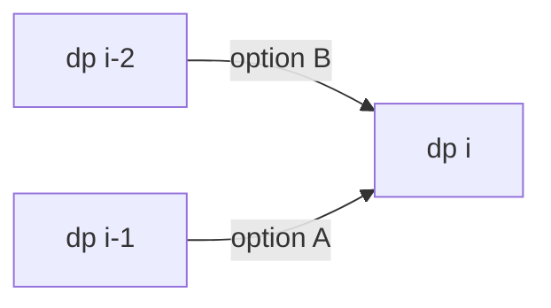

# Linear DP: stairs, robbers and decoders

The first batch of NeetCode 1-D problems — Climbing Stairs, Min Cost Climbing Stairs, House Robber,
House Robber II and Decode Ways — are all the **same machine** with different paint. Each has a state
that is a single index, a recurrence that looks back one or two positions, and an O(1)-space solution
with two rolling variables. Master the machine once and you'll solve all five in minutes.

## The machine



For each position `i` you consider **one or two options**, each depending on a previous state, and
combine them:

| Problem | State `dp[i]` | Option A (from `i-1`) | Option B (from `i-2`) | Combine |
|---|---|---|---|---|
| Climbing Stairs | ways to reach step `i` | last move was 1 step | last move was 2 steps | `+` |
| Min Cost Stairs | cheapest cost to stand on `i` | come from `i-1`, pay `cost[i-1]` | come from `i-2`, pay `cost[i-2]` | `min` |
| House Robber | best loot from houses `0..i` | skip house `i` | rob house `i` (+ `nums[i]`) | `max` |
| Decode Ways | decodings of `s[:i]` | last code = 1 digit (if valid) | last code = 2 digits (if valid) | `+` |

Notice how each row answers the framework from lesson 2. The only differences are what the options
*mean* and how they're combined.

## Climbing Stairs, the template

```python-run
def climb(n):
    prev2, prev1 = 1, 1        # ways(0), ways(1)
    for _ in range(2, n + 1):
        prev2, prev1 = prev1, prev1 + prev2
    return prev1

print([climb(n) for n in range(1, 11)])
```

The tuple assignment `prev2, prev1 = prev1, prev1 + prev2` evaluates the whole right side **before**
assigning, so both new values use the old ones. Writing it as two separate statements is a common
bug:

```python
prev2 = prev1            # oops: prev2 lost its old value...
prev1 = prev1 + prev2    # ...so this computes 2 * prev1
```

### Generalising the step set

If you may climb any step size in a set `S`, the recurrence is `ways(i) = Σ ways(i - s)` for `s` in
`S`. The look-back window grows to `max(S)`, but the structure is identical.

```python-run
def climb_general(n, steps):
    ways = [1] + [0] * n
    for i in range(1, n + 1):
        ways[i] = sum(ways[i - s] for s in steps if s <= i)
    return ways[n]

print(climb_general(10, [1, 2]))      # 89, same as climb(10)
print(climb_general(10, [1, 3, 5]))
```

## Min Cost Climbing Stairs: from counting to optimising

Swap `+` for `min` and attach costs to transitions. The only subtlety is *where* the top is: it's
position `n`, one past the last step, and you start on step 0 or 1 for free, so `best(0) = best(1) =
0`.

| i | 0 | 1 | 2 | 3 (top) |
|---|---|---|---|---|
| cost | 10 | 15 | 20 | – |
| best | 0 | 0 | min(0+15, 0+10) = 10 | min(10+20, 0+15) = **15** |

```python-run
def min_cost(cost):
    a = b = 0                                   # best(i-2), best(i-1)
    for i in range(2, len(cost) + 1):
        a, b = b, min(b + cost[i - 1], a + cost[i - 2])
    return b

print(min_cost([10, 15, 20]), min_cost([1, 100, 1, 1, 1, 100, 1, 1, 100, 1]))
```

> [!WARNING]
> "Greedy: always step to the cheaper of the next two" sounds plausible and is wrong.
> On `[0, 2, 3, 2]` greedy pays 0 → 2 → 2 = 4, but 0 → (jump to index 2) 3 → top = 3. DP considers
> both options at every step; greedy commits early.

## House Robber: the take-or-skip pattern

Houses in a row, can't rob two neighbours. At house `i` there's a binary decision:

- **skip** house `i` → best is whatever we had through `i-1`;
- **take** house `i` → we must have skipped `i-1`, so best through `i-2` plus `nums[i]`.

$$best(i) = \max\big(best(i-1),\; best(i-2) + nums[i]\big)$$

Dry run on `[2, 7, 9, 3, 1]`:

| i | nums[i] | skip = best(i−1) | take = best(i−2) + nums[i] | best(i) |
|---|---|---|---|---|
| 0 | 2 | 0 | 0 + 2 | 2 |
| 1 | 7 | 2 | 0 + 7 | 7 |
| 2 | 9 | 7 | 2 + 9 | 11 |
| 3 | 3 | 11 | 7 + 3 | 11 |
| 4 | 1 | 11 | 11 + 1 | **12** |

```python-run
def rob(nums):
    prev2 = prev1 = 0
    for x in nums:
        prev2, prev1 = prev1, max(prev1, prev2 + x)
    return prev1

print(rob([1, 2, 3, 1]), rob([2, 7, 9, 3, 1]), rob([2, 1, 1, 2]))
```

The last case, `[2, 1, 1, 2]`, defeats the popular "max of even-indexed sum and odd-indexed sum"
shortcut: the best is houses 0 and 3 (total 4), which are neither all-even nor all-odd.

### Recovering which houses

Keep the full table and walk backwards: at each `i`, if `best(i) == best(i-1)` house `i` was
skipped; otherwise it was taken and you jump to `i-2`.

```python-run
def rob_with_choice(nums):
    n = len(nums)
    best = [0] * (n + 2)          # best[k+2] = best through house k; best[0]=best[1]=0
    for i, x in enumerate(nums):
        best[i + 2] = max(best[i + 1], best[i] + x)
    picked, i = [], n - 1
    while i >= 0:
        if best[i + 2] == best[i + 1]:
            i -= 1
        else:
            picked.append(i)
            i -= 2
    return best[n + 1], picked[::-1]

print(rob_with_choice([2, 7, 9, 3, 1]))
```

## House Robber II: reduce the circle to lines

On a circle, house 0 and house `n-1` are neighbours. Any valid plan skips at least one of them, so
the answer is the better of two linear problems: houses `0..n-2` and houses `1..n-1`. This
"break a cycle by case analysis on one element" trick reappears in many circular problems.

```python-run
def rob_line(a):
    p2 = p1 = 0
    for x in a:
        p2, p1 = p1, max(p1, p2 + x)
    return p1

def rob_circle(nums):
    if len(nums) == 1:
        return nums[0]
    return max(rob_line(nums[:-1]), rob_line(nums[1:]))

print(rob_circle([2, 3, 2]), rob_circle([1, 2, 3, 1]), rob_circle([200, 3, 140, 20, 10]))
```

> [!TIP]
> Don't forget `n == 1`: both slices are empty and you'd return 0.

## Decode Ways: conditional transitions

Digits map to letters `1 → A … 26 → Z`. Count the decodings of a digit string. Classify by the
**last code**:

- one digit `s[i-1]`, valid iff it isn't `'0'` → contributes `ways(i-1)`;
- two digits `s[i-2:i]`, valid iff the first digit isn't `'0'` and the value is ≤ 26 → contributes
  `ways(i-2)`.

It's Climbing Stairs where some steps are forbidden depending on the digits.

| i | prefix | single valid? | pair valid? | ways(i) |
|---|---|---|---|---|
| 0 | "" | | | 1 |
| 1 | "2" | yes | | 1 |
| 2 | "22" | yes (+1) | "22" yes (+1) | 2 |
| 3 | "226" | yes (+2) | "26" yes (+1) | **3** |

```python-run
def num_decodings(s):
    prev2, prev1 = 1, (0 if s[0] == "0" else 1)
    for i in range(2, len(s) + 1):
        cur = 0
        if s[i - 1] != "0":
            cur += prev1
        if s[i - 2] != "0" and int(s[i - 2:i]) <= 26:
            cur += prev2
        prev2, prev1 = prev1, cur
    return prev1

for s in ["12", "226", "06", "10", "100", "2101", "11106"]:
    print(s, num_decodings(s))
```

Zeros are the whole difficulty: `"10"` has exactly one decoding (`J`), `"100"` has none (the second
`0` can't stand alone, and `"00"` isn't a code), and `"06"` has none because codes can't have a
leading zero.

## Top-down versions

Each of these problems also has a natural suffix-based recursion. For Decode Ways:

```python-run
from functools import cache

def num_decodings_td(s):
    n = len(s)

    @cache
    def go(i):                     # number of decodings of s[i:]
        if i == n:
            return 1
        if s[i] == "0":
            return 0
        total = go(i + 1)
        if i + 1 < n and int(s[i:i + 2]) <= 26:
            total += go(i + 2)
        return total

    return go(0)

print(num_decodings_td("226"), num_decodings_td("11106"))
```

Suffix recursion reads well ("decode the rest starting at `i`"), but recursion depth equals `n`.
For inputs of a few hundred characters it's fine; for tens of thousands, use the loop.

## A reduction worth knowing: Delete and Earn

Many problems are House Robber wearing a costume. **Delete and Earn**: pick a number `x` from `nums`
to earn `x` points, but every copy of `x − 1` and `x + 1` is then deleted. Maximise points.

Observation: once you take one `x`, taking *all* copies of `x` is free (their neighbours are already
gone). So bucket the values: `gain[v] = v × count(v)`. Now choosing bucket `v` forbids buckets `v − 1`
and `v + 1` — a row of houses indexed by value.

| value v | 0 | 1 | 2 | 3 | 4 |
|---|---|---|---|---|---|
| gain[v] for `[2, 2, 3, 3, 3, 4]` | 0 | 0 | 4 | 9 | 4 |
| best through v | 0 | 0 | 4 | 9 | **9** |

```python-run
def delete_and_earn(nums):
    gain = [0] * (max(nums) + 1)
    for x in nums:
        gain[x] += x
    prev2 = prev1 = 0
    for g in gain:                       # House Robber over value buckets
        prev2, prev1 = prev1, max(prev1, prev2 + g)
    return prev1

print(delete_and_earn([3, 4, 2]), delete_and_earn([2, 2, 3, 3, 3, 4]))   # 6, 9
```

The skill being tested is the **reduction**, not the DP. When a new problem says "choosing this
excludes its neighbours", look for the row of houses.

## Debugging linear DP with a brute force

Linear DP bugs are almost always base cases or off-by-one indices, and they hide on large inputs.
A ten-line exhaustive solver finds them in seconds. Here is the pattern, applied to House Robber:

```python-run
from itertools import combinations
import random

def rob(nums):
    prev2 = prev1 = 0
    for x in nums:
        prev2, prev1 = prev1, max(prev1, prev2 + x)
    return prev1

def rob_brute(nums):
    n, best = len(nums), 0
    for k in range(n + 1):
        for idx in combinations(range(n), k):
            if all(b - a > 1 for a, b in zip(idx, idx[1:])):      # no two adjacent
                best = max(best, sum(nums[i] for i in idx))
    return best

random.seed(7)
for _ in range(300):
    nums = [random.randint(0, 20) for _ in range(random.randint(1, 9))]
    assert rob(nums) == rob_brute(nums), nums
print("300 random cases agree")

def even_odd(nums):                      # the tempting shortcut
    return max(sum(nums[::2]), sum(nums[1::2]))

bad = next(a for a in ([random.randint(0, 9) for _ in range(4)] for _ in range(1000))
           if even_odd(a) != rob_brute(a))
print("shortcut fails on", bad, "->", even_odd(bad), "vs", rob_brute(bad))
```

The second half shows the other use of a brute force: **finding a counter-example** to a greedy idea
before you waste interview time implementing it.

## Counting vs optimising: a subtle difference in base cases

The same recurrence shape needs different "empty" values depending on the operator:

| Operator | Identity for "nothing chosen" | Value for "impossible" |
|---|---|---|
| `+` (count ways) | 1 | 0 |
| `min` (cheapest) | 0 | +∞ |
| `max` (best) | 0 | −∞ |
| `or` (feasible) | True | False |

Decode Ways uses the first row: the empty prefix has **1** decoding, and a prefix that cannot be
decoded has **0**, which then poisons everything built on it — exactly the behaviour we want for
`"100"`. Min Cost Climbing Stairs uses the second row. If a count comes out as 0 everywhere, the
empty-prefix value was probably initialised to 0.

> [!INTERVIEW]
> Typical follow-ups for this family, and the one-line answers:
> **"Can you do it in O(1) space?"** → rolling variables.
> **"What if you can take 1, 2 or 3 steps?"** → window of three; or a general step set.
> **"Return the actual houses / decoding."** → keep the table, walk backwards.
> **"What if the street is a circle? A tree?"** → two linear runs; a (take, skip) pair per node.
> **"What if n is 10¹⁸?"** → the recurrence is linear, so use 2×2 matrix exponentiation in O(log n).

## Why constant look-back means O(1) space

All four recurrences read only `dp[i-1]` and `dp[i-2]`. Once `dp[i]` exists, `dp[i-2]` is never read
again. Two variables are therefore sufficient, and the solution uses O(1) extra memory. This is the
1-D case of a general principle: **the memory you need equals the width of the dependency window**.

## Pitfalls checklist

- Base cases at the edge: `ways(0) = 1`, `best(0) = best(1) = 0`, empty-prefix loot = 0.
- Sequential assignment instead of simultaneous tuple assignment.
- Greedy shortcuts (cheaper step, alternating houses, biggest house first).
- Circle problems: handle `n == 1` separately.
- Decode Ways: `'0'` alone, leading-zero pairs, values `27…99`.

## Summary

- Linear DP problems share one template: state = index, look back one or two steps, combine options.
- The combine operator follows the question: `+` for counts, `min`/`max` for optimisation.
- House Robber's take-or-skip and House Robber II's "break the circle" are reusable patterns.
- Constant look-back gives O(1) space with rolling variables.

## Check yourself

```quiz
[
  {"q": "In House Robber, what does best(i-2) + nums[i] represent?", "options": ["Skipping house i", "Robbing house i, which forces house i-1 to be skipped", "Robbing both i-1 and i", "The total of all houses"], "answer": 1, "explain": "Taking house i means the previous house wasn't robbed, so we build on the best answer through i-2."},
  {"q": "Why does 'max(sum of even indices, sum of odd indices)' fail for House Robber?", "options": ["It overflows", "The optimum can skip two houses in a row, mixing parities, e.g. [2,1,1,2]", "It's too slow", "It robs adjacent houses"], "answer": 1, "explain": "On [2,1,1,2] the best plan robs houses 0 and 3 for 4, while both parity sums are 3."},
  {"q": "How does House Robber II handle the circle?", "options": ["Doubles the array", "Takes the max of the linear answer without the first house and without the last house", "Uses a 2-D table", "Robs every third house"], "answer": 1, "explain": "At least one of the two end houses is skipped in any valid plan, so two linear subproblems cover all cases."},
  {"q": "For Decode Ways, how many decodings does \"100\" have?", "options": ["0", "1", "2", "3"], "answer": 0, "explain": "\"10\" must be J, leaving a lone \"0\" which is invalid; \"1\",\"00\" is also invalid."},
  {"q": "In Min Cost Climbing Stairs with cost = [10, 15, 20], what is best(3) (the top)?", "options": ["10", "15", "20", "30"], "answer": 1, "explain": "Start on step 1, pay 15, jump two steps to the top."},
  {"q": "What goes wrong with `prev2 = prev1; prev1 = prev1 + prev2`?", "options": ["Nothing", "prev2 is overwritten before it's used, so prev1 becomes 2*prev1", "It raises an exception", "It uses O(n) memory"], "answer": 1, "explain": "Use simultaneous tuple assignment so both right-hand values are the old ones."},
  {"q": "Why do these problems need only O(1) extra space?", "options": ["Inputs are small", "Each state depends only on the previous one or two states", "Python optimises lists", "They use recursion"], "answer": 1, "explain": "Memory needed equals the width of the dependency window."}
]
```

> **Source:** NeetCode 150 roadmap (1-D Dynamic Programming); Goodrich, Tamassia & Goldwasser,
> *Data Structures and Algorithms in Python*, §13.3 (components of a DP solution).
