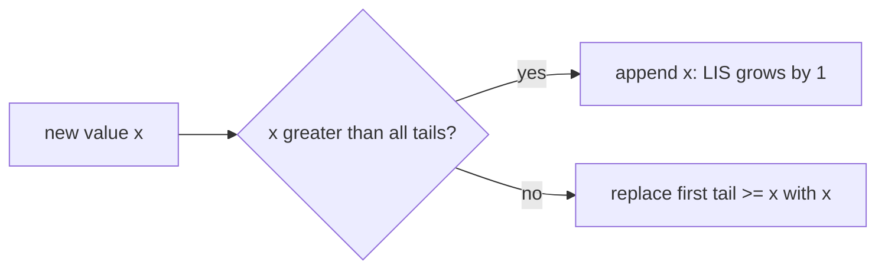

# Longest increasing subsequence and patience sorting

The Longest Increasing Subsequence (LIS) problem is the cleanest example of a DP whose state is
"the best answer **ending at** index `i`" — and it has a famous speed-up from O(n²) to O(n log n)
that comes from a card game. Both versions are interview staples, and the "ending at" idea transfers
directly to Maximum Product Subarray, Russian Doll Envelopes, Number of LIS and many more.

## The problem

Given `nums`, find the length of the longest **strictly increasing subsequence**. A subsequence keeps
the original order but may skip elements. For `[10, 9, 2, 5, 3, 7, 101, 18]` one answer is
`2, 3, 7, 101`, length 4.

Brute force enumerates all $2^n$ subsequences. For n = 2500 that's hopeless.

## O(n²) DP: "ending at i"

Why "ending at"? To extend a subsequence with `nums[i]` you must know its **last element** (it must be
smaller than `nums[i]`). A state "best LIS in `nums[:i]`" doesn't record the last element, so it
can't decide whether `nums[i]` extends it. Fixing the end solves that:

> `lis[i]` = length of the longest strictly increasing subsequence that **ends exactly at** index `i`.

**Recurrence:** the element before `nums[i]` in such a subsequence is some `nums[j]` with `j < i` and
`nums[j] < nums[i]`, or there is none:

$$lis[i] = 1 + \max\big(\{0\} \cup \{\, lis[j] : j < i,\ nums[j] < nums[i] \,\}\big)$$

**Base:** implicit (`lis[i] ≥ 1`). **Order:** left to right. **Answer:** $\max_i lis[i]$ — the best
subsequence can end anywhere.

| i | 0 | 1 | 2 | 3 | 4 | 5 | 6 | 7 |
|---|---|---|---|---|---|---|---|---|
| nums | 10 | 9 | 2 | 5 | 3 | 7 | 101 | 18 |
| lis | 1 | 1 | 1 | 2 | 2 | 3 | 4 | 4 |

For `i = 5` (value 7): earlier smaller values are 2 (lis 1), 5 (lis 2), 3 (lis 2) → `1 + 2 = 3`.

```python-run
def lis_quadratic(nums):
    n = len(nums)
    lis = [1] * n
    for i in range(n):
        for j in range(i):
            if nums[j] < nums[i] and lis[j] + 1 > lis[i]:
                lis[i] = lis[j] + 1
    return max(lis), lis

print(lis_quadratic([10, 9, 2, 5, 3, 7, 101, 18]))
print(lis_quadratic([0, 1, 0, 3, 2, 3]))
```

States: n; work per state: O(n) → **O(n²)** total. Fine for n = 2500 (about 3 million comparisons),
slow for n = 10⁵.

### Reconstructing the subsequence

Store `parent[i]` = the `j` that achieved the maximum, then follow parents back from the best end.

```python-run
def lis_sequence(nums):
    n = len(nums)
    lis, parent = [1] * n, [-1] * n
    for i in range(n):
        for j in range(i):
            if nums[j] < nums[i] and lis[j] + 1 > lis[i]:
                lis[i], parent[i] = lis[j] + 1, j
    i = max(range(n), key=lambda k: lis[k])
    seq = []
    while i != -1:
        seq.append(nums[i])
        i = parent[i]
    return seq[::-1]

print(lis_sequence([10, 9, 2, 5, 3, 7, 101, 18]))
```

## O(n log n): patience sorting

### The card game

Deal cards one at a time into piles, left to right. Rule: place each card on the **leftmost pile
whose top card is ≥ the new card**; if no such pile exists, start a new pile on the right. The number
of piles at the end equals the length of the LIS.

Dealing `10, 9, 2, 5, 3, 7, 101, 18`:

| card | piles (top cards) |
|---|---|
| 10 | [10] |
| 9 | [9] |
| 2 | [2] |
| 5 | [2, 5] |
| 3 | [2, 3] |
| 7 | [2, 3, 7] |
| 101 | [2, 3, 7, 101] |
| 18 | [2, 3, 7, 18] |

Four piles → LIS length 4.

### Why it works: the `tails` invariant

Rephrase the piles as an array:

> `tails[k]` = the **smallest possible last element** of a strictly increasing subsequence of length
> `k + 1` among the elements seen so far.

Two facts make this powerful:

1. **`tails` is strictly increasing.** If an increasing subsequence of length `k+2` ends at value
   `t`, dropping its last element gives a length-`k+1` subsequence ending below `t`; so
   `tails[k] < tails[k+1]`.
2. **Smaller tails dominate.** Among subsequences of the same length, the one with the smallest last
   element can be extended by everything the others can, and more. So remembering only the smallest
   tail per length loses nothing.

Processing a new value `x`:

- If `x` is larger than every tail, it extends the longest subsequence → append.
- Otherwise find the first tail `≥ x` (position `k`). A subsequence of length `k` ends below `x`
  (because `tails[k-1] < x`), so `x` can end a length-`k+1` subsequence with a smaller tail than
  before → `tails[k] = x`.

Because `tails` is sorted, "first tail ≥ x" is exactly `bisect_left(tails, x)` — **O(log n)** per
element.

```python-run
from bisect import bisect_left

def lis_fast(nums, trace=False):
    tails = []
    for x in nums:
        k = bisect_left(tails, x)
        if k == len(tails):
            tails.append(x)
        else:
            tails[k] = x
        if trace:
            print(f"x={x:>4}  tails={tails}")
    return len(tails)

print(lis_fast([10, 9, 2, 5, 3, 7, 101, 18], trace=True))
```



> [!WARNING]
> `tails` is **not** an actual increasing subsequence of the input. After processing
> `[3, 4, 1]` it is `[1, 4]`, but 1 comes after 4 in the input. Only its **length** is meaningful
> (and with extra bookkeeping you can still recover a real LIS).

### Strict vs non-strict

- Strictly increasing → `bisect_left` (an equal value *replaces* the tail; duplicates can't extend).
- Non-decreasing → `bisect_right` (an equal value goes after equal tails, so it *can* extend).

```python-run
from bisect import bisect_left, bisect_right

def lis_generic(nums, strict=True):
    find = bisect_left if strict else bisect_right
    tails = []
    for x in nums:
        k = find(tails, x)
        tails[k:k + 1] = [x]
    return len(tails)

data = [7, 7, 7, 7]
print("strict:", lis_generic(data), " non-decreasing:", lis_generic(data, strict=False))
```

(The slice assignment `tails[k:k+1] = [x]` appends when `k == len(tails)` and replaces otherwise — a
compact idiom.)

### Recovering an actual LIS in O(n log n)

Record, for each element, the index of the current tail of the previous pile when it was placed —
a parent pointer — and the index stored at each pile.

```python-run
from bisect import bisect_left

def lis_fast_sequence(nums):
    tails, tail_idx, parent = [], [], [-1] * len(nums)
    for i, x in enumerate(nums):
        k = bisect_left(tails, x)
        if k > 0:
            parent[i] = tail_idx[k - 1]
        if k == len(tails):
            tails.append(x); tail_idx.append(i)
        else:
            tails[k] = x; tail_idx[k] = i
    seq, i = [], tail_idx[-1]
    while i != -1:
        seq.append(nums[i]); i = parent[i]
    return seq[::-1]

print(lis_fast_sequence([10, 9, 2, 5, 3, 7, 101, 18]))
print(lis_fast_sequence([0, 8, 4, 12, 2, 10, 6, 14, 1, 9, 5, 13, 3, 11, 7, 15]))
```

## Comparing the two

```python-run
import random, time
from bisect import bisect_left

def quad(a):
    lis = [1] * len(a)
    for i in range(len(a)):
        for j in range(i):
            if a[j] < a[i] and lis[j] >= lis[i]:
                lis[i] = lis[j] + 1
    return max(lis)

def fast(a):
    t = []
    for x in a:
        k = bisect_left(t, x)
        t[k:k + 1] = [x]
    return len(t)

a = [random.randint(0, 10**6) for _ in range(1500)]
for f in (quad, fast):
    t0 = time.perf_counter(); r = f(a)
    print(f.__name__, r, f"{(time.perf_counter() - t0) * 1000:.1f} ms")
```

| Approach | Time | Space | Reconstruct? |
|---|---|---|---|
| Brute force | O(2ⁿ · n) | O(n) | yes |
| "Ending at i" DP | O(n²) | O(n) | easy (parents) |
| Patience sorting | O(n log n) | O(n) | with parent bookkeeping |

## Related problems that reduce to LIS

- **Russian Doll Envelopes** — sort by width ascending and, for equal widths, height **descending**;
  then LIS on heights. The descending tie-break stops two envelopes of equal width from nesting.
- **Maximum length of pair chain**, **Longest String Chain** — "ending at" DP after sorting.
- **Number of LIS** — keep both `length[i]` and `count[i]` in the O(n²) DP.
- **Minimum deletions to make a sequence sorted** = `n − LIS`.
- **LCS of two permutations** reduces to LIS by relabelling one permutation's values by their
  positions in the other.

```python-run
from bisect import bisect_left

def max_envelopes(envs):
    envs.sort(key=lambda e: (e[0], -e[1]))
    tails = []
    for _, h in envs:
        k = bisect_left(tails, h)
        tails[k:k + 1] = [h]
    return len(tails)

print(max_envelopes([[5, 4], [6, 4], [6, 7], [2, 3]]))   # 3: [2,3] -> [5,4] -> [6,7]
```

## Pitfalls

- Confusing the longest increasing **subsequence** with the longest increasing **contiguous run**.
- Returning `lis[n-1]` instead of `max(lis)` in the O(n²) version.
- Using `bisect_right` for a strictly increasing LIS (duplicates wrongly extend).
- Treating `tails` as the actual subsequence.
- Memoized recursion over `i` with n = 2500 can exceed Python's recursion limit.

## Summary

- "Ending at i" states let the recurrence check the last element; the answer is a max over all ends.
- The O(n²) DP compares every pair.
- Patience sorting keeps the smallest tail per length; `tails` stays sorted, so binary search gives
  O(n log n).
- `bisect_left` for strict, `bisect_right` for non-decreasing.

## Check yourself

```quiz
[
  {"q": "Why does the O(n²) LIS DP use 'ending at i' rather than 'within the prefix up to i'?", "options": ["It's shorter to code", "Extending a subsequence requires knowing its last element, which 'ending at i' fixes", "It avoids recursion", "It uses less memory"], "answer": 1, "explain": "To append nums[i] we need the previous element to be smaller; fixing the end element makes that check possible."},
  {"q": "What does tails[k] store in patience sorting?", "options": ["The k-th input value", "The smallest possible last element of an increasing subsequence of length k+1", "The length of the LIS ending at k", "The number of piles"], "answer": 1, "explain": "Keeping the smallest tail per length is optimal because smaller tails can be extended by more future values."},
  {"q": "Process [10, 9, 2, 5, 3, 7, 101, 18]. What is tails at the end?", "options": ["[2, 3, 7, 101]", "[2, 3, 7, 18]", "[2, 5, 7, 18]", "[10, 101]"], "answer": 1, "explain": "18 replaces 101 because 101 is the first tail ≥ 18."},
  {"q": "For a strictly increasing LIS with duplicates, which bisect function is correct?", "options": ["bisect_left", "bisect_right", "Either", "Neither"], "answer": 0, "explain": "bisect_left makes an equal value replace the existing tail instead of extending past it."},
  {"q": "Is the final tails array always a valid subsequence of the input?", "options": ["Yes", "No — only its length is guaranteed meaningful", "Only if the input is sorted", "Only for distinct values"], "answer": 1, "explain": "E.g. [3, 4, 1] gives tails [1, 4], but 1 appears after 4."},
  {"q": "In Russian Doll Envelopes, why sort equal widths by descending height?", "options": ["To speed up bisect", "So that envelopes with equal width can't both appear in the increasing height subsequence", "To make tails sorted", "It's arbitrary"], "answer": 1, "explain": "Equal widths can't nest; descending heights within a width prevent the LIS from chaining them."}
]
```

> **Source:** NeetCode 150 roadmap (Longest Increasing Subsequence); Goodrich, Tamassia & Goldwasser,
> *Data Structures and Algorithms in Python*, §13.3 (DP components).
