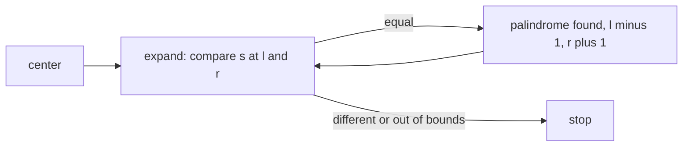

# Palindromes, products and word breaks

> **Before this lesson:** read [The DP framework](#/lesson/neet-dp/dp-framework) and
> [Linear DP: stairs, robbers and decoders](#/lesson/neet-dp/dp-linear). The "ending at i" idea comes from
> [Longest increasing subsequence and patience sorting](#/lesson/neet-dp/dp-lis).

## In plain words

This lesson covers three small topics that complete the one-dimensional problems:

1. **Palindromes.** A palindrome is text that reads the same backwards — `level`, `noon`, `racecar`.
   We want to find the longest palindrome hidden inside a string, and to count all of them. The trick
   is that a palindrome is a mirror: start in its middle and step outwards one letter each side while
   the two letters match.
2. **Largest product of neighbours.** Find the run of neighbouring numbers in a list whose product
   (all multiplied together) is biggest. The twist is negative numbers: multiplying two negatives gives
   a positive, so a very bad running product can suddenly become the best one.
3. **Word break.** Can a string with no spaces, like `applepie`, be cut into dictionary words
   (`apple` + `pie`)? Think of stepping stones at each position of the string: a word is a jump from
   one stone to another, and the question is whether the last stone can be reached.

Why it matters for a job: all three are standard interview questions, and each trains a habit you
will reuse — exploiting symmetry, carrying an extra piece of information per step, and treating a
yes/no question as "which positions can I reach?"

Words used below:

- **Substring** — letters that are next to each other in the string (no gaps). **Subarray** is the
  same idea for a list.
- **Center** — the middle of a palindrome: one letter for odd lengths, the gap between two letters for
  even lengths.
- **Reachability** — whether a position can be reached at all by legal steps.

This lesson collects the remaining 1-D NeetCode problems. They look unrelated — palindromic substrings,
maximum product subarray, word break — but each teaches a distinct, reusable idea:

| Problem | Idea |
|---|---|
| Longest Palindromic Substring, Palindromic Substrings | A 2-D interval recurrence that you can evaluate **center by center** in O(1) space |
| Maximum Product Subarray | "Ending here" DP where you must carry **two** values (max and min) |
| Word Break | Reachability DP over prefix positions, with a dictionary as the transition set |

## Part 1: palindromic substrings

A palindrome reads the same forwards and backwards. Substring = contiguous.

### The interval recurrence

Let `pal(i, j)` be true when `s[i..j]` is a palindrome. A string is a palindrome iff its two ends
match **and** the inside is a palindrome:

$$pal(i, j) = \big(s_i = s_j\big) \wedge \big(j - i < 2 \;\vee\; pal(i+1, j-1)\big)$$

Base cases: length 1 (always true) and length 2 (true iff the characters match). Dependencies point
from `(i, j)` to the shorter interval `(i+1, j-1)`, so we fill by increasing length — classic interval
DP order.

Table for `s = "abba"` (rows `i`, columns `j`, only `j ≥ i` matter):

| | a | b | b | a |
|---|---|---|---|---|
| a | T | F | F | **T** |
| b | | T | T | F |
| b | | | T | F |
| a | | | | T |

`pal(0, 3)`: ends `a = a` and `pal(1, 2)` (`"bb"`) is true → true.

```python-run
def pal_table(s):
    n = len(s)
    pal = [[False] * n for _ in range(n)]
    for length in range(1, n + 1):
        for i in range(n - length + 1):
            j = i + length - 1
            pal[i][j] = s[i] == s[j] and (length <= 2 or pal[i + 1][j - 1])
    return pal

s = "abba"
pal = pal_table(s)
count = sum(pal[i][j] for i in range(len(s)) for j in range(i, len(s)))
longest = max(((i, j) for i in range(len(s)) for j in range(i, len(s)) if pal[i][j]),
              key=lambda p: p[1] - p[0])
print("palindromic substrings:", count, " longest:", s[longest[0]:longest[1] + 1])
```

That's O(n²) time and O(n²) memory. We can keep the time and drop the memory.

### Expand around center

Every palindrome has a **center**: a character (odd length) or the gap between two characters (even
length). There are `2n − 1` centers. The recurrence `pal(i, j) ⇐ pal(i+1, j−1)` says: starting from a
center, a palindrome grows by one character on each side as long as those characters match. So for
each center, expand outward until the ends differ.



```python-run
def expand_all(s):
    n, count, best = len(s), 0, (0, 0)
    for c in range(n):
        for l, r in ((c, c), (c, c + 1)):         # odd center, even center
            while l >= 0 and r < n and s[l] == s[r]:
                count += 1                          # s[l..r] is a palindrome
                if r - l > best[1] - best[0]:
                    best = (l, r)
                l -= 1
                r += 1
    return count, s[best[0]:best[1] + 1]

for s in ["babad", "cbbd", "aaa", "abc", "forgeeksskeegfor"]:
    print(s, expand_all(s))
```

Each successful comparison discovers exactly one palindrome, so counting (Palindromic Substrings) and
tracking the longest (Longest Palindromic Substring) fall out of the same loop. Time O(n²) worst case
(e.g. `"aaaa…"`), space O(1).

> [!WARNING]
> Forgetting **even** centers is the classic bug: `"cbbd"` would return `"c"` and miss `"bb"`.

> [!NOTE]
> A tempting wrong idea for the longest palindrome: "find the longest common substring of `s` and
> `reverse(s)`." It fails when `s` contains a reversed copy of a non-palindromic chunk elsewhere, e.g.
> `"abacdfgdcaba"`: `"abacd"` appears reversed (`"dcaba"`) but isn't a palindrome.

### Beyond O(n²)

Manacher's algorithm reuses information from palindromes already found (mirror symmetry inside a big
palindrome) to get O(n). It's rarely required in interviews; mentioning it as a follow-up is enough.

### Substring vs subsequence palindromes

*Longest palindromic **subsequence*** allows gaps. Its recurrence differs on a mismatch: drop one end
and take the better.

$$L(i, j) = \begin{cases} L(i+1, j-1) + 2 & s_i = s_j \\ \max\big(L(i+1, j),\, L(i, j-1)\big) & \text{otherwise}\end{cases}$$

(It also equals the LCS of `s` and `reverse(s)` — here that reduction *is* correct.)

```python-run
def longest_pal_subseq(s):
    n = len(s)
    L = [[0] * n for _ in range(n)]
    for i in range(n - 1, -1, -1):
        L[i][i] = 1
        for j in range(i + 1, n):
            L[i][j] = L[i + 1][j - 1] + 2 if s[i] == s[j] else max(L[i + 1][j], L[i][j - 1])
    return L[0][n - 1]

print(longest_pal_subseq("bbbab"), longest_pal_subseq("cbbd"))
```

### Reusing the palindrome table: minimum cuts

The `pal` table is a building block for other DPs. **Palindrome Partitioning II** asks for the fewest
cuts that split `s` into palindromic pieces. With `pal` available, it becomes a Word-Break-style
prefix DP where the "dictionary" is the set of palindromic substrings:

> `cuts[i]` = minimum cuts for the prefix `s[:i]`;
> `cuts[i] = min(cuts[j] + 1)` over all `j < i` with `pal(j, i-1)`; using `cuts[0] = −1` makes a
> whole-prefix palindrome cost 0.

```python-run
def min_cut(s):
    n = len(s)
    pal = [[False] * n for _ in range(n)]
    for length in range(1, n + 1):
        for i in range(n - length + 1):
            j = i + length - 1
            pal[i][j] = s[i] == s[j] and (length <= 2 or pal[i + 1][j - 1])
    cuts = [-1] + [0] * n
    for i in range(1, n + 1):
        cuts[i] = min(cuts[j] + 1 for j in range(i) if pal[j][i - 1])
    return cuts[n]

for s in ["aab", "racecar", "abcde", "abbab"]:
    print(s, min_cut(s))          # 1, 0, 4, 1
```

For `"aab"`: `cuts = [-1, 0, 0, 1]` — `"a"` needs no cut, `"aa"` needs none, `"aab"` is `"aa" | "b"`.
Two O(n²) DPs stacked on each other is a common pattern: one precomputes a yes/no property of every
substring, the second optimises over prefixes.

## Part 2: Maximum Product Subarray

For **sums**, Kadane's algorithm keeps `cur` = best sum of a subarray ending here:
`cur = max(x, cur + x)`. For **products** that fails, because multiplying by a negative number turns
the smallest (most negative) product into the largest.

The fix: carry **two** states per index.

- `hi(i)` = maximum product of a subarray ending at `i`
- `lo(i)` = minimum product of a subarray ending at `i`

With `x = nums[i]`, the best subarray ending at `i` is either `x` alone, or extends the best/worst
subarray ending at `i-1`:

$$hi(i) = \max(x,\; hi(i-1)\cdot x,\; lo(i-1)\cdot x), \qquad lo(i) = \min(x,\; hi(i-1)\cdot x,\; lo(i-1)\cdot x)$$

Answer: $\max_i hi(i)$.

| i | x | hi | lo | best |
|---|---|---|---|---|
| 0 | −2 | −2 | −2 | −2 |
| 1 | 3 | 3 | −6 | 3 |
| 2 | −4 | **24** | −12 | **24** |

```python-run
def max_product(nums):
    best = hi = lo = nums[0]
    for x in nums[1:]:
        cands = (x, hi * x, lo * x)
        hi, lo = max(cands), min(cands)       # both from the OLD hi/lo
        best = max(best, hi)
    return best

def kadane_product_wrong(nums):
    best = cur = nums[0]
    for x in nums[1:]:
        cur = max(x, cur * x)
        best = max(best, cur)
    return best

for a in ([2, 3, -2, 4], [-2, 0, -1], [-2, 3, -4], [2, -5, -2, -4, 3]):
    print(a, max_product(a), "(naive:", kadane_product_wrong(a), ")")
```

Zeros need no special case: candidate `x = 0` resets both `hi` and `lo` to 0, which is exactly
"start fresh after the zero".

> [!TIP]
> "Carry extra values per state" is a general move. Whenever an operation can flip the order
> (negation, multiplication by negatives, subtraction), keep both extremes.

A longer dry run shows the roles of `hi` and `lo` swapping more than once. `nums = [2, -5, -2, -4, 3]`:

| i | x | candidates (x, hi·x, lo·x) | hi | lo | best |
|---|---|---|---|---|---|
| 0 | 2 | – | 2 | 2 | 2 |
| 1 | −5 | −5, −10, −10 | −5 | −10 | 2 |
| 2 | −2 | −2, 10, 20 | 20 | −2 | 20 |
| 3 | −4 | −4, −80, 8 | 8 | −80 | 20 |
| 4 | 3 | 3, 24, −240 | **24** | −240 | **24** |

At `i = 2` the new maximum (20) comes from the old **minimum** (−10 × −2). At `i = 3` the maximum 8
comes from the old minimum again (−2 × −4), i.e. the subarray `[-2, -4]`, and the final answer 24 is
`[-2, -4, 3]`. The naive Kadane variant reports 10 here because it threw the −10 away.

Common bugs, all of which the table above would expose:

- updating `hi` first and then computing `lo` from the *new* `hi`;
- initialising `best` to 0, which breaks single negative inputs like `[-2]`;
- omitting the bare `x` candidate, so a subarray can never restart after a zero.

### An alternative view

The maximum-product subarray, within any zero-free segment, is always a prefix or a suffix of that
segment (if the segment's product is negative, drop everything up to the first or after the last
negative number). So the max over all prefix products and suffix products (resetting at zeros) is the
answer — a neat O(n) trick without DP vocabulary.

## Part 3: Word Break

Given `s` and a dictionary, can `s` be split into dictionary words (reuse allowed)?

### Why greedy fails

- Longest match first: `"goalspecial"` with `[go, goal, goals, special]` → takes `goals`, then `pecial`
  fails. But `goal + special` works.
- Shortest match first: `"aaaaaaa"` with `[aaaa, aaa]` → `aaa, aaa`, then `a` fails. But `aaa + aaaa`
  works.

### Reachability over positions

Think of positions `0..n` in the string as nodes. A dictionary word `w` that occurs at position `j`
gives an edge `j → j + len(w)`. The question is whether node `n` is reachable from node 0 — and since
edges only go forward, a simple left-to-right DP decides it:

> `ok[i]` = `s[:i]` can be segmented. `ok[0] = True`.
> `ok[i] = any(ok[i - len(w)] and s[i - len(w):i] == w for w in words)`.

```python-run
def word_break(s, words):
    words = set(words)
    lens = sorted({len(w) for w in words})
    ok = [True] + [False] * len(s)
    for i in range(1, len(s) + 1):
        ok[i] = any(L <= i and ok[i - L] and s[i - L:i] in words for L in lens)
    return ok[-1], ok

res, table = word_break("leetcode", ["leet", "code"])
print(res, ["T" if x else "." for x in table])
print(word_break("catsandog", ["cats", "dog", "sand", "and", "cat"])[0])
print(word_break("goalspecial", ["go", "goal", "goals", "special"])[0])
```

| i | 0 | 1 | 2 | 3 | 4 | 5 | 6 | 7 | 8 |
|---|---|---|---|---|---|---|---|---|---|
| s[:i] | "" | l | le | lee | leet | leetc | … | … | leetcode |
| ok | T | F | F | F | T | F | F | F | T |

Iterating over **distinct word lengths** (at most 20) rather than all dictionary words keeps the inner
loop short: O(n · m · L) where m = number of distinct lengths and L = cost of slicing/hashing.

### Top-down version and why plain recursion explodes

```python-run
from functools import cache
import time

def word_break_td(s, words):
    words = tuple(words)

    @cache
    def can(i):
        if i == len(s):
            return True
        return any(s.startswith(w, i) and can(i + len(w)) for w in words)

    return can(0)

s = "a" * 60 + "b"
words = ["a", "aa", "aaa", "aaaa", "aaaaa"]
t0 = time.perf_counter()
print(word_break_td(s, words), f"{(time.perf_counter() - t0) * 1000:.2f} ms with memo")
```

Without `@cache` that input would try every way of splitting 60 `a`s into pieces of length 1–5 — on
the order of 10¹⁷ ways — before discovering the final `b` can never match.

### Listing the segmentations: Word Break II

If the question changes to "return **all** ways to segment `s`", the output can be exponential, so no
table of booleans suffices. The standard approach is memoized backtracking over the same suffix
states: `sentences(i)` returns every segmentation of `s[i:]`, built from each dictionary word that
starts at `i` followed by every segmentation of the rest.

```python-run
from functools import cache

def word_break_all(s, words):
    words = set(words)
    n = len(s)

    @cache
    def sentences(i):                       # all segmentations of s[i:]
        if i == n:
            return [""]
        out = []
        for j in range(i + 1, n + 1):
            w = s[i:j]
            if w in words:
                for rest in sentences(j):
                    out.append(w + (" " + rest if rest else ""))
        return out

    return sentences(0)

print(word_break_all("catsanddog", ["cat", "cats", "and", "sand", "dog"]))
print(word_break_all("pineapplepenapple", ["apple", "pen", "applepen", "pine", "pineapple"]))
print(word_break_all("catsandog", ["cats", "dog", "sand", "and", "cat"]))
```

The same split — *decide* with a boolean DP, *count* with an integer DP, *list* with memoized
backtracking — applies to Decode Ways, Climbing Stairs and most other prefix problems.

> [!INTERVIEW]
> Follow-ups to expect in this lesson's problems: **palindromes** — "can you do better than O(n²)?"
> (Manacher, O(n); name it, explain the mirror idea, don't code it unless asked); **product** — "what
> if the array contains zeros / is all negative?" (walk through the `hi`/`lo` table); **word break** —
> "how would you speed up the dictionary lookups?" (set of words plus distinct lengths, or a trie) and
> "return one valid segmentation" (store, for each reachable `i`, the `j` it came from).

### Variants

- **Word Break II** asks for all segmentations: memoized backtracking returning lists (output can be
  exponential, so DP alone can't help).
- A **trie** over the dictionary lets you scan forward from position `i` and find all words starting
  there in one pass.

## Summary

- Palindrome problems have an interval recurrence; expand-around-center evaluates it with O(1) space.
- Count palindromes = count successful expansion steps; include even centers.
- Maximum Product Subarray carries both a max and a min "ending here".
- Word Break is reachability over prefix positions; greedy matching fails.

## Glossary

| Term | Meaning in plain words |
|---|---|
| **Palindrome** | Text that reads the same forwards and backwards. |
| **Substring / subarray** | A run of neighbouring characters / list items. |
| **Center** | The middle point a palindrome is symmetric around (a letter or a gap). |
| **Expand around center** | Growing a palindrome outward from its middle while the two ends match. |
| **Kadane's algorithm** | The 'best run ending here' method for the largest sum of neighbours. |
| **hi / lo** | The largest and smallest product of a run ending at the current position. |
| **Reachability DP** | A yes/no table saying which positions can be reached. |
| **Dictionary (word list)** | The set of allowed words in Word Break. |
| **Trie** | A tree of letters that stores many words and shares their common beginnings. |
| **Backtracking** | Trying choices one by one and undoing them, used when every solution must be listed. |

## Check yourself

```quiz
[
  {"q": "How many centers does expand-around-center check for a string of length n?", "options": ["n", "2n − 1", "n²", "n/2"], "answer": 1, "explain": "n single-character centers (odd lengths) plus n − 1 gaps (even lengths)."},
  {"q": "How many palindromic substrings does \"aaa\" have?", "options": ["3", "4", "6", "7"], "answer": 2, "explain": "Three 'a', two 'aa', one 'aaa'."},
  {"q": "Why does Maximum Product Subarray keep the minimum product too?", "options": ["To handle zeros only", "A negative number turns the most negative product into the largest", "For reconstruction", "It isn't needed"], "answer": 1, "explain": "Multiplying by a negative swaps the order, so the previous minimum can become the new maximum."},
  {"q": "What is the maximum product subarray of [-2, 3, -4]?", "options": ["3", "6", "12", "24"], "answer": 3, "explain": "The whole array: (-2)·3·(-4) = 24."},
  {"q": "Why does greedily taking the longest dictionary word fail in Word Break?", "options": ["It's too slow", "A long match can leave an unsplittable remainder that a shorter match would avoid", "Dictionaries are unordered", "It never fails"], "answer": 1, "explain": "\"goalspecial\": taking 'goals' strands 'pecial', while 'goal' + 'special' works."},
  {"q": "In Word Break, ok[i] means…", "options": ["s[i] is a word", "the prefix s[:i] can be segmented into dictionary words", "there are i words", "s[i:] can be segmented"], "answer": 1, "explain": "It's reachability of position i from position 0 using word edges."},
  {"q": "Longest common substring of s and reverse(s) is a correct way to find the longest palindromic substring.", "options": ["True", "False"], "answer": 1, "explain": "It fails when a non-palindromic chunk appears reversed elsewhere, e.g. \"abacdfgdcaba\"."}
]
```

> **Source:** NeetCode 150 roadmap (Longest Palindromic Substring, Palindromic Substrings, Maximum
> Product Subarray, Word Break); Goodrich, Tamassia & Goldwasser, *Data Structures and Algorithms in
> Python*, §13.3.
