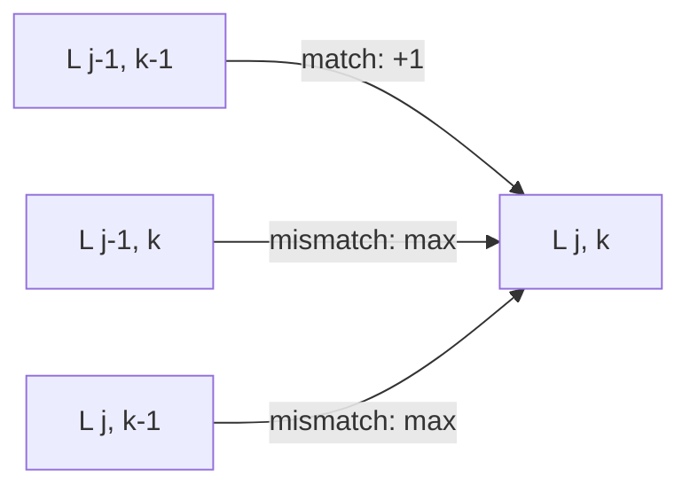

# String DP: LCS, edit distance and friends

Two-string problems are where DP tables become genuinely two-dimensional — and they all share one
skeleton. The state is a pair of prefix lengths `(i, j)`; the recurrence looks at the last characters
`a[i-1]` and `b[j-1]`; the table has an empty-string row and column as its base. Learn the skeleton on
Longest Common Subsequence (the problem Goodrich uses to introduce text DP), then watch it adapt to
Edit Distance, Distinct Subsequences, Interleaving String and Regular Expression Matching.

## Longest Common Subsequence

A **subsequence** keeps order but may skip characters. LCS asks for the longest string that is a
subsequence of both `X` and `Y`. It's the core of `diff` (comparing two versions of a file) and of DNA
sequence comparison, the motivating applications in Goodrich §13.3.2.

Brute force: enumerate the $2^n$ subsequences of `X` and test each against `Y` in O(m) — **O(2ⁿ·m)**.

### State and recurrence

Following Goodrich: let `L[j][k]` be the LCS length of the prefixes `X[0:j]` and `Y[0:k]`. Look at the
last characters `x = X[j-1]` and `y = Y[k-1]`.

- **They match** (`x == y`): some LCS of the two prefixes ends with this character, so
  `L[j][k] = 1 + L[j-1][k-1]`. (Proof sketch: take any LCS; if it doesn't use both last characters,
  re-align its final character to them or append the match — it's never worse.)
- **They differ**: no common subsequence can end with *both* `x` and `y`, so drop one of them:
  `L[j][k] = max(L[j-1][k], L[j][k-1])`.

Base: `L[0][k] = L[j][0] = 0` (empty prefix). Order: row-major. Answer: `L[n][m]`.



### A table walkthrough

`X = "ABCBDAB"`, `Y = "BDCABA"` (a textbook pair). Rows are prefixes of X, columns prefixes of Y:

| | ∅ | B | D | C | A | B | A |
|---|---|---|---|---|---|---|---|
| ∅ | 0 | 0 | 0 | 0 | 0 | 0 | 0 |
| A | 0 | 0 | 0 | 0 | 1 | 1 | 1 |
| B | 0 | 1 | 1 | 1 | 1 | 2 | 2 |
| C | 0 | 1 | 1 | 2 | 2 | 2 | 2 |
| B | 0 | 1 | 1 | 2 | 2 | 3 | 3 |
| D | 0 | 1 | 2 | 2 | 2 | 3 | 3 |
| A | 0 | 1 | 2 | 2 | 3 | 3 | 4 |
| B | 0 | 1 | 2 | 2 | 3 | 4 | **4** |

```python-run
def lcs_table(X, Y):
    n, m = len(X), len(Y)
    L = [[0] * (m + 1) for _ in range(n + 1)]
    for j in range(n):
        for k in range(m):
            if X[j] == Y[k]:
                L[j + 1][k + 1] = L[j][k] + 1
            else:
                L[j + 1][k + 1] = max(L[j][k + 1], L[j + 1][k])
    return L

def lcs_string(X, Y):
    L = lcs_table(X, Y)
    out, j, k = [], len(X), len(Y)
    while j and k:
        if X[j - 1] == Y[k - 1]:
            out.append(X[j - 1]); j -= 1; k -= 1
        elif L[j - 1][k] >= L[j][k - 1]:
            j -= 1
        else:
            k -= 1
    return "".join(reversed(out))

X, Y = "ABCBDAB", "BDCABA"
for row in lcs_table(X, Y):
    print(row)
print("LCS:", lcs_string(X, Y))
```

### Space optimisation

Each row reads only the previous row (up and up-left) and the current row (left), so two rows of
length `min(n, m) + 1` suffice. Keep the full table if you need to reconstruct the string.

## Edit Distance

Transform `word1` into `word2` with insertions, deletions and replacements; minimise the number of
operations (Levenshtein distance). Same state: `E[i][j]` = distance between `word1[:i]` and
`word2[:j]`.

- Last characters equal → no cost: `E[i][j] = E[i-1][j-1]`.
- Otherwise the last operation is one of:
  - **replace** `a → b`: `1 + E[i-1][j-1]`
  - **delete** `a`: `1 + E[i-1][j]`
  - **insert** `b`: `1 + E[i][j-1]`

Base: `E[i][0] = i` (delete everything), `E[0][j] = j` (insert everything). Note: **not zeros** — this
is the most common edit-distance bug.

`"horse"` → `"ros"`:

| | ∅ | r | o | s |
|---|---|---|---|---|
| ∅ | 0 | 1 | 2 | 3 |
| h | 1 | 1 | 2 | 3 |
| o | 2 | 2 | 1 | 2 |
| r | 3 | 2 | 2 | 2 |
| s | 4 | 3 | 3 | 2 |
| e | 5 | 4 | 4 | **3** |

```python-run
def edit_distance(a, b, show=False):
    n, m = len(a), len(b)
    E = [[0] * (m + 1) for _ in range(n + 1)]
    for i in range(n + 1):
        E[i][0] = i
    for j in range(m + 1):
        E[0][j] = j
    for i in range(1, n + 1):
        for j in range(1, m + 1):
            if a[i - 1] == b[j - 1]:
                E[i][j] = E[i - 1][j - 1]
            else:
                E[i][j] = 1 + min(E[i - 1][j - 1], E[i - 1][j], E[i][j - 1])
    if show:
        # walk back to list the operations
        ops, i, j = [], n, m
        while i or j:
            if i and j and a[i - 1] == b[j - 1] and E[i][j] == E[i - 1][j - 1]:
                i, j = i - 1, j - 1
            elif i and j and E[i][j] == E[i - 1][j - 1] + 1:
                ops.append(f"replace {a[i-1]}->{b[j-1]}"); i, j = i - 1, j - 1
            elif i and E[i][j] == E[i - 1][j] + 1:
                ops.append(f"delete {a[i-1]}"); i -= 1
            else:
                ops.append(f"insert {b[j-1]}"); j -= 1
        print(ops[::-1])
    return E[n][m]

print(edit_distance("horse", "ros", show=True))
print(edit_distance("intention", "execution", show=True))
print(edit_distance("kitten", "sitting"))
```

> [!NOTE]
> Without replacements (only insert/delete), the distance is `n + m − 2·LCS`. Allowing replacement can
> only lower it, which is why the two formulas differ.

## Distinct Subsequences: counting instead of optimising

Count the ways to choose positions in `s` that spell `t`. State `D[i][j]` = ways to form `t[:j]` from
`s[:i]`.

- Always: skip `s[i-1]` → `D[i-1][j]`.
- If `s[i-1] == t[j-1]`: also use it → `D[i-1][j-1]`.

Combine with `+` (disjoint: either the last character of `s` is used or it isn't). Base: `D[i][0] = 1`
(one way to form the empty string), `D[0][j>0] = 0`.

```python-run
def num_distinct(s, t):
    m = len(t)
    ways = [1] + [0] * m
    for ch in s:
        for j in range(m, 0, -1):         # downward: like 0/1 knapsack, each s-char used once
            if t[j - 1] == ch:
                ways[j] += ways[j - 1]
    return ways[m]

print(num_distinct("rabbbit", "rabbit"), num_distinct("babgbag", "bag"))
```

The one-row version iterates `j` **downward** for the same reason 0/1 knapsack does: `ways[j-1]` must
still be the previous row's value.

## Interleaving String: feasibility over two pointers

Can `s3` be formed by merging `s1` and `s2` while preserving each one's order? After consuming `i`
characters of `s1` and `j` of `s2`, we've produced `s3[:i+j]` — so `(i, j)` is the state.

$$ok(i, j) = \big(ok(i-1, j) \wedge s1_{i-1} = s3_{i+j-1}\big) \vee \big(ok(i, j-1) \wedge s2_{j-1} = s3_{i+j-1}\big)$$

```python-run
def is_interleave(s1, s2, s3):
    n, m = len(s1), len(s2)
    if n + m != len(s3):
        return False
    ok = [[False] * (m + 1) for _ in range(n + 1)]
    ok[0][0] = True
    for i in range(n + 1):
        for j in range(m + 1):
            c = s3[i + j - 1] if i + j else ""
            if i and ok[i - 1][j] and s1[i - 1] == c:
                ok[i][j] = True
            if j and ok[i][j - 1] and s2[j - 1] == c:
                ok[i][j] = True
    return ok[n][m]

print(is_interleave("aabcc", "dbbca", "aadbbcbcac"), is_interleave("aabcc", "dbbca", "aadbbbaccc"))
```

Greedy ("take from `s1` whenever it matches") fails on the first example; when both strings can
supply the next character, the DP explores both.

## Regular Expression Matching

Pattern characters: letters, `.` (any single character), and `x*` (zero or more copies of `x`). The
match must cover the whole string. Using **suffix** states reads most naturally:

> `dp[i][j]` = does `s[i:]` match `p[j:]`?

Let `first = i < len(s) and p[j] in (s[i], '.')`.

- If `p[j+1] == '*'`: either use **zero** copies → `dp[i][j+2]`, or, if `first`, consume one character
  and **stay** on the star → `dp[i+1][j]`.
- Otherwise: `first and dp[i+1][j+1]`.

Base: `dp[len(s)][len(p)] = True`. Order: both indices **decreasing** (dependencies point to larger
indices).

```python-run
def is_match(s, p):
    n, m = len(s), len(p)
    dp = [[False] * (m + 1) for _ in range(n + 1)]
    dp[n][m] = True
    for i in range(n, -1, -1):
        for j in range(m - 1, -1, -1):
            first = i < n and p[j] in (s[i], ".")
            if j + 1 < m and p[j + 1] == "*":
                dp[i][j] = dp[i][j + 2] or (first and dp[i + 1][j])
            else:
                dp[i][j] = first and dp[i + 1][j + 1]
    return dp[0][0]

tests = [("aa", "a"), ("aa", "a*"), ("ab", ".*"), ("aab", "c*a*b"),
         ("mississippi", "mis*is*p*."), ("aaa", "a*a"), ("a" * 20 + "b", "a*" * 9 + "c")]
for s, p in tests:
    print(f"{s!r:24} {p!r:22} {is_match(s, p)}")
```

The last test is the killer for naive backtracking: nine stars each try to absorb some of the `a`s —
an exponential number of distributions — before the final `c` fails. The DP evaluates each `(i, j)`
once: 22 × 19 cells.

## The skeleton, side by side

| Problem | Cell meaning | Match case | Mismatch / other | Combine | Base row/col |
|---|---|---|---|---|---|
| LCS | longest common subseq | diag + 1 | up, left | max | 0 |
| Edit Distance | min edits | diag | 1 + min(diag, up, left) | min | 0,1,2,… |
| Distinct Subsequences | # ways | up + diag | up | + | col 0 = 1 |
| Interleaving | feasible? | up (s1) / left (s2) | – | or | (0,0) = T |
| Regex (suffix) | matches? | diag; star: right-2 or down | – | or | (n,m) = T |

## Pitfalls

- Mixing prefix-length indices with character indices (`X[j-1]` belongs to row `j`).
- Wrong base row/column (Edit Distance needs `0..m`, not zeros).
- Space-optimising counting DPs with the inner loop in the wrong direction.
- Substring vs subsequence: substring LCS resets to 0 on mismatch.
- Regex: forgetting that `x*` can match zero characters, so an empty `s` may still match.

## Summary

- Two-string DP: state `(i, j)` over prefixes or suffixes; recurrence on the last (or first)
  characters.
- LCS and Edit Distance are the templates; counting, feasibility and pattern matching swap the
  combine operator and base cases.
- Tables can be walked backwards to recover the actual alignment or edit script.

## Check yourself

```quiz
[
  {"q": "In LCS, when X[j-1] != Y[k-1], L[j][k] equals…", "options": ["L[j-1][k-1] + 1", "max(L[j-1][k], L[j][k-1])", "0", "L[j-1][k-1]"], "answer": 1, "explain": "A common subsequence can't end with both differing characters, so drop one of them and take the better result."},
  {"q": "What is the edit distance between \"horse\" and \"ros\"?", "options": ["2", "3", "4", "5"], "answer": 1, "explain": "horse → rorse (replace) → rose (delete r) → ros (delete e)."},
  {"q": "What are the correct base values for Edit Distance's first row?", "options": ["All zeros", "0, 1, 2, …, m", "All ones", "∞"], "answer": 1, "explain": "Turning an empty string into word2[:j] needs j insertions."},
  {"q": "In Distinct Subsequences, why is D[i][0] = 1?", "options": ["Convention", "There is exactly one way to form the empty string: choose nothing", "To avoid zero division", "Because t is non-empty"], "answer": 1, "explain": "Counting DPs need the 'empty selection' to count as one way."},
  {"q": "For regex matching with suffix states dp[i][j], what does dp[i][j+2] represent when p[j+1] == '*'?", "options": ["Using one copy of p[j]", "Using zero copies of p[j] (skipping 'x*')", "A mismatch", "The end of s"], "answer": 1, "explain": "The star allows zero repetitions, so we can skip the two-character token."},
  {"q": "Which problem's one-row optimisation must iterate j downward, like 0/1 knapsack?", "options": ["LCS", "Distinct Subsequences", "Unique Paths", "Interleaving String"], "answer": 1, "explain": "ways[j] += ways[j-1] must read the previous row's ways[j-1], so it must not be updated first."},
  {"q": "Without replacements, the minimum number of insertions and deletions to turn a into b is…", "options": ["LCS", "len(a) + len(b) − 2·LCS(a, b)", "|len(a) − len(b)|", "Edit distance"], "answer": 1, "explain": "Keep an LCS, delete everything else from a, insert everything else of b."}
]
```

> **Source:** Goodrich, Tamassia & Goldwasser, *Data Structures and Algorithms in Python*, §13.3.2
> (DNA and Text Sequence Alignment, LCS algorithm and reconstruction); NeetCode 150 roadmap (2-D DP).
