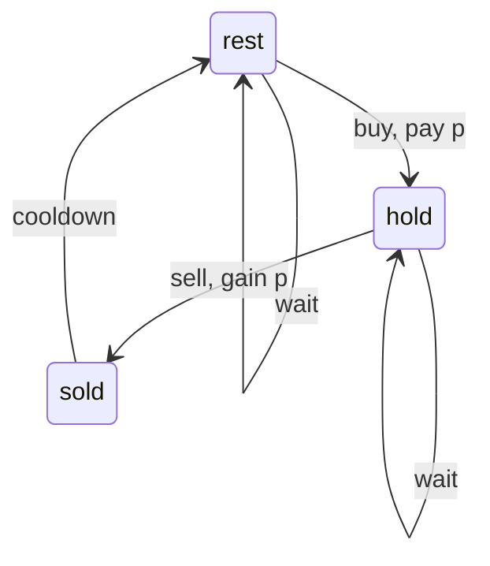

# Counting knapsacks and state machines

Two ideas turn many "1-D looking" problems into 2-D DP:

1. **A second index for a budget.** Coin Change II, Target Sum and the 0/1 knapsack all have state
   `(items considered, amount)`. Even when the final code uses one array, the *reasoning* is 2-D.
2. **A second index for a mode.** Best Time to Buy and Sell Stock with Cooldown has state
   `(day, what am I holding / allowed to do)`. The mode set is tiny, so the table is `n × 3`.

Both are "add a dimension until the future depends only on the state" — the central DP skill.

## Part 1: counting with a budget

### Coin Change II — combinations, not permutations

Count the multisets of coins (unlimited supply) summing to `amount`. `1 + 2` and `2 + 1` are the same
combination.

A first attempt — "which coin is last?" — gives `ways[a] = Σ ways[a - c]`. That counts **ordered**
sequences: for amount 3 with coins `{1, 2}` it counts `1+1+1`, `1+2`, `2+1` = 3 instead of 2.

To count each multiset once, impose an order on the *decisions*: handle coin types one at a time.

> `ways(i, a)` = number of combinations making `a` using only the first `i` coin types.

Decision about coin type `i`: use **none** of it → `ways(i-1, a)`; use **at least one** → remove one
copy and stay on the same type → `ways(i, a - c_i)`.

$$ways(i, a) = ways(i-1, a) + ways(i, a - c_i), \qquad ways(i, 0) = 1,\ ways(0, a>0) = 0$$

Table for `amount = 5`, `coins = [1, 2, 5]`:

| coin types allowed \ a | 0 | 1 | 2 | 3 | 4 | 5 |
|---|---|---|---|---|---|---|
| none | 1 | 0 | 0 | 0 | 0 | 0 |
| {1} | 1 | 1 | 1 | 1 | 1 | 1 |
| {1, 2} | 1 | 1 | 2 | 2 | 3 | 3 |
| {1, 2, 5} | 1 | 1 | 2 | 2 | 3 | **4** |

Cell `({1,2}, 4)`: without any 2 → 1 way (`1+1+1+1`); with at least one 2 → `ways({1,2}, 2) = 2`
(`2+1+1`, `2+2`). Total 3.

```python-run
def change_2d(amount, coins):
    n = len(coins)
    ways = [[0] * (amount + 1) for _ in range(n + 1)]
    for i in range(n + 1):
        ways[i][0] = 1
    for i in range(1, n + 1):
        c = coins[i - 1]
        for a in range(1, amount + 1):
            ways[i][a] = ways[i - 1][a] + (ways[i][a - c] if a >= c else 0)
    return ways

for row in change_2d(5, [1, 2, 5]):
    print(row)
```

Collapsing to one row: the "use" term reads the **current** row to the left, so iterate `a`
**upward** (unbounded knapsack), with coins in the outer loop.

```python-run
def change(amount, coins):
    ways = [1] + [0] * amount
    for c in coins:                       # coin types outer  -> combinations
        for a in range(c, amount + 1):    # upward            -> unlimited reuse
            ways[a] += ways[a - c]
    return ways[amount]

print(change(5, [1, 2, 5]), change(3, [2]), change(10, [10]), change(0, [7]))
```

The four combinations of loop choices give four different problems:

| Outer loop | Inner direction | Counts |
|---|---|---|
| coins | amounts **up** | combinations, unlimited coins (Coin Change II) |
| coins | amounts **down** | subsets, each coin at most once (count subset sums) |
| amounts | coins | ordered sequences, unlimited (Combination Sum IV / Climbing Stairs) |

```python-run
def count_all(amount, coins):
    combos = [1] + [0] * amount
    subsets = [1] + [0] * amount
    perms = [1] + [0] * amount
    for c in coins:
        for a in range(c, amount + 1):
            combos[a] += combos[a - c]
        for a in range(amount, c - 1, -1):
            subsets[a] += subsets[a - c]
    for a in range(1, amount + 1):
        perms[a] = sum(perms[a - c] for c in coins if c <= a)
    return combos[amount], subsets[amount], perms[amount]

print(count_all(5, [1, 2, 5]))   # (combinations, subsets, permutations)
```

### Target Sum — two roads to the same table

Assign `+` or `−` to every number so the expression equals `target`; count assignments.

**Road 1: DP over running sums.** State `(i, s)` = number of sign assignments of the first `i` numbers
with running sum `s`. Each number sends `s` to `s + x` and `s − x`. Sums live in `[-total, total]`, so
a dictionary keyed by sum is the easiest table.

```python-run
def target_sum_dict(nums, target, trace=False):
    ways = {0: 1}
    for x in nums:
        nxt = {}
        for s, c in ways.items():
            nxt[s + x] = nxt.get(s + x, 0) + c
            nxt[s - x] = nxt.get(s - x, 0) + c
        ways = nxt
        if trace:
            print(x, dict(sorted(ways.items())))
    return ways.get(target, 0)

print(target_sum_dict([1, 1, 1, 1, 1], 3, trace=True))
```

There are at most `2·total + 1` distinct sums per layer, versus `2^n` sign patterns — the overlap is
enormous.

**Road 2: reduce to subset-sum counting.** Let `P` be the sum of numbers given `+` and `N` the sum
given `−`. Then `P − N = target` and `P + N = total`, so

$$P = \frac{total + target}{2}.$$

Count subsets with sum `P` — a 0/1 counting knapsack (inner loop downward). If `total + target` is odd
or `|target| > total`, no assignment exists.

```python-run
def target_sum_subset(nums, target):
    total = sum(nums)
    if abs(target) > total or (total + target) % 2:
        return 0
    P = (total + target) // 2
    ways = [1] + [0] * P
    for x in nums:
        for s in range(P, x - 1, -1):
            ways[s] += ways[s - x]
    return ways[P]

for nums, t in [([1, 1, 1, 1, 1], 3), ([1], 1), ([1, 1, 1], 2), ([0, 0, 1], 1), ([100], -200)]:
    print(nums, t, target_sum_subset(nums, t))
```

> [!WARNING]
> Zeros matter: `+0` and `−0` are different assignments, so `[0, 0, 1]` with target 1 has 4 ways. The
> downward loop with `x = 0` does `ways[s] += ways[s]` — doubling — which is exactly right. Don't
> "optimise" zeros away.

### The 0/1 knapsack as a 2-D table

The max-value knapsack from lesson 5 belongs here too: `best(i, c) = max(best(i-1, c), v_i +
best(i-1, c - w_i))`. In interviews you'll often be asked for the 2-D version first (clear reasoning),
then the 1-D optimisation (downward loop), then reconstruction of the chosen items (requires the 2-D
table). Practise all three on the `dp-knapsack-01` problem.

## Part 2: state machines

### Stock with cooldown

Buy and sell a stock any number of times; hold at most one share; after selling you must skip one day
before buying again. Maximise profit.

The index `day` alone is not a sufficient state: what you may do tomorrow depends on whether you hold a
share and whether you sold today. So add a **mode**:

- `hold` — you own a share at the end of the day;
- `sold` — you sold today (tomorrow is a forced cooldown);
- `rest` — you own nothing and are free to buy tomorrow.



Reading the arrows *into* each state gives the recurrences (primed = today, unprimed = yesterday):

$$hold' = \max(hold,\ rest - p) \qquad sold' = hold + p \qquad rest' = \max(rest,\ sold)$$

Base (before day 0): `hold = −∞` (impossible), `sold = 0`, `rest = 0`. Answer: `max(sold, rest)` after
the last day (ending while holding is never better).

| day | price | hold | sold | rest |
|---|---|---|---|---|
| – | – | −∞ | 0 | 0 |
| 0 | 1 | −1 | −∞ | 0 |
| 1 | 2 | −1 | 1 | 0 |
| 2 | 3 | −1 | 2 | 1 |
| 3 | 0 | 1 | −1 | 2 |
| 4 | 2 | 1 | **3** | 2 |

```python-run
def max_profit_cooldown(prices, trace=False):
    hold, sold, rest = float("-inf"), 0, 0
    for p in prices:
        hold, sold, rest = max(hold, rest - p), hold + p, max(rest, sold)
        if trace:
            print(f"p={p}  hold={hold}  sold={sold}  rest={rest}")
    return max(sold, rest)

print(max_profit_cooldown([1, 2, 3, 0, 2], trace=True))
```

The tuple assignment is essential: all three new values must be computed from **yesterday's** values.

> [!TIP]
> Recipe for state-machine DP: (1) list the modes, (2) draw the transition diagram with gains/costs on
> the arrows, (3) for each mode write `new_mode = best over incoming arrows`, (4) pick base values
> (−∞ for impossible modes), (5) decide which modes are valid endings.

### The same recipe, other rules

- **Unlimited transactions, no cooldown** (Stock II): two modes. `hold' = max(hold, cash − p)`,
  `cash' = max(cash, hold + p)`.
- **Transaction fee**: subtract the fee on the sell arrow.
- **At most k transactions** (Stock III/IV): the mode becomes `(transactions used, holding?)` — a
  `k × 2` set of modes.

```python-run
def max_profit_fee(prices, fee):
    hold, cash = float("-inf"), 0
    for p in prices:
        hold, cash = max(hold, cash - p), max(cash, hold + p - fee)
    return cash

def max_profit_k(prices, k):
    hold = [float("-inf")] * (k + 1)      # hold[t]: holding, t-th transaction open
    cash = [0] * (k + 1)                  # cash[t]: not holding, t transactions completed
    for p in prices:
        for t in range(k, 0, -1):
            cash[t] = max(cash[t], hold[t] + p)
            hold[t] = max(hold[t], cash[t - 1] - p)
    return cash[k]

print(max_profit_fee([1, 3, 2, 8, 4, 9], 2))      # 8
print(max_profit_k([3, 3, 5, 0, 0, 3, 1, 4], 2))  # 6
```

### You've seen state machines already

House Robber is a two-mode machine (`robbed yesterday` / `didn't`), and Maximum Product Subarray
carries two values per index. Whenever you find yourself wanting "one more bit of memory", add it to
the state.

## Pitfalls

- Coin Change II with the loops swapped (counts permutations).
- Target Sum: missing parity/range checks; skipping zeros.
- Stock problems: sequential updates that mix today's and yesterday's values; `hold` initialised to 0.
- Assuming the answer is in the last cell of a particular mode — think about which modes are valid
  endings.

## Summary

- Add a dimension when the index alone doesn't determine the future: a budget or a mode.
- Counting combinations needs a canonical order of decisions: item types outer, amounts inner.
- Target Sum is a counting subset-sum after a little algebra.
- State machines: draw the diagram, write one line per mode, update simultaneously.

## Check yourself

```quiz
[
  {"q": "For amount = 5 and coins = [1, 2, 5], how many combinations are there?", "options": ["3", "4", "5", "9"], "answer": 1, "explain": "5; 2+2+1; 2+1+1+1; 1+1+1+1+1. (9 is the number of ordered sequences.)"},
  {"q": "In ways(i, a) = ways(i-1, a) + ways(i, a − c_i), why does the second term stay on row i?", "options": ["It's a typo", "After using one copy of coin i, more copies of coin i may still be used", "To count permutations", "Because coins are sorted"], "answer": 1, "explain": "Unlimited supply: removing one copy leaves a subproblem that may still use the same coin type."},
  {"q": "Target Sum with nums = [1,1,1,1,1], target = 3 reduces to counting subsets with sum…", "options": ["3", "4", "5", "8"], "answer": 1, "explain": "P = (total + target) / 2 = (5 + 3) / 2 = 4."},
  {"q": "How many sign assignments of [0, 0, 1] evaluate to 1?", "options": ["1", "2", "4", "8"], "answer": 2, "explain": "The 1 must be +, and each zero can take either sign: 2 × 2 = 4."},
  {"q": "In the cooldown stock DP, why does buying transition from rest and not from sold?", "options": ["Because sold is negative", "After selling you must wait one day, so only the rest mode may buy", "To save memory", "It could be either"], "answer": 1, "explain": "The cooldown rule is encoded by routing sold → rest before any buy."},
  {"q": "What should hold be before the first day?", "options": ["0", "−∞", "prices[0]", "1"], "answer": 1, "explain": "Holding a share before any purchase is impossible; −∞ prevents selling a share you never bought."},
  {"q": "Which loop structure counts ordered sequences (permutations) of coins?", "options": ["coins outer, amounts up", "coins outer, amounts down", "amounts outer, coins inner", "None"], "answer": 2, "explain": "For each amount, any coin can be the last one, so different orders are counted separately."}
]
```

> **Source:** NeetCode 150 roadmap (Coin Change II, Target Sum, Best Time to Buy and Sell Stock with
> Cooldown); Goodrich, Tamassia & Goldwasser, *Data Structures and Algorithms in Python*, §13.3.
