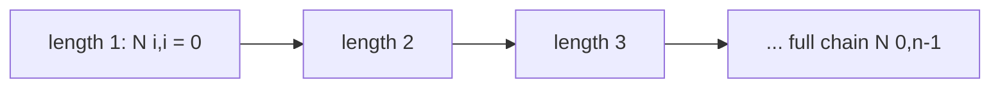

# Interval DP: matrix chains and burst balloons

Some problems aren't about prefixes at all. When you repeatedly **merge, cut or remove** things from a
row, the leftover pieces are contiguous ranges, and the natural subproblem is an **interval**
`(i, j)`. Interval DP has a distinctive shape — an O(n²) table filled diagonal by diagonal with an
O(n) choice per cell — and one key design question: *what is the last operation inside this
interval?*

Goodrich, Tamassia and Goldwasser introduce dynamic programming with exactly such a problem, the
matrix chain-product. We'll follow their development, then apply the same pattern to Burst Balloons,
the hardest interval problem on the NeetCode list.

## Matrix chain-product

### The problem

We want the product $A = A_0 \cdot A_1 \cdots A_{n-1}$, where $A_i$ has shape $d_i \times d_{i+1}$.
Multiplying a $d \times e$ matrix by an $e \times f$ matrix with the standard algorithm takes
$d \cdot e \cdot f$ scalar multiplications. Matrix multiplication is associative, so any
parenthesisation gives the same result — but not the same cost.

Goodrich's example: $B$ is $2 \times 10$, $C$ is $10 \times 50$, $D$ is $50 \times 20$.

| Order | Cost |
|---|---|
| $B \cdot (C \cdot D)$ | $10\cdot50\cdot20 + 2\cdot10\cdot20 = 10{,}400$ |
| $(B \cdot C) \cdot D$ | $2\cdot10\cdot50 + 2\cdot50\cdot20 = 3{,}000$ |

The number of parenthesisations equals the number of binary trees with `n` leaves (a Catalan number),
which is exponential, so brute force is out.

### Subproblems and the last multiplication

Define $N_{i,j}$ = the minimum number of scalar multiplications needed to compute
$A_i \cdot A_{i+1} \cdots A_j$. The whole problem is $N_{0,n-1}$.

However we parenthesise $A_i \cdots A_j$, there is a **final** multiplication, which splits the chain
as $(A_i \cdots A_k) \cdot (A_{k+1} \cdots A_j)$ for some $i \le k < j$. The left part is a
$d_i \times d_{k+1}$ matrix, the right part is $d_{k+1} \times d_{j+1}$, so the final multiplication
costs $d_i\, d_{k+1}\, d_{j+1}$. And each part must itself be computed optimally — if it weren't,
swapping in a cheaper way would lower the total (the **subproblem optimality** argument).

$$N_{i,j} = \min_{i \le k < j} \big( N_{i,k} + N_{k+1,j} + d_i\, d_{k+1}\, d_{j+1} \big), \qquad N_{i,i} = 0$$

Unlike divide-and-conquer, the subproblems **overlap**: $N_{1,2}$ is needed by $N_{0,2}$, $N_{1,3}$,
$N_{0,3}$, … so we store them in a table.

### Fill order: by length

$N_{i,j}$ depends on intervals strictly **shorter** than `(i, j)`. So compute all intervals of length
1 (zeros), then length 2, then 3, and so on — moving along diagonals of the table.



```python-run
def matrix_chain(d):
    """d has n+1 entries; matrix k is d[k] x d[k+1]. Returns (table N, split table)."""
    n = len(d) - 1
    N = [[0] * n for _ in range(n)]
    split = [[None] * n for _ in range(n)]
    for b in range(1, n):                  # b = j - i
        for i in range(n - b):
            j = i + b
            N[i][j], split[i][j] = min(
                (N[i][k] + N[k + 1][j] + d[i] * d[k + 1] * d[j + 1], k) for k in range(i, j))
    return N, split

def show(split, i, j):
    if i == j:
        return f"A{i}"
    k = split[i][j]
    return f"({show(split, i, k)} {show(split, k + 1, j)})"

d = [2, 10, 50, 20]
N, split = matrix_chain(d)
print(N[0][-1], show(split, 0, len(d) - 2))

d = [30, 35, 15, 5, 10, 20, 25]            # classic 6-matrix example
N, split = matrix_chain(d)
for row in N:
    print(row)
print(N[0][-1], show(split, 0, len(d) - 2))
```

For `d = [30, 35, 15, 5, 10, 20, 25]` the table's upper triangle is:

| i \ j | 0 | 1 | 2 | 3 | 4 | 5 |
|---|---|---|---|---|---|---|
| 0 | 0 | 15750 | 7875 | 9375 | 11875 | **15125** |
| 1 | | 0 | 2625 | 4375 | 7125 | 10500 |
| 2 | | | 0 | 750 | 2500 | 5375 |
| 3 | | | | 0 | 1000 | 3500 |
| 4 | | | | | 0 | 5000 |
| 5 | | | | | | 0 |

Three nested loops, each at most `n` iterations: **O(n³)** time, O(n²) space.

## The interval DP template

```python
for length in range(2, n + 1):            # or the gap j - i
    for i in range(0, n - length + 1):
        j = i + length - 1
        dp[i][j] = best over k in (i..j) of  combine(dp[i][k], dp[k'][j]) + cost(i, k, j)
```

Design questions:

1. **What does the interval include?** Closed `[i, j]`, half-open, or *open* `(l, r)` with sentinels?
2. **What does `k` mean?** The position of the **last** operation (almost always the right choice),
   so the two sides are independent.
3. **What does the final operation cost**, given that both sides are already done?

Top-down works just as well and removes the order question:

```python-run
from functools import cache

def matrix_chain_td(d):
    @cache
    def N(i, j):
        if i == j:
            return 0
        return min(N(i, k) + N(k + 1, j) + d[i] * d[k + 1] * d[j + 1] for k in range(i, j))
    return N(0, len(d) - 2)

print(matrix_chain_td([30, 35, 15, 5, 10, 20, 25]))
```

## Burst Balloons

Balloons with numbers `nums`. Bursting balloon `i` earns `left · nums[i] · right`, where `left` and
`right` are its **current** neighbours (1 beyond the ends). Maximise total coins.

### Why "first burst" fails

Natural first idea: pick the first balloon to burst, then recurse on the rest. But after bursting
balloon `k`, its left and right neighbours become adjacent — the two sides **interact**, and "the rest"
is no longer two independent intervals. The state would have to be the whole set of remaining
balloons: $2^n$ states.

### Think backwards: the last balloon

Pad the array with a 1 on each end: `a = [1] + nums + [1]`. Consider an **open** interval `(l, r)`:
all balloons strictly between `l` and `r` will be burst, while `l` and `r` themselves are still
standing. Let `k` be the **last** balloon burst inside `(l, r)`.

- When `k` is burst, everything else inside is gone, so its neighbours are exactly `l` and `r`:
  it earns `a[l] · a[k] · a[r]`.
- Before that, the balloons in `(l, k)` were burst with `l` and `k` standing as walls, and those in
  `(k, r)` with `k` and `r` as walls. The two sides never see each other — **independent
  subproblems** of the same form.

$$dp[l][r] = \max_{l < k < r} \big( dp[l][k] + dp[k][r] + a_l\, a_k\, a_r \big), \qquad dp[l][l+1] = 0$$

Answer: `dp[0][n+1]`. Compare with the matrix chain: the same "last operation splits the interval"
structure, with a boundary-dependent cost.

### Dry run

`nums = [3, 1, 5, 8]`, padded `a = [1, 3, 1, 5, 8, 1]` (indices 0–5).

| (l, r) | balloons inside | best choice of last `k` | dp |
|---|---|---|---|
| (0, 2) | 3 | k=1: 1·3·1 | 3 |
| (1, 3) | 1 | k=2: 3·1·5 | 15 |
| (2, 4) | 5 | k=3: 1·5·8 | 40 |
| (3, 5) | 8 | k=4: 5·8·1 | 40 |
| (0, 3) | 3, 1 | k=1: 0 + 15 + 1·3·5 = 30 | 30 |
| (1, 4) | 1, 5 | k=3: 15 + 0 + 3·5·8 = 135 | 135 |
| (2, 5) | 5, 8 | k=4: 40 + 0 + 1·8·1 = 48 | 48 |
| (0, 4) | 3, 1, 5 | k=1: 0 + 135 + 1·3·8 = 159 | 159 |
| (1, 5) | 1, 5, 8 | k=4: 135 + 0 + 3·8·1 = 159 | 159 |
| (0, 5) | all | k=4: 159 + 0 + 1·8·1 = **167** | 167 |

```python-run
def max_coins(nums, trace=False):
    a = [1] + nums + [1]
    n = len(a)
    dp = [[0] * n for _ in range(n)]
    for gap in range(2, n):
        for l in range(n - gap):
            r = l + gap
            best_k, best = None, 0
            for k in range(l + 1, r):
                v = dp[l][k] + dp[k][r] + a[l] * a[k] * a[r]
                if best_k is None or v > best:
                    best_k, best = k, v
            dp[l][r] = best
            if trace:
                print(f"({l},{r}) last=a[{best_k}]={a[best_k]}  dp={best}")
    return dp[0][n - 1]

print(max_coins([3, 1, 5, 8], trace=True))
print(max_coins([1, 5]))
```

Complexity: O(n²) intervals × O(n) choices = **O(n³)**; about n³/6 inner steps, i.e. 4.5 million for
n = 300.

> [!INTERVIEW]
> The phrase to remember: "**Fix the last operation, not the first.**" If choosing the first operation
> makes the remaining pieces depend on each other, reverse time. The same reversal solves Minimum Cost
> to Cut a Stick, Remove Boxes and Strange Printer.

### Checking against brute force

Trust, but verify. A brute force over all burst orders confirms the DP on small inputs:

```python-run
from itertools import permutations
import random

def brute(nums):
    best = 0
    for order in permutations(range(len(nums))):
        alive = list(range(len(nums)))
        total = 0
        for i in order:
            p = alive.index(i)
            left = nums[alive[p - 1]] if p > 0 else 1
            right = nums[alive[p + 1]] if p + 1 < len(alive) else 1
            total += left * nums[i] * right
            alive.pop(p)
        best = max(best, total)
    return best

def max_coins(nums):
    a = [1] + nums + [1]
    n = len(a)
    dp = [[0] * n for _ in range(n)]
    for gap in range(2, n):
        for l in range(n - gap):
            r = l + gap
            dp[l][r] = max(dp[l][k] + dp[k][r] + a[l] * a[k] * a[r] for k in range(l + 1, r))
    return dp[0][n - 1]

random.seed(1)
for _ in range(200):
    nums = [random.randint(0, 9) for _ in range(random.randint(1, 6))]
    assert brute(nums) == max_coins(nums), nums
print("DP matches brute force on 200 random cases")
```

Writing a tiny brute force and comparing on random inputs is the most effective way to debug any DP.

## Other interval DPs

| Problem | Interval meaning | Split / last operation |
|---|---|---|
| Matrix chain | product of matrices `i..j` | last multiplication at `k` |
| Burst Balloons | open interval `(l, r)` | last balloon `k` burst |
| Min Cost to Cut a Stick | stick between cut points `l, r` | first cut inside (cost = length) |
| Longest Palindromic Subsequence | substring `i..j` | compare the two ends (O(1) per cell) |
| Palindrome Partitioning II | prefix + palindrome table | last palindrome piece |
| Optimal BST | keys `i..j` | root `k` |

Not every interval DP has an O(n) split loop: palindromic problems only compare the ends, giving
O(n²).

## Pitfalls

- Filling row by row with `i` ascending: `dp[i][j]` needs `dp[k+1][j]` from *later* rows. Use length
  order, or iterate `i` **descending** and `j` ascending.
- Burst Balloons: using original neighbours `a[k-1], a[k+1]` instead of interval boundaries
  `a[l], a[r]`.
- Forgetting to pad with 1s, then drowning in boundary cases.
- Off-by-one between closed and open interval conventions — pick one and write it in a comment.

## Summary

- Interval DP: state `(i, j)`, recurrence over a split point, fill by increasing length, usually
  O(n³).
- Choose the **last** operation in the interval so that the two sides are independent.
- Matrix chain-product (Goodrich §13.3.1) is the canonical example; Burst Balloons is the same idea
  with open intervals and sentinel 1s.
- Validate DPs against brute force on small random inputs.

## Check yourself

```quiz
[
  {"q": "In the matrix chain recurrence, what does the term d_i · d_{k+1} · d_{j+1} represent?", "options": ["The cost of the left subchain", "The cost of the final multiplication joining (A_i…A_k) and (A_{k+1}…A_j)", "The number of matrices", "The size of the table"], "answer": 1, "explain": "The left product is d_i × d_{k+1} and the right is d_{k+1} × d_{j+1}; multiplying them costs the product of the three dimensions."},
  {"q": "In which order must an interval table be filled?", "options": ["Row by row from the top with j ascending", "By increasing interval length", "Column by column from the right only", "Any order"], "answer": 1, "explain": "Each interval depends on strictly shorter intervals, so shorter ones must be ready first."},
  {"q": "Why does Burst Balloons choose the LAST balloon to burst in an interval?", "options": ["It gives bigger numbers", "Then its neighbours are exactly the interval boundaries and the two sides are independent", "It reduces memory", "Because the first is always the smallest"], "answer": 1, "explain": "Choosing the first balloon makes the two sides adjacent and dependent; choosing the last isolates them."},
  {"q": "For nums = [3, 1, 5, 8], what is the maximum number of coins?", "options": ["152", "159", "167", "175"], "answer": 2, "explain": "Burst 1 (15), 5 (120), 3 (24), 8 (8) = 167."},
  {"q": "What is the time complexity of the matrix chain DP for n matrices?", "options": ["O(n)", "O(n²)", "O(n³)", "O(2ⁿ)"], "answer": 2, "explain": "O(n²) intervals, each minimising over up to n split points."},
  {"q": "For B: 2×10, C: 10×50, D: 50×20, the minimum number of scalar multiplications is…", "options": ["3,000", "10,400", "13,400", "20,000"], "answer": 0, "explain": "(B·C)·D costs 1,000 + 2,000 = 3,000."},
  {"q": "What is an effective way to debug a DP solution?", "options": ["Add more dimensions", "Compare with a brute-force solution on many small random inputs", "Increase the recursion limit", "Switch languages"], "answer": 1, "explain": "A simple exhaustive solver is easy to get right and quickly exposes a wrong recurrence or base case."}
]
```

> **Source:** Goodrich, Tamassia & Goldwasser, *Data Structures and Algorithms in Python*, §13.3.1
> (Matrix Chain-Product: defining subproblems, characterizing optimal solutions, Code Fragment 13.5);
> NeetCode 150 roadmap (Burst Balloons).
