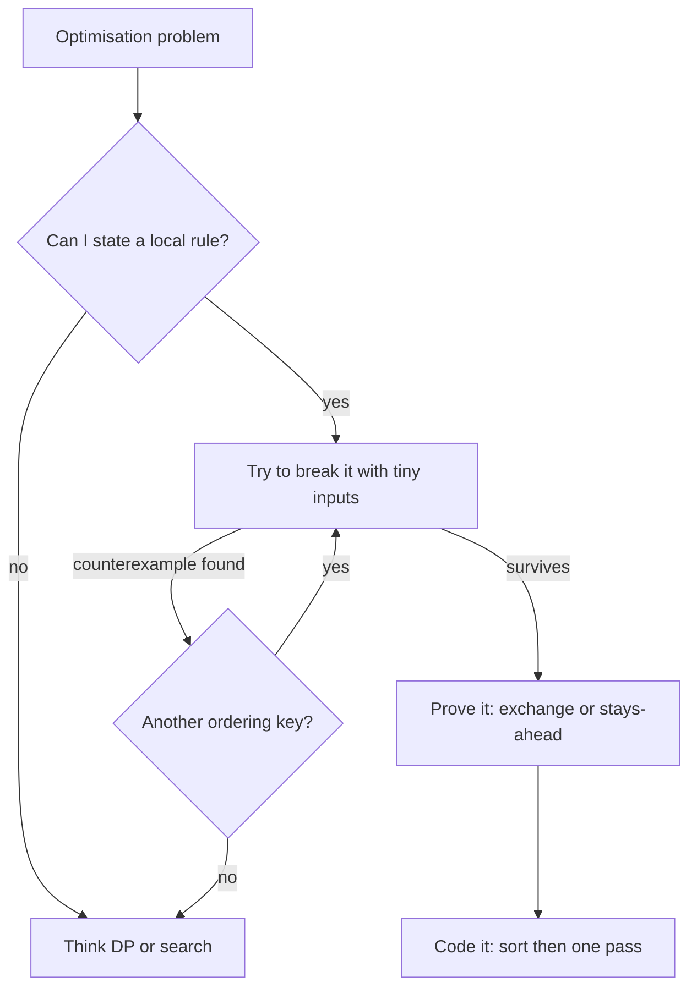

# When greedy works: exchange arguments and counterexamples

A greedy algorithm is the laziest possible optimiser. It builds a solution one decision at a time,
always grabs whatever looks best *right now*, and never looks back. No table of subproblems, no
backtracking, usually one sort and one pass. When that works it gives the shortest, fastest code of
any technique in this guide. When it does not work it gives a confident wrong answer.

So the skill you are really learning in this lesson is not "how to write a greedy loop" — that part
is five lines — but **how to tell whether the greedy loop is correct**: how to prove it when it is,
and how to break it quickly when it is not.

## 1. The pattern

Goodrich, Tamassia and Goldwasser introduce the greedy method right after Huffman coding and describe
it as a design pattern for optimisation problems: you start from a well-understood initial state and
repeatedly make the choice that gives the best immediate improvement among those currently
available. They are blunt that this "does not always lead to an optimal solution", and they name the
condition under which it does: the problem must have the **greedy-choice property** — a globally
optimal solution can be reached through a series of locally optimal choices.

In code the pattern almost always looks like this:

```
order the candidates by some key            # sort, or a heap, or the natural left-to-right order
state = empty / initial
for each candidate in that order:
    if taking it keeps the solution feasible:
        take it and update state
return state
```

Three design decisions hide in there:

1. **What is a "candidate"?** An interval, a coin, an array index, a card value …
2. **What is the ordering key?** Earliest end, largest value, smallest element, left to right …
3. **What state must I carry?** Usually a constant amount: last end time, furthest reach, running sum.

Decision 2 is where problems are won or lost. For most problems there are several *plausible*
orderings and only one is correct.



## 2. A problem where greedy works: interval scheduling

You are given activities, each with a start and end time, and one room. Choose as many
non-overlapping activities as possible. (This is LeetCode's *Non-overlapping Intervals* in disguise.)

Four natural greedy rules come to mind:

| Rule | Verdict |
|---|---|
| Earliest **start** first | Wrong |
| **Shortest** activity first | Wrong |
| **Fewest conflicts** first | Wrong |
| Earliest **end** first | Correct |

Before proving the last one, let us *break* the first three. Finding small counterexamples is a
skill worth practising deliberately — in an interview it is how you avoid sinking ten minutes into a
wrong idea.

```python-run
def schedule(intervals, key):
    """Greedy: consider intervals in `key` order, keep each one that fits."""
    chosen = []
    for s, e in sorted(intervals, key=key):
        if all(e <= cs or s >= ce for cs, ce in chosen):
            chosen.append((s, e))
    return sorted(chosen)

def conflicts(iv, all_iv):
    return sum(1 for o in all_iv if o != iv and iv[0] < o[1] and o[0] < iv[1])

# Counterexample 1: one long early interval blocks many short ones.
a = [(0, 100), (1, 2), (3, 4), (5, 6)]
print("earliest start :", schedule(a, key=lambda iv: iv[0]))
print("earliest end   :", schedule(a, key=lambda iv: iv[1]))

# Counterexample 2: a short interval straddles the boundary of two long ones.
b = [(0, 10), (9, 12), (11, 20)]
print("shortest first :", schedule(b, key=lambda iv: iv[1] - iv[0]))
print("earliest end   :", schedule(b, key=lambda iv: iv[1]))

# Counterexample 3: fewest conflicts (the classic 11-interval instance).
c = [(0, 2), (2, 4), (4, 6), (6, 8),             # optimal: these 4
     (1, 3), (1, 3), (1, 3),                     # crowd the left
     (5, 7), (5, 7), (5, 7),                     # crowd the right
     (3, 5)]                                     # only 2 conflicts, but ruins the middle
print("fewest conflicts:", schedule(c, key=lambda iv: conflicts(iv, c)))
print("earliest end    :", schedule(c, key=lambda iv: iv[1]))
```

Run it: every wrong rule returns fewer activities than earliest-end-first on its counterexample.

### Proof technique 1: the exchange argument

An **exchange argument** shows that any optimal solution can be transformed, step by step, into the
greedy solution without getting worse. The template:

1. Let `G` be the greedy solution and `O` be *any* optimal solution.
2. Look at the first place they differ.
3. Show you can swap `O`'s choice for `G`'s choice there, and `O` stays feasible and no worse.
4. Repeat. `O` turns into `G`, so `G` is optimal too.

For interval scheduling: let `g` be the activity with the earliest end time overall (greedy's first
pick) and let `o` be the first activity (by time) in the optimal set `O`. If `o ≠ g`, replace `o`
with `g`. Because `g` ends no later than `o`, and everything else in `O` starts after `o` ends, `g`
does not collide with anything else in `O`. The set has the same size and now contains `g`. Having
agreed on the first pick, delete everything that overlaps `g` and repeat the argument on the remaining
smaller problem.

That last sentence uses the second ingredient of every greedy proof, **optimal substructure**: once
the first choice is fixed, what remains is a smaller instance of the same problem, and an optimal
answer to the whole thing contains an optimal answer to the remainder.

### Proof technique 2: greedy stays ahead

Sometimes it is easier to show that after every step the greedy solution is *at least as good* as any
other solution by some measure. For interval scheduling: let greedy's picks end at `g₁ ≤ g₂ ≤ …` and
any other valid schedule's picks end at `o₁ ≤ o₂ ≤ …`. Claim: `gₖ ≤ oₖ` for every `k`.

- `k = 1`: greedy picks the globally earliest end, so `g₁ ≤ o₁`.
- Step: the other schedule's `(k+1)`-th activity starts at or after `oₖ ≥ gₖ`, so it was available to
  greedy, which picks the earliest-ending available activity. Hence `gₖ₊₁ ≤ oₖ₊₁`.

If the other schedule had more activities than greedy, its extra activity would start after
greedy's last end and greedy would have picked it. Contradiction.

You will reuse "stays ahead" for *Jump Game II* (greedy's k-jump frontier is at least as far right
as anyone's) and for *Gas Station*.

> [!INTERVIEW]
> You are rarely asked for a formal proof. You *are* expected to say one or two sentences of
> justification: "Sorting by end time is safe because swapping any optimal solution's first interval
> for the earliest-ending one can't create an overlap." That sentence is an exchange argument.

## 3. A problem where greedy sometimes works: making change

Give change for an amount using as few coins as possible. The cashier's algorithm — take the largest
coin that fits, repeat — is greedy. With US coins `{1, 5, 10, 25}` it is always optimal. Change the
coin set and it breaks:

```python-run
from functools import lru_cache

def greedy_change(coins, amount):
    used = []
    for c in sorted(coins, reverse=True):
        while amount >= c:
            amount -= c
            used.append(c)
    return used if amount == 0 else None

def optimal_change(coins, amount):
    @lru_cache(None)
    def best(a):
        if a == 0:
            return ()
        options = [best(a - c) + (c,) for c in coins if c <= a and best(a - c) is not None]
        return min(options, key=len) if options else None
    return list(best(amount))

for coins, amount in [((1, 5, 10, 25), 63), ((1, 3, 4), 6), ((1, 15, 25), 30), ((4, 5), 8)]:
    print(coins, amount, "greedy:", greedy_change(coins, amount), " optimal:", optimal_change(coins, amount))
```

With coins `{1, 3, 4}` and amount 6, greedy takes `4` and is then forced into `1 + 1` (three coins);
the optimum is `3 + 3`. With `{4, 5}` and amount 8, greedy takes `5` and gets stuck completely.

What went wrong with the exchange argument? For US coins you can argue that an optimal solution never
holds five pennies (swap for a nickel), two nickels (swap for a dime), and so on — so the small coins
can never add up to a larger coin's value, which forces the largest coin to be used. With `{1, 3, 4}`
the swap fails: two 3s cannot be exchanged for a 4 plus something without increasing the count. The
structure that made the exchange possible is simply absent, and you need dynamic programming (the
*Coin Change* problem).

*Lemonade Change* in this module is a friendly cousin: the bills are `{5, 10, 20}`, each a multiple of
the previous, and the exchange argument ("two 5s can do anything a 10 can") goes through.

## 4. A problem where greedy fails outright: 0/1 knapsack

You have a bag with capacity `W` and items with weights and values; maximise total value.

- If items are **divisible** (the *fractional* knapsack), greedy by value-per-weight is optimal.
  Exchange argument: if an optimal solution contains some amount of a lower-density item while a
  higher-density item is not fully used, swap an equal weight of one for the other — value goes up.
- If items are **indivisible** (the 0/1 knapsack), the same rule fails. Capacity 50; items
  `(weight 10, value 60)`, `(20, 100)`, `(30, 120)`. Densities are 6, 5, 4. Greedy takes the first
  two (value 160, weight 30) and cannot fit the third. The optimum is the last two: value 220.

The exchange "swap a bit of low-density for high-density" requires being able to take *a bit*. With
whole items, taking the dense item can leave awkward unusable space. The feasibility constraint
interacts with future choices, and that is the signature of a DP problem.

> [!WARNING]
> "Greedy passed the examples" is not evidence. LeetCode examples are tiny and are usually chosen
> so that the obvious wrong greedy still passes. Always attack your own rule with adversarial inputs:
> ties, one huge element, all-equal elements, an element that looks good now and blocks two later.

## 5. Recognising greedy problems

No test is fool-proof, but these signals should raise your greedy antenna:

- **"Maximum number of … / minimum number of …"** with items that can be sorted (intervals, tasks,
  weights). Counting problems are friendlier to greedy than weighted-sum problems. As soon as each
  item has an independent *value* (weighted interval scheduling, knapsack), expect DP.
- **A forced move exists.** In *Hand of Straights* the smallest remaining card *must* start a group —
  there is no alternative, so taking it greedily cannot be wrong. Look for the extreme element
  (smallest, largest, earliest, leftmost) and ask "what are its options?" If it has only one, or one
  option dominates the rest, that is your greedy choice. *Boats to Save People* works the same way:
  the heaviest person either pairs with the lightest or with no one.
- **Monotone resources.** If a choice can only make things better or only worse in a single
  direction, filtering is safe. In *Merge Triplets*, `max` never decreases a coordinate, so any
  triplet exceeding the target is useless forever and every other triplet is harmless.
- **You only need a yes/no or a count, not the arrangement.** *Jump Game* asks whether the end is
  reachable; tracking the furthest reachable index suffices and you never need to commit to a path.
- **Constraints are large** (`n = 10^5`) and an `O(n²)` DP is the obvious solution. The intended
  answer is then often the DP with its state collapsed into a single number — which is greedy.

That last point deserves emphasis. Many "greedy" solutions are best understood as **degenerate DP**.
Kadane's algorithm is the DP `best_ending_here[i] = max(nums[i], best_ending_here[i-1] + nums[i])`
with one variable. *Jump Game* is the reachability DP where the set of reachable indices happens to
always be a prefix, so one integer describes it. If you can write the DP first and then notice the
state is monotone or one-dimensional, you get the greedy solution *and* its correctness proof for
free.

## 6. Greedy elsewhere in this guide

The greedy method is not a chapter; it is a thread that runs through algorithms:

- **Huffman coding** (the textbook's motivating example): repeatedly merge the two least frequent
  symbols. Greedy with a min-heap.
- **Dijkstra's shortest paths**: repeatedly finalise the closest unfinalised vertex. Goodrich et al.
  present it explicitly as the greedy method applied to shortest paths, and note that the proof
  depends on non-negative edge weights — a negative edge is precisely a counterexample to the greedy
  choice.
- **Prim's and Kruskal's minimum spanning trees**: always add the cheapest safe edge. The "cut
  property" proof is an exchange argument.
- **Heaps + greedy**: whenever the "best current candidate" changes as you go, a heap supplies it in
  `O(log n)`: *Meeting Rooms II*, *Task Scheduler*, *Reorganize String*, *IPO*.

## 7. A worked example end to end: boats

**Problem.** Each boat holds at most two people and at most `limit` weight. Minimise boats.

**Step 1 — find the forced or dominant move.** The heaviest person `h` needs a boat no matter what.
Who should share with them? If the lightest person `l` does not fit with `h`, nobody does, so `h`
sails alone: forced. If `l` does fit, pairing them is *dominant*:

**Step 2 — exchange argument.** Take any optimal assignment. Suppose `h` sails with someone else `p`
(or alone) and `l` sails with `q` (or alone). Swap so `h` sails with `l`, and `p` sails with `q`.
`h + l ≤ limit` by assumption. `p + q ≤ h + q`? We need `p + q ≤ limit`: `p ≤ h` because `h` is the
heaviest, and `q` shared a boat with `l`... careful — we know `l + q ≤ limit`, not `h + q`. Use the
other bound instead: `p` shared a boat with `h`, so `p + h ≤ limit`, and `q ≤ h`, so
`p + q ≤ p + h ≤ limit`. The swap is feasible and uses the same number of boats.

Notice how the first attempt at the inequality was wrong and had to be repaired. That is normal;
exchange arguments are about finding *which* known inequality to lean on.

**Step 3 — code.** Sort; two pointers from both ends.

```python-run
def boats(people, limit):
    p = sorted(people)
    i, j, count = 0, len(p) - 1, 0
    while i <= j:
        if p[i] + p[j] <= limit:
            i += 1          # lightest rides along
        j -= 1              # heaviest always leaves
        count += 1
    return count

# brute force over all pairings to sanity-check the greedy on small random inputs
import itertools, random
def brute(people, limit):
    best = len(people)
    def go(rest, used):
        nonlocal best
        if used >= best: return
        if not rest:
            best = used; return
        first, others = rest[0], rest[1:]
        go(others, used + 1)                                   # first goes alone
        for k, o in enumerate(others):
            if first + o <= limit:
                go(others[:k] + others[k+1:], used + 1)        # first pairs with o
    go(list(people), 0)
    return best

random.seed(1)
for _ in range(300):
    ppl = [random.randint(1, 10) for _ in range(random.randint(1, 8))]
    assert boats(ppl, 10) == brute(ppl, 10), ppl
print("greedy matched brute force on 300 random cases")
print(boats([3, 2, 2, 1], 3), boats([3, 5, 3, 4], 5))
```

The last block is a habit worth stealing: **when unsure about a greedy rule, test it against a
brute force on hundreds of small random inputs.** You cannot do that in a whiteboard interview, but
you can do it while practising, and it trains your instinct for which rules hold.

## 8. Pitfalls

- **Wrong sort key.** By start vs by end; ascending vs descending; forgetting a tie-breaker. For
  interval problems, ties between an end and a start at the same time are a classic source of
  off-by-one bugs.
- **Greedy on a weighted objective.** If every item has its own profit, counting arguments no longer
  apply.
- **Irrevocable choices that should be revocable.** Some problems need "greedy with regret": take
  the item now, and undo the worst earlier choice later using a heap (*Course Schedule III*,
  *Minimum Number of Refueling Stops*). The local rule is still greedy, but the state is a heap rather
  than a single number.
- **Proving by example.** Three passing examples prove nothing; one failing example disproves
  everything.

## Summary

- Greedy = sequence of locally best, irrevocable choices; correct only when the problem has the
  **greedy-choice property** and **optimal substructure**.
- Prove with an **exchange argument** (morph an optimal solution into the greedy one) or
  **greedy stays ahead** (induction on a progress measure).
- Disprove with a **small counterexample**; get in the habit of hunting for one first.
- Interval scheduling → earliest end first. Coins → greedy only for canonical systems. Fractional
  knapsack → greedy; 0/1 knapsack → DP.
- Many greedy algorithms are a DP whose state collapsed to one number (Kadane, Jump Game).

```quiz
[
  {"q": "For choosing the maximum number of non-overlapping intervals, which ordering makes the simple 'take it if it fits' greedy optimal?",
   "options": ["Earliest start time first", "Shortest duration first", "Earliest end time first", "Fewest conflicts first"],
   "answer": 2,
   "explain": "Finishing earliest leaves the most room for the rest; an exchange argument shows any optimal solution can start with the earliest-ending interval."},
  {"q": "With coins {1, 3, 4} and amount 6, what does largest-coin-first greedy produce and what is optimal?",
   "options": ["Greedy 3+3, optimal 3+3", "Greedy 4+1+1 (3 coins), optimal 3+3 (2 coins)", "Greedy 4+3, optimal 4+1+1", "Greedy fails to make change"],
   "answer": 1,
   "explain": "Greedy grabs the 4 and is forced into two 1s. The coin system is not canonical, so the exchange argument breaks and DP is required."},
  {"q": "What does an exchange argument show?",
   "options": ["That the greedy algorithm runs in O(n log n)", "That any optimal solution can be transformed into the greedy solution without becoming worse", "That the problem is NP-hard", "That the greedy solution is unique"],
   "answer": 1,
   "explain": "You swap the optimal solution's choices for greedy's choices one at a time, keeping feasibility and cost, so greedy must be optimal as well."},
  {"q": "Why is greedy-by-density optimal for fractional knapsack but not for 0/1 knapsack?",
   "options": ["0/1 knapsack has negative weights", "The exchange step needs to swap an arbitrary small weight of one item for another, which is impossible with indivisible items", "Sorting is not allowed in 0/1 knapsack", "Fractional knapsack has no capacity limit"],
   "answer": 1,
   "explain": "With whole items a dense item can leave unusable space; the swap that proves optimality requires divisibility."},
  {"q": "In Hand of Straights, why is it safe to always start a group at the smallest remaining card?",
   "options": ["Because small cards are worth more", "Because the smallest card cannot be in the middle or end of any run, so starting a run there is forced", "Because the hand is already sorted", "It is not safe; DP is needed"],
   "answer": 1,
   "explain": "A forced move can never be a mistake. No smaller card exists to precede it, so it must be the first card of its group."},
  {"q": "Which statement about Dijkstra's algorithm is consistent with the greedy method?",
   "options": ["It tries all paths and keeps the best", "It repeatedly finalises the closest unfinalised vertex, which is only justified when edge weights are non-negative", "It works by dynamic programming over edge counts", "It requires sorting all edges first"],
   "answer": 1,
   "explain": "Finalising the nearest vertex is a greedy choice; a negative edge could later offer a shorter route and is exactly a counterexample to that choice."},
  {"q": "You suspect a greedy rule is correct but cannot prove it. What is the most useful practical check while practising?",
   "options": ["Run it on the examples in the statement", "Compare it against a brute-force solver on many small random inputs", "Increase the input size", "Rewrite it recursively"],
   "answer": 1,
   "explain": "Random small cases find counterexamples quickly; statement examples are usually too gentle to expose a wrong greedy."}
]
```

> **Source:** Goodrich, Tamassia & Goldwasser, *Data Structures and Algorithms in Python*, §13.4.2 "The Greedy Method" (greedy-choice property, Huffman coding) and ch. 14 (Dijkstra, Prim–Jarník and Kruskal as greedy algorithms). Proof patterns (exchange, stays-ahead) and all examples are written for this guide; problems follow the NeetCode 150 list.
