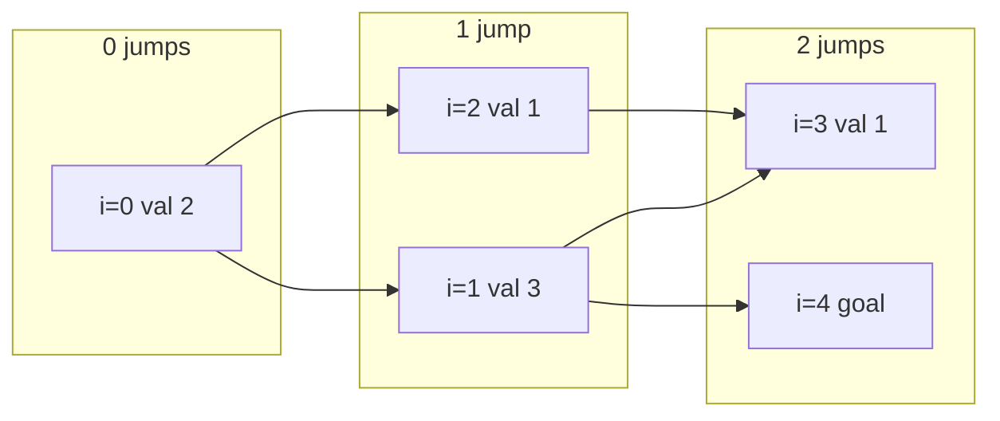

# Greedy patterns: Kadane, frontiers, and running ranges

The previous lesson was about *whether* greedy is correct. This one is a field guide to the handful
of shapes that greedy solutions take in interview problems. Almost every greedy question in the
NeetCode list is one of six patterns, and each pattern is defined by **what tiny piece of state you
carry** as you scan:

| Pattern | State you carry | Problems |
|---|---|---|
| Restart | running total, reset when it turns harmful | Maximum Subarray, Gas Station |
| Frontier | furthest point reachable so far | Jump Game, Jump Game II, Partition Labels |
| Range of possibilities | `[lo, hi]` of some counter | Valid Parenthesis String |
| Forced smallest / extremes | sorted order + counts or two pointers | Hand of Straights, Boats to Save People |
| Filter then combine | "have I seen what I need?" flags | Merge Triplets |
| Two passes | one array per direction, combined | Candy |

Learn to name the pattern and the code writes itself.

## 1. Restart: Kadane's algorithm

**Problem.** Largest sum of a contiguous, non-empty subarray.

Scan left to right maintaining `cur`, the best sum of a subarray that **ends exactly here**. When
you arrive at a new element `x`, the best subarray ending at `x` either extends the previous best or
starts over:

$$cur_i = \max(x_i,\; cur_{i-1} + x_i)$$

The greedy reading of that formula: *a negative running total is baggage — drop it*. Extending is
better than restarting exactly when `cur_{i-1} > 0`.

```python-run
def kadane(nums):
    best = cur = nums[0]
    best_range = (0, 0)
    s = 0
    for i in range(1, len(nums)):
        if cur < 0:                 # baggage: restart here
            cur, s = nums[i], i
        else:
            cur += nums[i]
        if cur > best:
            best, best_range = cur, (s, i)
    return best, best_range

nums = [-2, 1, -3, 4, -1, 2, 1, -5, 4]
best, (i, j) = kadane(nums)
print(best, nums[i:j + 1])
print(kadane([-3, -7, -1]))        # all negative: the single largest element
```

Why is this correct? It is a DP. Let $E_i$ be the best sum ending at index $i$; any subarray ending
at $i$ is either just `[x_i]` or a subarray ending at $i-1$ plus $x_i$, giving the recurrence above.
The overall answer is $\max_i E_i$ because the best subarray ends somewhere. Since $E_i$ depends only
on $E_{i-1}$, one variable is enough.

There is a second way to see it that connects to the next problem. With prefix sums
$P_k = x_0 + \dots + x_{k-1}$, the sum of `nums[i..j]` is $P_{j+1} - P_i$. To maximise it for a fixed
$j$, subtract the **smallest prefix seen so far**. "Reset when the running sum goes negative" is the
same thing as "the smallest prefix so far just moved to here".

> [!WARNING]
> Initialise with `nums[0]`, not `0`. With `best = 0` an all-negative array returns 0, which
> corresponds to the empty subarray — not allowed.

### Gas Station is Kadane on a circle

Each station contributes `gas[i] − cost[i]` to your tank. You need a starting point from which the
running sum never dips below zero. The same restart rule applies: if starting at `s` the tank first
goes negative when leaving station `i`, then no station in `s..i` can be the answer — you arrived at
each of them with a tank `≥ 0`, so starting there with exactly 0 can only be worse. Restart at `i+1`.

One global fact finishes it: if the total of all differences is `≥ 0`, an answer exists. Picture the
prefix-sum curve; start right after its lowest point and every later prefix, measured from there, is
non-negative.

```python-run
def can_complete(gas, cost):
    if sum(gas) < sum(cost):
        return -1
    start = tank = 0
    for i in range(len(gas)):
        tank += gas[i] - cost[i]
        if tank < 0:
            start, tank = i + 1, 0
    return start

gas, cost = [1, 2, 3, 4, 5], [3, 4, 5, 1, 2]
print(can_complete(gas, cost))

# the "lowest point of the prefix curve" view gives the same answer
diffs = [g - c for g, c in zip(gas, cost)]
prefix, run = [], 0
for d in diffs:
    run += d
    prefix.append(run)
print(prefix, "-> start after index", prefix.index(min(prefix)))
```

## 2. Frontier: how far can I get?

A **frontier** greedy tracks a single number: the furthest position reachable (or the furthest
position the current segment is obliged to cover).

### Jump Game — reachability

`nums[i]` is the maximum jump length from index `i`. The reachable indices always form a prefix
`0..reach` (if you can reach `k` you can reach everything before `k`, by jumping shorter). So:

```
reach = 0
for i, step in enumerate(nums):
    if i > reach: return False
    reach = max(reach, i + step)
return True
```

### Jump Game II — fewest jumps is BFS in disguise

Indices reachable in exactly `k` jumps form a contiguous window. Scanning the window for jump `k`
tells you where the window for jump `k+1` ends (`farthest`). When the scan pointer hits the end of the
current window, you must jump.



```python-run
def min_jumps(nums):
    jumps = cur_end = farthest = 0
    for i in range(len(nums) - 1):          # never "jump from" the last index
        farthest = max(farthest, i + nums[i])
        if i == cur_end:
            jumps += 1
            cur_end = farthest
            print(f"jump {jumps}: window now ends at index {cur_end}")
    return jumps

print(min_jumps([2, 3, 1, 1, 4]))
```

A tempting but wrong rule is "always take the longest jump". On `[2, 3, 1, 1, 4]` that goes
`0 → 2 → 3 → 4` (three jumps) instead of `0 → 1 → 4`. The correct greedy does not choose a landing
square at all; it only tracks *windows*.

### Partition Labels — a frontier you are obliged to reach

Every letter in a piece drags the piece's right edge out to that letter's last occurrence. Track
`end = max(end, last[ch])` and cut when `i == end`. This is the Jump Game loop with "must reach"
instead of "can reach"; it is also *merge intervals* applied to the 26 letter intervals.

```python-run
def partition_labels(s):
    last = {ch: i for i, ch in enumerate(s)}
    sizes, start, end = [], 0, 0
    for i, ch in enumerate(s):
        end = max(end, last[ch])
        if i == end:
            sizes.append(s[start:end + 1])
            start = i + 1
    return sizes

print(partition_labels("ababcbacadefegdehijhklij"))
```

> [!TIP]
> Frontier problems share a tell: the loop body is `frontier = max(frontier, something(i))` followed
> by a check of `i` against the frontier. If you find yourself writing that, you are in this pattern.

## 3. A range of possibilities: Valid Parenthesis String

For ordinary parentheses, validity is checked with one counter: +1 for `(`, −1 for `)`, never
negative, zero at the end. A wildcard `*` that can be `(`, `)` or empty makes the counter
non-deterministic — but the set of possible counter values is always a **contiguous range**, so two
numbers describe it:

- `(` → `lo += 1; hi += 1`
- `)` → `lo -= 1; hi -= 1`
- `*` → `lo -= 1; hi += 1`

If `hi < 0`, even treating every star as `(` leaves an unmatched `)`: fail. If `lo < 0`, clamp it to
0 — a negative open count is not a legal state, so those possibilities are discarded. Accept if
`lo == 0` at the end.

```python-run
def check(s):
    lo = hi = 0
    for ch in s:
        if ch == "(":   lo, hi = lo + 1, hi + 1
        elif ch == ")": lo, hi = lo - 1, hi - 1
        else:           lo, hi = lo - 1, hi + 1
        if hi < 0:
            return False
        lo = max(lo, 0)
    return lo == 0

for s in ["(*)", "(*))", ")*(", "**((", "(((******))"]:
    print(f"{s!r:16} {check(s)}")
```

Why is the set of possibilities really a gap-free range? Before any star it is a single value. A
star can contribute −1, 0 or +1, so it turns a range `[lo, hi]` into `[lo−1, hi+1]` with no holes,
and parentheses merely shift the whole range. Clamping removes illegal negative values from the
bottom, which keeps it contiguous.

The general lesson: **when a counter becomes uncertain, track the interval of values it could
take.** The same idea appears in *Check if a Parentheses String Can Be Valid* and in simulation
problems with "at most k" freedom.

## 4. Forced moves at the extremes

Sort (or count) and look at the smallest or largest element. It has the fewest options, so deciding
its fate first is safe.

- **Hand of Straights.** The smallest card must begin a run. If it appears `k` times, it begins `k`
  runs; subtract `k` from each of the next `groupSize − 1` values, failing if any is short.
- **Boats to Save People.** The heaviest person pairs with the lightest if possible, else goes alone.
  Two pointers on the sorted array.
- **Lemonade Change.** No sorting, but the same reasoning about options: a `$10` bill is only useful
  for `$20` customers, a `$5` is useful for everyone — spend the less flexible resource first.

```python-run
from collections import Counter

def is_n_straight_hand(hand, group_size):
    if len(hand) % group_size:
        return False
    count = Counter(hand)
    for start in sorted(count):
        k = count[start]
        if k == 0:
            continue
        for v in range(start, start + group_size):
            if count[v] < k:
                return False
            count[v] -= k
    return True

print(is_n_straight_hand([1, 2, 3, 6, 2, 3, 4, 7, 8], 3))
print(is_n_straight_hand([1, 2, 3, 4, 5], 4))
print(is_n_straight_hand([1, 1, 2, 3], 2))      # 1,1 cannot both start a run of [1,2]
```

## 5. Filter, then combine

Some operations are **monotone** — `max`, `min`, bitwise OR, set union. They only push values in one
direction. Then each input item is either *poison* (using it overshoots the target for ever) or
*harmless* (using it never hurts). Discard the poison, combine everything else, and check whether you
hit the target.

*Merge Triplets to Form Target Triplet* is the cleanest example: skip any triplet with a coordinate
above the target's; among the rest, check that each target coordinate is matched by someone.

```python-run
def merge_triplets(triplets, target):
    best = [0, 0, 0]
    for t in triplets:
        if all(t[k] <= target[k] for k in range(3)):      # harmless
            best = [max(best[k], t[k]) for k in range(3)]
    return best == list(target)

print(merge_triplets([[2, 5, 3], [1, 8, 4], [1, 7, 5]], [2, 7, 5]))
print(merge_triplets([[3, 4, 5], [4, 5, 6]], [3, 2, 5]))
```

## 6. Two passes

When each element is constrained by **both** neighbours, satisfy the left constraints in a
left-to-right pass, the right constraints in a right-to-left pass, and combine.

*Candy*: each child needs more candy than a lower-rated neighbour. Left pass: `c[i] = c[i-1] + 1`
on an ascent, else 1. Right pass: `c[i] = max(c[i], c[i+1] + 1)` on a descent. Each pass yields the
minimum that satisfies its own family of constraints; the pointwise maximum satisfies both, and
nothing smaller can.

```python-run
def candy(ratings):
    n = len(ratings)
    c = [1] * n
    for i in range(1, n):
        if ratings[i] > ratings[i - 1]:
            c[i] = c[i - 1] + 1
    print("after left pass :", c)
    for i in range(n - 2, -1, -1):
        if ratings[i] > ratings[i + 1]:
            c[i] = max(c[i], c[i + 1] + 1)
    print("after right pass:", c)
    return sum(c)

print(candy([1, 3, 4, 5, 2]))
print(candy([1, 2, 87, 87, 87, 2, 1]))
```

The same two-sweep shape solves *Trapping Rain Water* (max to the left, max to the right) and
*Product of Array Except Self*.

## 7. How to attack an unfamiliar greedy problem

1. **Brute force first, out loud.** It defines the problem precisely and gives you something to
   compare against.
2. **Ask what a DP state would be.** If the state seems to need only "the best so far" or "the
   furthest so far", greedy is likely.
3. **Find the extreme element and list its options.** One option → forced. One dominant option →
   exchange argument.
4. **Choose the scan order.** Left to right, sorted by end, sorted by size, or from both ends.
5. **Try to break it** with 3–5 element inputs: ties, zeros, a single giant element, all equal.
6. **State the invariant** your loop maintains ("`reach` is the furthest index reachable from any
   index `≤ i`"). If you can say it in one sentence, the code will be right.

> [!INTERVIEW]
> Interviewers like to follow *Jump Game* with *Jump Game II*, and *Meeting Rooms* with
> *Meeting Rooms II*. The follow-up usually upgrades the state from a boolean to a count; the scan
> stays the same. Say the invariant for the easy version clearly and the harder one is a small edit.

## Pitfalls checklist

- Kadane with `best = 0` (fails all-negative arrays).
- Jump Game II looping over the last index (one extra jump).
- Gas Station without the total-sum check.
- Valid Parenthesis String comparing only counts (order matters: `")*("`).
- Hand of Straights ignoring multiplicities.
- Candy overwriting instead of taking `max` in the second pass.

## Summary

- Name the pattern by its state: running total (restart), frontier, range, extremes, filter, two passes.
- Kadane and Gas Station drop a prefix as soon as it becomes a liability.
- Jump Game tracks the reachable prefix; Jump Game II tracks BFS layers as windows.
- When a counter becomes uncertain, track the interval `[lo, hi]` of its possible values.
- The smallest or largest element usually has a forced or dominant move.
- Monotone operations let you filter out harmful items and take all the rest.

```quiz
[
  {"q": "In Kadane's algorithm, what does the variable `cur` represent after processing index i?",
   "options": ["The best subarray sum anywhere in nums[0..i]", "The best sum of a subarray that ends exactly at index i", "The prefix sum up to i", "The smallest prefix sum so far"],
   "answer": 1,
   "explain": "cur is the best sum ending at i; the global answer is the maximum of cur over all i."},
  {"q": "Why does Kadane's algorithm initialise best with nums[0] rather than 0?",
   "options": ["To avoid integer overflow", "Because the subarray must be non-empty, so an all-negative array must return its largest element", "Because 0 is not a valid sum", "It makes the loop shorter"],
   "answer": 1,
   "explain": "Starting from 0 silently allows the empty subarray and returns 0 for inputs like [-3, -1]."},
  {"q": "In Jump Game II, when do you increment the jump counter?",
   "options": ["Whenever nums[i] is larger than the previous value", "When the scan index reaches the end of the window reachable with the current number of jumps", "At every index", "Only when nums[i] == 0"],
   "answer": 1,
   "explain": "Each window is a BFS layer; leaving it requires one more jump, and the next window ends at the farthest index seen."},
  {"q": "In Gas Station, starting at s you first run out of fuel leaving station i. Why can no station between s and i be a valid start?",
   "options": ["They have less gas than station s", "You reached each of them with a non-negative tank, so starting there with an empty tank cannot do better", "They are too close to the end", "The problem guarantees uniqueness"],
   "answer": 1,
   "explain": "Starting mid-way removes a non-negative surplus, so the tank at i can only be lower; the failure repeats."},
  {"q": "For Valid Parenthesis String, what do lo and hi track?",
   "options": ["Indices of the first and last star", "The minimum and maximum possible number of unmatched '(' after the current prefix", "The number of '(' and ')' seen", "The stack depth and its maximum"],
   "answer": 1,
   "explain": "A star widens the range by one in each direction; fail when hi < 0, clamp lo at 0, accept when lo == 0."},
  {"q": "Which input shows that 'always take the longest jump' is wrong for Jump Game II?",
   "options": ["[1,1,1,1]", "[2,3,1,1,4]", "[4,1,1,1,1]", "[0]"],
   "answer": 1,
   "explain": "Longest-jump goes 0→2→3→4 (3 jumps); the optimum 0→1→4 uses 2."},
  {"q": "In Candy, why must the second (right-to-left) pass use max(c[i], c[i+1] + 1)?",
   "options": ["To handle equal ratings", "Because plain assignment could lower a value the first pass already required at a peak", "To make the algorithm O(n)", "It is only a style preference"],
   "answer": 1,
   "explain": "A peak must satisfy both neighbours; overwriting can violate the left constraint established earlier."}
]
```

> **Source:** Goodrich, Tamassia & Goldwasser, *Data Structures and Algorithms in Python*, §13.4.2 (the greedy method) for the underlying design pattern; pattern taxonomy, proofs and code written for this guide around the NeetCode 150 greedy problems.
