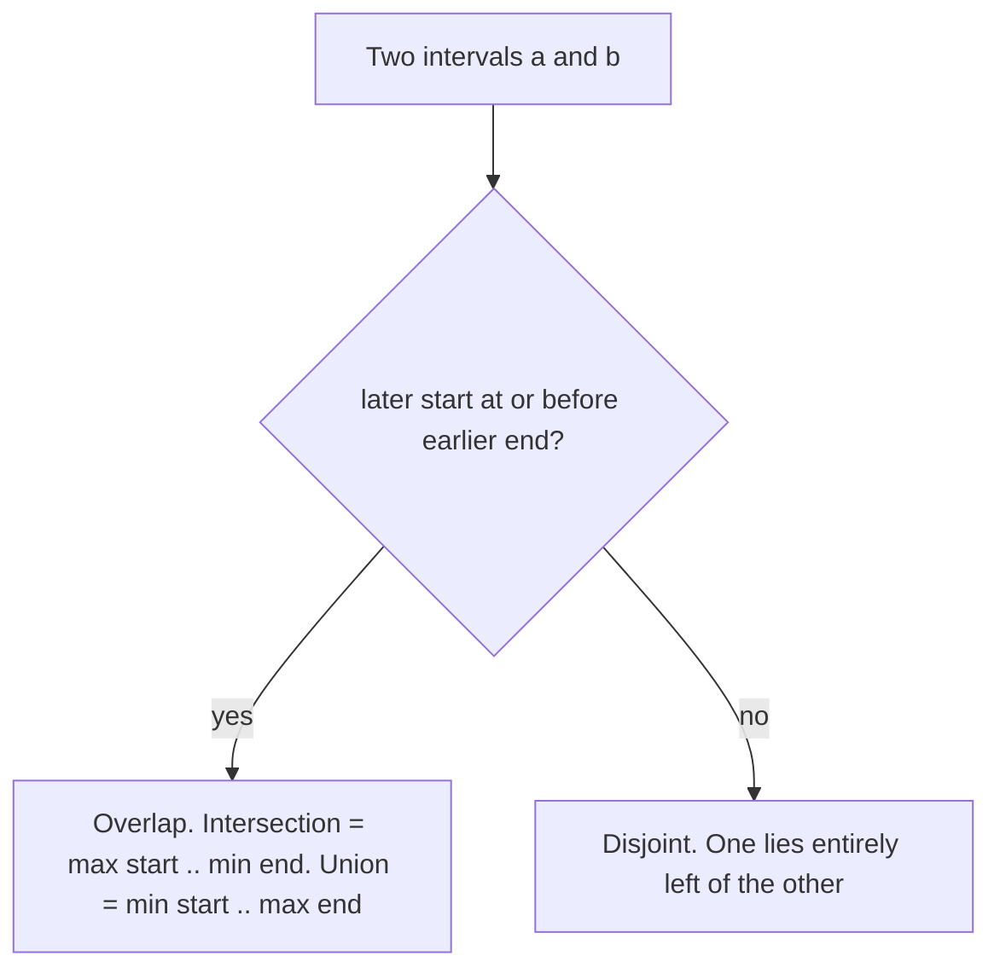
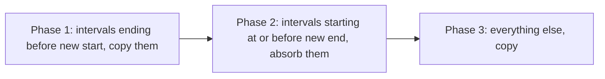

# Interval fundamentals: overlap, sorting, merging

> **Before this lesson:** you should know Python lists of lists, `sorted` with a `key=` function, and Big-O notation ([How to approach an interview problem](#/lesson/neet-arrays/approach)). The idea of a greedy rule and of an exchange argument comes from [When greedy works](#/lesson/neet-greedy-math/greedy-method).

## In plain words

An **interval** is a stretch between two numbers — a start and an end. A meeting from 9:00 to 10:30 is an interval. So is "rows 120 to 180 of a file", "ages 18 to 25", or a hotel booking from the 3rd to the 7th. In code an interval is usually a two-element list `[start, end]`.

Think of a paper wall calendar. Each appointment is a strip of tape stuck along the day. Interval questions are questions about those strips: Do two strips overlap? If I merge all the overlapping strips, which blocks of the day are busy? How many strips must I peel off so none overlap?

**Why this matters for a job.** Booking systems, calendars, video editors, memory allocators, network firewalls (ranges of addresses) and databases (ranges of keys) all store and combine ranges. "Merge overlapping ranges" is one of the most commonly reused routines in real code bases, and one of the most commonly asked interview questions.

### Words used in this lesson

- **Endpoint**: the start or the end of an interval.
- **Overlap**: two intervals share at least one point in time.
- **Disjoint**: the opposite of overlapping — no shared point.
- **Closed interval** `[s, e]`: both endpoints are included. **Half-open interval** `[s, e)`: the start is included, the end is not.
- **Sort key**: the value `sorted` compares; `key=lambda iv: iv[1]` sorts intervals by their end. (`lambda iv: iv[1]` is a tiny unnamed function that takes an interval and returns its second element.)
- **Sweep**: one left-to-right pass over the sorted intervals.
- **Two pointers**: two index variables that move through one or two lists.
- **De Morgan's rule**: "not (A or B)" is the same as "(not A) and (not B)".

### The smallest possible example

Two meetings: `[1, 3]` and `[2, 4]`. Draw them on a number line:

```
1---3
  2---4
```

They share the stretch from 2 to 3, so they overlap; merged, they form `[1, 4]`. Now `[1, 2]` and `[5, 6]`: the first ends (2) before the second starts (5), so they are disjoint. Every rule in this lesson is built from that one comparison — *does one end before the other starts?*

Calendars, bookings, IP ranges, genome segments, video clips, CPU bursts: a surprising amount of real
software manipulates **intervals** — pairs `[start, end]` on a number line. Interview questions about
them look varied, but nearly all of them reduce to three moves:

1. know precisely when two intervals **overlap**,
2. **sort** by start or by end (choosing which is the whole game),
3. sweep once, comparing each interval with **one remembered value**.

This lesson builds those three moves carefully. The next lesson adds sweep lines and heaps for
questions about *how many* intervals are active at once.

## 1. What exactly is an interval?

Before writing any code, pin down the convention, because it changes `<` into `<=`:

- **Closed** `[s, e]`: both endpoints belong to the interval. `[1, 3]` and `[3, 5]` share the point 3,
  so they **overlap**. *Merge Intervals* and *Insert Interval* use this convention.
- **Half-open** `[s, e)`: the end is excluded. A meeting from 9 to 10 and another from 10 to 11 do
  **not** clash. *Meeting Rooms*, *Meeting Rooms II* and *Non-overlapping Intervals* behave this way
  (touching is fine).

> [!INTERVIEW]
> Ask it out loud: "If one interval ends at 5 and another starts at 5, do they overlap?" It takes
> five seconds, shows care, and decides every comparison operator you are about to write.

## 2. The overlap test

Take two closed intervals `a = [a.s, a.e]` and `b = [b.s, b.e]`. There are several ways for them to
overlap (partial left, partial right, one containing the other) and it is easy to miss a case when
enumerating them. It is much simpler to enumerate the ways they can be **disjoint** — there are only
two: `a` lies entirely to the left of `b`, or entirely to the right.

$$\text{disjoint} \iff a.e < b.s \;\;\text{or}\;\; b.e < a.s$$

Negate it (De Morgan):

$$\text{overlap} \iff a.s \le b.e \;\;\text{and}\;\; b.s \le a.e$$

Equivalently, **"the later start is no later than the earlier end"**:
`max(a.s, b.s) <= min(a.e, b.e)`. That formulation is worth memorising because it also hands you the
intersection itself: when they overlap, the common part is `[max(a.s, b.s), min(a.e, b.e)]`, and the
union (their merge) is `[min(a.s, b.s), max(a.e, b.e)]`.

For half-open intervals replace `<=` by `<`.

```python-run
def overlap(a, b, closed=True):
    lo, hi = max(a[0], b[0]), min(a[1], b[1])
    return lo <= hi if closed else lo < hi

def intersection(a, b):
    lo, hi = max(a[0], b[0]), min(a[1], b[1])
    return [lo, hi] if lo <= hi else None

cases = [([1, 3], [2, 6]),      # partial
         ([1, 10], [4, 5]),     # containment
         ([1, 3], [3, 5]),      # touching
         ([1, 2], [4, 5])]      # disjoint
for a, b in cases:
    print(a, b, "closed:", overlap(a, b), "half-open:", overlap(a, b, closed=False),
          "intersection:", intersection(a, b))
```



## 3. Why sorting helps

Comparing all pairs costs `O(n²)`. Sorting by start time gives a powerful structural guarantee:

> After sorting by start, if interval `j` overlaps interval `i` (with `i < j`), then every interval
> between them also starts before `i` ends.

In other words, the intervals that overlap a given one are **contiguous in sorted order**, beginning
right after it. That is why a single left-to-right pass that only looks at "the previous thing" is
enough for so many problems.

### Can one person attend all meetings?

Sort by start and check neighbours. If any meeting starts before the previous one ends, the answer is
no. Non-neighbours need not be checked: if meeting `j` clashed with meeting `i < j−1`, then meeting
`i+1` — which starts no later than `j` — would clash with `i` too.

```python-run
def can_attend(meetings):
    meetings = sorted(meetings)
    return all(meetings[i][0] >= meetings[i - 1][1] for i in range(1, len(meetings)))

print(can_attend([[0, 30], [5, 10], [15, 20]]))   # False
print(can_attend([[7, 10], [2, 4]]))              # True
print(can_attend([[1, 5], [5, 10]]))              # True: half-open, back-to-back is fine
```

Python sorts lists of lists lexicographically, so `sorted(intervals)` sorts by start and breaks ties
by end. Use `key=lambda iv: iv[1]` when you need end order.

## 4. Merge Intervals

**Problem.** Given closed intervals in any order, merge all overlapping ones.

After sorting by start, keep a result list and compare each interval with the **last merged block**
only:

- if it starts at or before the block's end → it overlaps; extend the block's end to
  `max(block_end, e)`;
- otherwise → the block is finished; start a new one.

```python-run
def merge(intervals):
    intervals = sorted(intervals)
    out = [list(intervals[0])]
    for s, e in intervals[1:]:
        if s <= out[-1][1]:
            out[-1][1] = max(out[-1][1], e)
            print(f"  [{s},{e}] overlaps -> block becomes {out[-1]}")
        else:
            out.append([s, e])
            print(f"  [{s},{e}] starts a new block")
    return out

print(merge([[8, 10], [1, 3], [2, 6], [15, 18], [2, 4]]))
print(merge([[1, 10], [2, 3], [4, 5]]))
```

Two details cause most bugs:

1. **`max`, not assignment.** With `[1, 10]` followed by `[2, 3]`, writing `out[-1][1] = e` would
   *shrink* the block to `[1, 3]`. The second example above exists to remind you.
2. **Why only the last block?** Loop invariant: the blocks in `out` are disjoint, sorted, and the last
   one has the largest end seen so far. A new interval starts no earlier than everything processed,
   so if it does not reach back into the last block, it cannot reach any earlier one.

Complexity: `O(n log n)` for the sort, `O(n)` for the sweep.

> [!TIP]
> Many problems are "merge intervals" in costume. *Partition Labels*: each letter's
> first–last occurrence is an interval; merged blocks are the answer. *Employee Free Time*: merge
> everyone's busy intervals, then report the gaps. Calendar apps showing "busy" blocks do exactly this.

## 5. Insert Interval

**Problem.** The list is already sorted and non-overlapping; insert one more interval and keep it
that way.

You could append and call `merge` (`O(n log n)`), but the input's structure allows a single `O(n)`
pass with three phases:



```python-run
def insert(intervals, new):
    s, e = new
    out, i, n = [], 0, len(intervals)
    while i < n and intervals[i][1] < s:        # strictly left of the new interval
        out.append(intervals[i]); i += 1
    while i < n and intervals[i][0] <= e:       # overlapping: swallow it
        s, e = min(s, intervals[i][0]), max(e, intervals[i][1])
        i += 1
    out.append([s, e])
    return out + intervals[i:]                  # strictly right

print(insert([[1, 3], [6, 9]], [2, 5]))
print(insert([[1, 2], [3, 5], [6, 7], [8, 10], [12, 16]], [4, 8]))
print(insert([], [5, 7]))
print(insert([[1, 5]], [6, 8]))
```

The conditions are the two halves of the *disjoint* test from section 2: `iv.end < s` means "entirely
left", `iv.start > e` means "entirely right", and whatever is neither must overlap.

## 6. Sort by start or by end?

This is the question that separates interval problems.

| Goal | Sort by | Why |
|---|---|---|
| Merge / detect overlaps / insert | **start** | overlapping intervals become contiguous; compare with the running block |
| Keep the **maximum number** of non-overlapping intervals (equivalently, remove the minimum) | **end** | the interval that finishes first leaves the most room |
| Assign rooms / count simultaneous intervals | **start**, plus a heap of ends | process arrivals in order, free the earliest-ending room |
| Answer point queries offline | **start** (and sort queries) | add intervals as the query point passes their start |

### Non-overlapping Intervals

**Problem.** Remove as few intervals as possible so the rest do not overlap (touching allowed).

Removing the fewest is keeping the most, and that is the interval-scheduling problem from the greedy
lesson: sort by **end**, keep an interval whenever it starts at or after the end of the last kept one.

```python-run
def erase_overlap(intervals):
    kept, last_end = 0, float("-inf")
    for s, e in sorted(intervals, key=lambda iv: iv[1]):
        if s >= last_end:
            kept += 1
            last_end = e
    return len(intervals) - kept

print(erase_overlap([[1, 2], [2, 3], [3, 4], [1, 3]]))        # 1
print(erase_overlap([[1, 100], [11, 22], [1, 11], [2, 12]]))  # 2

# the tempting wrong version: sort by start and keep the first that fits
def wrong(intervals):
    kept, last_end = 0, float("-inf")
    for s, e in sorted(intervals):
        if s >= last_end:
            kept += 1
            last_end = e
    return len(intervals) - kept
trap = [[1, 100], [2, 3], [4, 5]]
print("correct:", erase_overlap(trap), " wrong greedy:", wrong(trap))
```

On the trap input the wrong version keeps `[1, 100]` because it starts first, and that one interval
blocks both short ones (2 removals instead of 1).

There is a correct start-sorted variant, and it is instructive: sort by start, and when the current
interval overlaps the previous kept one, **drop whichever ends later** (`last_end = min(last_end, e)`)
and count a removal. Dropping the longer-reaching one is the same "earliest end survives" greedy,
applied pairwise.

*Minimum Number of Arrows to Burst Balloons* is this problem with closed intervals (touching balloons
*can* share an arrow): sort by end, shoot at the end of the first balloon, skip all balloons that
start at or before that point.

## 7. Two sorted lists: the two-pointer merge

When you have **two** lists that are each sorted and disjoint (two people's calendars), walk them with
two pointers. At each step compute the intersection of the two current intervals and advance the
pointer whose interval **ends first** — that interval cannot intersect anything further in the other
list.

```python-run
def interval_intersection(A, B):
    i = j = 0
    out = []
    while i < len(A) and j < len(B):
        lo, hi = max(A[i][0], B[j][0]), min(A[i][1], B[j][1])
        if lo <= hi:
            out.append([lo, hi])
        if A[i][1] < B[j][1]:
            i += 1
        else:
            j += 1
    return out

print(interval_intersection([[0, 2], [5, 10], [13, 23], [24, 25]],
                            [[1, 5], [8, 12], [15, 24], [25, 26]]))
```

"Advance the one that ends first" is the same instinct as "sort by end": the earliest end is the
element whose future is fully determined.

## 8. Pitfalls

- **Forgetting to sort.** Sample inputs are often pre-sorted; hidden tests are not.
- **`<` vs `<=`.** Decide the open/closed convention first and derive every comparison from the
  disjointness test.
- **Shrinking on containment.** Always `end = max(end, e)` when merging.
- **Mutating the input.** `intervals.sort()` changes the caller's list, and `out.append(intervals[i])`
  followed by `out[-1][1] = ...` edits the caller's inner lists. Copy (`list(iv)`) when in doubt.
- **Empty input.** *Meeting Rooms* and *Insert Interval* allow `[]`.
- **Sorting by the wrong key** for counting problems (start instead of end).
- **Negative coordinates.** Initialise "last end" to `-inf`, not `0`.

## Summary

- Disjoint ⇔ one ends before the other starts; overlap ⇔ `max(starts) <= min(ends)` (strict for
  half-open). Intersection and union fall out of the same two expressions.
- Sorting by start makes overlapping intervals contiguous → merge, insert, "can attend all" with one
  pass and one remembered block.
- Sorting by end is for maximising the number of compatible intervals.
- With two sorted lists, use two pointers and advance the interval that ends first.

## Glossary

- **Interval** — a pair `[start, end]` describing a continuous range.
- **Closed / half-open** — whether the end point itself belongs to the interval (`[s, e]`) or not (`[s, e)`).
- **Overlap** — two intervals share at least one point; test: the later start is not after the earlier end.
- **Disjoint** — not overlapping.
- **Intersection** — the part two intervals have in common: `[max of starts, min of ends]`.
- **Union / merge** — the single interval covering two overlapping ones: `[min of starts, max of ends]`.
- **Lexicographic order** — dictionary order: compare first elements, and only on a tie compare the second.
- **Loop invariant** — a fact that stays true on every iteration, used to argue a loop is correct.
- **Interval scheduling** — choosing the largest set of non-overlapping intervals; solved by taking the earliest end first.
- **Two pointers** — walking two indices through sorted data so that each element is looked at once.

```quiz
[
  {"q": "Two closed intervals [a.s, a.e] and [b.s, b.e] overlap exactly when…",
   "options": ["a.s < b.s and a.e < b.e", "max(a.s, b.s) <= min(a.e, b.e)", "a.e == b.s", "min(a.s, b.s) <= max(a.e, b.e)"],
   "answer": 1,
   "explain": "The later start must not come after the earlier end. Option 4 is always true and says nothing."},
  {"q": "In Merge Intervals (sorted by start), why update with out[-1][1] = max(out[-1][1], e) instead of out[-1][1] = e?",
   "options": ["To handle negative numbers", "Because the new interval may be contained in the current block and would otherwise shrink it", "Because Python lists are immutable", "It is faster"],
   "answer": 1,
   "explain": "[1,10] followed by [2,3] must stay [1,10]; plain assignment would cut it to [1,3]."},
  {"q": "To remove the minimum number of intervals so that none overlap, you should sort by…",
   "options": ["start time, keep the first that fits", "length, shortest first", "end time, keep each interval that starts at or after the last kept end", "start time descending"],
   "answer": 2,
   "explain": "This is interval scheduling: earliest finish leaves the most room; proven by an exchange argument."},
  {"q": "Meetings are [1,5] and [5,10]. Under the usual meeting-room convention, can one person attend both?",
   "options": ["No, they share time 5", "Yes, meeting times are treated as half-open so back-to-back is fine", "Only if sorted by end", "It depends on the number of rooms"],
   "answer": 1,
   "explain": "A meeting ending at 5 has finished when the next starts at 5; the clash test uses strict <."},
  {"q": "Insert Interval can be solved in O(n) rather than O(n log n) because…",
   "options": ["the new interval is always at the end", "the input is already sorted and disjoint, so intervals split into left / overlapping / right groups in one pass", "binary search finds the answer", "intervals are short"],
   "answer": 1,
   "explain": "No sort is needed: copy the left group, absorb the overlapping group, copy the right group."},
  {"q": "When intersecting two sorted interval lists with two pointers, which pointer do you advance?",
   "options": ["The one whose interval starts first", "The one whose interval ends first", "Always the first list's", "Both"],
   "answer": 1,
   "explain": "The interval that ends first cannot intersect anything later in the other list, so it is finished."},
  {"q": "After sorting by start, checking only adjacent pairs is enough to decide whether any two meetings clash because…",
   "options": ["non-adjacent meetings never clash", "if meeting j clashes with an earlier meeting i, then meeting i+1 (which starts no later than j) also clashes with i", "sorting removes clashes", "adjacent meetings are the longest"],
   "answer": 1,
   "explain": "Overlaps with a given interval are contiguous in start order, so the neighbour witnesses any clash."}
]
```

> **Source:** Interval scheduling as an application of the greedy method follows Goodrich, Tamassia & Goldwasser, *Data Structures and Algorithms in Python*, §13.4.2 (greedy-choice property); sorting foundations from ch. 12. Problem selection follows the NeetCode 150 "Intervals" list; explanations and code are original to this guide.
