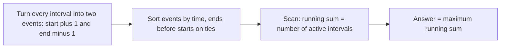
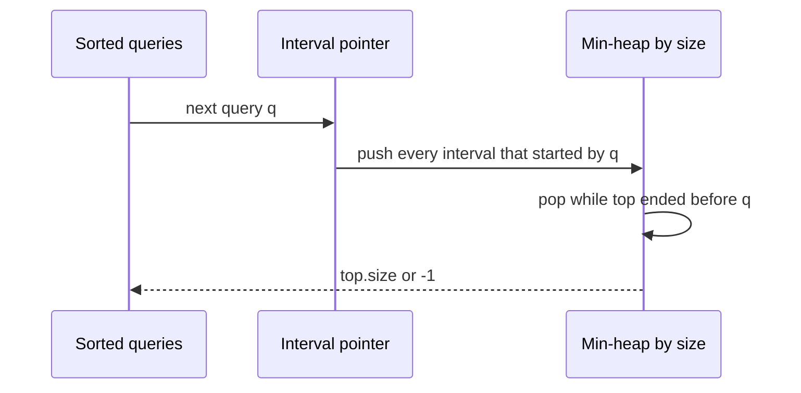

# Sweep lines and heaps: meeting rooms and queries

> **Before this lesson:** read [Interval fundamentals](#/lesson/neet-greedy-math/interval-basics) (overlap test, sorting by start or end). You also need the idea of a **heap** — a container that always hands you its smallest item quickly; it is taught in [Priority queues and binary heaps](#/lesson/dsa-foundations/heaps), and a short recap is given below.

## In plain words

Imagine watching the door of an office building. You do not care who is inside; you only click a counter **up** when someone enters and **down** when someone leaves. The highest number the counter ever shows is the largest crowd of the day.

That is a **sweep line**: instead of comparing every interval with every other interval, you walk along the timeline and react only at the moments something changes — an interval starting or ending. Those moments are called **events**.

Sometimes a counter is not enough because you need to know *which* of the people inside will leave first (to give their desk to the next arrival). For that you keep the people inside in a **heap**.

**Why this matters for a job.** "How many things are happening at the same time?" is the question behind server capacity planning, meeting-room and seat allocation, rate limiting, and billing for concurrent usage. The sweep-line technique answers it in one sorted pass.

### Words used in this lesson

- **Event**: a point in time where something changes (an interval starts or ends).
- **Active set**: the intervals that have started but not yet ended at the current moment.
- **Peak**: the largest size the active set ever reaches.
- **Heap / priority queue**: a container where `heappush` adds an item and `heappop` removes the *smallest* item, both in `O(log n)` time; `heap[0]` peeks at the smallest without removing it. Python's module is `heapq`, and a heap is stored in an ordinary list.
- **Tuple**: a fixed group of values such as `(time, +1)`. Python compares tuples element by element, left to right.
- **Query**: a question asked about the data, here "which interval covers this point?".
- **Offline**: answering questions in an order you choose, because you know all of them in advance.
- **Prefix sum**: a running total.

### The smallest possible example

Two meetings: 9–11 and 10–12. Events in time order: 9 (start, counter 1), 10 (start, counter 2), 11 (end, counter 1), 12 (end, counter 0). The peak is 2, so two rooms are needed. If the second meeting were 11–12 instead, the events at 11 would be "end" then "start", the counter would go 1 → 0 → 1, and one room would do.

A short heap warm-up, since heaps appear throughout:

```python
import heapq
h = []                     # an empty heap is an empty list
heapq.heappush(h, 30)      # add 30
heapq.heappush(h, 10)      # add 10; the smallest item is now h[0] == 10
print(heapq.heappop(h))    # removes and prints 10, the smallest
```

The first intervals lesson answered questions about *pairs*: do these two overlap, which blocks
merge. This lesson answers questions about **crowds**:

- What is the largest number of intervals that are active at the same moment? (*Meeting Rooms II*)
- For each query point, which of the intervals covering it is best? (*Minimum Interval to Include
  Each Query*)

Both are solved by imagining a vertical line sweeping across the timeline from left to right and
maintaining the set of intervals the line currently cuts through — the **active set**. Two tools
maintain that set cheaply: a sorted list of **events**, and a **heap**.

## 1. The sweep-line idea

Stand at time `−∞` and walk right. Nothing changes between interval endpoints; things only happen at
**events**:

- at an interval's start, it joins the active set (+1),
- at an interval's end, it leaves (−1).

If you only need the *size* of the active set, you do not need to store the set at all — a counter
will do.



### Meeting Rooms II by events

**Problem.** Given meetings `[start, end)`, how many rooms are needed?

The answer is the peak size of the active set: at the busiest instant, each active meeting needs its
own room, and that many rooms is always enough (when a meeting starts, fewer than `peak` others are
active, so a room is free).

```python-run
def min_rooms_events(meetings):
    events = []
    for s, e in meetings:
        events.append((s, +1))
        events.append((e, -1))
    events.sort()                 # (t, -1) sorts before (t, +1): ends are processed first on ties
    active = peak = 0
    for t, delta in events:
        active += delta
        peak = max(peak, active)
        print(f"t={t:>2} {'start' if delta > 0 else 'end  '} -> active={active}")
    return peak

print("rooms:", min_rooms_events([[0, 30], [5, 10], [15, 20], [10, 15]]))
```

Look at `t=10` in the output: one meeting ends and another starts. Because tuples sort
lexicographically and `-1 < +1`, the end event is processed first, the room is released, and the count
never touches 3. **Tie-breaking is where sweep-line bugs live.** If meetings were closed intervals
(the room is still occupied *at* the end time) you would need starts before ends instead — sort with
`(t, -delta)`.

### The two-array variant

Because a `+1`/`−1` event does not care *which* meeting it belongs to, you can sort starts and ends
independently and merge them with two pointers. Same idea, less memory, no tuples:

```python-run
def min_rooms_two_arrays(meetings):
    starts = sorted(s for s, _ in meetings)
    ends = sorted(e for _, e in meetings)
    rooms = peak = j = 0
    for s in starts:
        while ends[j] <= s:        # every meeting that has ended by time s frees a room
            rooms -= 1
            j += 1
        rooms += 1
        peak = max(peak, rooms)
    return peak

print(min_rooms_two_arrays([[0, 30], [5, 10], [15, 20]]))
print(min_rooms_two_arrays([[1, 5], [5, 10]]))
```

`j` never runs off the end: an end event can only be consumed when some start is at or after it, and
there are as many ends as starts, each end later than its own start.

### Difference arrays: the sweep line for small coordinates

When times are small integers (say `0..10^6`), skip the sorting: `diff[s] += 1`, `diff[e] -= 1`, then
a prefix sum over `diff` gives the number of active intervals at every time. *Car Pooling*
(`trips[i] = [passengers, from, to]`, capacity check) is this with `+passengers` / `−passengers`.

```python-run
def car_pooling(trips, capacity):
    diff = [0] * 1002
    for people, start, end in trips:
        diff[start] += people
        diff[end] -= people          # passengers leave AT `end`, so the seat is free there
    load = 0
    for d in diff:
        load += d
        if load > capacity:
            return False
    return True

print(car_pooling([[2, 1, 5], [3, 3, 7]], 4))   # False: 5 people between 3 and 5
print(car_pooling([[2, 1, 5], [3, 5, 7]], 3))   # True: drop-off happens before pick-up at 5
```

## 2. When a counter is not enough: a heap of end times

The event sweep tells you *how many* rooms. Suppose you also need to know which room each meeting
gets, or — as in the next problem — some property of the active intervals. Then you need the active
set itself, organised so that the interval you care about is on top.

For room allocation the interesting active meeting is **the one that ends first**: if any room is
free by the time a new meeting starts, that one is. A min-heap keyed by end time gives it in `O(1)`
and updates in `O(log n)`.

```python-run
import heapq

def min_rooms_heap(meetings):
    ends = []                                   # min-heap of end times, one entry per room in use
    for s, e in sorted(meetings):
        if ends and ends[0] <= s:
            freed = heapq.heapreplace(ends, e)  # reuse the room that freed up earliest
            print(f"[{s},{e}) reuses the room freed at {freed}; heap={sorted(ends)}")
        else:
            heapq.heappush(ends, e)
            print(f"[{s},{e}) opens room #{len(ends)}; heap={sorted(ends)}")
    return len(ends)

print(min_rooms_heap([[0, 30], [5, 10], [15, 20], [10, 15], [12, 40]]))
```

Why is one pop per arrival enough? If the earliest-ending room is not free, no room is. If it is
free, we reuse it; other rooms may also be free, but leaving them in the heap is harmless — the heap
size counts **rooms ever opened**, which is what we want, not "meetings currently active".

`heapq.heapreplace(h, x)` pops the smallest item and pushes `x` in one `O(log n)` operation; it is the
idiomatic way to say "reuse".

> [!INTERVIEW]
> Expect the follow-up "now return the room number for each meeting" (*Meeting Rooms III* style).
> Keep two heaps: free room ids (min-heap), and busy rooms as `(end_time, room_id)`. Before placing a
> meeting, move every busy room with `end <= start` back to the free heap.

Both approaches are `O(n log n)`. The sweep is simpler; the heap generalises.

## 3. Offline queries + heap with lazy deletion

**Problem (Minimum Interval to Include Each Query).** Given closed intervals and query points, report
for each query the size (`right − left + 1`) of the smallest interval containing it, or `−1`.

Brute force is `O(n · q)`: with both at `10^5` that is ten billion checks. Here is the chain of ideas
that brings it down to `O((n + q) log n)`.

**Idea 1 — answer the queries in sorted order.** The queries are all known in advance, and nothing
forces us to answer them in the order given. This is called processing queries **offline**. If the
sweep line visits queries left to right, the set of intervals with `left ≤ q` only ever grows.

**Idea 2 — the active set lives in a min-heap keyed by size.** As the sweep passes an interval's
left end, push `(size, right)`. The top of the heap is the smallest interval that has *started*.

**Idea 3 — lazy deletion.** Some started intervals have also *ended* (`right < q`). We do not need
to remove them the moment they end; we only care when one of them is sitting on top of the heap
pretending to be the answer. So before reading the top, pop while `top.right < q`. An interval that
has ended for this query has ended for all later (larger) queries too, so it is never needed again.
Stale entries buried deeper in the heap do no harm.

```python-run
import heapq

def min_interval(intervals, queries):
    intervals = sorted(intervals)
    heap, answers, i = [], {}, 0
    for q in sorted(set(queries)):
        while i < len(intervals) and intervals[i][0] <= q:       # started by q
            left, right = intervals[i]
            heapq.heappush(heap, (right - left + 1, right))
            i += 1
        while heap and heap[0][1] < q:                           # top has already ended
            heapq.heappop(heap)
        answers[q] = heap[0][0] if heap else -1
        print(f"q={q}: heap={sorted(heap)} -> {answers[q]}")
    return [answers[q] for q in queries]

print(min_interval([[1, 4], [2, 4], [3, 6], [4, 4]], [2, 3, 4, 5]))
print(min_interval([[2, 3], [2, 5], [1, 8], [20, 25]], [2, 19, 5, 22]))
```

Each interval is pushed once and popped at most once, so the heap work is `O(n log n)`; sorting the
queries costs `O(q log q)`.



The three ideas — sort queries, grow the active set monotonically, delete lazily — form a reusable
template. You will meet it again in *Sliding Window Maximum* (monotonic deque with lazy expiry),
*The Skyline Problem*, and *Number of Flowers in Full Bloom*.

> [!TIP]
> Remember to map answers back to the **original** query order. Either store results in a dict
> keyed by query value (duplicates then share an answer), or sort indices:
> `for qi in sorted(range(len(queries)), key=queries.__getitem__)`.

## 4. Choosing the tool

| Question | Tool | Cost |
|---|---|---|
| Do any two overlap? | sort by start, compare neighbours | `O(n log n)` |
| Maximum simultaneous intervals | event sweep or two sorted arrays | `O(n log n)` |
| Same, with small integer coordinates | difference array + prefix sum | `O(n + range)` |
| Which resource does each interval get? | heap of `(end, resource)` | `O(n log n)` |
| Best active interval for each query point | offline queries + heap + lazy deletion | `O((n+q) log n)` |
| Many online inserts and queries | balanced tree / segment tree (`sortedcontainers`, *My Calendar*) | `O(log n)` each |

## 5. A closer look at correctness: why peak overlap = rooms needed

It is worth being able to justify the Meeting Rooms II answer rather than only asserting it.

- **Lower bound.** If at some instant `k` meetings are in progress, they need `k` distinct rooms. So
  `rooms ≥ peak`.
- **Upper bound.** Process meetings by start time and give each one any free room, opening a new room
  only when none is free. Suppose this greedy opens room number `r`. At that moment all `r − 1`
  existing rooms are busy with meetings that started earlier and have not ended — together with the
  new meeting, that is `r` meetings active at the same instant, so `r ≤ peak`.

Hence the greedy uses exactly `peak` rooms. This is the "structural bound" style of proof: exhibit a
witness (an instant with `k` overlapping meetings) that forces any solution to use at least what
greedy uses.

## 6. Pitfalls

- **Tie order in the event sort.** For half-open meetings process ends before starts; for closed
  intervals, starts before ends. Encode the tie-break in the tuple.
- **`<` vs `<=` when freeing a room.** `ends[0] <= s` for half-open meetings.
- **Heap holding the wrong key.** For room reuse the key is the *end* time; for the query problem it
  is the *size* (with `right` carried along for expiry).
- **Eager deletion.** Trying to remove an arbitrary element from a heap is `O(n)`. Delete lazily at
  the top instead.
- **Returning answers in sorted-query order.**
- **Size off by one**: closed interval `[l, r]` covers `r − l + 1` integers.
- **Sorting only by start when ends matter for ties** — rarely an issue with the heap method, but
  it matters for event sweeps.

## Summary

- A sweep line turns intervals into start/end events; the running sum of `+1/−1` is the number of
  active intervals, and its peak answers "how many rooms".
- Sort ties deliberately: half-open intervals free the room before the next start.
- A min-heap of end times answers "which room frees up first"; the heap's final size is the number of
  rooms.
- For point queries, sort the queries, add intervals as the sweep passes their left end, keep them in
  a heap ordered by what you want to minimise, and pop expired tops lazily.

## Glossary

- **Sweep line** — processing a timeline from left to right, stopping only at events.
- **Event** — a start (+1) or end (−1) of an interval.
- **Active set** — intervals currently "open" under the sweep line.
- **Difference array** — an array storing only the *changes* at each position; its running total gives the actual values.
- **Heap (min-heap)** — a structure that returns its smallest element in O(1) and adds/removes in O(log n).
- **`heapq.heapreplace`** — pop the smallest and push a new item in one step.
- **Offline queries** — sorting the questions so they can be answered in one sweep, then restoring their original order.
- **Lazy deletion** — leaving outdated items inside a heap and discarding them only when they reach the top.
- **Lower bound / upper bound** — an argument that at least / at most a certain amount is needed; when both agree the answer is exact.
- **Tie-break** — the rule for ordering two events that happen at the same time.

```quiz
[
  {"q": "Meetings are half-open [start, end). In an event sweep, how should an end at time t and a start at time t be ordered?",
   "options": ["Start first", "End first, so the room is released before it is needed", "Order does not matter", "Process them as one event of weight 0 only if they belong to the same meeting"],
   "answer": 1,
   "explain": "Back-to-back meetings share a room; processing the end first prevents a spurious extra room."},
  {"q": "In the heap solution to Meeting Rooms II, what does the heap contain?",
   "options": ["Start times of all meetings", "End times of the meetings currently occupying each opened room", "Room numbers", "Durations"],
   "answer": 1,
   "explain": "The minimum end time identifies the room that becomes free first; the heap's size is the number of rooms opened."},
  {"q": "Why is the minimum number of rooms at least the peak number of simultaneous meetings?",
   "options": ["Because rooms are sorted", "Because meetings active at the same instant must all be in different rooms", "Because of the heap property", "Because meetings have positive length"],
   "answer": 1,
   "explain": "k overlapping meetings at one instant force k rooms; the greedy assignment shows that many also suffices."},
  {"q": "What does 'offline' query processing mean in Minimum Interval to Include Each Query?",
   "options": ["Queries are answered without using the intervals", "All queries are known up front, so they may be answered in a convenient (sorted) order and mapped back", "Queries are cached on disk", "Each query is answered by binary search"],
   "answer": 1,
   "explain": "Sorting queries lets the set of started intervals grow monotonically as the sweep moves right."},
  {"q": "What is lazy deletion in a heap?",
   "options": ["Never deleting anything", "Leaving expired entries in the heap and discarding them only when they reach the top", "Deleting the largest element first", "Rebuilding the heap after each query"],
   "answer": 1,
   "explain": "Only the top matters for the answer; stale entries deeper down are harmless and each is popped at most once."},
  {"q": "When times are small non-negative integers, which technique finds the maximum overlap without sorting?",
   "options": ["Binary search", "Difference array: +1 at start, -1 at end, then prefix sums", "Union-find", "Two stacks"],
   "answer": 1,
   "explain": "The prefix sum of the difference array is the number of active intervals at each time, in O(n + range)."},
  {"q": "In min_interval, the heap stores (size, right). Why carry `right`?",
   "options": ["To break ties alphabetically", "To detect that the top interval ended before the current query and must be popped", "To compute the size", "It is unnecessary"],
   "answer": 1,
   "explain": "An interval with right < q no longer contains q (or any later query), so it is discarded when it surfaces."}
]
```

> **Source:** Priority queues and heaps follow Goodrich, Tamassia & Goldwasser, *Data Structures and Algorithms in Python*, ch. 9 (heap-based priority queues, `heapq`); the greedy room-allocation argument applies §13.4.2. Problems follow the NeetCode 150 "Intervals" list; explanations and code are original to this guide.
