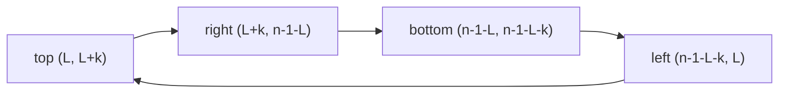
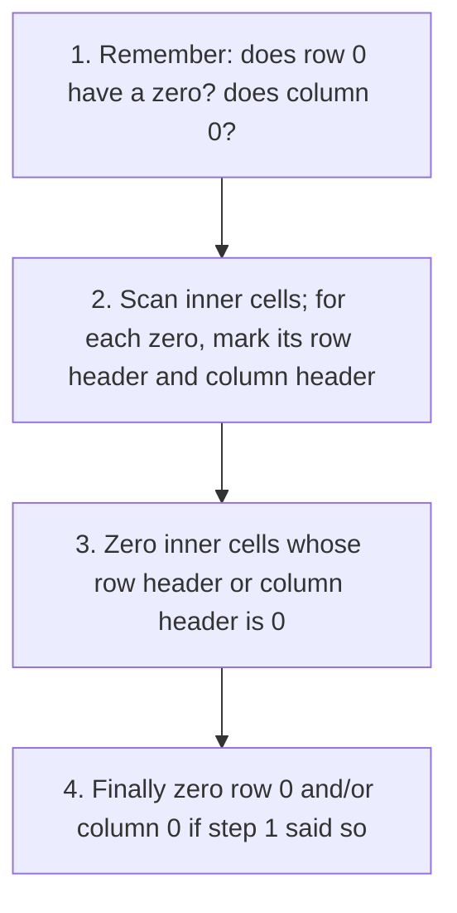

# Matrix manipulation: rotate, spiral, mark in place

Matrix questions rarely need a clever algorithm. They need **index discipline**: knowing exactly
which cell maps to which, where a loop starts and stops, and how to avoid overwriting data you still
need. Interviewers like them for precisely that reason — a candidate who can write a spiral traversal
without an off-by-one error is a candidate who is careful.

This lesson gives you a small toolkit: coordinate conventions, the handful of transforms that all
rotations and reflections are built from, the shrinking-boundary technique for layer-by-layer
traversals, and two ways to stash extra information *inside* the matrix when you are not allowed
extra memory. It ends with a little coordinate geometry for point-set problems like *Detect Squares*.

## 1. Conventions that prevent bugs

A matrix in Python is a list of rows: `matrix[r][c]`, **row first, column second**. Rows grow
downward, columns grow to the right — so `r` behaves like a *y* coordinate pointing down and `c` like
*x*. Mixing these up is the most common source of matrix bugs; always name your variables `r, c` (or
`row, col`), never `x, y` or `i, j` when both orders are in play.

```python-run
m = [[1, 2, 3, 4],
     [5, 6, 7, 8],
     [9, 10, 11, 12]]
rows, cols = len(m), len(m[0])
print(rows, "rows x", cols, "cols; m[1][2] =", m[1][2])

# The classic aliasing trap when creating a grid:
bad = [[0] * 3] * 2          # two references to the SAME row
bad[0][0] = 9
print("bad :", bad)
good = [[0] * 3 for _ in range(2)]
good[0][0] = 9
print("good:", good)

# Handy idioms
print("transpose:", [list(col) for col in zip(*m)])
print("column 1 :", [row[1] for row in m])
print("neighbours of (1,1):", [(1 + dr, 1 + dc) for dr, dc in ((0, 1), (1, 0), (0, -1), (-1, 0))])
```

> [!WARNING]
> `[[0] * cols] * rows` creates `rows` references to one list. Writing to one row changes all of
> them. Always build grids with a comprehension.

**In place** means you mutate the object you were given. In Python, assigning to the parameter name
(`matrix = something`) only rebinds a local variable — the caller sees nothing. Mutate through
indices (`matrix[r][c] = v`), methods (`row.reverse()`), or slice assignment (`matrix[:] = new`).

## 2. Rotations are built from reflections

There are four elementary flips of a square grid, each a simple index map (with `n` the side length):

| Transform | Maps `(r, c)` to | In-place code |
|---|---|---|
| Transpose (main diagonal) | `(c, r)` | swap `m[r][c]` with `m[c][r]` for `c > r` |
| Horizontal mirror (reverse each row) | `(r, n−1−c)` | `row.reverse()` |
| Vertical mirror (reverse row order) | `(n−1−r, c)` | `m.reverse()` |
| Anti-transpose (anti-diagonal) | `(n−1−c, n−1−r)` | swap across the other diagonal |

A 90° clockwise rotation sends `(r, c)` to `(c, n−1−r)`: the top row becomes the right column.
Compare with the table: **transpose, then reverse each row** gives `(r,c) → (c,r) → (c, n−1−r)`.
Composition of two reflections is a rotation — true in geometry, and true for index maps.

- Clockwise 90°: transpose, then reverse each row. (Or: reverse row order, then transpose.)
- Counter-clockwise 90°: transpose, then reverse row order. (Or: reverse each row, then transpose.)
- 180°: reverse row order and reverse each row.

```python-run
def show(m, title):
    print(title)
    for row in m:
        print("  ", row)

def rotate_cw(m):
    n = len(m)
    for r in range(n):
        for c in range(r + 1, n):          # strictly above the diagonal: each pair swapped once
            m[r][c], m[c][r] = m[c][r], m[r][c]
    for row in m:
        row.reverse()

m = [[1, 2, 3], [4, 5, 6], [7, 8, 9]]
show(m, "original")
rotate_cw(m)
show(m, "rotated 90 degrees clockwise")

# sanity check against the index formula (r, c) -> (c, n-1-r)
orig = [[1, 2, 3], [4, 5, 6], [7, 8, 9]]
n = 3
assert all(m[c][n - 1 - r] == orig[r][c] for r in range(n) for c in range(n))
print("formula check passed")
```

Why `range(r + 1, n)`? If the inner loop ran over all `c`, each pair `(r,c)/(c,r)` would be swapped
twice and the matrix would end up unchanged — a famous silent bug.

### The four-way cycle

The alternative is to rotate the matrix one **ring** at a time, moving four cells at once:



Save the top cell, pull left into top, bottom into left, right into bottom, saved into right. It does
the job in one pass with fewer writes, but the index expressions are easy to get wrong. In an
interview, prefer transpose-and-reverse, and mention the cycle version as an alternative.

> [!TIP]
> If extra space is allowed, Python has a one-liner: `[list(row) for row in zip(*matrix[::-1])]`
> rotates clockwise (reverse the row order, then transpose). `matrix[:] = ...` makes it "in place"
> from the caller's point of view, though it still allocates O(n²) temporarily.

## 3. Layer-by-layer traversal with shrinking boundaries

*Spiral Matrix* asks for the elements in clockwise spiral order. The robust technique: maintain four
boundaries — `top`, `bottom`, `left`, `right` — of the rectangle that has not been visited yet. Walk
one side, then **move that boundary inward**.

```python-run
def spiral(matrix):
    out = []
    top, bottom = 0, len(matrix) - 1
    left, right = 0, len(matrix[0]) - 1
    while top <= bottom and left <= right:
        for c in range(left, right + 1):            # → along the top
            out.append(matrix[top][c])
        top += 1
        for r in range(top, bottom + 1):            # ↓ down the right side
            out.append(matrix[r][right])
        right -= 1
        if top <= bottom:                           # ← along the bottom, if a row remains
            for c in range(right, left - 1, -1):
                out.append(matrix[bottom][c])
            bottom -= 1
        if left <= right:                           # ↑ up the left side, if a column remains
            for r in range(bottom, top - 1, -1):
                out.append(matrix[r][left])
            left += 1
    return out

print(spiral([[1, 2, 3, 4], [5, 6, 7, 8], [9, 10, 11, 12]]))
print(spiral([[1, 2, 3]]))          # single row: guards prevent walking it backwards
print(spiral([[1], [2], [3]]))      # single column
```

The two `if` guards are the whole difficulty. After walking the top row and the right column, the
remaining rectangle may have **no rows left** (the input was a single row) or **no columns left** (a
single column). Without the guards, a single row would be emitted left-to-right and then again
right-to-left.

Test every traversal you write on `1 × 1`, `1 × n`, `n × 1` and a non-square case. Those four inputs
catch almost every boundary bug.

### The direction-vector alternative

Simulate a walker that turns right when blocked:

```python-run
def spiral_walk(matrix):
    rows, cols = len(matrix), len(matrix[0])
    seen = [[False] * cols for _ in range(rows)]
    dirs = [(0, 1), (1, 0), (0, -1), (-1, 0)]      # right, down, left, up (clockwise)
    r = c = d = 0
    out = []
    for _ in range(rows * cols):
        out.append(matrix[r][c])
        seen[r][c] = True
        nr, nc = r + dirs[d][0], c + dirs[d][1]
        if not (0 <= nr < rows and 0 <= nc < cols) or seen[nr][nc]:
            d = (d + 1) % 4                         # turn right
            nr, nc = r + dirs[d][0], c + dirs[d][1]
        r, c = nr, nc
    return out

print(spiral_walk([[1, 2, 3, 4], [5, 6, 7, 8], [9, 10, 11, 12]]))
```

It needs `O(mn)` extra space for `seen`, but the `dirs` array with `d = (d + 1) % 4` is a pattern you
will reuse constantly (grid BFS/DFS, robot simulations, *Spiral Matrix II/III*). Note that
`(dr, dc) → (dc, −dr)` rotates a direction clockwise in row/column coordinates — the same index map
as rotating a matrix.

## 4. Using the matrix as its own scratch space

*Set Matrix Zeroes*: if a cell is 0, zero its entire row and column — using `O(1)` extra memory.

The trap is doing it on the fly: zeros you write become triggers for more zeroing, and the whole grid
collapses. You must separate **reading** (which rows/columns need zeroing?) from **writing**.

Three solutions, in decreasing memory:

1. Copy the matrix: `O(mn)` space.
2. Two sets `zero_rows`, `zero_cols`: `O(m + n)` space.
3. Store those two sets **in the first row and first column of the matrix itself**: `O(1)` space.

For solution 3, `matrix[0][c] == 0` will mean "column `c` must be zeroed" and `matrix[r][0] == 0`
will mean "row `r` must be zeroed". But row 0 and column 0 held real data, so first record — in two
plain booleans — whether *they* originally contained a zero. Then the order of operations matters:



```python-run
def set_zeroes(m):
    rows, cols = len(m), len(m[0])
    row0 = any(m[0][c] == 0 for c in range(cols))
    col0 = any(m[r][0] == 0 for r in range(rows))
    for r in range(1, rows):
        for c in range(1, cols):
            if m[r][c] == 0:
                m[r][0] = m[0][c] = 0
    for r in range(1, rows):
        for c in range(1, cols):
            if m[r][0] == 0 or m[0][c] == 0:
                m[r][c] = 0
    if row0:
        for c in range(cols): m[0][c] = 0
    if col0:
        for r in range(rows): m[r][0] = 0

for grid in ([[1, 1, 1], [1, 0, 1], [1, 1, 1]],
             [[0, 1, 2, 0], [3, 4, 5, 2], [1, 3, 1, 5]],
             [[1, 2, 3, 4], [5, 0, 7, 8], [0, 10, 11, 12], [13, 14, 15, 0]]):
    set_zeroes(grid)
    print(grid)
```

The headers must be applied to the inner cells **before** row 0 and column 0 are themselves
overwritten; otherwise the markers are destroyed.

### Encoding state in the value

A related trick: when cell values come from a tiny set, pack "old value" and "new value" into one
number. In *Game of Life* each cell is 0 or 1; write the next state into bit 1 (`cell |= new << 1`),
keep reading the old state from bit 0 (`cell & 1`), and finally shift everything right by one.
Problems on arrays do the same with signs (*Find All Duplicates*: negate `nums[abs(x) − 1]` to mark
"seen"). The general principle: **find unused capacity in the data you already have.**

> [!INTERVIEW]
> For *Set Matrix Zeroes*, present the `O(m+n)` two-set solution first — it is short and obviously
> correct — then upgrade it: "those two sets can live in the first row and column if I save their own
> state in two booleans." Interviewers want to see the progression, not a memorised trick.

## 5. A little coordinate geometry

Some "matrix" problems are really about **points** `(x, y)` on a grid.

**Hash the points.** Store points in a `set` of tuples for existence checks, or a `Counter` when
duplicates count. Looking up whether a specific point exists is then `O(1)`, which turns "find three
more points" into "choose one and compute where the others must be".

**Axis-aligned squares** (*Detect Squares*). Fix a query corner `(qx, qy)`. Choose the **diagonally
opposite** corner `(x, y)`: it must satisfy `|x − qx| = |y − qy| > 0`. The other two corners are then
forced: `(x, qy)` and `(qx, y)`. The number of squares is the product of the multiplicities of those
three points, summed over all diagonal candidates.

```python-run
from collections import Counter

points = Counter()
for p in [(3, 10), (11, 2), (3, 2), (11, 2)]:
    points[p] += 1

def count_squares(qx, qy):
    total = 0
    for (x, y), k in list(points.items()):
        if x != qx and abs(x - qx) == abs(y - qy):         # a valid diagonal corner
            total += k * points[(x, qy)] * points[(qx, y)]
    return total

print(count_squares(11, 10))   # 2: the point (11, 2) was added twice
print(count_squares(14, 8))    # 0
```

Other geometry facts that come up:

- **Squared distances** avoid floating point: compare `dx*dx + dy*dy`, never `sqrt`.
- **Slopes** as reduced fractions: represent the direction `(dx, dy)` divided by `gcd(dx, dy)` with a
  normalised sign instead of a float (*Max Points on a Line*).
- **Rotating a vector 90°**: `(dx, dy) → (−dy, dx)`. With it you can find squares that are *not*
  axis-aligned: from side `A → B`, the other two corners are `B + rot(AB)` and `A + rot(AB)`.
- **Diagonals of a grid**: cells on the same ↘ diagonal share `r − c`; cells on the same ↙
  anti-diagonal share `r + c` (used in *N-Queens* and *Diagonal Traverse*).

## 6. Pitfalls checklist

- Row/column confusion: `matrix[r][c]`, and `len(matrix)` is the number of rows.
- Non-square inputs: use `rows` and `cols`, not a single `n`, unless the problem guarantees a square.
- Transposing with a full double loop (swaps twice = no-op).
- Spiral without guards on the bottom/left passes.
- Zeroing on the fly in *Set Matrix Zeroes*; applying headers after wiping them.
- Rebinding the parameter instead of mutating it for "in-place" problems.
- `[[0] * n] * m` aliasing.
- In point problems: forgetting duplicates, zero-area shapes, and the second diagonal direction.

## Summary

- Index maps are the language of matrix problems; write the map `(r, c) → (r', c')` before coding.
- Rotation = two reflections: clockwise is transpose + reverse each row.
- Layer traversals use four shrinking boundaries; guard the last two passes.
- To save memory, separate reading from writing and store markers in the first row/column or in
  spare bits of each cell.
- For point sets, hash the points and let geometry tell you where the remaining points must be.

```quiz
[
  {"q": "Rotating an n×n matrix 90° clockwise sends cell (r, c) to…",
   "options": ["(c, r)", "(c, n-1-r)", "(n-1-c, r)", "(n-1-r, n-1-c)"],
   "answer": 1,
   "explain": "The top row becomes the right column: transpose gives (c, r), reversing each row gives (c, n-1-r)."},
  {"q": "Why must the in-place transpose loop use c in range(r + 1, n)?",
   "options": ["To skip the diagonal for speed only", "Because looping over every (r, c) swaps each pair twice and leaves the matrix unchanged", "Because Python cannot swap equal indices", "To avoid index errors"],
   "answer": 1,
   "explain": "Each off-diagonal pair must be swapped exactly once; visiting both (r,c) and (c,r) undoes the swap."},
  {"q": "In the boundary version of Spiral Matrix, what are the two if-guards for?",
   "options": ["Empty matrices", "After moving top and right inward, there may be no row or no column left, and walking it again would duplicate elements", "Negative numbers", "Square matrices only"],
   "answer": 1,
   "explain": "A single remaining row would otherwise be emitted left-to-right and then right-to-left."},
  {"q": "In the O(1)-space Set Matrix Zeroes, why are two extra booleans needed?",
   "options": ["To count zeros", "Because the first row and first column are used as marker storage, so whether they themselves contained a zero must be saved separately", "To handle negative values", "They are optional"],
   "answer": 1,
   "explain": "Markers overwrite row 0 / column 0, and matrix[0][0] alone cannot say whether it refers to the row or the column."},
  {"q": "What is wrong with grid = [[0] * 3] * 2 ?",
   "options": ["It creates a 3×2 grid instead of 2×3", "Both rows are the same list object, so modifying one row modifies the other", "It is a syntax error", "Nothing"],
   "answer": 1,
   "explain": "List multiplication copies references. Use [[0] * 3 for _ in range(2)]."},
  {"q": "In Detect Squares, given query (qx, qy) and a stored point (x, y) with |x-qx| == |y-qy| != 0, where must the other two corners be?",
   "options": ["(x, y) and (qx, qy) again", "(x, qy) and (qx, y)", "(y, x) and (qy, qx)", "(x+qx, y+qy) and (0, 0)"],
   "answer": 1,
   "explain": "For an axis-aligned square the remaining corners share one coordinate with each of the diagonal corners."},
  {"q": "A function `def rotate(self, matrix): matrix = [list(r) for r in zip(*matrix[::-1])]` is submitted for an in-place problem. What happens?",
   "options": ["It works", "The caller's matrix is unchanged because only the local name was rebound", "It raises a TypeError", "It rotates counter-clockwise"],
   "answer": 1,
   "explain": "Assignment to a parameter does not mutate the object. Use matrix[:] = ... or element-wise swaps."}
]
```

> **Source:** Two-dimensional arrays and list aliasing follow Goodrich, Tamassia & Goldwasser, *Data Structures and Algorithms in Python*, §5.6 (multidimensional data sets) — including the warning about building grids with list multiplication. Problems follow the NeetCode 150 "Math & Geometry" list; explanations and code are original to this guide.
