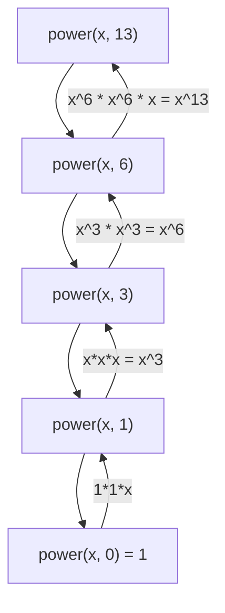

# Interview number theory: digits, modular arithmetic, fast power, primes, gcd

> **Before this lesson:** you should know Python integers, strings, `while` loops and functions, and the meaning of `O(n)` and `O(log n)` ([How to approach an interview problem](#/lesson/neet-arrays/approach)). Recursion (a function calling itself) is used once; it is introduced in [Thinking recursively](#/lesson/dsa-foundations/recursion-examples). No mathematics beyond school arithmetic is assumed.

## In plain words

**Number theory** is the study of whole numbers: their digits, their divisors, their remainders. For programming interviews you need only five small tools from it, and you met most of them in primary school:

- **Digits and carrying** — adding 58 + 67 on paper, column by column.
- **Remainders** — a clock: 5 hours after 10 o'clock is 3 o'clock, because clocks wrap around at 12.
- **Powers** — repeated multiplication, done cleverly so that a huge power needs only a few steps.
- **Primes** — numbers such as 2, 3, 5, 7 that cannot be split into smaller whole-number factors.
- **Greatest common divisor** — the largest number that divides two numbers, used to reduce fractions such as 12/18 = 2/3.

**Why this matters for a job.** Remainders drive hash tables, circular buffers and "every N-th request" logic. Fast powers and primes are the foundation of encryption (the padlock in your browser). Digit-by-digit arithmetic is how computers handle numbers too large for a single machine word — money amounts, cryptographic keys, IDs. Interviewers also like these problems because the code is short, so every line gets scrutinised.

### Words used in this lesson

- **Integer**: a whole number (…, −2, −1, 0, 1, 2, …).
- **Quotient and remainder**: 17 divided by 5 is 3 remainder 2. In Python `17 // 5` is the quotient 3 and `17 % 5` is the remainder 2; `divmod(17, 5)` returns both as `(3, 2)`.
- **Divisor / factor**: `d` divides `n` if `n % d == 0`. **Multiple**: `n` is a multiple of `d`.
- **Carry**: the extra digit passed to the next column when a column's total needs two digits.
- **Overflow**: a result too big for a fixed-size machine integer. Python integers do not overflow; C and Java integers do.
- **Exponent**: the `n` in `x^n` (written `x ** n` in Python).
- **Base**: how many different digits a number system uses — base 10 uses 0–9, base 2 (binary) uses 0 and 1.

### The smallest possible example

Take the number 472 apart, one digit at a time, from the right:

```python
x = 472
print(x % 10)    # 2   -> the last digit (remainder after dividing by 10)
print(x // 10)   # 47  -> everything except the last digit
```

Repeat on 47 to get 7 and 4, then on 4 to get 4 and 0, and stop at 0. This two-line move — "take the last digit, drop the last digit" — is the starting point of the first section.

"Math" interview questions do not test mathematics so much as a short list of computational
techniques that happen to be about numbers. There are five of them, and this lesson covers each:

1. **Digit manipulation** — peeling digits off with `% 10` and `// 10`, and doing arithmetic on digit
   arrays or strings with carries (*Plus One*, *Multiply Strings*, *Happy Number*, *Reverse Integer*).
2. **Modular arithmetic** — keeping numbers small by reducing as you go.
3. **Fast exponentiation** — computing `x^n` in `O(log n)` multiplications (*Pow(x, n)*).
4. **Primes** — trial division and the sieve of Eratosthenes (*Count Primes*).
5. **Greatest common divisor** — Euclid's algorithm (the *GCD and LCM* warm-up).

## 1. Digits

### Peeling digits

Any non-negative integer `x` splits into "everything but the last digit" and "the last digit":

```
x // 10   and   x % 10         or both at once:   q, d = divmod(x, 10)
```

Looping until `x == 0` visits the digits from least to most significant. The inverse — pushing a
digit `d` onto the right of `res` — is `res = res * 10 + d`. Pop from one number and push onto another
and you have reversed the digits.

```python-run
def digits(x):
    out = []
    while x:
        x, d = divmod(x, 10)
        out.append(d)
    return out[::-1] or [0]

def reverse_digits(x):
    res = 0
    while x:
        x, d = divmod(x, 10)
        res = res * 10 + d
    return res

def digit_square_sum(x):
    total = 0
    while x:
        x, d = divmod(x, 10)
        total += d * d
    return total

print(digits(9075), reverse_digits(1200), digit_square_sum(19))

# Python's floor semantics on negatives — a classic trap
print(-123 // 10, -123 % 10, divmod(-123, 10))   # -13 7, not -12 -3 as in C or Java
```

> [!WARNING]
> In Python `//` rounds toward negative infinity and `%` takes the sign of the divisor, so
> `-123 % 10 == 7`. C, C++ and Java truncate toward zero (`-123 % 10 == -3`). When a problem involves
> negative numbers and digits, strip the sign first and put it back at the end.

**Happy Number** combines digit peeling with **cycle detection**. Repeatedly replacing `n` by the sum
of its squared digits either reaches 1 or loops. It cannot grow for ever: a `d`-digit number maps to
at most `81·d`, which is below the number itself as soon as `d ≥ 4`, so the sequence falls under
1000 and stays there. A bounded deterministic sequence must repeat, and you detect the repeat with a
set or with Floyd's slow/fast pointers.

```python-run
def step(x):
    return sum(int(ch) ** 2 for ch in str(x))

def trail(n, limit=20):
    seen, path = set(), []
    while n not in seen and len(path) < limit:
        seen.add(n); path.append(n)
        n = step(n)
    return path, n

for start in (19, 2, 7):
    path, repeat = trail(start)
    print(start, "->", path, "| repeats at", repeat)
```

### Arithmetic on digit arrays

When numbers are too large for a machine word (or the problem forbids converting them), you do
**grade-school arithmetic** on arrays of digits. The universal loop is

```
total = a_digit + b_digit + carry        (or the product plus what is already in the slot)
digit = total % 10
carry = total // 10
```

working from the least significant end.

**Plus One** is the degenerate case: the carry starts as 1. A digit below 9 absorbs it and you stop;
a 9 becomes 0 and passes it on. If the carry survives the whole array, the number was all nines and
gains a new leading 1.

**Multiply Strings** is long multiplication. The key fact is *where each partial product lands*: with
`num1` of length `m` and `num2` of length `n`, the product has at most `m + n` digits, and digit
`num1[i] × num2[j]` contributes to result slot `i + j + 1`, carrying into slot `i + j`.

```python-run
def multiply(num1, num2):
    m, n = len(num1), len(num2)
    res = [0] * (m + n)
    for i in range(m - 1, -1, -1):
        for j in range(n - 1, -1, -1):
            total = res[i + j + 1] + int(num1[i]) * int(num2[j])
            res[i + j + 1] = total % 10
            res[i + j] += total // 10
        print(f"after digit {num1[i]} of {num1}: {res}")
    s = "".join(map(str, res)).lstrip("0")
    return s or "0"

print(multiply("123", "456"), 123 * 456)
print(multiply("0", "9999"))
```

Why `m + n` digits? An `m`-digit number is below `10^m`, so the product is below `10^(m+n)`.

> [!NOTE]
> Python integers have arbitrary precision — `int("9" * 500) ** 2` works without any special handling. That is a gift for
> real programs and a trap in interviews, where the point of *Multiply Strings* or *Reverse Integer*
> is to show you can manage carries and overflow yourself. Say so: "In Python I could call `int`, but
> I'll implement the digit arithmetic."

## 2. Modular arithmetic

`a mod m` is the remainder after dividing `a` by `m`. Its usefulness comes from the fact that taking
remainders **commutes with addition, subtraction and multiplication**:

$$(a + b) \bmod m = ((a \bmod m) + (b \bmod m)) \bmod m$$
$$(a \cdot b) \bmod m = ((a \bmod m) \cdot (b \bmod m)) \bmod m$$

So if only the final remainder matters you may reduce after every operation and never hold a number
larger than about `m²`. This is why problems with astronomically large answers say "return it modulo
`10^9 + 7`": that prime is below `2^30`, so two residues multiplied together stay below `2^60` and
fit a 64-bit integer in languages that have fixed-width integers.

```python-run
MOD = 10**9 + 7

def factorial_mod(n):
    res = 1
    for k in range(2, n + 1):
        res = res * k % MOD          # reduce at every step: numbers stay small
    return res

import math
print(factorial_mod(1000) == math.factorial(1000) % MOD)

# Clock arithmetic and wrap-around indexing are the same idea
n = 5
i = 0
print([(i - 1) % n, (i + 1) % n])    # neighbours on a circle: Python's % is always in 0..n-1
```

**Division does not commute** with `mod`. To divide by `b` modulo a prime `p` you multiply by the
*modular inverse* of `b`, which by Fermat's little theorem is `b^(p−2) mod p` — computed with fast
exponentiation, the next topic. In Python: `pow(b, -1, p)`.

Two more everyday uses:

- **Circular structures.** `(i + k) % n` walks around a ring — circular queues, *Gas Station*,
  rotating an array.
- **Parity and divisibility tests.** `x % 2`, and digit tricks such as "a number is divisible by 3
  iff its digit sum is" (because `10 ≡ 1 mod 3`).

## 3. Fast exponentiation

Computing `x^n` by multiplying `n` times is hopeless when `n` is around two billion. Goodrich,
Tamassia and Goldwasser use this problem to illustrate how a better recursive decomposition changes
the running time from `O(n)` to `O(log n)`. The observation:

$$x^n = \begin{cases} 1 & n = 0 \\ \left(x^{\lfloor n/2 \rfloor}\right)^2 & n \text{ even} \\ \left(x^{\lfloor n/2 \rfloor}\right)^2 \cdot x & n \text{ odd} \end{cases}$$

Each call halves the exponent, so the depth is about `log₂ n` — 31 levels for `n = 2³¹`.

```python-run
calls = 0
def power(x, n):
    """Repeated squaring, recursive."""
    global calls
    calls += 1
    if n == 0:
        return 1
    half = power(x, n // 2)          # ONE recursive call, reused twice
    return half * half * (x if n % 2 else 1)

print(power(3, 13), 3 ** 13, "calls:", calls)

def power_iter(x, n):
    """Same idea, driven by the binary digits of n."""
    result = 1
    while n:
        if n & 1:                    # lowest bit set: this power of x is part of the product
            result *= x
        x *= x                       # x, x^2, x^4, x^8, ...
        n >>= 1
    return result

print(power_iter(3, 13), "| 13 =", bin(13), "-> 3^8 * 3^4 * 3^1 =", 3**8 * 3**4 * 3)
```

The iterative version reads the exponent in binary. `13 = 1101₂ = 8 + 4 + 1`, so
`x^13 = x^8 · x^4 · x^1`. The loop generates `x, x², x⁴, x⁸` by squaring and multiplies in the ones
whose bit is set.



Three details for *Pow(x, n)*:

- **Negative exponents**: `x^(−n) = (1/x)^n`. Convert first, then run the loop on a non-negative `n`.
- **One recursive call, not two.** Writing `power(x, n//2) * power(x, n//2)` recomputes the same
  subproblem twice at every level and is `O(n)` again.
- **Fixed-width overflow**: in Java or C, negating `n = −2³¹` overflows. Python does not care, but
  mentioning it earns credit.

**Modular exponentiation** is the same loop with `% m` after each multiplication; Python's built-in
three-argument `pow(base, exp, mod)` does exactly this, and it is the workhorse of cryptography
(RSA, Diffie–Hellman) and of hash/"count modulo 10⁹+7" problems.

```python-run
def pow_mod(base, exp, mod):
    result, base = 1, base % mod
    while exp:
        if exp & 1:
            result = result * base % mod
        base = base * base % mod
        exp >>= 1
    return result

print(pow_mod(7, 10**18, 10**9 + 7) == pow(7, 10**18, 10**9 + 7))
p = 10**9 + 7
inv3 = pow_mod(3, p - 2, p)          # modular inverse via Fermat's little theorem
print(inv3, 3 * inv3 % p)
```

The technique generalises to anything with an associative "multiply": square a **matrix** repeatedly
to get the `n`-th Fibonacci number in `O(log n)`.

## 4. Primes

A **prime** is an integer greater than 1 whose only divisors are 1 and itself.

### Testing one number: trial division up to √n

If `n = a · b` with `a ≤ b`, then `a ≤ √n`. So if no integer in `2..√n` divides `n`, nothing does.

```python-run
def is_prime(n):
    if n < 2:
        return False
    i = 2
    while i * i <= n:                # i <= sqrt(n) without floating point
        if n % i == 0:
            return False
        i += 1
    return True

print([k for k in range(30) if is_prime(k)])

def factorize(n):
    """Prime factorisation by trial division: O(sqrt n)."""
    out, p = [], 2
    while p * p <= n:
        while n % p == 0:
            out.append(p)
            n //= p
        p += 1
    if n > 1:
        out.append(n)                # whatever is left is a prime larger than sqrt(original)
    return out

print(factorize(360), factorize(97), factorize(10**9 + 7))
```

Write the bound as `i * i <= n` rather than `i <= math.sqrt(n)`: no floating-point rounding, and
no import.

### Testing many numbers: the sieve of Eratosthenes

To find **all** primes below `n`, testing each individually costs `O(n√n)`. The sieve inverts the
question: instead of asking "is `k` prime?", it crosses off every number that is a **multiple** of a
prime. What survives is prime.

1. Assume every number from 2 to `n−1` is prime.
2. For `p = 2, 3, 4, …` while `p² < n`: if `p` is still marked prime, cross off
   `p², p² + p, p² + 2p, …`.
3. Count the survivors.

Two optimisations are baked in and both deserve a sentence of justification:

- **Stop at `√n`.** Any composite `c < n` has a prime factor `≤ √c < √n`, so it has been crossed off
  by then.
- **Start crossing at `p²`.** A smaller multiple `k·p` with `k < p` has a prime factor smaller than
  `p` and was crossed off earlier.

```python-run
def sieve(n):
    is_p = bytearray([1]) * n
    is_p[0:2] = b"\x00\x00"[:n]
    p = 2
    while p * p < n:
        if is_p[p]:
            is_p[p * p::p] = bytes(len(range(p * p, n, p)))   # cross off a whole progression
        p += 1
    return is_p

flags = sieve(50)
print([i for i, f in enumerate(flags) if f])
print("primes below 10^6:", sum(sieve(10**6)))
```

The running time is `O(n log log n)` — each number is crossed off once per distinct prime factor,
and the sum of `1/p` over primes up to `n` grows like `log log n`. For practical purposes that is
linear. Memory is `O(n)`; a `bytearray` uses one byte per number, whereas a list of Python bools
uses eight bytes per pointer.

> [!TIP]
> The slice assignment `is_p[p*p::p] = bytes(k)` runs in C and is many times faster than a Python
> `for` loop. In the browser judge (Pyodide) this is the difference between instant and several
> seconds for `n` in the millions.

A useful variant stores the **smallest prime factor** of each number instead of a boolean; then any
number below `n` can be factorised in `O(log n)` by repeatedly dividing by its stored factor.

## 5. Greatest common divisor

The **gcd** of two integers is the largest integer dividing both. **Euclid's algorithm** rests on a
single fact: any common divisor of `a` and `b` also divides `a − b`, and therefore `a mod b` (which
is `a` minus a multiple of `b`); conversely any common divisor of `b` and `a mod b` divides `a`. So
the pairs `(a, b)` and `(b, a mod b)` have exactly the same common divisors:

$$\gcd(a, b) = \gcd(b,\; a \bmod b), \qquad \gcd(a, 0) = a$$

```python-run
def gcd(a, b):
    while b:
        print(f"  gcd({a}, {b})")
        a, b = b, a % b
    return a

print(gcd(1071, 462))

def lcm(a, b):
    x, y = a, b
    while y:
        x, y = y, x % y
    return a // x * b            # divide first: keeps the intermediate value small

print(lcm(4, 6), lcm(21, 6))

from functools import reduce
import math
nums = [12, 18, 30]
print(reduce(math.gcd, nums), reduce(lcm, nums))
```

**How fast?** After two iterations the first argument has at least halved (if `b ≤ a/2` then
`a mod b < b ≤ a/2`; if `b > a/2` then `a mod b = a − b < a/2`). So the number of steps is
`O(log min(a, b))` — about 45 steps at most for 32-bit inputs. The worst case is consecutive Fibonacci
numbers.

**Least common multiple.** Since `gcd(a, b) · lcm(a, b) = a · b`,
`lcm(a, b) = a // gcd(a, b) * b`. Both `gcd` and `lcm` are associative, so fold them across an array.

Where gcd shows up in interviews:

- reducing fractions and representing slopes exactly (*Max Points on a Line*),
- "can we measure / reach exactly `k`?" puzzles (*Water and Jug Problem*: possible iff `k` is a
  multiple of `gcd(x, y)`),
- periodicity of strings and rotations (*GCD of Strings*; rotating an array by `k` decomposes into
  `gcd(n, k)` cycles),
- grouping (*X of a Kind in a Deck of Cards*: gcd of all counts must be ≥ 2).

Python provides `math.gcd` (any number of arguments since 3.9) and `math.lcm`. Know how to write
Euclid by hand anyway — it is three lines and a common warm-up.

## 6. Pitfalls checklist

- `%` and `//` on negative numbers in Python vs C/Java.
- Checking overflow *after* it happened (in fixed-width languages) instead of before:
  `if res > (LIMIT - d) // 10`.
- Leading zeros in digit-array results; the special case `"0"`.
- `**` and floats for big powers or roots: `int(n ** 0.5)` can be off by one for large `n`; use
  `math.isqrt(n)` or `i * i <= n`.
- Two recursive calls in fast power.
- Sieve bounds: "primes less than `n`" vs "up to `n`"; `n < 2`.
- `lcm` as plain product (only true for coprime numbers).

## Summary

- `divmod(x, 10)` peels digits; `res*10 + d` pushes them; carries are `total % 10` and `total // 10`.
- Reduce modulo `m` after every `+`, `−`, `×`; division needs a modular inverse.
- Fast power: square and halve — `O(log n)` multiplications; read the exponent in binary.
- Trial division to `√n` tests one number; the sieve finds all primes below `n` in `O(n log log n)`.
- Euclid: `gcd(a, b) = gcd(b, a % b)`; `lcm = a // gcd * b`.

## Glossary

- **`divmod(a, b)`** — returns the quotient and remainder of `a / b` together.
- **Carry** — the part of a column sum that moves to the next, more significant, column.
- **Modulo (`mod`, `%`)** — the remainder after division; "arithmetic on a clock".
- **Residue** — a number already reduced modulo `m`, i.e. between 0 and `m − 1`.
- **Modular inverse** — the number that plays the role of `1/b` under a modulus.
- **Repeated squaring (fast exponentiation)** — computing `x^n` by squaring and halving the exponent, in `O(log n)` multiplications.
- **Prime / composite** — a number above 1 with no divisors other than 1 and itself / a number that has some.
- **Trial division** — testing divisibility by every candidate up to `√n`.
- **Sieve of Eratosthenes** — finding all primes below `n` by crossing off multiples.
- **gcd / lcm** — greatest common divisor / least common multiple.
- **Euclid's algorithm** — computing a gcd by repeatedly replacing `(a, b)` with `(b, a % b)`.
- **Cycle detection** — noticing that a repeating process has returned to a value it produced before.
- **Arbitrary precision** — integers that can grow to any size, as in Python.

```quiz
[
  {"q": "What does divmod(-123, 10) return in Python?",
   "options": ["(-12, -3)", "(-13, 7)", "(-12, 3)", "(12, -3)"],
   "answer": 1,
   "explain": "Python floors the quotient toward negative infinity and the remainder takes the divisor's sign: -13*10 + 7 = -123."},
  {"q": "In Multiply Strings with len(num1)=m and len(num2)=n, the product of num1[i] and num2[j] is added to which slot of the length m+n result?",
   "options": ["i + j", "i + j + 1, with the carry going to i + j", "i * j", "m + n - i - j"],
   "answer": 1,
   "explain": "Counting from the left, the units digit of that partial product lands at i+j+1 and its carry one slot to the left."},
  {"q": "How many multiplications does repeated squaring need to compute x^n?",
   "options": ["O(n)", "O(log n)", "O(sqrt n)", "O(1)"],
   "answer": 1,
   "explain": "The exponent halves every step; at most two multiplications per bit of n."},
  {"q": "Why does writing power(x, n//2) * power(x, n//2) ruin fast exponentiation?",
   "options": ["It gives the wrong answer for odd n only", "Two recursive calls per level make the call tree have O(n) nodes", "Python caches the first call so it is fine", "It overflows the stack immediately"],
   "answer": 1,
   "explain": "The recurrence becomes T(n) = 2T(n/2) + O(1) = O(n). Compute the half once and square it."},
  {"q": "In the sieve of Eratosthenes, why can crossing off multiples of p start at p*p?",
   "options": ["Smaller multiples are prime", "Every smaller multiple k*p with k < p has a prime factor below p and was already crossed off", "It is only an approximation", "Because p*p is always odd"],
   "answer": 1,
   "explain": "k*p with k<p was eliminated when processing k's smallest prime factor."},
  {"q": "Which identity is Euclid's algorithm built on?",
   "options": ["gcd(a, b) = gcd(a+b, b)", "gcd(a, b) = gcd(b, a mod b)", "gcd(a, b) = a*b / lcm(a, b) only", "gcd(a, b) = gcd(a/2, b/2)"],
   "answer": 1,
   "explain": "a mod b is a minus a multiple of b, so (a,b) and (b, a mod b) share exactly the same common divisors."},
  {"q": "Which operation can NOT be reduced modulo m term by term?",
   "options": ["Addition", "Multiplication", "Division", "Subtraction"],
   "answer": 2,
   "explain": "Division requires multiplying by a modular inverse (e.g. b^(p-2) mod p for prime p)."},
  {"q": "Why does the Happy Number process always end in 1 or a cycle?",
   "options": ["Because squares are always even", "Values quickly fall below a small bound, and a deterministic sequence over finitely many values must repeat", "Because of Fermat's little theorem", "It does not; it can grow forever"],
   "answer": 1,
   "explain": "A d-digit number maps to at most 81d, so the sequence is trapped in a finite range and must revisit a value."}
]
```

> **Source:** Repeated squaring follows Goodrich, Tamassia & Goldwasser, *Data Structures and Algorithms in Python*, §4.4.1 (Code Fragment 4.12, computing powers with O(log n) recursive calls); the sieve is the subject of their Exercise C-10.31. Modular arithmetic, Euclid's algorithm and digit arithmetic are standard results presented here in original wording. Problems follow the NeetCode 150 "Math & Geometry" list.
