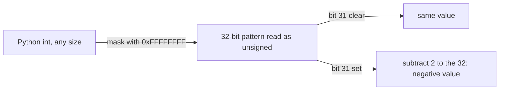

# Bits in Python: operators, two's complement, and unbounded ints

Every integer in a computer is a row of bits, and a small set of operators lets you read and write
those bits directly. Bit manipulation problems are popular in interviews because the solutions are
tiny, fast, and impossible to stumble into — you either know the operator algebra or you do not.

Python adds a twist. In C, Java or Go an `int` is a fixed 32- or 64-bit word and arithmetic silently
wraps around. Python integers **never overflow**: they grow as needed. That is convenient, but
several classic problems (*Sum of Two Integers*, *Reverse Bits*, *Reverse Integer*) are *about*
fixed-width behaviour, so in Python you have to simulate the 32-bit word yourself. This lesson gives
you the mental model to do that confidently.

Play with the explorer below as you read: type a number, flip bits, and watch the signed and
unsigned interpretations.

<div class="widget" data-widget="bits"></div>

## 1. Binary and hexadecimal

A `w`-bit pattern $[x_{w-1}, \dots, x_1, x_0]$ read as an **unsigned** number has value

$$\sum_{i=0}^{w-1} x_i \, 2^i$$

Bit 0 is the **least significant bit** (LSB), bit `w−1` the **most significant** (MSB). Hexadecimal
is shorthand: one hex digit is exactly four bits, so `0xFF` is eight ones and `0xFFFFFFFF` is
thirty-two ones.

```python-run
x = 0b1011_0110                 # binary literal; underscores are just for readability
print(x, bin(x), hex(x), format(x, "08b"), f"{x:#010b}")
print(int("10110110", 2), int("b6", 16))
print(x.bit_length(), (0).bit_length(), (255).bit_length(), (256).bit_length())
print(0xFF, 0xFFFF, 0xFFFFFFFF, 2**32 - 1)
```

`format(x, "032b")` — zero-padded to 32 binary digits — is the single most useful debugging tool
for this topic.

## 2. The six operators

| Operator | Name | Rule per bit | Typical use |
|---|---|---|---|
| `a & b` | AND | 1 only if both are 1 | **mask** (keep selected bits), test a bit |
| `a \| b` | OR | 1 if either is 1 | **set** bits |
| `a ^ b` | XOR | 1 if they differ | **toggle** bits, cancel pairs |
| `~a` | NOT | flip every bit | build inverted masks |
| `a << k` | left shift | move bits up `k` places, fill with 0 | multiply by `2^k`, build `1 << k` |
| `a >> k` | right shift | move bits down `k` places | divide by `2^k` (floor), read bit `k` |

CS:APP's advice for evaluating any bit-level expression is the right one: expand the operands into
binary, apply the operation column by column, convert back.

```python-run
a, b = 0b0110_1001, 0b0101_0101          # 0x69 and 0x55
show = lambda label, v: print(f"{label:8} {v & 0xFF:08b}  0x{v & 0xFF:02X}")
show("a", a); show("b", b)
show("a & b", a & b)
show("a | b", a | b)
show("a ^ b", a ^ b)
show("~a", ~a)                           # masked to 8 bits for display
show("a << 2", a << 2)                   # note the bits falling off the 8-bit window
show("a >> 2", a >> 2)
```

> [!WARNING]
> Precedence traps. In Python, shifts bind **looser** than `+`/`-`: `1 << n - 1` is `1 << (n - 1)`,
> not `(1 << n) - 1`. And in C, C++, Java and JavaScript (though not Python) comparisons bind tighter
> than `&`, `|`, `^`, so `x & 1 == 0` there means `x & (1 == 0)`. Parenthesise bit expressions
> generously — `(x & 1) == 0`, `(1 << n) - 1` — and the code is right in every language.

### The single-bit toolkit

With `mask = 1 << k` (a number with only bit `k` set):

```python-run
x, k = 0b1010_0101, 3
mask = 1 << k
print("test  ", (x >> k) & 1, bool(x & mask))
print("set   ", format(x | mask, "08b"))
print("clear ", format(x & ~mask, "08b"))
print("toggle", format(x ^ mask, "08b"))
print("low k bits ", format(x & (mask - 1), "08b"))     # (1 << k) - 1 is k ones
```

These five lines are the vocabulary for bitmask DP, flags, permissions and bitsets.

## 3. Negative numbers: two's complement

Fixed-width machines represent signed integers in **two's complement**. The top bit gets a
*negative* weight:

$$\text{value} = -x_{w-1} \, 2^{w-1} + \sum_{i=0}^{w-2} x_i \, 2^i$$

For `w = 8`: `0111 1111` is +127, `1000 0000` is −128, and `1111 1111` is −128 + 127 = **−1**. The
range is asymmetric: $[-2^{w-1},\; 2^{w-1}-1]$, so for 32 bits `−2147483648 … 2147483647`.

Three facts make two's complement the universal choice:

1. **Same adder for signed and unsigned.** Add the bit patterns as if unsigned and discard the carry
   out of the top bit; the result is correct for the signed interpretation too (modulo `2^w`).
2. **Negation is "flip and add one":** `−x == ~x + 1`. Consequently `~x == −x − 1`.
3. **The same pattern has two readings.** As unsigned, a pattern with the top bit set is worth
   exactly `2^w` more than its signed reading: `unsigned = signed + 2^w` for negatives.

```python-run
def to_unsigned(x, w=8):
    return x & ((1 << w) - 1)                 # the bit pattern of x in w bits, read as unsigned

def to_signed(u, w=8):
    return u - (1 << w) if u >> (w - 1) else u   # reinterpret a w-bit pattern as signed

for v in (5, -5, -1, -128, 127):
    u = to_unsigned(v)
    print(f"{v:5} -> pattern {u:08b} (unsigned {u:3}) -> back to signed {to_signed(u)}")

x = 37
print(~x, -x - 1, (~x + 1) == -x)             # ~x == -x-1 always
```

### Overflow in a fixed-width world

In a 32-bit language, `2147483647 + 1` wraps to `−2147483648`: the carry enters the sign bit. CS:APP
describes two's-complement addition as ordinary addition followed by **truncation** to `w` bits —
which is the same thing as arithmetic modulo `2^w`. Keep that sentence in mind; it is exactly how we
will simulate it in Python.

## 4. Python's integers: an infinite two's complement

Python `int`s are arbitrary precision. There is no top bit, no wrap-around, no overflow:

```python-run
print(2**31 - 1 + 1)            # just keeps growing
print(2**100)
print(1 << 70)                  # left shift never loses bits
print(bin(-5), bin(5))          # bin() shows a minus sign and the magnitude — NOT the bit pattern
print(-1 >> 10, -8 >> 1, 8 >> 1)   # right shift of a negative stays negative
print(-5 & 0xFF, format(-5 & 0xFF, "08b"))
```

How do bitwise operators work on a negative number if there is no fixed width? Python defines them
**as if every integer were written in two's complement with infinitely many sign bits**:

```
 5  =  ...0000 0000 0101
-5  =  ...1111 1111 1011
-1  =  ...1111 1111 1111
```

A non-negative number has infinitely many leading 0s, a negative number infinitely many leading 1s.
Every consequence follows from that picture:

- `~x` flips all (infinitely many) bits → `−x − 1`. `~5 == −6`, `~0 == −1`.
- `x >> k` on a negative number is an **arithmetic** shift: the ones on the left are still there, so
  the result stays negative (`−1 >> anything == −1`). It equals `floor(x / 2^k)`. C distinguishes
  *logical* right shift (fill with zeros) from *arithmetic* (fill with copies of the sign bit);
  Python only has the arithmetic one, and Java spells the logical one `>>>`.
- `x << k` never discards anything; it is simply `x · 2^k`.
- `x & mask` with a non-negative mask chops off the infinite sign extension and yields a
  **non-negative** number: the low bits of `x`'s two's-complement pattern. This is the key trick.

> [!NOTE]
> `bin(-5)` prints `-0b101`: sign and magnitude, for human reading. To see the 32-bit pattern, mask
> first: `format(-5 & 0xFFFFFFFF, "032b")`.

## 5. Simulating a 32-bit word

Two tiny conversions are all you need.

**Truncate to 32 bits** (get the unsigned pattern): `u = x & 0xFFFFFFFF`.

**Reinterpret as signed**: if bit 31 is set, subtract `2^32`.

```python-run
MASK = 0xFFFFFFFF
INT_MAX = 0x7FFFFFFF

def u32(x):                  # what a 32-bit register would hold
    return x & MASK

def s32(u):                  # read a 32-bit pattern as a signed int
    u &= MASK
    return u if u <= INT_MAX else u - (1 << 32)

print(s32(2147483647 + 1))               # wraps to -2147483648, like C
print(u32(-1), hex(u32(-1)))
print(s32(u32(-123)))
print(s32(0x80000000), s32(0xFFFFFFFF))

def logical_shift_right(x, k):           # Java's >>> for 32-bit values
    return u32(x) >> k

print(-8 >> 1, logical_shift_right(-8, 1))
```

An equivalent formula for the signed conversion that avoids subtraction: `~(u ^ MASK)`. Flipping the
low 32 bits gives `2^32 − 1 − u`, and `~` of that is `u − 2^32`.



### Worked example: adding without `+`

*Sum of Two Integers* forbids `+` and `−`. Think about adding two single bits: the sum bit is their
XOR; the carry is their AND, and it belongs one column to the left. For whole words:

```
a + b  ==  (a ^ b)  +  ((a & b) << 1)
```

That still contains a `+`, so repeat the decomposition until the carry term becomes zero. In a 32-bit
word that happens within 32 rounds, because the carry acquires at least one more trailing zero each
time and eventually shifts out of the word.

In Python, with a negative operand, the carry can chase the **infinite** run of sign bits and the
naive loop never ends. So keep everything truncated to 32 bits and convert at the end:

```python-run
MASK, INT_MAX = 0xFFFFFFFF, 0x7FFFFFFF

def get_sum(a, b, trace=False):
    a &= MASK
    b &= MASK
    while b:
        if trace:
            print(f"  a={a:032b}\n  b={b:032b}\n")
        a, b = (a ^ b) & MASK, ((a & b) << 1) & MASK
    return a if a <= INT_MAX else ~(a ^ MASK)

print(get_sum(5, 3))
print(get_sum(-2, 3))
print(get_sum(-1, 1))
print(get_sum(-7, -9))
print("trace of 7 + 1:")
get_sum(7, 1, trace=True)

# what happens without the mask? (bounded here so the demo terminates)
a, b, rounds = -1, 1, 0
while b and rounds < 100:
    a, b = a ^ b, (a & b) << 1
    rounds += 1
print("unmasked -1 + 1 still running after", rounds, "rounds; carry has", b.bit_length(), "bits")
```

The last lines show the failure mode: the carry bit keeps marching left for ever, because `−1` is an
endless row of ones.

This is exactly how hardware adds: XOR gates produce sum bits, AND gates produce carries (a
*ripple-carry adder*). Subtraction is addition of the two's complement: `a − b == a + (~b + 1)`.

## 6. Shifts as arithmetic

- `x << k` is `x · 2^k`.
- `x >> k` is `⌊x / 2^k⌋` — floor, also for negatives (`−7 >> 1 == −4`), unlike C's truncating `/`.
- `x & ((1 << k) − 1)` is `x mod 2^k` — and in Python it is non-negative even for negative `x`,
  consistent with `%`.
- `x & 1` is the parity of `x`; works for negatives too.

```python-run
for x in (13, -13):
    print(x, x << 2, x >> 2, x // 4, x & 3, x % 4, x & 1)
```

Fast exponentiation (previous lesson) reads the exponent with exactly these: `n & 1` and `n >>= 1`.

## 7. Pitfalls

- **`^` is XOR, not power.** `2 ^ 10 == 8`. Power is `**`.
- **Precedence**: `1 << n - 1` shifts by `n - 1`; parenthesise shifts and (for portability to C-family
  languages) every `&`, `|`, `^` inside a comparison.
- **Infinite loops on negatives**: `while n: n >>= 1` never ends for negative `n` in Python (it
  converges to −1), and the carry loop of the adder never ends without a mask.
- **`bin()` of a negative** is not the two's-complement pattern.
- **Forgetting to convert back**: after masking, `−1` looks like `4294967295`. Convert with `s32`.
- **Width assumptions**: "32 iterations" must be written explicitly; `while n` stops early and loses
  leading zeros (*Reverse Bits*).
- **Left shifts grow**: in Python `x << 1` never discards the top bit; mask after shifting when
  simulating a register.

## Summary

- Six operators: `& | ^ ~ << >>`. Masks select, OR sets, XOR toggles, `1 << k` targets bit `k`.
- Two's complement gives the top bit weight `−2^(w−1)`; `−x == ~x + 1`; arithmetic is modulo `2^w`.
- Python ints behave like two's complement with an infinite sign extension: no overflow, arithmetic
  right shift only, `~x == −x − 1`.
- Simulate a 32-bit register with `x & 0xFFFFFFFF`, and read it as signed by subtracting `2^32` when
  bit 31 is set.
- Addition is XOR for the sum plus shifted AND for the carry, repeated until the carry dies.

```quiz
[
  {"q": "What does ~5 evaluate to in Python?",
   "options": ["-5", "-6", "2", "4294967290"],
   "answer": 1,
   "explain": "~x flips every bit of the infinitely sign-extended representation, which equals -x - 1."},
  {"q": "What is -1 & 0xFF ?",
   "options": ["-1", "255", "1", "0"],
   "answer": 1,
   "explain": "-1 is an infinite row of ones; masking keeps the low eight, giving the non-negative value 255."},
  {"q": "In 8-bit two's complement, the pattern 1000 0000 represents…",
   "options": ["0", "128", "-128", "-0"],
   "answer": 2,
   "explain": "The top bit has weight -2^7 = -128 and all other bits are zero."},
  {"q": "Why does the classic XOR/AND carry loop for a + b need a 32-bit mask in Python but not in Java?",
   "options": ["Python's XOR is slower", "Python ints are unbounded, so with negative operands the carry can propagate through infinitely many sign bits and never become zero", "Java has no negative numbers", "The mask makes the result positive"],
   "answer": 1,
   "explain": "A fixed-width word drops the carry off the top; Python must emulate that by truncating each round."},
  {"q": "Given a 32-bit pattern u (0 <= u < 2^32) with bit 31 set, its signed value is…",
   "options": ["u", "-u", "u - 2^32", "~u"],
   "answer": 2,
   "explain": "Unsigned and signed readings of the same pattern differ by exactly 2^32 when the sign bit is set."},
  {"q": "What does 1 << n - 1 evaluate to in Python when n = 4?",
   "options": ["15, because it is (1 << 4) - 1", "8, because shifts bind looser than subtraction: 1 << (4 - 1)", "16", "A syntax error"],
   "answer": 1,
   "explain": "Arithmetic operators bind tighter than shifts. For a mask of n ones write (1 << n) - 1."},
  {"q": "What is -7 >> 1 in Python?",
   "options": ["-3", "-4", "3", "2147483644"],
   "answer": 1,
   "explain": "Python's right shift is arithmetic and equals floor division by 2: floor(-3.5) = -4."},
  {"q": "Which expression clears bit k of x?",
   "options": ["x | (1 << k)", "x ^ (1 << k)", "x & ~(1 << k)", "x & (1 << k)"],
   "answer": 2,
   "explain": "~(1 << k) has every bit set except bit k, so AND keeps everything else and forces bit k to 0."}
]
```

> **Source:** Bryant & O'Hallaron, *Computer Systems: A Programmer's Perspective*, ch. 2 — §2.1.7 (bit-level operations), §2.1.9 (shift operations: logical vs arithmetic), §2.2.3 (two's-complement encodings), §2.2.4 (signed/unsigned conversion), §2.2.7 (truncation) and §2.3.1–2.3.2 (unsigned and two's-complement addition as arithmetic modulo 2^w). The Python-specific behaviour (unbounded ints with conceptually infinite sign extension) follows the Python language reference; wording and examples are original to this guide.
