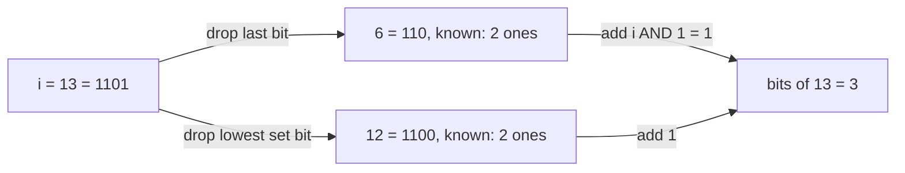
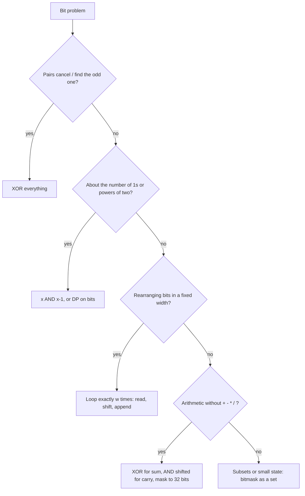

# Bit tricks for interviews: x & (x-1), XOR, masks, bit DP

> **Before this lesson:** read [Bits in Python](#/lesson/neet-greedy-math/bits-python), which explains binary numbers, the six bitwise operators (`&`, `|`, `^`, `~`, `<<`, `>>`), two's complement, and how to imitate a 32-bit number in Python. This lesson uses all of them.

## In plain words

The previous lesson taught the alphabet of bit manipulation; this lesson teaches the common words. A **bit trick** is a short expression — often a single line — that does a job you would otherwise write a loop for.

An everyday comparison: to check whether a number is divisible by 10 you do not divide it; you glance at the last digit. That works because of how decimal notation is built. Bit tricks are the same kind of shortcut for binary notation: because of how binary is built, "is this number a power of two?" or "which value has no partner?" can be answered by looking at the bits in the right way.

There are only about a dozen such shortcuts worth knowing, and they fall into four groups. For each one this lesson shows *why* it works on a small example, so that you can rebuild it from understanding instead of memorising it.

**Why this matters for a job.** These idioms appear in real systems code: memory allocators round sizes to powers of two, databases and network protocols pack several yes/no flags into one integer, checksums and error-correcting codes are built from XOR, and search engines store sets as rows of bits. Recognising `x & (x - 1)` or `mask |= 1 << k` when you read code is a practical skill, and interviewers treat it as a signal of comfort with low-level thinking.

### Words used in this lesson

- **Set bit**: a bit equal to 1. The **lowest set bit** is the rightmost 1.
- **Popcount** (population count, also called **Hamming weight**): how many bits of a number are 1.
- **Power of two**: 1, 2, 4, 8, 16, … — numbers with exactly one set bit.
- **XOR** (exclusive or, `^`): outputs 1 where the two input bits differ.
- **Commutative / associative**: the order (`a ^ b == b ^ a`) and the grouping (`(a ^ b) ^ c == a ^ (b ^ c)`) do not matter.
- **Bitmask**: an integer used as a row of yes/no switches.
- **Subset**: any selection of items from a set, including none or all of them.
- **DP (dynamic programming)**: computing an answer from already-computed answers to smaller inputs.
- **ASCII**: the standard numbering of English letters and symbols (`'A'` is 65, `'a'` is 97).

### The smallest possible example

XOR a number with itself and you get 0; XOR with 0 changes nothing:

```python
print(6 ^ 6)        # 0   -> every bit meets an equal bit, so every output bit is 0
print(6 ^ 0)        # 6   -> XOR with zero keeps the number
print(6 ^ 9 ^ 6)    # 9   -> the two 6s cancel wherever they stand; only 9 is left
```

That last line is the complete idea behind the *Single Number* problem later in the lesson.

The previous lesson explained what the operators do and how Python's integers differ from machine
words. This one is the playbook: the dozen identities that solve nearly every bit-manipulation
question you will be asked, each with the reasoning that lets you re-derive it under pressure.

The tricks fall into four families:

1. **Lowest-set-bit identities** — `x & (x − 1)` and `x & −x`.
2. **XOR algebra** — cancellation, finding the odd one out, swapping.
3. **Bit-by-bit loops** — extract, shift, rebuild (*Reverse Bits*, *Counting Bits*).
4. **Integers as sets** — bitmasks for subsets and state compression.

## 1. The lowest set bit

### `x & (x − 1)` clears the lowest set bit

Look at what subtracting 1 does in binary. Scanning from the right, the trailing zeros become ones
and the first `1` becomes `0`; everything to the left is untouched:

```
x      =  1 0 1 1 0 1 0 0 0
x - 1  =  1 0 1 1 0 0 1 1 1
x&(x-1)=  1 0 1 1 0 0 0 0 0
```

To the left of the lowest set bit the two numbers agree (AND keeps them); at and below it they are
opposites (AND gives zeros). Net effect: **exactly the lowest 1 is erased.**

Three immediate applications:

```python-run
def popcount(x):
    """Number of 1 bits (Brian Kernighan's method): one iteration per SET bit."""
    count = 0
    while x:
        x &= x - 1
        count += 1
    return count

def is_power_of_two(x):
    return x > 0 and (x & (x - 1)) == 0      # exactly one set bit

print([popcount(v) for v in (0, 1, 11, 128, 255, 2**32 - 1)])
print([v for v in range(1, 70) if is_power_of_two(v)])

x = 0b101101000
while x:
    print(format(x, "09b"))
    x &= x - 1
```

- **Number of 1 Bits**: loop `x &= x − 1` until zero and count. The loop runs once per set bit, not
  once per bit position.
- **Power of two**: a positive number is a power of two iff it has a single set bit, i.e. clearing
  the lowest set bit leaves zero.
- **A DP recurrence**: `popcount(x) = popcount(x & (x − 1)) + 1` (used for *Counting Bits* below).

> [!WARNING]
> Mind operator precedence. In **C, C++, Java and JavaScript**, `==` binds tighter than `&`, so
> `x & (x - 1) == 0` means `x & ((x - 1) == 0)` — a famous silent bug. **Python** is different:
> its bitwise operators bind tighter than comparisons, so the unparenthesised form happens to work.
> Because you will read and write bit code in several languages, parenthesise anyway:
> `(x & (x - 1)) == 0`. The traps that *do* bite in Python are the shifts, which bind looser than
> `+` and `-`.

```python-run
x = 12
print(x & (x - 1) == 0, (x & (x - 1)) == 0)     # same in Python (would differ in C/Java)
print(1 << 3 - 1, (1 << 3) - 1)                 # 4 vs 7: shift binds LOOSER than minus
print(x & 4 != 0, (x & 4) != 0, x & (4 != 0))   # comparison is applied last in Python
```

### `x & −x` isolates the lowest set bit

Since `−x == ~x + 1`, negating flips every bit above the lowest set bit and leaves that bit and the
zeros below it unchanged. AND-ing with `x` keeps only that one bit:

```python-run
for x in (0b101101000, 12, 7, 64):
    low = x & -x
    print(f"{x:>4} = {x:09b}   lowest set bit = {low:09b} (value {low}, index {low.bit_length() - 1})")
```

This is the engine of the Fenwick (binary indexed) tree, and it is how you pick "any differing bit"
in *Single Number III*.

## 2. XOR algebra

XOR is addition modulo 2 in every bit position, with no carries. Four properties are all you need:

| Property | Statement |
|---|---|
| Identity | `a ^ 0 == a` |
| Self-inverse | `a ^ a == 0` |
| Commutative | `a ^ b == b ^ a` |
| Associative | `(a ^ b) ^ c == a ^ (b ^ c)` |

Together they mean: **in a long XOR chain you may reorder freely, and anything that appears an even
number of times disappears.**

### Single Number

Every value appears twice except one. XOR everything; pairs cancel; the loner remains. `O(n)` time,
`O(1)` space, no hashing.

### Missing Number

`nums` holds `n` distinct values from `0..n`. XOR all the indices `0..n` together with all the
values: each present number appears twice (once as an index, once as a value) and cancels; the
missing one appears once.

```python-run
from functools import reduce
from operator import xor

print(reduce(xor, [4, 1, 2, 1, 2]))

def missing_number(nums):
    acc = len(nums)
    for i, v in enumerate(nums):
        acc ^= i ^ v
    return acc

print(missing_number([3, 0, 1]), missing_number([0, 1]), missing_number([1]))

# XOR of 0..n has a closed form with period 4 — a nice fact to know
def xor_upto(n):
    return [n, 1, n + 1, 0][n % 4]
print([reduce(xor, range(k + 1)) == xor_upto(k) for k in range(12)])
```

The arithmetic alternative for *Missing Number* is Gauss's sum: `n(n+1)/2 − sum(nums)`. Both are
fine in Python; in fixed-width languages the XOR version cannot overflow.

### Two loners: split by a differing bit

If *two* values appear once (everything else twice), the XOR of the whole array is `a ^ b`, which is
non-zero. Any set bit of it marks a position where `a` and `b` differ. Use `x & −x` to pick one such
bit, partition the array by that bit, and XOR each half separately:

```python-run
def two_singles(nums):
    x = 0
    for v in nums:
        x ^= v                      # x == a ^ b
    bit = x & -x                    # a bit where a and b differ
    a = 0
    for v in nums:
        if v & bit:
            a ^= v                  # the half containing exactly one of them
    return sorted((a, a ^ x))

print(two_singles([1, 2, 1, 3, 2, 5]))
```

### XOR swap, Hamming distance, toggling

CS:APP presents swapping two variables with three XORs and no temporary as an exercise in the
property `a ^ a = 0`, and adds — correctly — that it has no performance advantage. Know it as a
curiosity; never use it in real code (and it zeroes the value if both operands are the same
location).

More useful: `a ^ b` has a 1 exactly where `a` and `b` differ, so the **Hamming distance** is
`popcount(a ^ b)`. And `x ^ mask` toggles the bits selected by `mask` (flip case of an ASCII letter:
`ord(ch) ^ 32`).

```python-run
a, b = 29, 15
a ^= b; b ^= a; a ^= b
print(a, b)
print(bin(1 ^ 4), bin(1 ^ 4).count("1"))            # Hamming distance between 1 and 4
print("".join(chr(ord(c) ^ 32) for c in "Hello"))   # toggle ASCII case
```

## 3. Bit-by-bit loops

Many problems process a word one bit at a time with the same three moves:

- **read** the lowest bit: `x & 1`
- **discard** it: `x >>= 1`
- **append** a bit to a result: `res = (res << 1) | bit`

### Reverse Bits

Pop bits off the bottom of `n` and push them onto the bottom of `res`. The first bit popped is pushed
first, so it ends up at the top. The loop must run **exactly 32 times** — stopping when `n` hits
zero would lose `n`'s leading zeros, which are the result's trailing zeros.

```python-run
def reverse_bits(n):
    res = 0
    for _ in range(32):
        res = (res << 1) | (n & 1)
        n >>= 1
    return res

n = 43261596
print(format(n, "032b"))
print(format(reverse_bits(n), "032b"), reverse_bits(n))
print(reverse_bits(1))            # 2**31
```

For speed you can swap in parallel: halves, then bytes, nibbles, pairs, and single bits, using masks
such as `0x55555555` (`0101…`), `0x33333333` (`0011…`), `0x0F0F0F0F`. Five steps instead of
thirty-two — the standard "divide and conquer on the word" technique, which also yields an `O(log w)`
popcount.

### Counting Bits: DP over bit patterns

To get the popcount of every number `0..n` in `O(n)` total, relate each number to a smaller one whose
answer you already know:

- **Drop the last bit**: `bits[i] = bits[i >> 1] + (i & 1)`
- **Drop the lowest set bit**: `bits[i] = bits[i & (i − 1)] + 1`

```python-run
def count_bits(n):
    bits = [0] * (n + 1)
    for i in range(1, n + 1):
        bits[i] = bits[i >> 1] + (i & 1)
    return bits

print(count_bits(16))
alt = [0] * 17
for i in range(1, 17):
    alt[i] = alt[i & (i - 1)] + 1
print(alt == count_bits(16))
```



Both recurrences are valid because the number they refer to is strictly smaller than `i`. This is
the simplest example of **DP indexed by a bit pattern**.

## 4. Integers as sets: bitmasks

A set of small integers `{0, …, w−1}` can be stored as one integer whose bit `k` is 1 iff `k` is in
the set. Set operations become single machine instructions:

| Set operation | Bitmask |
|---|---|
| empty set, full set of `n` items | `0`, `(1 << n) − 1` |
| add `k`, remove `k`, toggle `k` | `s \| (1 << k)`, `s & ~(1 << k)`, `s ^ (1 << k)` |
| membership | `(s >> k) & 1` |
| union, intersection, difference | `a \| b`, `a & b`, `a & ~b` |
| size | popcount (`bin(s).count("1")` or `s.bit_count()` in 3.10+) |
| is `a` a subset of `b`? | `(a & b) == a` |

Counting from `0` to `2^n − 1` enumerates **every subset** of `n` items — the iterative alternative
to backtracking for *Subsets*:

```python-run
items = ["a", "b", "c"]
n = len(items)
for mask in range(1 << n):
    subset = [items[k] for k in range(n) if (mask >> k) & 1]
    print(format(mask, "03b"), subset)

# enumerate all sub-masks of a mask (useful in bitmask DP)
mask = 0b1011
sub = mask
subs = []
while True:
    subs.append(format(sub, "04b"))
    if sub == 0:
        break
    sub = (sub - 1) & mask
print(subs)
```

Bitmasks also compress state for dynamic programming: "which of these ≤ 20 items have been used"
fits in one integer and can be a dictionary key or array index (*Travelling Salesman*, *Partition to
K Equal Sum Subsets*, *Shortest Path Visiting All Nodes*). A 26-bit mask describes which letters a
word contains, which makes "do these two words share a letter?" a single AND (*Maximum Product of
Word Lengths*).

```python-run
def letter_mask(word):
    m = 0
    for ch in word:
        m |= 1 << (ord(ch) - ord("a"))
    return m

words = ["abcw", "baz", "foo", "bar", "xtfn", "abcdef"]
masks = [letter_mask(w) for w in words]
best = max((len(a) * len(b), a, b)
           for i, a in enumerate(words) for j, b in enumerate(words)
           if i < j and (masks[i] & masks[j]) == 0)
print(best)
```

> [!TIP]
> Python-specific helpers: `x.bit_length()` (position of the highest set bit + 1),
> `x.bit_count()` (popcount, Python ≥ 3.10), `bin(x).count("1")` (works everywhere),
> `int.from_bytes` / `to_bytes`. In an interview, use the built-in *after* showing you know the
> manual version — or ask whether built-ins are allowed.

## 5. Counting per bit position

When XOR cancellation is not enough — say every element appears **three** times except one — fall
back to the most general tool: treat each of the 32 bit positions independently. Sum that bit over
all numbers; the sum modulo 3 is the loner's bit.

```python-run
def single_number_ii(nums):
    result = 0
    for k in range(32):
        ones = sum((v >> k) & 1 for v in nums)
        if ones % 3:
            result |= 1 << k
    return result - (1 << 32) if result >> 31 else result      # reinterpret as signed 32-bit

print(single_number_ii([2, 2, 3, 2]), single_number_ii([-4, 7, 7, 7, 5, 5, 5]))
```

Two things to notice. First, `(v >> k) & 1` works for negative `v` because Python's shift is
arithmetic and the sign bits are "there". Second, the result is assembled as an unsigned 32-bit
pattern and must be converted back to a signed value at the end — the simulation recipe from the
previous lesson.

The same per-bit view answers "sum of Hamming distances between all pairs" (for each bit, `ones ×
zeros`) and "maximum XOR of two numbers" (greedy from the top bit with a trie or prefix set).

## 6. A decision guide



## 7. Pitfalls

- **Precedence**: `1 << k - 1` is `1 << (k - 1)`; and in C-family languages `x & mask == 0` is
  `x & (mask == 0)`. Parenthesise: `(x & mask) == 0`, `(1 << k) - 1`, `(x >> k) & 1`.
- **Negative inputs in Python**: `while x: x >>= 1` never terminates for `x < 0`; mask first.
- **Fixed-width loops**: iterate `range(32)`, not `while n`.
- **Off-by-one in masks**: `k` ones is `(1 << k) − 1`; bit indices start at 0.
- **`^` vs `**`**.
- **Cleverness tax**: XOR swap and branch-free tricks impress nobody if the code is unreadable.
  Explain the identity in one sentence when you use it.

## Summary

- `x & (x − 1)` removes the lowest set bit → popcount, power-of-two test, a DP recurrence.
- `x & −x` isolates the lowest set bit.
- XOR is its own inverse, commutative and associative → duplicates cancel (*Single Number*,
  *Missing Number*); `a ^ b` marks differing bits.
- Bit loops: read `x & 1`, shift, append with `(res << 1) | bit`; fix the iteration count to the
  word width.
- `bits[i] = bits[i >> 1] + (i & 1)` computes all popcounts in linear time.
- Integers double as sets; `range(1 << n)` enumerates all subsets.
- When all else fails, count each bit position separately.

## Glossary

- **Lowest set bit** — the rightmost 1 of a number; `x & -x` isolates it, `x & (x - 1)` removes it.
- **Popcount / Hamming weight** — the number of 1 bits.
- **Hamming distance** — the number of positions in which two bit patterns differ: `popcount(a ^ b)`.
- **Kernighan's method** — counting set bits by repeatedly clearing the lowest one.
- **XOR cancellation** — equal values XOR to 0, so paired values vanish from a long XOR.
- **Identity element** — a value that changes nothing under an operation (0 for XOR).
- **Bitmask** — an integer whose bits are used as independent flags or as membership in a set.
- **Sub-mask** — a mask whose 1 bits are all contained in another mask's 1 bits.
- **Bit DP** — dynamic programming whose table is indexed by a bit pattern.
- **State compression** — packing a small set of yes/no facts into one integer.
- **Fenwick tree** — an array-based structure for running totals that relies on `x & -x`.
- **Trie** — a tree of prefixes; a binary trie stores numbers bit by bit.

```quiz
[
  {"q": "What does x & (x - 1) do for x > 0?",
   "options": ["Isolates the lowest set bit", "Clears the lowest set bit", "Sets the lowest clear bit", "Flips all bits"],
   "answer": 1,
   "explain": "Subtracting 1 flips the lowest 1 and the zeros below it; AND with x zeroes that whole tail and keeps the rest."},
  {"q": "What is the result of XOR-ing all elements of [7, 3, 5, 3, 7]?",
   "options": ["0", "3", "5", "7"],
   "answer": 2,
   "explain": "7^7 and 3^3 cancel to 0; XOR is commutative and associative, so only 5 remains."},
  {"q": "Why must Reverse Bits loop exactly 32 times rather than `while n:`?",
   "options": ["For speed", "Stopping early drops n's leading zeros, which must become trailing zeros of the result", "Because n may be negative", "Because Python ints are 32 bits"],
   "answer": 1,
   "explain": "reverse(1) must be 2^31; a loop that stops when n == 0 would return 1."},
  {"q": "Which recurrence correctly computes the number of set bits of i from a smaller index?",
   "options": ["bits[i] = bits[i - 1] + 1", "bits[i] = bits[i >> 1] + (i & 1)", "bits[i] = bits[i // 2] * 2", "bits[i] = bits[i ^ 1]"],
   "answer": 1,
   "explain": "i >> 1 is i without its last bit; add that bit back. bits[i & (i-1)] + 1 also works."},
  {"q": "In Missing Number, why does XOR-ing all indices 0..n with all values give the answer?",
   "options": ["XOR computes the sum modulo n", "Every present number occurs once as an index and once as a value and cancels; the missing one occurs only as an index", "Because the array is sorted", "It only works when n is a power of two"],
   "answer": 1,
   "explain": "This reduces the problem to Single Number over the combined multiset."},
  {"q": "A positive integer x is a power of two exactly when…",
   "options": ["x % 2 == 0", "(x & (x - 1)) == 0", "(x & -x) == 0", "x ^ x == 0"],
   "answer": 1,
   "explain": "Powers of two have a single set bit, so clearing the lowest set bit leaves zero."},
  {"q": "How many iterations does `for mask in range(1 << n)` perform, and what does each mask represent?",
   "options": ["n iterations, one per element", "2^n iterations, each mask encoding one subset of n items", "n^2 iterations, each mask a pair", "n! iterations, each mask a permutation"],
   "answer": 1,
   "explain": "Bit k of the mask says whether item k is in the subset; there are 2^n subsets."},
  {"q": "What does x & -x compute?",
   "options": ["0 for every x", "The value of the lowest set bit of x", "The absolute value of x", "x with its lowest set bit cleared"],
   "answer": 1,
   "explain": "-x is ~x + 1, which agrees with x only at the lowest set bit."}
]
```

> **Source:** Bryant & O'Hallaron, *Computer Systems: A Programmer's Perspective*, ch. 2 — §2.1.6–2.1.7 (Boolean algebra, bit vectors as sets, masking, the XOR swap of Practice Problem 2.10), §2.1.9 (shifts) and §2.2.3 (two's complement, used for `x & −x`). The interview tricks (Kernighan's popcount, XOR cancellation, bit DP, subset enumeration) are standard folklore presented in original wording; problems follow the NeetCode 150 "Bit Manipulation" list.
