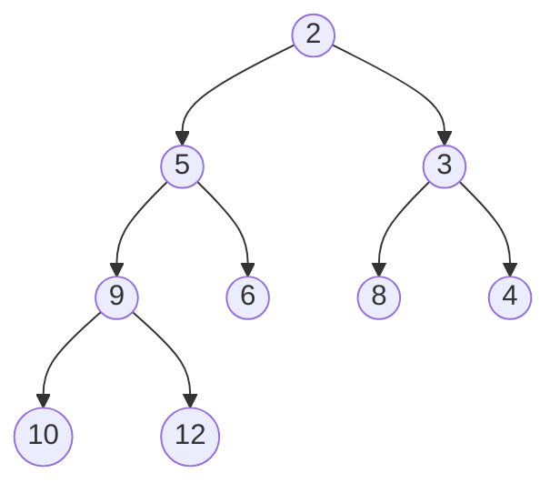
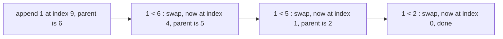

# Binary heaps and Python's heapq

## Why a new data structure?

A surprising number of problems boil down to the same request, made over and over: *"give me the
smallest (or largest) thing you have right now — and by the way, here are some more things."*

- An operating system picks the highest-priority runnable process, while new processes keep arriving.
- Dijkstra's algorithm repeatedly needs the closest unvisited vertex, while discovering new candidates.
- A streaming service wants the 10 most-played songs out of a billion play events.
- A simulation processes the earliest pending event, which schedules further events.

The abstract data type behind all of these is the **priority queue**: a collection that supports

| operation | meaning |
|---|---|
| `add(k)` | insert an item with key (priority) `k` |
| `min()` | look at the item with the smallest key |
| `remove_min()` | remove and return the item with the smallest key |

Notice what a priority queue does *not* promise: it does not let you search for an arbitrary item, and
it does not keep everything sorted. That weaker promise is exactly what lets it be fast.

### Two obvious implementations, both lopsided

| implementation | `add` | `min` | `remove_min` |
|---|---|---|---|
| unsorted list | $O(1)$ | $O(n)$ | $O(n)$ |
| sorted list | $O(n)$ | $O(1)$ | $O(1)$ |
| **binary heap** | $O(\log n)$ | $O(1)$ | $O(\log n)$ |

An unsorted list makes insertion trivial but must scan for the minimum. A sorted list has the minimum
ready but pays to keep order on every insertion. If you perform $n$ adds and $n$ removals, both cost
$O(n^2)$ overall. (Fun fact from the textbook: sorting with an unsorted-list priority queue *is*
selection sort, and with a sorted-list priority queue it *is* insertion sort.)

The **binary heap** strikes a balance: both operations in $O(\log n)$, so $n$ adds and $n$ removals
cost $O(n \log n)$. It does this by keeping the data only *partially* ordered — just enough order to
find the minimum instantly, and no more.

## The heap: two properties

A (min-)heap is a binary tree that satisfies two rules.

**1. Heap-order property (relational).** Every node's key is greater than or equal to its parent's
key. Consequently keys never decrease along any root-to-leaf path, and **the minimum is at the root**.

**2. Complete-binary-tree property (structural).** Every level is full except possibly the last, and
the last level is filled from left to right with no gaps.



Check both rules on the picture: each child is ≥ its parent; levels 0–2 are full and the two nodes on
level 3 are pushed to the left.

> [!WARNING]
> A heap is **not** a binary search tree. There is no left/right ordering between siblings: in the
> picture, `5` is on the left and `3` on the right. All you know is parent ≤ children. That means a
> heap cannot find an arbitrary key in $O(\log n)$, and iterating over the underlying list does
> **not** give sorted order.

### Why completeness matters: the height is logarithmic

A complete tree with height $h$ has full levels $0..h-1$ containing $1 + 2 + \dots + 2^{h-1} = 2^h - 1$
nodes, plus between $1$ and $2^h$ nodes on the last level. So

$$2^h \le n \le 2^{h+1} - 1 \quad\Longrightarrow\quad h = \lfloor \log_2 n \rfloor .$$

A heap with a million items is only 19 levels tall. Every heap operation walks one root-to-leaf path
at most, so every operation is $O(\log n)$.

## The array trick: no pointers needed

Because a complete tree has no gaps, you can store it in a plain list by reading the tree level by
level. The node at index `i` has

$$\text{left}(i) = 2i + 1,\qquad \text{right}(i) = 2i + 2,\qquad \text{parent}(i) = \left\lfloor \frac{i-1}{2} \right\rfloor .$$

The heap above becomes:

| index | 0 | 1 | 2 | 3 | 4 | 5 | 6 | 7 | 8 |
|---|---|---|---|---|---|---|---|---|---|
| key | 2 | 5 | 3 | 9 | 6 | 8 | 4 | 10 | 12 |

The "last position" of the tree is simply the end of the list, so adding a node is `append` and
removing the last node is `pop()` — both $O(1)$ amortised. No node objects, no child pointers, and the
data sits contiguously in memory.

```python-run
heap = [2, 5, 3, 9, 6, 8, 4, 10, 12]

def show(h):
    for i, k in enumerate(h):
        kids = [h[c] for c in (2*i + 1, 2*i + 2) if c < len(h)]
        par = h[(i - 1) // 2] if i else None
        print(f"index {i}: key {k:>2}  parent {par}  children {kids}")

show(heap)
print("heap order holds:", all(heap[(i - 1) // 2] <= heap[i] for i in range(1, len(heap))))
```

## Insertion: up-heap bubbling (sift up)

To add a key:

1. **Preserve the shape**: put the new key in the next free position — the end of the list.
2. **Restore the order**: while the new key is smaller than its parent, swap them.

The new key "bubbles up" along a single path towards the root, so at most $\lfloor \log_2 n \rfloor$ swaps.

Inserting `1` into our heap:



## Removal: down-heap bubbling (sift down)

The minimum is at the root, but you can't just delete the root — that would leave a hole. Instead:

1. **Preserve the shape**: move the *last* item into the root and shrink the list by one.
2. **Restore the order**: while the item is larger than its **smaller** child, swap with that child.

Why the smaller child? After the swap, the child that moved up becomes the parent of its former
sibling, so it must be ≤ that sibling. Swapping with the larger child would break the heap order.

Again the walk follows one path, now downward: $O(\log n)$.

## A complete heap in 30 lines

```python-run
class MinHeap:
    def __init__(self):
        self.a = []

    def __len__(self):
        return len(self.a)

    def push(self, k):
        a = self.a
        a.append(k)                       # 1. keep the shape
        i = len(a) - 1
        while i > 0:                      # 2. sift up
            p = (i - 1) // 2
            if a[i] >= a[p]:
                break
            a[i], a[p] = a[p], a[i]
            i = p

    def pop(self):
        a = self.a
        a[0], a[-1] = a[-1], a[0]         # move last item to the root
        smallest = a.pop()
        i, n = 0, len(a)
        while True:                       # sift down
            l, r, m = 2*i + 1, 2*i + 2, i
            if l < n and a[l] < a[m]: m = l
            if r < n and a[r] < a[m]: m = r
            if m == i:
                break
            a[i], a[m] = a[m], a[i]
            i = m
        return smallest

h = MinHeap()
for x in [9, 4, 7, 1, 8, 2]:
    h.push(x)
    print("push", x, "->", h.a)
print("pops:", [h.pop() for _ in range(len(h))])
```

Popping everything returns the keys in sorted order — that is **heap-sort**: $n$ pushes and $n$ pops,
$O(n \log n)$ total, and it can be done in place inside the original array.

## Building a heap in O(n): bottom-up construction

Pushing $n$ items one at a time costs $O(n \log n)$ in the worst case. If you have all the items up
front there is a faster way, usually called **heapify**:

> Put the items in the array in any order. Then, for every internal node **from the last one back to
> the root**, sift it down.

Leaves are already valid one-element heaps. Each sift-down merges two valid sub-heaps under a new root.

Why is this $O(n)$ and not $O(n \log n)$? Because most nodes are near the bottom and have a very short
distance to fall. About $n/2$ nodes are leaves (0 steps), $n/4$ nodes can fall at most 1 level, $n/8$
at most 2 levels, and so on:

$$\sum_{j \ge 1} \frac{n}{2^{j+1}} \cdot j \;=\; \frac{n}{2}\sum_{j\ge1}\frac{j}{2^{j}} \;=\; \frac{n}{2}\cdot 2 \;=\; n .$$

Contrast that with repeated insertion, where the *many* nodes at the bottom may each have to climb the
*whole* height.

```python-run
def heapify(a):
    n = len(a)
    for start in range(n // 2 - 1, -1, -1):     # last internal node down to the root
        i = start
        while True:
            l, r, m = 2*i + 1, 2*i + 2, i
            if l < n and a[l] < a[m]: m = l
            if r < n and a[r] < a[m]: m = r
            if m == i: break
            a[i], a[m] = a[m], a[i]
            i = m

data = [14, 9, 8, 25, 5, 11, 27, 16, 15, 4, 12, 6, 7, 23, 20]
heapify(data)
print(data)
print("valid heap:", all(data[(i - 1) // 2] <= data[i] for i in range(1, len(data))))
```

> [!INTERVIEW]
> "What's the complexity of building a heap from n elements?" — **O(n)** with bottom-up heapify.
> Many candidates say O(n log n). If asked why, give the "half the nodes are leaves and don't move"
> argument above.

## Python's `heapq` module

Python does not have a heap *class*. Instead, the `heapq` module provides functions that treat an
ordinary `list` as a min-heap stored in exactly the array layout described above.

| function | effect | time |
|---|---|---|
| `heapq.heappush(h, x)` | add `x` | $O(\log n)$ |
| `heapq.heappop(h)` | remove and return the smallest | $O(\log n)$ |
| `h[0]` | peek at the smallest (no function needed) | $O(1)$ |
| `heapq.heapify(h)` | turn a list into a heap, in place | $O(n)$ |
| `heapq.heappushpop(h, x)` | push `x`, then pop the smallest | $O(\log n)$, one sift |
| `heapq.heapreplace(h, x)` | pop the smallest, then push `x` | $O(\log n)$, one sift |
| `heapq.nlargest(k, it)` / `nsmallest(k, it)` | the k largest / smallest, sorted | about $O(n \log k)$ |
| `heapq.merge(*sorted_iters)` | lazily merge sorted inputs | $O(\log k)$ per item |

```python-run
import heapq

h = [7, 2, 9, 4]
heapq.heapify(h)
print("heapified:", h, " min =", h[0])

heapq.heappush(h, 1)
print("after push 1:", h)
print("pop:", heapq.heappop(h), "->", h)

# pushpop: push first, then pop. If x is the smallest, x itself comes straight back.
print("heappushpop(h, 0):", heapq.heappushpop(h, 0), h)
# replace: pop first, then push. The returned value may be LARGER than x.
print("heapreplace(h, 0):", heapq.heapreplace(h, 0), h)

print("3 largest:", heapq.nlargest(3, [5, 1, 8, 3, 9, 2]))
print("merge:", list(heapq.merge([1, 4, 7], [2, 5, 8], [3, 6, 9])))
```

> [!WARNING]
> `heappop` on an empty list raises `IndexError`, and so does `h[0]`. Guard with `if h:` or
> `while h:`.

### The max-heap trick

`heapq` only provides a **min**-heap. For a max-heap of numbers, store **negated** values:

```python-run
import heapq

nums = [3, 10, 4, 8]
maxheap = [-x for x in nums]
heapq.heapify(maxheap)

print("largest:", -maxheap[0])
print("pop largest:", -heapq.heappop(maxheap))
heapq.heappush(maxheap, -7)          # remember to negate on the way in...
print("now largest:", -maxheap[0])   # ...and on the way out
```

The single most common heap bug in interviews is forgetting one of the minus signs — pushing a
positive value into a heap of negatives. Be systematic: negate at every push, negate at every pop/peek.

For things you can't negate (strings, objects), either wrap them in a small class that reverses
`__lt__`, or — when you only need the top `k` — restructure the problem so that a min-heap suffices
(see the next lesson).

### Heaps of tuples: priorities with payloads

`heapq` compares elements with `<`. Tuples compare lexicographically, so the idiom is to push
`(priority, payload)`:

```python-run
import heapq

tasks = []
heapq.heappush(tasks, (2, "write tests"))
heapq.heappush(tasks, (1, "fix prod bug"))
heapq.heappush(tasks, (3, "refactor"))
while tasks:
    print(heapq.heappop(tasks))
```

When two priorities are **equal**, Python compares the second elements. If those are not comparable
(dicts, custom objects, `ListNode`s...), you get a `TypeError`. The standard fix is a unique
tie-breaker in the middle — usually an increasing counter or the item's index:

```python-run
import heapq, itertools

class Job:                       # no __lt__ defined
    def __init__(self, name): self.name = name

counter = itertools.count()
h = []
for pr, name in [(1, "a"), (1, "b"), (0, "c")]:
    heapq.heappush(h, (pr, next(counter), Job(name)))   # counter breaks ties, Jobs never compared

print([heapq.heappop(h)[2].name for _ in range(3)])     # equal priorities come out FIFO
```

A bonus of the counter: items with equal priority come out in insertion order (the heap becomes
*stable*).

### No decrease-key: lazy deletion

Textbook priority queues sometimes offer `update(item, new_key)` or `remove(item)` — the *adaptable*
priority queue, implemented by tracking each item's index in the array (a "locator"). `heapq` has no
such operation. The practical workaround is **lazy deletion**:

- to "update" an item, just push a new entry with the new priority;
- when you pop an entry, check whether it is stale (already processed, or its priority no longer
  matches the current one) and skip it if so.

The heap may hold outdated entries, but each is popped at most once, so the total cost stays
$O(m \log m)$ for $m$ pushes. You will use this trick in Dijkstra's algorithm later in this track.

## Complexity cheat sheet

| operation | time | note |
|---|---|---|
| peek min (`h[0]`) | $O(1)$ | |
| push | $O(\log n)$ | sift up |
| pop | $O(\log n)$ | sift down |
| heapify | $O(n)$ | bottom-up |
| search for arbitrary value | $O(n)$ | heaps are not search trees |
| delete arbitrary value | $O(n)$ to find it | or use lazy deletion |
| heap-sort | $O(n \log n)$ | in place, not stable |
| space | $O(n)$ | a flat list |

<div class="widget" data-widget="bigo"></div>

## Common pitfalls

1. **Treating the list as sorted.** `h[1]` is *not* the second smallest in general (it is one of the
   two candidates, `h[1]` or `h[2]`), and `h[-1]` is not the maximum.
2. **Mutating the list behind the heap's back** (`h.sort(reverse=True)`, `h.remove(x)`, `h[0] = 5`).
   After any such edit you must call `heapify` again.
3. **Forgetting negation** in the max-heap trick.
4. **Tuple tie crashes** when payloads aren't comparable.
5. **Using a heap when you need a sorted order of everything.** Just sort.
6. **Using `sorted()` inside a loop** when a heap would maintain the order incrementally.

## Summary

- A priority queue returns the smallest item quickly while accepting insertions.
- A binary heap is a complete binary tree with parent ≤ children, stored in a flat list with index
  arithmetic `2i+1`, `2i+2`, `(i-1)//2`.
- Push = append + sift up; pop = swap root with last, remove, sift down; both $O(\log n)$ because the
  height is $\lfloor \log_2 n \rfloor$.
- Bottom-up heapify builds a heap in $O(n)$.
- In Python: `heapq` functions on a list, min-heap only; negate for a max-heap; push tuples with a
  tie-breaker; use lazy deletion instead of decrease-key.

```quiz
[
  {"q": "In the array representation of a binary heap (0-indexed), where are the children of the node at index 5?",
   "options": ["Indices 10 and 11", "Indices 11 and 12", "Indices 6 and 7", "Indices 9 and 10"], "answer": 1,
   "explain": "left = 2i + 1 = 11 and right = 2i + 2 = 12."},
  {"q": "Which statement about a min-heap stored in a Python list h is always true?",
   "options": ["h is sorted in ascending order", "h[-1] is the maximum element", "h[0] is the minimum element", "h[1] <= h[2]"], "answer": 2,
   "explain": "Heap order only guarantees parent <= children, so the root h[0] is the minimum. Siblings are unordered and the max is some leaf, not necessarily the last one."},
  {"q": "What is the worst-case time to build a heap from n unordered items with heapq.heapify?",
   "options": ["O(log n)", "O(n)", "O(n log n)", "O(n^2)"], "answer": 1,
   "explain": "Bottom-up construction sifts down each internal node; most nodes are near the bottom and move very little, and the total work sums to O(n)."},
  {"q": "During pop, the last item is moved to the root and sifted down. Why must it be swapped with the SMALLER child?",
   "options": ["It is faster to compare", "The smaller child becomes the parent of the other child, so it must be <= that child", "The larger child might be a leaf", "It keeps the tree complete"], "answer": 1,
   "explain": "After the swap, the promoted child is the parent of its sibling. Only the smaller child is guaranteed to be <= the sibling, preserving heap order."},
  {"q": "You push (priority, obj) tuples into heapq where obj has no ordering defined. What can go wrong?",
   "options": ["Nothing, heapq only looks at the first element", "TypeError when two priorities are equal, because Python then compares the objs", "The heap silently becomes a max-heap", "heappop returns only the priority"], "answer": 1,
   "explain": "Tuples compare element by element; on a priority tie the second elements are compared. Insert a unique counter between them to break ties."},
  {"q": "How do you get max-heap behaviour for integers using heapq?",
   "options": ["Call heapq.heapify(h, reverse=True)", "Push -x and negate again when popping", "Sort the list in reverse first", "Use heapq.heappop(h, -1)"], "answer": 1,
   "explain": "heapq is a min-heap; the smallest negated value corresponds to the largest original value."},
  {"q": "A heap holds one million items. Roughly how many comparisons-swaps levels can a single push traverse at most?",
   "options": ["About 20", "About 1,000", "About 500,000", "About 1,000,000"], "answer": 0,
   "explain": "The height is floor(log2(1,000,000)) = 19, so a sift-up visits at most about 20 levels."},
  {"q": "What is the difference between heappushpop(h, x) and heapreplace(h, x)?",
   "options": ["They are aliases", "pushpop pushes first then pops (may return x itself); replace pops first then pushes (never returns x)", "replace works only on max-heaps", "pushpop is O(n)"], "answer": 1,
   "explain": "heappushpop returns the smallest of heap-plus-x; heapreplace returns the old minimum even if x is smaller than it."}
]
```

> **Source:** Goodrich, Tamassia & Goldwasser, *Data Structures and Algorithms in Python*, ch. 9
> (§9.1 Priority Queue ADT, §9.2 list-based implementations, §9.3 Heaps incl. bottom-up construction
> and the `heapq` module, §9.4 sorting with a priority queue, §9.5 adaptable priority queues);
> Python `heapq` documentation.
