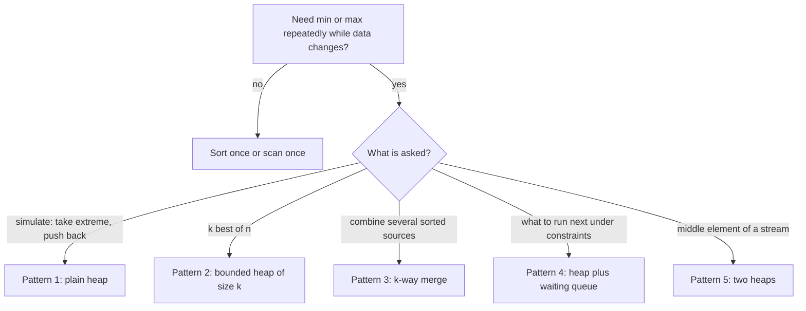
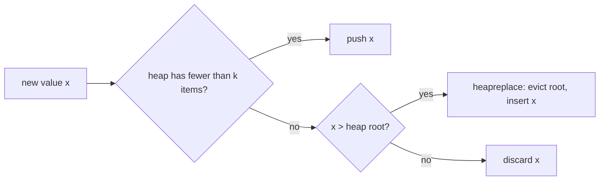
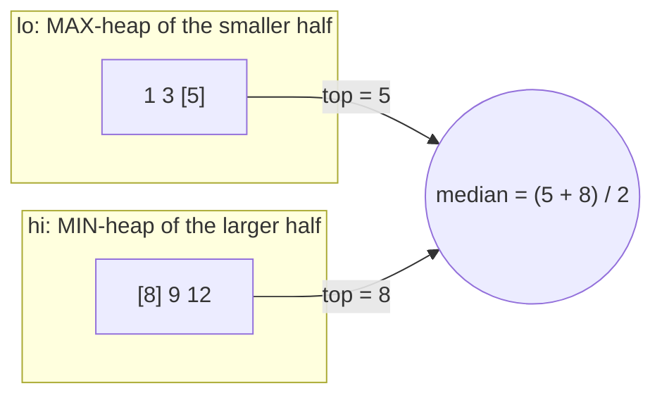

# Heap patterns: top-k, merging, scheduling and two heaps

The previous lesson explained *how* a heap works. This one is about recognising *when* to reach for
one. Nearly every heap interview problem is an instance of one of five patterns:

| pattern | signal in the problem statement | example problems |
|---|---|---|
| 1. Repeated extreme | "repeatedly take the largest / smallest, maybe put something back" | Last Stone Weight |
| 2. Top-k with a bounded heap | "k largest", "k closest", "k most frequent", "k-th largest" | Kth Largest in a Stream / Array, K Closest Points |
| 3. K-way merge | "merge k sorted ...", "most recent across several sorted feeds" | Design Twitter, Merge K Sorted Lists |
| 4. Greedy scheduling | "cooldown", "earliest deadline", "next available" | Task Scheduler |
| 5. Two heaps | "median", "balance two halves" | Find Median from Data Stream |



## Pattern 1 — Repeated extreme (simulation)

The process itself says "take the biggest". Put everything in a heap, loop while the heap has enough
items, pop, compute, push results back.

```python-run
import heapq

def last_stone_weight(stones):
    h = [-s for s in stones]            # max-heap via negation
    heapq.heapify(h)                    # O(n)
    while len(h) > 1:
        y = -heapq.heappop(h)           # heaviest
        x = -heapq.heappop(h)           # second heaviest
        if y != x:
            heapq.heappush(h, -(y - x))
    return -h[0] if h else 0

print(last_stone_weight([2, 7, 4, 1, 8, 1]))   # 1
```

Each round removes at least one item, so there are at most $n - 1$ rounds of $O(\log n)$:
$O(n \log n)$ in total. Re-sorting a list every round would be $O(n^2 \log n)$.

## Pattern 2 — Top-k with a bounded heap

This is the pattern with a counter-intuitive twist, so let's take it slowly.

**Goal:** the `k` largest of `n` values (or just the k-th largest).

**Naive heap idea:** max-heap of all `n` values, pop `k` times: $O(n + k \log n)$ time, $O(n)$ memory.
That's fine when everything fits in memory, but it can't handle a stream, and the heap is as large as
the input.

**The bounded-heap idea:** keep only the `k` best values seen so far. When a new value arrives, the
one question you need answered is:

> *Is the newcomer better than the **worst** of my current best k?*

So you need fast access to the **worst of the best** — the *minimum* of the k largest. That is a
**min-heap of size k**.

> [!TIP]
> **k largest → min-heap of size k. k smallest → max-heap of size k.**
> The heap's root is the "bouncer": the weakest member of the club, the first to be thrown out.



```python-run
import heapq

def k_largest(stream, k):
    heap = []                                   # min-heap, never more than k items
    for x in stream:
        if len(heap) < k:
            heapq.heappush(heap, x)
        elif x > heap[0]:
            heapq.heapreplace(heap, x)
        print(f"saw {x:>2}  heap={heap}  k-th largest so far={heap[0] if len(heap) == k else None}")
    return heap

k_largest([4, 5, 8, 2, 3, 5, 10, 9, 4], k=3)
```

Cost: $O(n \log k)$ time and $O(k)$ memory. When $k \ll n$ this beats sorting, and — more importantly —
it works on a **stream**: at any moment `heap[0]` is the k-th largest so far. That is literally the
whole solution to *Kth Largest Element in a Stream*.

### k smallest / k closest

Flip everything: keep a max-heap of size k (negated keys). For *K Closest Points to Origin* the key is
the squared distance $x^2 + y^2$ (no need for the square root — it's monotonic):

```python-run
import heapq

def k_closest(points, k):
    heap = []                                   # entries (-dist2, x, y): root = FARTHEST kept point
    for x, y in points:
        d = -(x * x + y * y)
        if len(heap) < k:
            heapq.heappush(heap, (d, x, y))
        elif d > heap[0][0]:                    # closer than the farthest kept point
            heapq.heapreplace(heap, (d, x, y))
    return [[x, y] for _, x, y in heap]

print(k_closest([[3, 3], [5, -1], [-2, 4], [0, 1]], 2))
```

### Which top-k method should I use?

| method | time | extra space | works on a stream? | notes |
|---|---|---|---|---|
| sort, slice | $O(n \log n)$ | $O(n)$ | no | simplest; say it first |
| max-heap of all, pop k | $O(n + k \log n)$ | $O(n)$ | no | good when k is tiny |
| bounded heap of size k | $O(n \log k)$ | $O(k)$ | **yes** | the standard interview answer |
| quickselect | $O(n)$ average, $O(n^2)$ worst | $O(1)$ | no | mutates input; mention as follow-up |
| `heapq.nlargest(k, it)` | $O(n \log k)$ | $O(k)$ | — | the bounded heap, pre-packaged |

> [!INTERVIEW]
> For *Kth Largest Element in an Array*, a strong answer names all three: sort ($n \log n$), heap
> ($n \log k$), quickselect (average $n$) — and then codes the one the interviewer picks. Quickselect:
> partition around a random pivot, then recurse only into the side containing index `n - k`.

```python-run
import random

def quickselect_kth_largest(nums, k):
    target = len(nums) - k                      # index in ascending order
    lo, hi = 0, len(nums) - 1
    a = nums[:]
    while True:
        pivot = a[random.randint(lo, hi)]
        lt, i, gt = lo, lo, hi                  # three-way (Dutch flag) partition
        while i <= gt:
            if a[i] < pivot:
                a[lt], a[i] = a[i], a[lt]; lt += 1; i += 1
            elif a[i] > pivot:
                a[i], a[gt] = a[gt], a[i]; gt -= 1
            else:
                i += 1
        if target < lt:   hi = lt - 1
        elif target > gt: lo = gt + 1
        else:             return pivot

print(quickselect_kth_largest([3, 2, 3, 1, 2, 4, 5, 5, 6], 4))   # 4
```

## Pattern 3 — K-way merge

You have `k` sorted sequences and want their elements in global order (all of them, or just the
first few). Keep **one candidate per sequence** in a heap:

1. Push the head of each sequence, tagged with which sequence it came from.
2. Pop the smallest; output it.
3. Push the *next* element from the same sequence.

The heap never holds more than `k` entries, so each output costs $O(\log k)$.

```python-run
import heapq

def merge_k(lists):
    heap = [(lst[0], i, 0) for i, lst in enumerate(lists) if lst]   # (value, which list, index)
    heapq.heapify(heap)
    out = []
    while heap:
        val, i, j = heapq.heappop(heap)
        out.append(val)
        if j + 1 < len(lists[i]):
            heapq.heappush(heap, (lists[i][j + 1], i, j + 1))
    return out

print(merge_k([[1, 4, 9], [2, 3, 10], [], [5, 6, 7, 8]]))
```

*Design Twitter* is this pattern in disguise. Each user's tweets, stored in posting order, form a list
sorted by time. A news feed is "the first 10 outputs of a k-way merge (newest first) over the lists of
the user and everyone they follow". You seed a **max**-heap with each list's most recent tweet, pop,
and push that list's next-older tweet — stopping after 10 pops. Cost: $O(F + 10 \log F)$ for $F$
followees, no matter how many tweets exist in total.

## Pattern 4 — Greedy scheduling with a heap and a waiting room

Scheduling problems often look like: *at each time step choose the best available job; jobs become
available (again) at certain times.* The standard machinery is

- a **heap** of jobs that are available now, keyed by whatever "best" means;
- a **queue or second heap** of jobs that are not yet available, keyed by the time they become available.

Each step: move newly-available jobs from the waiting room into the heap, then pop the best one.

*Task Scheduler*: identical tasks must be `n` slots apart. The greedy rule is to always run the
available task with the **most remaining copies** — it is the hardest one to fit, so leaving it for
later creates idle time.

```python-run
import heapq
from collections import Counter, deque

def least_interval(tasks, n, verbose=True):
    heap = [-c for c in Counter(tasks).values()]     # max-heap of remaining counts
    heapq.heapify(heap)
    cooling = deque()                                # (time it may return to the heap, -remaining)
    time, timeline = 0, []
    while heap or cooling:
        time += 1
        if heap:
            c = heapq.heappop(heap) + 1              # run one copy (counts are negative)
            timeline.append("run")
            if c:
                cooling.append((time + n, c))
        else:
            timeline.append("idle")
        if cooling and cooling[0][0] == time:
            heapq.heappush(heap, cooling.popleft()[1])
    if verbose:
        print(" ".join(timeline))
    return time

print(least_interval(list("AAABBB"), 2))    # 8
print(least_interval(list("AAABBBCD"), 2))  # 8, the idle slots are filled by C and D
```

A plain FIFO queue works as the waiting room here because every task has the same cooldown, so release
times are already in increasing order. When cooldowns differ, the waiting room must itself be a
min-heap keyed on release time (*Single-Threaded CPU*, *Meeting Rooms II*).

> [!NOTE]
> Task Scheduler also has a closed form: with `maxf` the largest frequency and `cnt` the number of
> tasks having it, the answer is `max(len(tasks), (maxf - 1) * (n + 1) + cnt)`. Picture `maxf - 1`
> frames of width `n + 1`, each starting with the most frequent task, followed by a final partial
> frame. Know the simulation first — it generalises; the formula does not.

## Pattern 5 — Two heaps

To track the **median** of a growing collection you need the middle one or two values. Split the
data into halves:



Maintain two invariants:

1. **Order:** every element of `lo` ≤ every element of `hi`.
2. **Balance:** `len(lo) == len(hi)` or `len(lo) == len(hi) + 1`.

Then the median is `lo`'s top (odd count) or the average of both tops (even count).

A neat way to keep both invariants without case analysis:

```python-run
import heapq

class MedianFinder:
    def __init__(self):
        self.lo = []        # max-heap (stored negated)
        self.hi = []        # min-heap

    def addNum(self, x):
        heapq.heappush(self.lo, -x)                         # 1. always enter through lo
        heapq.heappush(self.hi, -heapq.heappop(self.lo))    # 2. lo's max crosses to hi  (fixes ORDER)
        if len(self.hi) > len(self.lo):                     # 3. rebalance             (fixes BALANCE)
            heapq.heappush(self.lo, -heapq.heappop(self.hi))

    def findMedian(self):
        if len(self.lo) > len(self.hi):
            return float(-self.lo[0])
        return (-self.lo[0] + self.hi[0]) / 2

mf = MedianFinder()
for x in [6, 10, 2, 6, 5, 0]:
    mf.addNum(x)
    print(f"add {x:>2}: lo={sorted(-v for v in mf.lo)} hi={sorted(mf.hi)} median={mf.findMedian()}")
```

Why step 2 fixes the order: after pushing `x` into `lo`, the only possible violation is that `lo`'s
maximum is now larger than something in `hi`. Moving `lo`'s maximum across to `hi` removes the
violation — whatever remains in `lo` is ≤ the moved value, and the moved value sits correctly in `hi`.

Each `addNum` does at most three pushes and two pops: $O(\log n)$. `findMedian` is $O(1)$.

> [!INTERVIEW]
> Classic follow-ups for the median problem: *"all values are in 0..100"* → keep 101 counters and walk
> them (O(100) per query, O(1) per insert). *"A sliding window"* → two heaps plus lazy deletion, or a
> sorted container.

## Choosing between a heap and its alternatives

| need | best tool |
|---|---|
| min/max repeatedly, with insertions | heap |
| everything in sorted order, once | `sorted()` |
| k-th element of static data | quickselect or bounded heap |
| min/max **and** arbitrary deletion or rank queries | balanced BST / `sortedcontainers.SortedList` |
| min/max of a sliding window | monotonic deque |
| keys are small integers | bucket / counting array |

## Pitfalls checklist

- **Wrong heap direction for top-k.** k largest needs a *min*-heap. If your heap grows to size `n`,
  you built the naive version.
- **`k` vs. `k + 1`**: trim the heap when `len(heap) > k`, not `>= k`.
- **Deduplicating by accident.** "k-th largest" counts duplicates unless stated otherwise.
- **Timestamps vs. ids.** In *Design Twitter*, recency is posting order — keep a global counter.
- **Idle-time off-by-one.** With cooldown `n`, a task run at time `t` can run again at `t + n + 1`.
- **Balancing two heaps by size only** — a large value can get stuck in the lower half. Always route
  through the opposite heap as in the template.

## Summary

- Simulation of "take the extreme" → plain heap.
- Top-k → heap of size `k` whose root is the *worst* kept element; $O(n \log k)$.
- Several sorted sources → heap holding one cursor per source.
- Scheduling → heap of ready items + waiting room keyed by release time.
- Median → max-heap for the lower half, min-heap for the upper half, kept balanced.

```quiz
[
  {"q": "To report the 5 LARGEST values of a huge stream using O(5) memory, which structure do you maintain?",
   "options": ["A max-heap of size 5", "A min-heap of size 5", "A sorted list of everything", "Two heaps of equal size"], "answer": 1,
   "explain": "You need quick access to the weakest of the current top 5 so it can be evicted; that is the minimum, hence a min-heap."},
  {"q": "What is the time complexity of finding the k largest of n values with a bounded heap?",
   "options": ["O(n log n)", "O(n log k)", "O(k log n)", "O(n k)"], "answer": 1,
   "explain": "Each of the n values causes at most one push/replace on a heap of size at most k."},
  {"q": "In a k-way merge of k sorted lists with N total elements, how large does the heap get and what is the total time?",
   "options": ["Size N, time O(N log N)", "Size k, time O(N log k)", "Size k, time O(N k)", "Size 1, time O(N)"], "answer": 1,
   "explain": "The heap holds one cursor per list (at most k entries); each of the N outputs costs one pop and at most one push."},
  {"q": "In the two-heap median structure, which heap holds the smaller half and of what type is it?",
   "options": ["A min-heap", "A max-heap", "Either works", "A sorted list"], "answer": 1,
   "explain": "You need the LARGEST of the smaller half (the value just below the middle), so the lower half is a max-heap."},
  {"q": "tasks = AAAB, cooldown n = 2. What is the minimum total time?",
   "options": ["4", "6", "7", "9"], "answer": 2,
   "explain": "A B idle A idle idle A: (maxf - 1) * (n + 1) + cnt = 2 * 3 + 1 = 7."},
  {"q": "Why does the Task Scheduler greedy pick the task with the most remaining copies?",
   "options": ["It has the smallest letter", "It is the bottleneck: postponing it forces idle gaps later", "It keeps the heap small", "It was inserted first"], "answer": 1,
   "explain": "The most frequent task needs the most cooldown gaps; using other tasks to fill its gaps is only possible if it is scheduled as early as possible."},
  {"q": "For Design Twitter's getNewsFeed, why is a k-way merge better than collecting and sorting all tweets of the followees?",
   "options": ["It uses less code", "Its cost depends on the number of followees and the feed size (10), not on the total number of tweets", "Sorting is not stable", "Heaps cannot hold tuples"], "answer": 1,
   "explain": "Only the newest unread tweet of each followee is ever in the heap, and you stop after 10 pops."},
  {"q": "Which approach finds the k-th largest element of a static array in O(n) average time?",
   "options": ["Heap-sort", "Bounded heap", "Quickselect", "Binary search"], "answer": 2,
   "explain": "Quickselect partitions around a pivot and recurses into one side only: n + n/2 + n/4 + ... = O(n) on average."}
]
```

> **Source:** Goodrich, Tamassia & Goldwasser, *Data Structures and Algorithms in Python*, ch. 9
> (§9.3.7 `heapq`, `nlargest`/`nsmallest`; §9.4 sorting with a priority queue; §9.5 adaptable
> priority queues); problem ordering follows the NeetCode 150 "Heap / Priority Queue" list.
