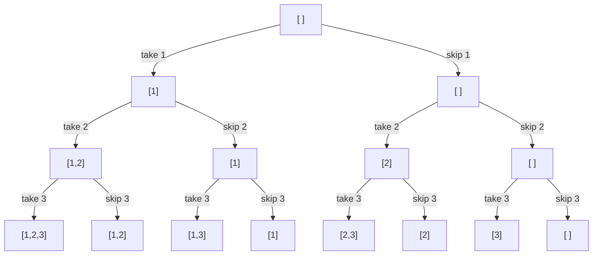
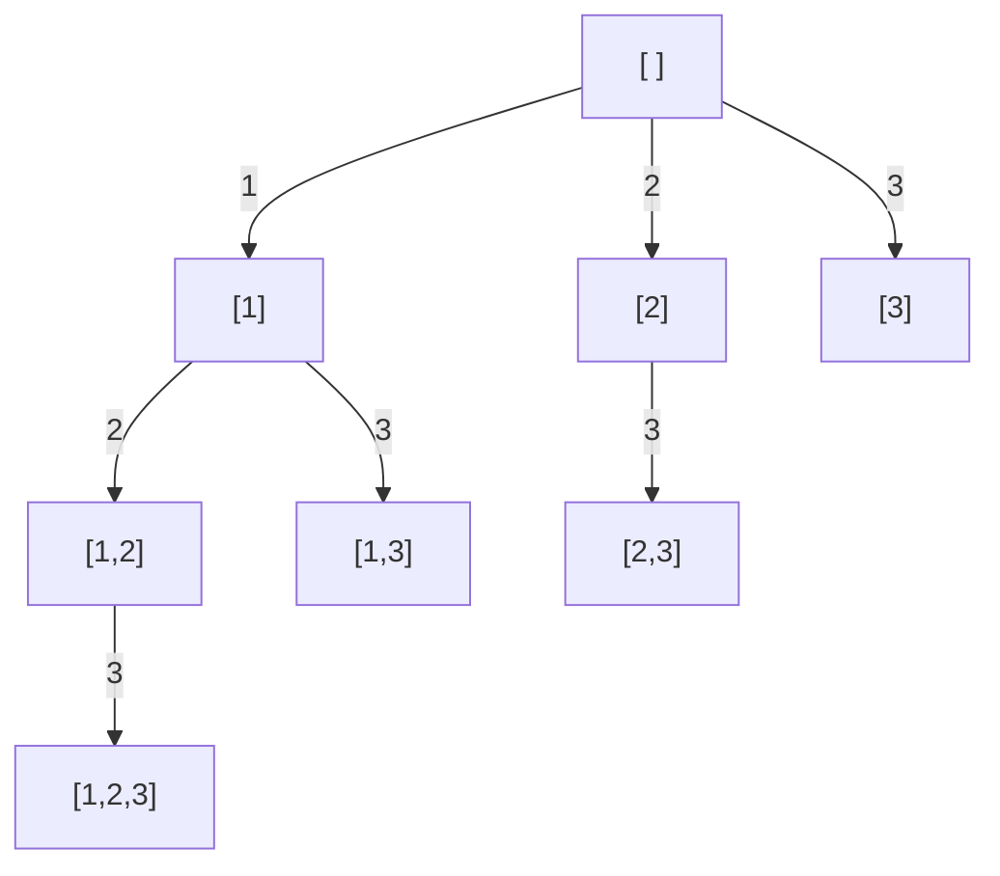
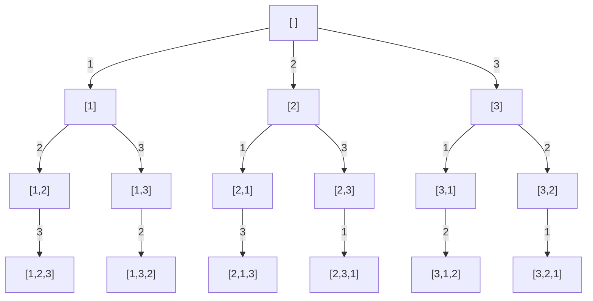

# The backtracking template and state-space trees

## What backtracking is

Some problems don't ask for *one* number — they ask you to **enumerate**: all subsets, all
permutations, all ways to cut a string, all placements of queens. Others ask whether *any* arrangement
satisfying some rules exists. There is usually no clever formula; you have to search through the
possibilities.

**Backtracking** is a disciplined way of doing that search. You build a candidate solution **one
decision at a time**. After each decision you recurse to make the next one. When you reach a complete
solution you record it; when you reach a dead end (or have finished exploring below a decision) you
**undo the last decision** and try the next alternative.

It is depth-first search — not on a graph you were given, but on an *implicit* tree of partial
solutions called the **state-space tree**:

- the **root** is the empty partial solution;
- each **edge** is one decision ("include 3", "put `b` next", "place a queen in column 2");
- each **node** is the partial solution built by the decisions on the path from the root;
- **leaves** are complete solutions or dead ends.

Three questions define any backtracking algorithm:

1. **What is a partial solution (the state)?** Usually a list `path` plus an index or a `used` set.
2. **What choices are available from a state?**
3. **When is a state complete — or hopeless?**

## The universal template

```python
def solve(problem):
    result = []
    path = []                           # the partial solution, shared and mutated

    def backtrack(state):
        if is_complete(state):          # 1. base case
            result.append(path[:])      #    record a COPY
            return
        for choice in choices(state):   # 2. enumerate decisions
            if not is_valid(choice):    #    prune
                continue
            path.append(choice)         # 3. choose
            backtrack(next_state)       # 4. explore
            path.pop()                  # 5. un-choose  <- the "backtrack"
    backtrack(initial_state)
    return result
```

**Choose → explore → un-choose.** The un-choose step restores `path` (and any other shared state such
as a `used` array or a board) to exactly what it was before the choice, so the next iteration of the
loop starts from a clean slate. Everything else in this lesson is a variation of these few lines.

> [!WARNING]
> `result.append(path)` stores a *reference* to the one shared list. By the time the search ends,
> that list is empty, and your result is `[[], [], [], ...]`. Always append a copy: `path[:]`,
> `list(path)`, or `"".join(path)` for strings. This is the #1 backtracking bug.

```python-run
def demo(copy):
    res, path = [], []
    def bt(i):
        if i == 2:
            res.append(path[:] if copy else path)
            return
        for bit in (0, 1):
            path.append(bit); bt(i + 1); path.pop()
    bt(0)
    return res

print("without copy:", demo(False))
print("with copy:   ", demo(True))
```

## Shape 1 — Subsets: include or exclude

*Given distinct numbers, list every subset.* For each element there are two options — take it or
leave it — so the tree is a full binary tree of depth $n$ with $2^n$ leaves.



```python-run
def subsets(nums):
    res, path = [], []
    def dfs(i):
        if i == len(nums):
            res.append(path[:])
            return
        path.append(nums[i])     # choose: include nums[i]
        dfs(i + 1)               # explore
        path.pop()               # un-choose
        dfs(i + 1)               # the other branch: exclude nums[i]
    dfs(0)
    return res

print(subsets([1, 2, 3]))
```

### The "for-loop" form of subsets

There is a second way to draw the same search that turns out to be more reusable. Instead of asking
"do I take element `i`?", ask **"which element do I add next?"** — any element with an index ≥ `start`.
Now *every node* of the tree (not just the leaves) is a subset.



```python-run
def subsets_loop(nums):
    res, path = [], []
    def dfs(start):
        res.append(path[:])                    # every node is an answer
        for j in range(start, len(nums)):
            path.append(nums[j])
            dfs(j + 1)                         # only later elements may follow
            path.pop()
    dfs(0)
    return res

print(subsets_loop([1, 2, 3]))
```

The `start` index is what prevents `[2, 1]` from appearing as well as `[1, 2]`: elements are always
added in increasing index order, so each *set* is generated in exactly one *order*.

> [!TIP]
> **Combinations use a `start` index; permutations use a `used` set.** If the order of the chosen
> items doesn't matter, force a canonical order with `start`. If order matters, every unused item is
> a candidate at every step.

## Shape 2 — Combinations with a target

*Combination Sum: distinct positive candidates, each usable any number of times; list all combinations
summing to `target`.*

Same for-loop skeleton, with three small changes:

- the state carries the remaining amount;
- a candidate may be reused, so recurse with `j` (not `j + 1`);
- prune when a candidate exceeds what remains — and because the candidates are **sorted**, all later
  candidates are too large as well, so `break` instead of `continue`.

```python-run
def combination_sum(candidates, target):
    cand = sorted(candidates)
    res, path = [], []
    calls = 0
    def dfs(start, remain):
        nonlocal calls
        calls += 1
        if remain == 0:
            res.append(path[:])
            return
        for j in range(start, len(cand)):
            if cand[j] > remain:
                break                       # pruning: sorted, so nothing further fits
            path.append(cand[j])
            dfs(j, remain - cand[j])        # j again: reuse allowed
            path.pop()
    dfs(0, target)
    print("recursive calls:", calls)
    return res

print(combination_sum([2, 3, 6, 7], 7))
print(combination_sum([2, 3, 5], 8))
```

One-character differences give you a family of problems:

| problem | recursive call | extra rule |
|---|---|---|
| Subsets | `dfs(j + 1)` | record every node |
| Combinations of size k | `dfs(j + 1)` | record when `len(path) == k` |
| Combination Sum (reuse allowed) | `dfs(j, remain - c)` | record when `remain == 0` |
| Combination Sum II (use once, input has duplicates) | `dfs(j + 1, remain - c)` | skip equal siblings (next lesson) |

## Shape 3 — Permutations: a `used` set

*List all orderings of distinct numbers.* At each depth, every element not already on the path is a
legal choice. The tree has $n$ branches at the root, $n-1$ at depth 1, and so on: $n!$ leaves.



```python-run
def permute(nums):
    res, path = [], []
    used = [False] * len(nums)
    def dfs():
        if len(path) == len(nums):
            res.append(path[:])
            return
        for i, x in enumerate(nums):
            if used[i]:
                continue
            used[i] = True;  path.append(x)     # choose
            dfs()                               # explore
            path.pop();      used[i] = False    # un-choose (BOTH pieces of state)
    dfs()
    return res

print(permute([1, 2, 3]))
```

Notice that un-choosing must restore **all** state that choosing modified — here both `path` and
`used`.

## Shape 4 — Cartesian product: one independent choice per position

*Letter Combinations of a Phone Number*: digit `2` means one of `abc`, digit `3` one of `def`, ...
Each position has its own menu and choices don't interact. Depth = number of digits, branching = 3 or
4.

```python-run
KEYS = {"2": "abc", "3": "def", "4": "ghi", "5": "jkl", "6": "mno", "7": "pqrs", "8": "tuv", "9": "wxyz"}

def letter_combinations(digits):
    if not digits:
        return []                      # edge case: NOT [""]
    res, path = [], []
    def dfs(i):
        if i == len(digits):
            res.append("".join(path))
            return
        for ch in KEYS[digits[i]]:
            path.append(ch); dfs(i + 1); path.pop()
    dfs(0)
    return res

print(letter_combinations("23"))
```

## Shape 5 — Partitioning: where to cut next

*Palindrome Partitioning: split a string so every piece is a palindrome.* The decision at each step
is **where the next piece ends**. `dfs(i)` means "the prefix `s[:i]` has been cut up already; partition
the rest".

```python-run
def partition(s):
    res, path = [], []
    def dfs(i):
        if i == len(s):
            res.append(path[:])
            return
        for j in range(i + 1, len(s) + 1):       # piece = s[i:j]
            piece = s[i:j]
            if piece == piece[::-1]:             # constraint: only palindromes are valid choices
                path.append(piece)
                dfs(j)
                path.pop()
    dfs(0)
    return res

print(partition("aab"))
print(partition("racecar"))
```

A string of length $n$ has $n - 1$ gaps, each either cut or not: $2^{n-1}$ partitions in the worst case
(e.g. `"aaaa"`, where every piece is a palindrome).

## How big is the tree? Complexity of backtracking

Backtracking is exponential by nature — it enumerates an exponentially large output. A useful rule
of thumb:

$$\text{time} \approx (\text{number of nodes in the state-space tree}) \times (\text{work per node})$$

and when you record complete solutions, add (number of solutions) × (cost of copying one).

| problem | tree size | per-leaf cost | total | max input you can expect |
|---|---|---|---|---|
| Subsets | $2^n$ leaves | $O(n)$ copy | $O(n \cdot 2^n)$ | $n \le 20$ |
| Permutations | $n!$ leaves, $\approx e \cdot n!$ nodes | $O(n)$ copy | $O(n \cdot n!)$ | $n \le 9$ |
| Letter combinations | $4^n$ leaves | $O(n)$ join | $O(n \cdot 4^n)$ | $n \le 10$ |
| Palindrome partitioning | $2^{n-1}$ leaves | $O(n)$ | $O(n \cdot 2^n)$ | $n \le 16$ |
| Combination sum | up to $n^{T/m}$ ($m$ = smallest candidate) | $O(T/m)$ | exponential | small targets |
| N-Queens | $\le n!$ | $O(n^2)$ render | roughly $O(n!)$ | $n \le 12$ |

**Space** (besides the output) is the recursion depth plus the path: $O(n)$ in all of the above.

> [!INTERVIEW]
> Constraints are a hint. `n <= 10`–`20` with "return all ..." almost always means backtracking; an
> interviewer does not expect a polynomial algorithm. Conversely, if you are only asked to **count**
> the solutions or find the **best** one and `n` is large, think dynamic programming instead —
> backtracking would enumerate far too much.

```python-run
import math
print(f"{'n':>3} {'2^n':>10} {'n!':>12}")
for n in (5, 10, 12, 15, 20):
    print(f"{n:>3} {2**n:>10} {math.factorial(n):>12}")
```

## Passing state: mutate-and-undo vs. copy-on-call

You will see two styles:

```python
# style A: shared path, explicit undo
path.append(x); dfs(i + 1); path.pop()

# style B: pass a new object, no undo needed
dfs(i + 1, path + [x])
```

Style B is shorter and impossible to "forget to undo", but creates a new list at every node — fine for
small inputs and for strings (`cur + ch`). Style A does $O(1)$ work per edge and is what you should
master, because it extends to state that is expensive to copy (a board, a `used` array, a grid).

## Worked dry run: `subsets_loop([1,2,3])`

| call | `path` on entry | recorded | loop |
|---|---|---|---|
| `dfs(0)` | `[]` | `[]` | j = 0, 1, 2 |
| `dfs(1)` | `[1]` | `[1]` | j = 1, 2 |
| `dfs(2)` | `[1,2]` | `[1,2]` | j = 2 |
| `dfs(3)` | `[1,2,3]` | `[1,2,3]` | — |
| *(pop 3, pop 2)* | | | |
| `dfs(3)` | `[1,3]` | `[1,3]` | — |
| *(pop 3, pop 1)* | | | |
| `dfs(2)` | `[2]` | `[2]` | j = 2 |
| `dfs(3)` | `[2,3]` | `[2,3]` | — |
| *(pop 3, pop 2)* | | | |
| `dfs(3)` | `[3]` | `[3]` | — |

Eight calls, eight subsets — one per node of the second tree diagram.

## Common pitfalls

1. **Appending the path without copying it.**
2. **Forgetting to undo** — or undoing only part of the state.
3. **Using `j + 1` vs `j` vs `i + 1` incorrectly** in the recursive call. `dfs(start + 1)` instead of
   `dfs(j + 1)` is a classic typo that produces duplicates.
4. **Generating duplicates by ignoring order** (looping from 0 every time for a combination problem).
5. **Returning `[""]` or `[[]]` for empty input** when the problem wants `[]` — or the reverse. Subsets
   of `[]` is `[[]]`; letter combinations of `""` is `[]`.
6. **Recomputing validity from scratch** at every node when it could be maintained incrementally
   (running sum, sets of attacked columns — see the next lesson).

## Summary

- Backtracking = DFS over the tree of partial solutions: **choose, explore, un-choose**.
- Decide the state, the choices, and the completion test; the template writes itself.
- `start` index ⇒ combinations/subsets (order irrelevant); `used` set ⇒ permutations (order matters).
- Record a **copy** of the path.
- Complexity ≈ nodes × work per node: $2^n$, $n!$, $k^n$ — expect small inputs.

```quiz
[
  {"q": "What are the three steps performed inside the loop of the backtracking template?",
   "options": ["Sort, search, return", "Choose, explore, un-choose", "Push, pop, peek", "Divide, conquer, combine"], "answer": 1,
   "explain": "Append the choice to the partial solution, recurse, then remove it so the next choice starts from the same state."},
  {"q": "A solution to Subsets returns [[], [], [], []] for nums = [1, 2]. What is the most likely bug?",
   "options": ["Wrong base case", "The path list was appended without copying", "Missing sort", "Recursion limit"], "answer": 1,
   "explain": "All four entries reference the same list object, which is empty once the search has unwound."},
  {"q": "How many leaves does the state-space tree for permutations of 5 distinct items have?",
   "options": ["25", "32", "120", "3125"], "answer": 2,
   "explain": "5 choices, then 4, then 3, 2, 1: 5! = 120."},
  {"q": "In Combination Sum (reuse allowed), which recursive call is correct after choosing cand[j]?",
   "options": ["dfs(j + 1, remain - cand[j])", "dfs(j, remain - cand[j])", "dfs(0, remain - cand[j])", "dfs(start + 1, remain)"], "answer": 1,
   "explain": "Passing j allows the same candidate again but forbids earlier ones, so each combination appears once, in non-decreasing index order."},
  {"q": "Why does the combinations template pass a start index?",
   "options": ["To make recursion faster", "To generate each set in only one order and avoid duplicates like [1,2] and [2,1]", "To limit recursion depth", "To sort the output"], "answer": 1,
   "explain": "Only allowing later indices fixes a canonical order for each combination."},
  {"q": "What does letterCombinations('') have to return, and why is it a trap?",
   "options": ["[''] because the product of nothing is one empty string", "[] - the generic recursion would produce [''] so the empty input needs a special case", "None", "['abc']"], "answer": 1,
   "explain": "The base case fires immediately and records the empty string; the problem specifies an empty list instead."},
  {"q": "A problem says: n <= 16, return ALL valid arrangements. Which technique do the constraints suggest?",
   "options": ["Greedy", "Binary search", "Backtracking", "Two pointers"], "answer": 2,
   "explain": "Tiny n plus 'return all' means the output itself is exponential; enumeration by backtracking is expected."},
  {"q": "In the permutations template, what must the un-choose step restore?",
   "options": ["Only path", "Only the used array", "Both path and the used flag", "Nothing, Python handles it"], "answer": 2,
   "explain": "Every piece of shared state modified by the choice has to be reverted, otherwise later branches see a corrupted state."}
]
```

> **Source:** recursion and exhaustive enumeration as in Goodrich, Tamassia & Goldwasser, *Data
> Structures and Algorithms in Python*, ch. 4 (recursion; the "puzzle solve" exhaustive-search
> pattern), and depth-first search from ch. 14 §14.3.1; problem ordering follows the NeetCode 150
> "Backtracking" list.
