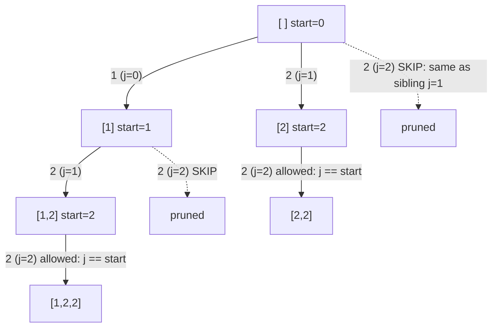
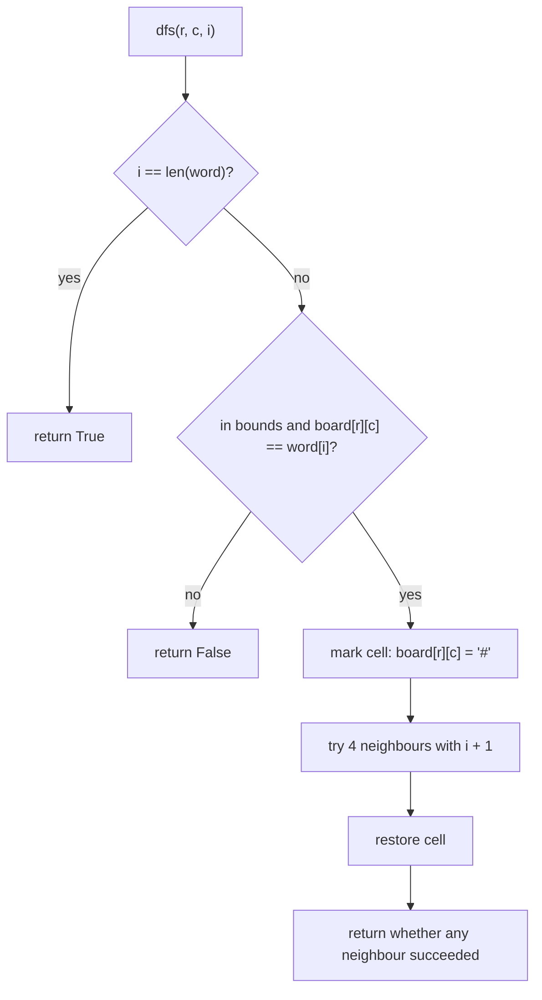
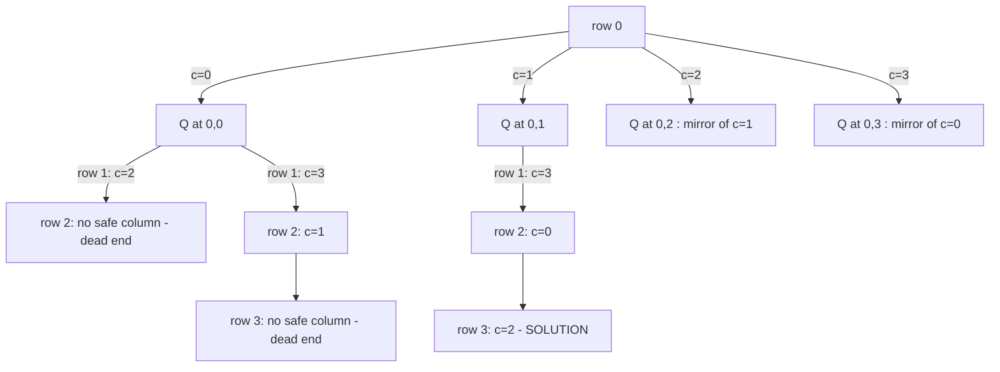

# Duplicates, pruning and constraint search

The previous lesson gave you the choose–explore–un-choose template and the basic tree shapes. Real
problems add three complications:

1. the input contains **duplicate values**, yet the output must not contain duplicate solutions;
2. the tree is too big to walk completely, so you must **prune** branches that cannot succeed;
3. the "path" lives on a **grid or board**, and validity depends on everything placed so far.

This lesson handles each in turn, using *Subsets II*, *Combination Sum II*, *Word Search* and
*N-Queens* as the running examples.

## Part 1 — Duplicates in the input

### The problem

Run the plain subsets algorithm on `[1, 2, 2]`. To the algorithm the two `2`s are different elements
(index 1 and index 2), so it happily produces `[1, 2]` twice — once with each `2` — and `[2]` twice.

```python-run
def subsets_naive(nums):
    res, path = [], []
    def dfs(start):
        res.append(path[:])
        for j in range(start, len(nums)):
            path.append(nums[j]); dfs(j + 1); path.pop()
    dfs(0)
    return res

out = subsets_naive([1, 2, 2])
print(out)
print(len(out), "subsets,", len({tuple(s) for s in out}), "distinct")
```

You *could* throw everything into a set of tuples at the end. That works, but it does all the wasted
work first — and for an input like `[1] * 30` the wasted work is $2^{30}$ nodes for only 31 distinct
subsets. The right fix is to never generate the duplicates.

### The rule: skip equal siblings

**Sort the input** so equal values are adjacent. Then, inside the loop:

```python
if j > start and nums[j] == nums[j - 1]:
    continue
```

Read it as: *"at this level of the tree, I have already started a branch with this value; a second
branch starting with the same value would generate the same sub-tree."*



The condition `j > start` is the subtle part. It distinguishes two situations:

- `j == start`: this is the **first** choice at this level. Taking a `2` right after a `2` on the path
  *deepens* the path (`[2] → [2, 2]`). That is legitimate — the subset `[2, 2]` is new.
- `j > start`: an earlier **sibling** at this level already used this value. Skip.

> [!TIP]
> **Duplicates are allowed down a path, forbidden across siblings.**
> Writing `j > 0` instead of `j > start` forbids both and loses `[2, 2]`.

```python-run
def subsets_with_dup(nums):
    nums = sorted(nums)
    res, path = [], []
    def dfs(start):
        res.append(path[:])
        for j in range(start, len(nums)):
            if j > start and nums[j] == nums[j - 1]:
                continue
            path.append(nums[j]); dfs(j + 1); path.pop()
    dfs(0)
    return res

print(subsets_with_dup([2, 1, 2]))
print(len(subsets_with_dup([1] * 30)), "subsets of thirty 1s - generated instantly")
```

### Same rule, different problem: Combination Sum II

Each number may be used once, the input has repeats, and combinations must be unique. It is the
subsets-with-duplicates search plus a target:

```python-run
def combination_sum2(candidates, target):
    cand = sorted(candidates)
    res, path = [], []
    def dfs(start, remain):
        if remain == 0:
            res.append(path[:])
            return
        for j in range(start, len(cand)):
            if j > start and cand[j] == cand[j - 1]:
                continue                    # duplicate sibling
            if cand[j] > remain:
                break                       # sorted => nothing later fits
            path.append(cand[j])
            dfs(j + 1, remain - cand[j])    # j + 1: each position used once
            path.pop()
    dfs(0, target)
    return res

print(combination_sum2([10, 1, 2, 7, 6, 1, 5], 8))
```

### Duplicates in permutations

For *Permutations II* (not in this module, but a common follow-up) the rule becomes: after sorting,
skip `nums[i]` if it equals `nums[i-1]` **and `nums[i-1]` is not currently used**. "Not used" means
the twin was already tried and un-chosen at this level — i.e. it is a sibling, not an ancestor.

### An equivalent view: choose a count per distinct value

Group the input with a counter: `{1: 1, 2: 2}`. For each distinct value decide **how many copies**
to take (0, 1, ..., count). Different counts ⇒ different multisets, so no duplicates can arise. The
sibling-skip rule is exactly this idea in disguise: taking the first `2`, then optionally the second,
is "how many 2s"; skipping straight to the second `2` is not offered.

## Part 2 — Pruning

A **pruning** test cuts off a sub-tree as soon as you can prove it contains no solution. Pruning never
changes the answer — only how much of the tree you walk. Because sub-trees are exponentially large,
a cheap test near the root can save enormous amounts of work.

### Kinds of pruning

| kind | idea | example |
|---|---|---|
| **Feasibility** | the partial solution already violates a constraint | two queens attack; letter doesn't match |
| **Bound** | even the best possible completion can't reach the goal | remaining sum < 0; candidate > remaining |
| **Ordering** | sort so that one failure implies all later failures | `break` instead of `continue` on sorted candidates |
| **Symmetry / duplicates** | this branch mirrors one already explored | skip equal siblings |
| **Pre-check** | a global test before any search | board lacks enough copies of a needed letter |

### Measuring the effect

```python-run
def count_nodes(cand, target, prune):
    cand = sorted(cand)
    nodes = 0
    def dfs(start, remain):
        nonlocal nodes
        nodes += 1
        if remain <= 0:
            return
        for j in range(start, len(cand)):
            if prune and cand[j] > remain:
                break
            dfs(j, remain - cand[j])
    dfs(0, target)
    return nodes

cand = [2, 3, 5, 7, 11, 13, 17, 19, 23]
for t in (20, 30, 40):
    print(f"target {t}: {count_nodes(cand, t, False):>7} nodes unpruned, {count_nodes(cand, t, True):>6} pruned")
```

> [!NOTE]
> **Order the choices so failures come early.** Trying the most constrained decision first (the
> variable with the fewest legal values, the rarest letter, the largest numbers when filling a
> budget) makes dead ends appear near the root, where cutting them removes the most.

## Part 3 — Backtracking on a grid: Word Search

*Does the word appear as a path of adjacent cells, using each cell at most once?*

This is DFS on a grid, with one crucial difference from flood fill. In flood fill, "visited" is
**global and permanent**: once a cell is seen, nobody needs it again. Here, "visited" means **"on the
current path"**. A cell that was part of a failed attempt must be released so that another attempt
can use it.



```python-run
def exist(board, word):
    R, C = len(board), len(board[0])

    def dfs(r, c, i):
        if i == len(word):
            return True
        if r < 0 or c < 0 or r == R or c == C or board[r][c] != word[i]:
            return False                          # feasibility pruning
        saved, board[r][c] = board[r][c], "#"     # choose: mark as on-path
        found = (dfs(r + 1, c, i + 1) or dfs(r - 1, c, i + 1) or
                 dfs(r, c + 1, i + 1) or dfs(r, c - 1, i + 1))
        board[r][c] = saved                       # un-choose: release the cell
        return found

    return any(dfs(r, c, 0) for r in range(R) for c in range(C))

board = [list("ABCE"), list("SFCS"), list("ADEE")]
for w in ("ABCCED", "SEE", "ABCB"):
    print(w, exist(board, w))
```

Things to notice:

- **In-place marking.** Overwriting the cell with `#` (a character that can never match) costs no
  extra memory and makes the "already on path" test free — it is folded into the letter comparison.
- **Short-circuit `or`.** As soon as one direction succeeds, the others are not explored. For
  *existence* problems you return a boolean up the stack and stop early; for *enumeration* problems
  you keep going.
- **Check order.** Test `i == len(word)` *before* bounds: when the last letter sits on the border, the
  next call is out of bounds but should still report success.
- **Extra pruning** for adversarial inputs: count letters first (if the board has fewer `Z`s than the
  word needs, return `False` immediately), and search for the reversed word if its last letter is rarer
  than its first — fewer starting cells survive the first comparison.

Complexity: from each of the $m \cdot n$ starts, each step has at most 3 onward directions (not back
where you came from), for a path of length $L$: $O(m \cdot n \cdot 3^L)$ time, $O(L)$ stack.

## Part 4 — Constraint satisfaction: N-Queens

*Place $n$ queens on an $n \times n$ board so that none attack each other.*

### Step 1: choose the decision sequence wisely

Naively, each of $n^2$ cells either has a queen or not: $2^{n^2}$ states. But every row must contain
**exactly one** queen (two in a row attack; fewer than one per row can't total $n$). So make the
decision *"which column does the queen of row `r` go in?"* — one decision per row, $n$ options each:
at most $n^n$ leaves, and far fewer after pruning. **Baking a constraint into the structure of the
choices is the strongest pruning there is.**

### Step 2: make the validity check O(1)

A queen at `(r, c)` attacks along its column and both diagonals. The key observation:

- cells on the same "\\" diagonal share the value **`r - c`**;
- cells on the same "/" diagonal share the value **`r + c`**.

| `r - c` | c=0 | c=1 | c=2 | c=3 | | `r + c` | c=0 | c=1 | c=2 | c=3 |
|---|---|---|---|---|---|---|---|---|---|---|
| **r=0** | 0 | -1 | -2 | -3 | | **r=0** | 0 | 1 | 2 | 3 |
| **r=1** | 1 | 0 | -1 | -2 | | **r=1** | 1 | 2 | 3 | 4 |
| **r=2** | 2 | 1 | 0 | -1 | | **r=2** | 2 | 3 | 4 | 5 |
| **r=3** | 3 | 2 | 1 | 0 | | **r=3** | 3 | 4 | 5 | 6 |

Keep three sets — used columns, used `r - c`, used `r + c`. A square is safe iff none of the three
sets contains its key.

```python-run
def solve_n_queens(n):
    cols, diag, anti = set(), set(), set()
    place = [0] * n                    # place[r] = column of the queen in row r
    res = []

    def dfs(r):
        if r == n:
            res.append(["." * c + "Q" + "." * (n - c - 1) for c in place])
            return
        for c in range(n):
            if c in cols or (r - c) in diag or (r + c) in anti:
                continue                                   # feasibility pruning
            cols.add(c); diag.add(r - c); anti.add(r + c)  # choose
            place[r] = c
            dfs(r + 1)                                     # explore
            cols.remove(c); diag.remove(r - c); anti.remove(r + c)   # un-choose

    dfs(0)
    return res

for board in solve_n_queens(4):
    print("\n".join(board), "\n")
print([len(solve_n_queens(n)) for n in range(1, 9)])   # 1, 0, 0, 2, 10, 4, 40, 92
```

### The search for n = 4



Out of $4^4 = 256$ complete assignments, the pruned search touches only a handful of nodes.

### How much does pruning buy?

```python-run
def nodes_visited(n, check_diagonals):
    cols, diag, anti = set(), set(), set()
    count = 0
    def dfs(r):
        nonlocal count
        count += 1
        if r == n:
            return
        for c in range(n):
            if c in cols: continue
            if check_diagonals and ((r - c) in diag or (r + c) in anti): continue
            cols.add(c)
            if check_diagonals: diag.add(r - c); anti.add(r + c)
            dfs(r + 1)
            cols.remove(c)
            if check_diagonals: diag.remove(r - c); anti.remove(r + c)
    dfs(0)
    return count

for n in (4, 6, 8):
    print(f"n={n}: n^n={n**n:>9}  columns-only={nodes_visited(n, False):>6}  full pruning={nodes_visited(n, True):>5}")
```

Checking the diagonals **during** the search (rather than validating complete boards at the end)
shrinks the 8-queens tree from about 110,000 nodes to about 2,000.

> [!INTERVIEW]
> Follow-ups for N-Queens: (1) *only count solutions* — same search, no rendering; (2) *use bitmasks*
> — represent the three sets as integers and compute the free columns as
> `~(cols | diag | anti) & ((1 << n) - 1)`; (3) *exploit symmetry* — only try the first-row queen in
> the left half and double the count.

## Backtracking vs. dynamic programming

Both explore decisions recursively. The difference is in what the sub-problems look like.

| | backtracking | dynamic programming |
|---|---|---|
| asked for | **all** solutions, or any one under complex constraints | a **count**, a **min/max**, or yes/no |
| sub-problems | depend on the whole path (which cells are used, which queens placed) | depend on a small state (index, remaining sum) and **repeat** |
| typical size | $n \le 20$ | $n$ in the thousands |

*Palindrome Partitioning* (list all) is backtracking; *Palindrome Partitioning II* (minimum cuts) is
DP over the same structure. *Combination Sum* (list all) is backtracking; *Coin Change* (fewest coins)
is DP. If you notice your backtracking state is just `(index, remaining)` and you only need a number,
add memoisation and you have a DP.

## Debugging checklist

- Print the path at entry to the recursive function with indentation `"  " * depth` — you will *see*
  the tree and spot the missing undo.
- Too many results? You're generating duplicates: check `start`, sorting, and the sibling-skip.
- Too few results? You're over-pruning: check `j > start` vs `j > 0`, and `break` vs `continue` on
  unsorted data.
- Results all identical or empty? Missing copy.
- Wrong answers only on later test cases of a grid problem? You forgot to restore the board.

## Summary

- **Duplicates:** sort, then skip a value equal to its left neighbour *at the same level*
  (`j > start`). Allowed down a path, forbidden across siblings.
- **Pruning:** reject infeasible partial solutions immediately; sort so that `break` can cut whole
  ranges; pre-check cheap global conditions; pick decisions that fail early.
- **Grid backtracking:** "visited" means "on the current path" — mark on the way in, restore on the
  way out.
- **Constraint search:** structure the choices so a constraint holds automatically (one queen per
  row), and maintain the remaining constraints incrementally in sets for $O(1)$ checks.

```quiz
[
  {"q": "In Subsets II, what does the condition `j > start and nums[j] == nums[j-1]` skip?",
   "options": ["Every duplicate value in the input", "A value equal to one already tried as a sibling at the same tree level", "Values already on the current path", "The first element of each level"], "answer": 1,
   "explain": "j > start means an earlier sibling at this level exists; if it had the same value its sub-tree already produced everything this branch would."},
  {"q": "What goes wrong if you write `j > 0` instead of `j > start`?",
   "options": ["Nothing", "Duplicate subsets appear", "Valid results such as [2,2] are lost", "Infinite recursion"], "answer": 2,
   "explain": "With j > 0 a value can never follow an equal value on the path, so subsets using several copies are never built."},
  {"q": "Why must the input be sorted before applying the skip-duplicates rule?",
   "options": ["So that equal values are adjacent and can be detected by comparing neighbours", "Backtracking only works on sorted data", "To make the output sorted", "To reduce recursion depth"], "answer": 0,
   "explain": "The rule compares nums[j] with nums[j-1]; equal values must be next to each other for that to detect them."},
  {"q": "In Word Search, why is the cell restored after the recursive calls?",
   "options": ["To keep the output pretty", "Because 'visited' is per path: another path may need that cell", "To avoid index errors", "Python requires it"], "answer": 1,
   "explain": "Unlike flood fill, a cell used by a failed attempt can be part of a different successful path."},
  {"q": "Which pair of keys identifies the two diagonals through cell (r, c) in N-Queens?",
   "options": ["r * c and r / c", "r - c and r + c", "r and c", "r % c and c % r"], "answer": 1,
   "explain": "Moving along a '\\' diagonal increases r and c together (r - c constant); along a '/' diagonal r increases while c decreases (r + c constant)."},
  {"q": "Candidates are sorted ascending. cand[j] > remain. Why may you `break` rather than `continue`?",
   "options": ["break is faster to type", "All later candidates are at least as large, so none can fit either", "continue would cause duplicates", "The recursion is finished"], "answer": 1,
   "explain": "Sorting turns one failed bound check into a proof about the entire rest of the loop."},
  {"q": "You are asked for the NUMBER of ways to reach a target sum with n = 1000 numbers. Which approach fits?",
   "options": ["Backtracking over all combinations", "Dynamic programming over (index, sum)", "N-Queens style sets", "Heap"], "answer": 1,
   "explain": "Only a count is needed and sub-problems repeat; enumeration would be exponential."},
  {"q": "Why does N-Queens recurse row by row instead of deciding queen/no-queen for each cell?",
   "options": ["Rows are easier to print", "Exactly one queen per row is forced, so this encodes a constraint into the choices and shrinks the tree from 2^(n*n) to at most n^n", "Columns cannot be checked otherwise", "It avoids recursion"], "answer": 1,
   "explain": "Structuring decisions so a constraint is automatically satisfied is the most powerful form of pruning."}
]
```

> **Source:** depth-first search and exhaustive enumeration as presented in Goodrich, Tamassia &
> Goldwasser, *Data Structures and Algorithms in Python*, ch. 4 (recursion) and ch. 14 §14.3.1
> (DFS); problem set and ordering from the NeetCode 150 "Backtracking" list.
