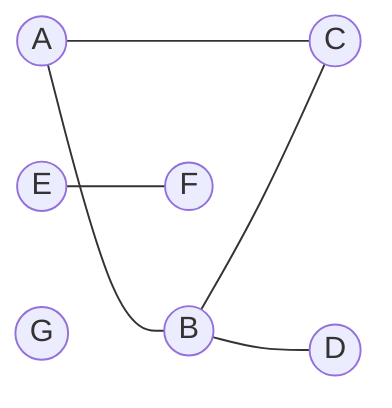
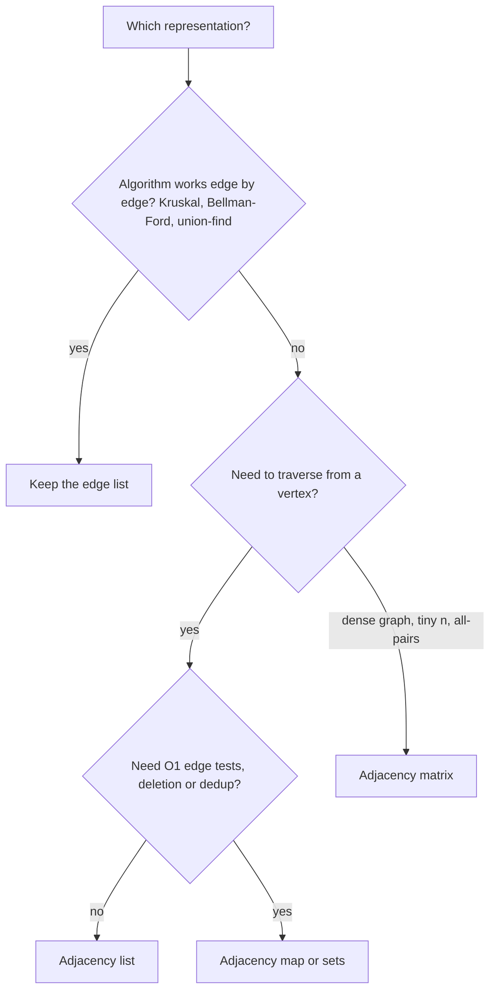

# Graphs and how to store them

## Why graphs?

Arrays model sequences. Trees model hierarchies. **Graphs** model *relationships* — anything where
things are connected to other things with no particular shape imposed:

- cities and roads, routers and cables, airports and flights;
- web pages and links, people and friendships;
- courses and prerequisites, build targets and dependencies;
- cells of a grid and their neighbours;
- even *words* that differ by one letter, or *states* of a puzzle connected by moves.

The last two matter most in interviews: the graph is often **not handed to you**. Half the skill is
recognising that a problem *is* a graph problem and deciding what the vertices and edges are. The other
half — the algorithms — is the subject of the remaining lessons of this track.

## Vocabulary

A **graph** $G = (V, E)$ is a set of **vertices** (nodes) $V$ and a set of **edges** $E$, each edge
joining a pair of vertices. Throughout, $n = |V|$ and $m = |E|$.



| term | meaning | in the picture |
|---|---|---|
| **undirected edge** | a two-way connection $\{u, v\}$ | every edge above |
| **directed edge** | a one-way connection $(u, v)$ from origin $u$ to destination $v$ | (none) |
| **adjacent** | two vertices joined by an edge | A and B |
| **incident** | an edge is incident to its endpoints | edge A–B is incident to A and to B |
| **degree** $\deg(v)$ | number of edges at $v$ | $\deg(B) = 3$, $\deg(G) = 0$ |
| **in-/out-degree** | for directed graphs: edges arriving / leaving | — |
| **path** | a sequence of vertices, each adjacent to the next | A, C, B, D |
| **simple path** | a path with no repeated vertex | A, C, B, D |
| **cycle** | a path that returns to its start | A, B, C, A |
| **connected** | every pair of vertices is joined by a path | this graph is *not* connected |
| **connected component** | a maximal connected piece | {A,B,C,D}, {E,F}, {G} |
| **self-loop / parallel edges** | edge from a vertex to itself / two edges with the same endpoints | (none — the graph is *simple*) |
| **weighted graph** | each edge carries a number (cost, length, time) | — |

Special families you should recognise:

- A **tree** is a connected graph with no cycles. It has exactly $n - 1$ edges, and there is exactly
  one simple path between any two vertices. A **forest** is a graph with no cycles (a collection of trees).
- A **DAG** is a *directed acyclic graph* — directed edges, no directed cycle. Prerequisites and
  dependencies form DAGs.
- A **spanning tree** of a connected graph is a subset of its edges that forms a tree touching every
  vertex.

### Three counting facts worth memorising

**1. The handshake lemma.** In an undirected graph, $\sum_{v} \deg(v) = 2m$ — every edge is counted
once at each end. For a directed graph, $\sum \text{indeg}(v) = \sum \text{outdeg}(v) = m$.

**2. Edge bounds.** A simple undirected graph has $m \le n(n-1)/2$; a simple directed graph has
$m \le n(n-1)$. So $m$ is $O(n^2)$. A graph is called **sparse** when $m$ is closer to $n$ and
**dense** when it is closer to $n^2$.

**3. Trees, connectivity and cycles.** For an undirected graph:

- connected ⇒ $m \ge n - 1$;
- a tree ⇒ $m = n - 1$;
- a forest ⇒ $m \le n - 1$ (precisely $m = n - c$ where $c$ is the number of components).

Turn those around and you get the checks used in *Graph Valid Tree*: a graph is a tree **iff** it has
exactly $n - 1$ edges and is connected — equivalently, exactly $n - 1$ edges and no cycle.

```python-run
edges = [("A","B"), ("A","C"), ("B","C"), ("B","D"), ("E","F")]
vertices = "ABCDEFG"
deg = {v: 0 for v in vertices}
for u, v in edges:
    deg[u] += 1
    deg[v] += 1
print(deg)
print("sum of degrees =", sum(deg.values()), "= 2 * m =", 2 * len(edges))
n = len(vertices)
print("max edges in a simple undirected graph on", n, "vertices:", n * (n - 1) // 2)
```

## Four ways to store a graph

The textbook describes four classic structures. They hold the same information but make different
operations cheap.

### 1. Edge list

Just a list of pairs (or triples with a weight).

```python
edges = [(0, 1), (0, 2), (1, 2), (1, 3)]
```

Simple and compact, $O(m)$ space — and it is how LeetCode usually *gives* you the graph. But finding
the neighbours of a vertex means scanning all $m$ edges, so you rarely traverse with it directly. It is
the right structure when the algorithm processes **edges as a whole**: Kruskal's algorithm sorts them,
Bellman-Ford loops over them, union-find consumes them one by one.

### 2. Adjacency list

For each vertex, the list of its neighbours. This is the default choice.

```python-run
from collections import defaultdict

def build_adj(n, edges, directed=False):
    adj = [[] for _ in range(n)]
    for u, v in edges:
        adj[u].append(v)
        if not directed:
            adj[v].append(u)        # undirected: store the edge in BOTH directions
    return adj

edges = [(0, 1), (0, 2), (1, 2), (1, 3)]
print("undirected:", build_adj(5, edges))
print("directed:  ", build_adj(5, edges, directed=True))

# when vertices are not 0..n-1 (strings, tuples, ...), use a dict
adj = defaultdict(list)
for a, b in [("JFK", "SFO"), ("JFK", "ATL"), ("SFO", "ATL")]:
    adj[a].append(b)
print(dict(adj))
```

- Space $O(n + m)$.
- Iterating over the neighbours of $v$ costs $O(\deg(v))$ — optimal, and the reason every traversal
  runs in $O(n + m)$: by the handshake lemma, visiting every vertex's list touches each edge twice.
- Testing "is there an edge $u$–$v$?" costs $O(\min(\deg u, \deg v))$ with lists.

> [!WARNING]
> Two classic bugs when building an adjacency list from an edge list:
> forgetting the reverse direction for an undirected graph, and creating lists only for vertices that
> appear in some edge — which silently drops **isolated vertices**. If the problem says "n nodes
> labelled 0..n-1", always allocate `n` lists.

### 3. Adjacency map

Replace each neighbour *list* with a hash *map* or *set* keyed by neighbour. This is the structure the
textbook recommends as the best all-rounder: neighbour iteration is still $O(\deg v)$, and the edge
lookup becomes $O(1)$ expected. The map's value is a natural home for the edge weight.

```python-run
graph = {
    "A": {"B": 4, "C": 1},
    "B": {"A": 4, "C": 2, "D": 5},
    "C": {"A": 1, "B": 2},
    "D": {"B": 5},
}
print("neighbours of B:", list(graph["B"]))
print("is there an edge A-D?", "D" in graph["A"])
print("weight of B-C:", graph["B"]["C"])
```

Use sets/maps when you need fast edge queries, need to delete edges, or must de-duplicate parallel
edges (as in *Alien Dictionary*, where the same "comes before" fact can be discovered many times).

### 4. Adjacency matrix

An $n \times n$ table where `M[u][v]` is 1 (or the weight) if there is an edge from `u` to `v`.

```python-run
n = 4
edges = [(0, 1), (0, 2), (1, 2), (1, 3)]
M = [[0] * n for _ in range(n)]
for u, v in edges:
    M[u][v] = M[v][u] = 1          # symmetric for undirected graphs
for row in M:
    print(row)
print("edge 1-3?", bool(M[1][3]), "  neighbours of 1:", [v for v in range(n) if M[1][v]])
```

Edge lookup is $O(1)$ worst case, but space is $O(n^2)$ regardless of how few edges exist, and listing
the neighbours of a vertex costs $O(n)$ — which makes traversals $O(n^2)$. Reasonable for **dense**
graphs or small $n$ (a few hundred), and it is the natural format for all-pairs algorithms such as
Floyd–Warshall. LeetCode sometimes *supplies* a matrix (`isConnected[i][j]` in *Number of Provinces*).

### Comparison

| operation | edge list | adjacency list | adjacency map | adjacency matrix |
|---|---|---|---|---|
| space | $O(m)$ | $O(n + m)$ | $O(n + m)$ | $O(n^2)$ |
| iterate neighbours of $v$ | $O(m)$ | $O(\deg v)$ | $O(\deg v)$ | $O(n)$ |
| is $(u, v)$ an edge? | $O(m)$ | $O(\min(\deg u, \deg v))$ | $O(1)$ expected | $O(1)$ |
| add an edge | $O(1)$ | $O(1)$ | $O(1)$ expected | $O(1)$ |
| remove an edge | $O(m)$ | $O(\deg)$ | $O(1)$ expected | $O(1)$ |
| add a vertex | $O(1)$ | $O(1)$ | $O(1)$ | $O(n^2)$ (rebuild) |



## Implicit graphs

Often you never build any of the structures above, because the neighbours of a vertex can be
**computed on demand**.

### Grids

A 2-D grid is a graph whose vertices are cells and whose edges join orthogonally adjacent cells
(sometimes also diagonal ones — read the statement!). Neighbours come from four offsets:

```python-run
grid = ["1101",
        "1000",
        "0011"]
R, C = len(grid), len(grid[0])

def neighbours(r, c):
    for dr, dc in ((1, 0), (-1, 0), (0, 1), (0, -1)):
        nr, nc = r + dr, c + dc
        if 0 <= nr < R and 0 <= nc < C and grid[nr][nc] == "1":   # in bounds AND passable
            yield nr, nc

print("land neighbours of (0,0):", list(neighbours(0, 0)))
print("land neighbours of (2,3):", list(neighbours(2, 3)))
```

An $R \times C$ grid has $n = RC$ vertices and about $2RC$ edges, so "linear time" on a grid means
$O(RC)$.

### State graphs

In *Word Ladder* the vertices are words and two words are adjacent when they differ in one letter.
Building all edges by comparing every pair costs $O(N^2 L)$; generating a word's neighbours on the
fly — all one-letter edits that exist in a set — costs $O(26 L)$ per word. The same idea powers puzzle
solvers (states of a lock, a sliding puzzle, a board) — vertices are states, edges are moves.

### Object graphs

Sometimes vertices are objects holding references to their neighbours, exactly like tree nodes but
without the tree shape:

```python
class Node:
    def __init__(self, val=0, neighbors=None):
        self.val = val
        self.neighbors = neighbors if neighbors is not None else []
```

This is the format of *Clone Graph*. There is no global vertex list; you discover the graph by walking
it, and you need a hash map keyed by node to remember what you have seen.

## Turning a problem into a graph

A reliable recipe:

1. **What are the vertices?** (cells, words, courses, cities, letters, states...)
2. **What are the edges?** When exactly are two vertices related? Directed or undirected? Weighted?
3. **What is the question in graph terms?**

| the problem says... | graph formulation | tool (later lessons) |
|---|---|---|
| "how many groups / islands / provinces" | count connected components | DFS/BFS or union-find |
| "fewest steps / moves / transformations" | shortest path, unweighted | BFS |
| "cheapest / fastest route with costs" | shortest path, weighted | Dijkstra / Bellman-Ford |
| "can all tasks be finished given prerequisites" | is the directed graph acyclic? | topological sort |
| "find a valid order" | topological order | Kahn / DFS |
| "is this a tree", "which edge is redundant" | connectivity + cycle detection | union-find / DFS |
| "connect everything at minimum cost" | minimum spanning tree | Prim / Kruskal |
| "use every ticket / edge exactly once" | Eulerian path | Hierholzer |

```python-run
# Example: prerequisites as a directed graph.  [a, b] means "b before a", so the edge is b -> a.
numCourses = 4
prerequisites = [[1, 0], [2, 0], [3, 1], [3, 2]]

adj = [[] for _ in range(numCourses)]
indeg = [0] * numCourses
for a, b in prerequisites:
    adj[b].append(a)
    indeg[a] += 1

print("adjacency:", adj)
print("in-degrees:", indeg, "-> courses with no prerequisites:", [c for c in range(numCourses) if indeg[c] == 0])
```

> [!INTERVIEW]
> Say the modelling step out loud: *"I'll treat each course as a vertex and each prerequisite pair as
> a directed edge from the prerequisite to the course; the question is whether this graph has a
> cycle."* Interviewers grade this translation at least as heavily as the code that follows.

## Practical Python notes

- **Vertices 0..n-1** → `adj = [[] for _ in range(n)]`. Never `[[]] * n` — that creates `n`
  references to the *same* list.
- **Arbitrary hashable vertices** → `collections.defaultdict(list)` (or `set`).
- **Weighted** → store `(neighbour, weight)` tuples, or a dict `adj[u][v] = w`.
- **Visited bookkeeping** → a `set` for hashable vertices, a boolean list for 0..n-1, a boolean matrix
  (or in-place marking) for grids.
- **1-indexed labels** (common: *Network Delay Time*, *Redundant Connection*) → allocate `n + 1` slots
  and ignore index 0.

```python-run
n = 3
wrong = [[]] * n
wrong[0].append(99)
print("[[]] * n       ->", wrong, " (one shared list!)")
right = [[] for _ in range(n)]
right[0].append(99)
print("comprehension  ->", right)
```

## Summary

- A graph is vertices plus edges; edges may be directed and/or weighted.
- $\sum \deg = 2m$; $m \le n(n-1)/2$; a tree has $n - 1$ edges, is connected and acyclic.
- **Adjacency list** (or map) is the default: $O(n + m)$ space and $O(\deg v)$ neighbour iteration,
  giving $O(n + m)$ traversals. **Edge lists** suit edge-centric algorithms; **matrices** suit dense
  graphs and $O(1)$ edge tests.
- Many graphs are implicit — grids, word/state graphs, object graphs — with neighbours computed on
  demand.
- Always start by naming the vertices, the edges, and the graph question being asked.

```quiz
[
  {"q": "An undirected graph has 10 edges. What is the sum of all vertex degrees?",
   "options": ["5", "10", "20", "Depends on the number of vertices"], "answer": 2,
   "explain": "Each edge contributes one to the degree of each endpoint: sum of degrees = 2m = 20."},
  {"q": "Which representation lets you iterate over the neighbours of v in O(deg v) time using O(n + m) space?",
   "options": ["Edge list", "Adjacency list", "Adjacency matrix", "None of them"], "answer": 1,
   "explain": "An adjacency list stores exactly the neighbours of each vertex; total size is n lists plus 2m entries."},
  {"q": "A connected undirected graph has n vertices and exactly n - 1 edges. What can you conclude?",
   "options": ["It contains exactly one cycle", "It is a tree", "It is a complete graph", "Nothing"], "answer": 1,
   "explain": "Connected with n - 1 edges means no edge is redundant, so there is no cycle: it is a tree."},
  {"q": "What is wrong with `adj = [[]] * n`?",
   "options": ["It is slower", "All n entries refer to the same list, so appending to one appends to all", "It raises an error", "It only works for directed graphs"], "answer": 1,
   "explain": "List multiplication copies references. Use a comprehension to create n distinct lists."},
  {"q": "For Kruskal's algorithm, which sorts all edges by weight and processes them one at a time, which representation is most natural?",
   "options": ["Adjacency matrix", "Adjacency list", "Edge list", "Object graph"], "answer": 2,
   "explain": "The algorithm never asks for a vertex's neighbours; it only needs the edges as a sortable collection."},
  {"q": "In an R x C grid treated as a 4-directional graph, what does O(V + E) become?",
   "options": ["O(R + C)", "O(R * C)", "O((R * C)^2)", "O(4^(R*C))"], "answer": 1,
   "explain": "There are R*C vertices and at most about 2*R*C edges, so V + E is proportional to R*C."},
  {"q": "A prerequisite pair [a, b] means b must be taken before a. Which edge models this so that a topological order is a valid schedule?",
   "options": ["a -> b", "b -> a", "an undirected edge", "a self-loop on a"], "answer": 1,
   "explain": "In a topological order every edge points from earlier to later, so the prerequisite b must be the origin."},
  {"q": "When is an adjacency matrix a reasonable choice?",
   "options": ["Sparse graph with a million vertices", "Dense graph or small n, where O(1) edge lookups matter", "Whenever the graph is directed", "Never"], "answer": 1,
   "explain": "The matrix always costs n^2 space and O(n) per neighbour scan, which is only acceptable when n is small or the graph is dense anyway."}
]
```

> **Source:** Goodrich, Tamassia & Goldwasser, *Data Structures and Algorithms in Python*, ch. 14,
> §14.1 (graph terminology, Propositions 14.8–14.11 on degree sums and edge bounds) and §14.2 (edge
> list, adjacency list, adjacency map and adjacency matrix structures).
