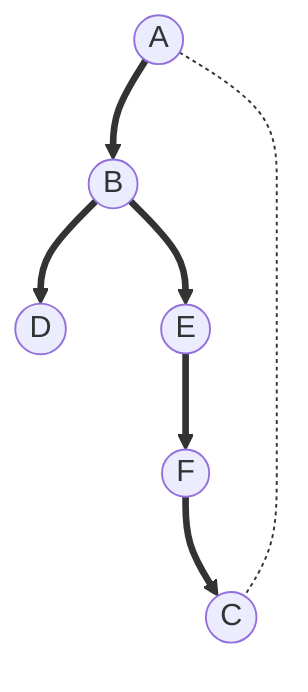
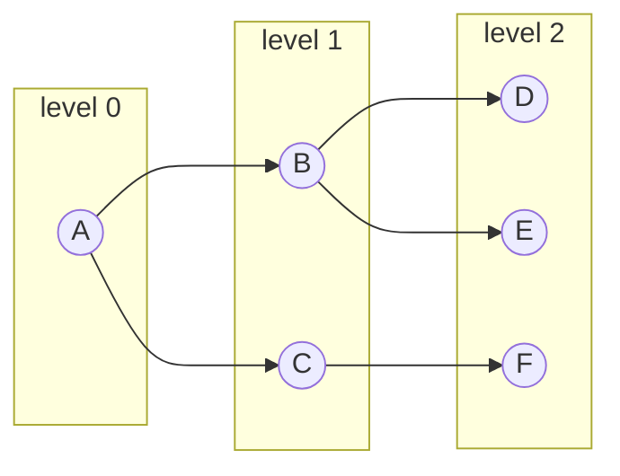
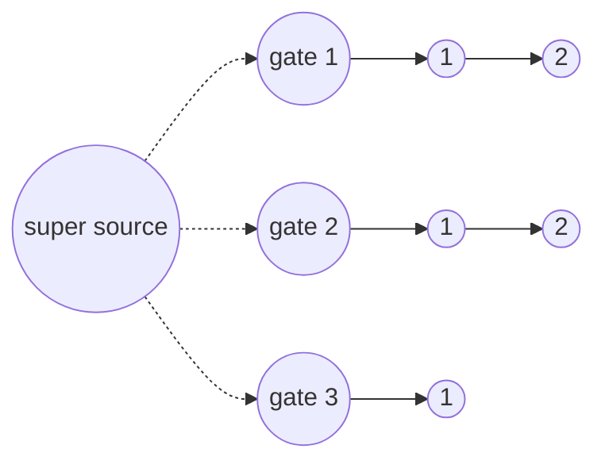
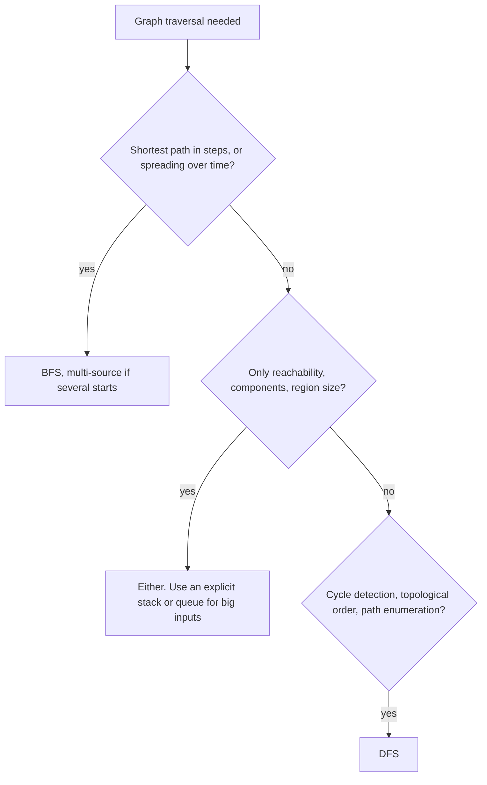

# DFS and BFS on grids and adjacency lists

## In plain words

To **traverse** a graph means to visit everything that can be reached from a starting point, in an
organised way. There are two classic ways to explore, and both are things you already do:

- **Depth-first search (DFS)** is how you explore a maze: follow one corridor as far as it goes; when
  you are stuck, walk back to the last junction and take the next corridor.
- **Breadth-first search (BFS)** is how a rumour spreads: first your friends hear it, then their
  friends, then *their* friends — in rings, one step farther out each time.

Why it matters for a job: "is A connected to B?", "what is the fewest number of clicks/hops/moves?",
"which accounts belong to the same person?" are everyday engineering questions, and almost every
other graph algorithm is one of these two searches with a little extra bookkeeping.

**Before this lesson:** read *Graphs and how to store them* (vertices, edges, adjacency lists, grids
as graphs). You also need two containers (track *DSA Foundations*): a **stack**, where the
last item put in is the first taken out (a pile of plates), and a **queue**, where the first item put
in is the first taken out (a line at a shop). Recursion is used for the first DFS examples.

## Traversal: the one skill everything else builds on

A **traversal** is a systematic procedure that visits every vertex reachable from a starting point,
examining every edge along the way. Almost every graph question — is it connected, how many pieces,
is there a path, what is the shortest path, is there a cycle — is answered by a traversal with a few
extra lines of bookkeeping.

There are two fundamental strategies, and they differ in a single decision: **which discovered vertex
do you expand next?**

| | depth-first search (DFS) | breadth-first search (BFS) |
|---|---|---|
| expands | the **most recently** discovered vertex | the **earliest** discovered vertex |
| frontier is a | stack (or the call stack) | queue |
| explores | one path as deep as possible, then backtracks | in rings of increasing distance |
| finds shortest paths? | no | **yes**, in unweighted graphs |
| typical uses | components, cycle detection, topological order, backtracking | fewest steps, level-by-level spreading |

Both visit each vertex once and each edge a constant number of times: $O(n + m)$ with an adjacency
list, $O(R \cdot C)$ on a grid.

The essential ingredient in both is the **visited set**. A tree traversal needs none, because a tree
has no cycles. In a general graph, without it you would walk around a cycle forever.

## Depth-first search

Think of exploring a maze with a ball of string and a piece of chalk. You walk forward, unrolling the
string and chalk-marking each junction. At a dead end — or a junction where every corridor leads to an
already-marked junction — you rewind the string to the previous junction and try another corridor.

```python-run
graph = {
    "A": ["B", "C"],
    "B": ["A", "D", "E"],
    "C": ["A", "F"],
    "D": ["B"],
    "E": ["B", "F"],
    "F": ["C", "E"],
}

def dfs(u, visited, depth=0):
    visited.add(u)
    print("  " * depth + u)
    for v in graph[u]:
        if v not in visited:
            dfs(v, visited, depth + 1)

dfs("A", set())
```



The thick arrows are the edges DFS used to discover new vertices; together they form the **DFS
tree**. The dotted edge A–C was examined when C was already visited — in an undirected graph such an
edge always connects a vertex to one of its ancestors and is called a **back edge**. A back edge is
proof of a cycle; we will lean on that in the next lesson.

Two facts from the textbook justify using DFS as a general tool. Starting a DFS at vertex $s$:

1. it visits **exactly** the vertices reachable from $s$ (the whole connected component, in an
   undirected graph);
2. the discovery edges form a spanning tree of that component.

### Iterative DFS with an explicit stack

Python's default recursion limit is 1000 frames. A DFS on a path-shaped graph of 10,000 vertices — or
a snake-shaped island in a 300 × 300 grid — recurses that deep and crashes with `RecursionError`. The
fix is to manage the stack yourself:

```python-run
def dfs_iterative(graph, start):
    visited = {start}
    stack = [start]
    order = []
    while stack:
        u = stack.pop()                 # LIFO: most recently discovered first
        order.append(u)
        for v in graph[u]:
            if v not in visited:
                visited.add(v)          # mark when PUSHED, so nothing is pushed twice
                stack.append(v)
    return order

graph = {"A": ["B", "C"], "B": ["A", "D", "E"], "C": ["A", "F"], "D": ["B"], "E": ["B", "F"], "F": ["C", "E"]}
print(dfs_iterative(graph, "A"))
```

The visiting order differs slightly from the recursive version (neighbours are popped in reverse),
but it is still a valid depth-first order, and for counting components or filling regions the order
is irrelevant.

> [!WARNING]
> You *can* raise the limit with `sys.setrecursionlimit(10**6)`, but very deep recursion can still
> overflow the real C stack and kill the interpreter. For grid problems with up to 10⁴–10⁵ cells,
> prefer an explicit stack or BFS.

## Breadth-first search

BFS explores in **levels**: first the start vertex (level 0), then everything one edge away (level 1),
then everything two edges away, and so on. A FIFO queue produces exactly that order.

```python-run
from collections import deque

def bfs(graph, start):
    dist = {start: 0}                   # doubles as the visited set
    q = deque([start])
    while q:
        u = q.popleft()                 # FIFO: earliest discovered first
        for v in graph[u]:
            if v not in dist:
                dist[v] = dist[u] + 1
                q.append(v)
    return dist

graph = {"A": ["B", "C"], "B": ["A", "D", "E"], "C": ["A", "F"], "D": ["B"], "E": ["B", "F"], "F": ["C", "E"]}
print(bfs(graph, "A"))
```



### Why BFS finds shortest paths

The key property: **a vertex at level $i$ is exactly $i$ edges from the start, and no path to it is
shorter.** The argument is an induction on levels. Vertices leave the queue in non-decreasing order of
level. When a vertex $v$ is first discovered, it is discovered from a vertex $u$ of the smallest level
that has an edge to $v$ — any neighbour on a lower level would have been dequeued earlier and would
have discovered $v$ first. So `dist[v] = dist[u] + 1` is minimal.

This holds only when every edge has the **same cost**. With unequal weights you need Dijkstra's
algorithm (lesson 9).

> [!TIP]
> "Minimum number of steps / moves / transformations / minutes" on an unweighted graph ⇒ **BFS**.
> DFS finds *a* path, not the shortest one.

### Level-by-level BFS

When you need to act on whole levels (count minutes, record depth), snapshot the queue length:

```python
steps = 0
while q:
    for _ in range(len(q)):      # exactly the vertices of the current level
        u = q.popleft()
        ...                      # push next-level vertices
    steps += 1
```

Storing the distance alongside each queue entry — `q.append((v, d + 1))` — is an equivalent alternative.

> [!WARNING]
> Use `collections.deque` and `popleft()`. `list.pop(0)` shifts every remaining element and silently
> turns an $O(n)$ BFS into $O(n^2)$.

### Recovering the path, not only its length

Remember, for each vertex, who discovered it; then walk the `parent` pointers backwards from the target.

```python-run
from collections import deque

def shortest_path(graph, s, t):
    parent = {s: None}
    q = deque([s])
    while q:
        u = q.popleft()
        if u == t:
            break
        for v in graph[u]:
            if v not in parent:
                parent[v] = u
                q.append(v)
    if t not in parent:
        return None
    path = []
    while t is not None:
        path.append(t)
        t = parent[t]
    return path[::-1]

graph = {"A": ["B", "C"], "B": ["A", "D", "E"], "C": ["A", "F"], "D": ["B"], "E": ["B", "F"], "F": ["C", "E"]}
print(shortest_path(graph, "D", "F"))
```

## Counting connected components

One traversal covers exactly one component. So: loop over all vertices; whenever you meet an unvisited
one, you have found a **new component** — count it and traverse from it.

```python-run
def count_components(n, edges):
    adj = [[] for _ in range(n)]
    for a, b in edges:
        adj[a].append(b)
        adj[b].append(a)
    seen = [False] * n
    count = 0
    for s in range(n):
        if seen[s]:
            continue
        count += 1                      # new component
        seen[s] = True
        stack = [s]
        while stack:
            u = stack.pop()
            for v in adj[u]:
                if not seen[v]:
                    seen[v] = True
                    stack.append(v)
    return count

print(count_components(5, [[0, 1], [1, 2], [3, 4]]))   # 2
print(count_components(4, []))                         # 4 isolated vertices
```

The outer loop is $O(n)$ and the traversals together touch each edge twice: $O(n + m)$ overall, *not*
$O(n \cdot (n + m))$, because the shared `seen` array guarantees no vertex is traversed twice.

## Grids: flood fill

On a grid the same loop is called **flood fill**. *Number of Islands* is literally "count connected
components of land cells":

```python-run
def num_islands(grid):
    R, C = len(grid), len(grid[0])
    seen = [[False] * C for _ in range(R)]
    islands = 0
    for sr in range(R):
        for sc in range(C):
            if grid[sr][sc] != "1" or seen[sr][sc]:
                continue
            islands += 1
            seen[sr][sc] = True
            stack = [(sr, sc)]
            while stack:
                r, c = stack.pop()
                for nr, nc in ((r + 1, c), (r - 1, c), (r, c + 1), (r, c - 1)):
                    if 0 <= nr < R and 0 <= nc < C and grid[nr][nc] == "1" and not seen[nr][nc]:
                        seen[nr][nc] = True
                        stack.append((nr, nc))
    return islands

grid = ["11000",
        "11000",
        "00100",
        "00011"]
print(num_islands([list(row) for row in grid]))   # 3
```

The four-part neighbour test is worth memorising in this order: **in bounds → passable → not visited**.
Checking bounds first prevents an `IndexError` (and prevents Python's negative indices from silently
wrapping around to the other side of the grid!).

Variations on the same skeleton:

| problem | change to the skeleton |
|---|---|
| Max Area of Island | count the cells popped during each fill; keep the maximum |
| Surrounded Regions | fill from **border** `O` cells only; whatever is left unfilled is captured |
| Pacific Atlantic | fill from each ocean's border, moving **uphill**; intersect the two visited sets |
| Clone Graph | the visited structure is a dict *old node → new node* |

> [!NOTE]
> **Mark-in-place.** Instead of a separate `seen` matrix you can overwrite visited cells (turn `"1"`
> into `"0"`, or `"O"` into a temporary `"S"`). It saves memory, but it mutates the caller's input —
> mention that trade-off in an interview.

### Clone Graph: the visited set as a map

```python-run
class Node:
    def __init__(self, val=0, neighbors=None):
        self.val = val
        self.neighbors = neighbors if neighbors is not None else []

def clone(node):
    if node is None:
        return None
    copies = {}
    def dfs(u):
        if u in copies:
            return copies[u]
        c = Node(u.val)
        copies[u] = c                    # register BEFORE recursing, or cycles recurse forever
        c.neighbors = [dfs(v) for v in u.neighbors]
        return c
    return dfs(node)

a, b, c = Node(1), Node(2), Node(3)
a.neighbors, b.neighbors, c.neighbors = [b, c], [a, c], [a, b]
a2 = clone(a)
print(a2.val, [x.val for x in a2.neighbors], "same object?", a2 is a)
print("cycle preserved:", a2.neighbors[0].neighbors[0] is a2)
```

## Multi-source BFS

Suppose a grid has several gates and you want each room's distance to its **nearest** gate
(*Walls and Gates*), or several rotten oranges infecting their neighbours every minute
(*Rotting Oranges*). Running one BFS per source costs $O(k \cdot RC)$.

The trick: **put all sources in the queue at distance 0 before starting.** The BFS then grows one
combined wavefront. It is exactly a single-source BFS from an imaginary "super source" joined to
every real source by a zero-length edge — so the first time any cell is reached, it is reached by its
closest source.



```python-run
from collections import deque

INF = 2147483647

def walls_and_gates(rooms):
    R, C = len(rooms), len(rooms[0])
    q = deque((r, c) for r in range(R) for c in range(C) if rooms[r][c] == 0)   # ALL gates
    while q:
        r, c = q.popleft()
        for nr, nc in ((r + 1, c), (r - 1, c), (r, c + 1), (r, c - 1)):
            if 0 <= nr < R and 0 <= nc < C and rooms[nr][nc] == INF:   # INF == "unvisited room"
                rooms[nr][nc] = rooms[r][c] + 1
                q.append((nr, nc))

rooms = [[INF, -1, 0, INF],
         [INF, INF, INF, -1],
         [INF, -1, INF, -1],
         [0, -1, INF, INF]]
walls_and_gates(rooms)
for row in rooms:
    print(row)
```

Each cell enters the queue once: $O(RC)$ total, regardless of how many gates there are.

*Rotting Oranges* uses the level-by-level form: every level is one minute, a counter of fresh oranges
tells you when to stop and whether any orange was unreachable.

```python-run
from collections import deque

def oranges_rotting(grid):
    grid = [row[:] for row in grid]
    R, C = len(grid), len(grid[0])
    q = deque((r, c) for r in range(R) for c in range(C) if grid[r][c] == 2)
    fresh = sum(row.count(1) for row in grid)
    minutes = 0
    while q and fresh:                       # stop as soon as nothing is fresh
        for _ in range(len(q)):
            r, c = q.popleft()
            for nr, nc in ((r + 1, c), (r - 1, c), (r, c + 1), (r, c - 1)):
                if 0 <= nr < R and 0 <= nc < C and grid[nr][nc] == 1:
                    grid[nr][nc] = 2
                    fresh -= 1
                    q.append((nr, nc))
        minutes += 1
    return minutes if fresh == 0 else -1

print(oranges_rotting([[2, 1, 1], [1, 1, 0], [0, 1, 1]]))   # 4
print(oranges_rotting([[2, 1, 1], [0, 1, 1], [1, 0, 1]]))   # -1
print(oranges_rotting([[0, 2]]))                            # 0
```

## Reverse the search

*Pacific Atlantic Water Flow* asks which cells can drain to both oceans. Simulating water from every
cell is $O((RC)^2)$. Instead ask the question backwards: *starting from the ocean, which cells could
have sent water here?* Walk **uphill** (to neighbours of equal or greater height) from each ocean's
border — two multi-source traversals — and intersect the results.

The general principle: **when many sources ask about reaching a few targets, search from the targets.**
*Surrounded Regions* is the same move — rather than testing each region for enclosure, start from the
border and mark everything that escapes.

## Searching an implicit graph: Word Ladder

The vertices are words; neighbours differ by one letter. BFS gives the shortest transformation. The
only difficulty is generating neighbours efficiently — index the words by wildcard pattern:

```python-run
from collections import defaultdict, deque

def ladder_length(begin, end, word_list):
    words = set(word_list)
    if end not in words:
        return 0
    buckets = defaultdict(list)
    for w in words | {begin}:
        for i in range(len(w)):
            buckets[w[:i] + "*" + w[i + 1:]].append(w)     # "hot" -> "*ot", "h*t", "ho*"
    seen = {begin}
    q = deque([(begin, 1)])
    while q:
        w, d = q.popleft()
        if w == end:
            return d
        for i in range(len(w)):
            for nb in buckets[w[:i] + "*" + w[i + 1:]]:
                if nb not in seen:
                    seen.add(nb)
                    q.append((nb, d + 1))
    return 0

print(ladder_length("hit", "cog", ["hot", "dot", "dog", "lot", "log", "cog"]))   # 5
```

## DFS or BFS? A decision guide



Memory can break ties: DFS holds one path (depth of the graph); BFS holds one frontier (width of the
graph). On a wide, shallow graph DFS is leaner; on a long, narrow one BFS is.

## Common pitfalls

1. **No visited set** (or marking too late). Mark a vertex when you **enqueue/push** it, not when you
   dequeue it — otherwise the same vertex is added many times.
2. **`list.pop(0)` as a queue.**
3. **Recursion depth** on large inputs.
4. **Bounds checks after indexing**, or negative indices wrapping around.
5. **Diagonals** — check whether the problem counts 4 or 8 neighbours.
6. **Strings vs. integers** in grids: `"1"` is not `1`.
7. **Forgetting unreachable vertices**: components need the outer loop; shortest-path answers need a
   "not found" case.
8. **Counting the last BFS level** when it did nothing (the off-by-one in *Rotting Oranges*).

## Summary

- DFS = stack, goes deep; BFS = queue, goes wide. Both $O(n + m)$.
- BFS computes shortest paths in **unweighted** graphs; keep `dist` or process level by level.
- One traversal = one connected component; loop over all vertices to count components / fill regions.
- Multi-source BFS: seed the queue with every source to get nearest-source distances in one pass.
- If a search from the sources is expensive, try searching from the targets.

## Glossary

| term | meaning |
|---|---|
| **Traversal** | a systematic visit of every vertex reachable from a start. |
| **Depth-first search (DFS)** | go as far as possible along one path, then step back and try another. |
| **Breadth-first search (BFS)** | visit all vertices one step away, then two steps away, and so on. |
| **Visited set** | the record of vertices already seen, which prevents going round in circles. |
| **Stack / queue** | last-in-first-out container / first-in-first-out container. |
| **Frontier** | the vertices discovered but not yet expanded. |
| **Level** | all vertices at the same number of steps from the start. |
| **Unweighted shortest path** | the path with the fewest edges. |
| **Connected component** | one 'island' of mutually reachable vertices. |
| **Flood fill** | a traversal that spreads over a region of a grid. |
| **Multi-source BFS** | a BFS started from several vertices at once. |
| **Recursion limit** | the maximum depth of nested function calls Python allows (1000 by default). |
| **Back edge** | an edge found during DFS that leads to an already visited ancestor; evidence of a cycle. |

```quiz
[
  {"q": "Which data structure turns the generic traversal into BFS?",
   "options": ["Stack", "FIFO queue", "Min-heap", "Hash set"], "answer": 1,
   "explain": "A queue expands vertices in the order they were discovered, producing levels of increasing distance."},
  {"q": "Why does BFS give shortest paths only in unweighted graphs?",
   "options": ["It visits fewer vertices", "It discovers vertices in order of number of edges from the start, which equals path cost only if all edges cost the same", "It uses less memory", "It doesn't use recursion"], "answer": 1,
   "explain": "BFS levels count edges. With unequal weights a path with more edges can be cheaper, which BFS cannot see."},
  {"q": "What is the time complexity of counting connected components with DFS on an adjacency list?",
   "options": ["O(n * m)", "O(n + m)", "O(n^2)", "O(m log n)"], "answer": 1,
   "explain": "The shared visited set ensures each vertex is expanded once and each edge examined at most twice."},
  {"q": "In multi-source BFS for Walls and Gates, why is the first value written to a room final?",
   "options": ["Rooms are processed in row order", "All gates start at distance 0, so the wavefront reaches each room first from its nearest gate", "Walls block longer paths", "The queue is sorted"], "answer": 1,
   "explain": "It is equivalent to BFS from a super-source connected to all gates; BFS reaches vertices in non-decreasing distance."},
  {"q": "A recursive DFS crashes with RecursionError on a 300 x 300 grid full of land. What is the best fix?",
   "options": ["Use a smaller grid", "Convert to an explicit stack or BFS", "Remove the visited set", "Use list.pop(0)"], "answer": 1,
   "explain": "The recursion can be 90,000 frames deep. An explicit stack or queue lives on the heap and has no such limit."},
  {"q": "When should a vertex be marked visited in BFS?",
   "options": ["When it is dequeued", "When it is enqueued", "After all its neighbours are processed", "It doesn't matter for efficiency"], "answer": 1,
   "explain": "Marking on enqueue prevents the same vertex from being added to the queue by several neighbours."},
  {"q": "Pacific Atlantic Water Flow is solved efficiently by...",
   "options": ["DFS downhill from every cell", "Two multi-source searches uphill from the ocean borders, then intersecting", "Sorting the cells by height", "Dijkstra from the centre"], "answer": 1,
   "explain": "Reversing the flow direction lets one traversal per ocean answer the question for all cells."},
  {"q": "In level-by-level BFS, what does `for _ in range(len(q))` accomplish?",
   "options": ["It sorts the queue", "It processes exactly the vertices of the current level before incrementing the step counter", "It avoids revisiting vertices", "It reverses the queue"], "answer": 1,
   "explain": "len(q) is evaluated once, before new vertices are appended, so the loop covers precisely one level."}
]
```

> **Source:** Goodrich, Tamassia & Goldwasser, *Data Structures and Algorithms in Python*, ch. 14,
> §14.3 (Graph Traversals: §14.3.1 depth-first search incl. Propositions 14.12–14.15, §14.3.2 DFS
> implementation and extensions — path reconstruction and connected components, §14.3.3
> breadth-first search incl. Propositions 14.16–14.17).
