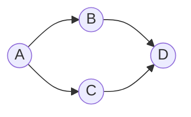
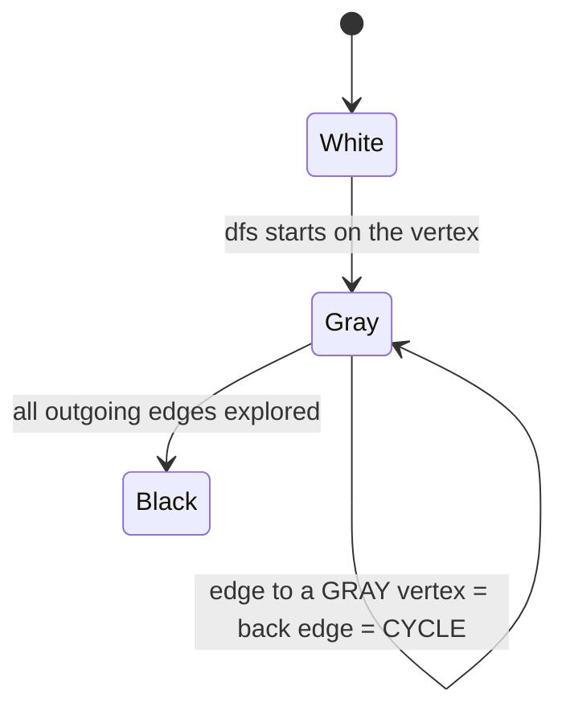
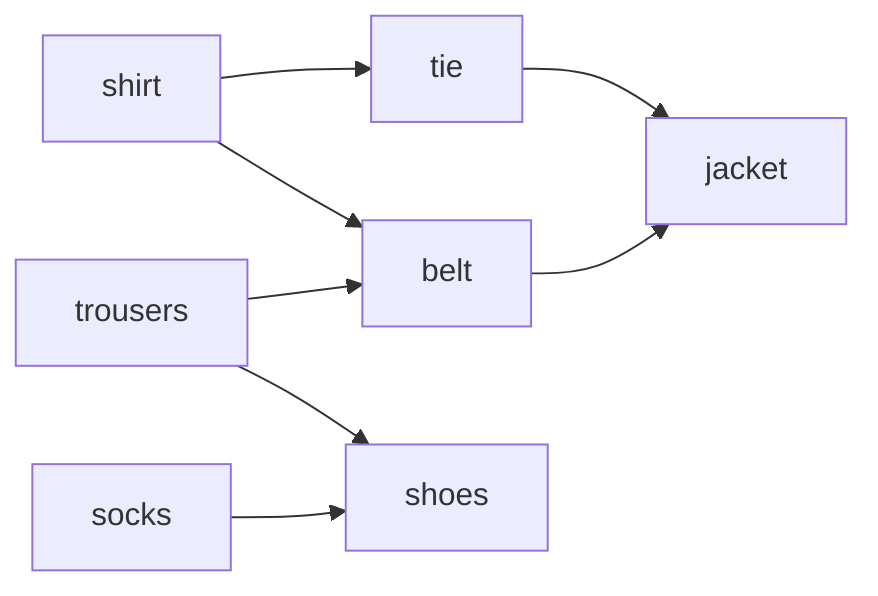

# Cycle detection and topological sort

## In plain words

Getting dressed has rules: socks before shoes, shirt before jacket. A **topological order** is any
order of doing things that respects all such "this before that" rules. Sometimes the rules contradict
each other — "A before B, B before C, C before A" — and then no order exists. A contradiction of that
kind is a **cycle**: following the rules leads you round in a circle back to where you began. This
lesson teaches how to detect a cycle and, when there is none, how to produce a valid order.

Why it matters for a job: build tools decide what to compile first, package managers decide what to
install first, spreadsheets decide which cell to recalculate first, and workflow systems (data
pipelines, CI/CD) decide which task to run first. All of them use exactly the algorithms below — and
all of them must report an error when dependencies are circular.

**Before this lesson:** read *Graphs and how to store them* (directed edges, in-degree, adjacency
lists) and *DFS and BFS on grids and adjacency lists* (recursive DFS, BFS with a queue, the visited
set).

Words used below: a **dependency** is a "must come first" relationship; **acyclic** means "has no
cycle"; **DAG** is short for *directed acyclic graph*.

## Two questions that are really one

- *Can I finish all my courses, given the prerequisite rules?*
- *In what order should I compile these modules, install these packages, run these tasks?*

Both are about **dependencies**. Draw each task as a vertex and each "X must come before Y" rule as a
directed edge X → Y. Then:

- a valid order exists **iff the graph has no directed cycle** (a cycle A → B → C → A means each of
  them must come before itself — impossible);
- any valid order is called a **topological order**.

So cycle detection and topological sorting are two sides of the same coin, and the algorithms that do
one do the other. This lesson covers cycle detection in undirected graphs, then in directed graphs, and
then the two standard topological sort algorithms: **Kahn's algorithm** (BFS on in-degrees) and the
**DFS post-order** method.

## Cycles in undirected graphs

### Method 1: DFS with a parent

During a DFS of an undirected graph, every edge you examine leads either to an unvisited vertex (a
*discovery* edge) or to a visited one. A visited neighbour is a cycle... **unless it is the
vertex you arrived from**, because each undirected edge appears in both adjacency lists.

```python-run
def has_cycle_undirected(n, edges):
    adj = [[] for _ in range(n)]
    for a, b in edges:
        adj[a].append(b)
        adj[b].append(a)
    seen = [False] * n

    def dfs(u, parent):
        seen[u] = True
        for v in adj[u]:
            if v == parent:
                continue              # the edge we arrived by is not a cycle
            if seen[v] or dfs(v, u):
                return True           # reached a visited vertex by a different edge
        return False

    return any(not seen[s] and dfs(s, -1) for s in range(n))

print(has_cycle_undirected(4, [[0, 1], [1, 2], [2, 3]]))          # False: a path
print(has_cycle_undirected(4, [[0, 1], [1, 2], [2, 0], [2, 3]]))  # True: triangle 0-1-2
```

> [!NOTE]
> The `v == parent` shortcut assumes no parallel edges. If the same pair can be joined by two
> different edges (which *is* a cycle), track the *edge id* you arrived by instead of the parent vertex.

### Method 2: count edges

For a **connected** undirected graph: it has a cycle iff $m > n - 1$. More generally, a graph with
$c$ components is a forest iff $m = n - c$.

### Method 3: union-find

Process edges one at a time; an edge whose endpoints are already in the same set closes a cycle. That
is the entire solution to *Redundant Connection*, and the subject of the next lesson.

### Application: Graph Valid Tree

A graph is a tree iff it is **connected and acyclic**. With exactly $n - 1$ edges, those two
properties imply each other, so the cheapest test is:

1. `len(edges) == n - 1`, and
2. *either* one traversal from vertex 0 reaches all `n` vertices, *or* no edge closes a cycle.

## Cycles in directed graphs: why "visited" is not enough

Try the undirected approach on this directed graph:



DFS from A goes A → B → D, backtracks, then A → C and sees that D is already visited. Is that a cycle?
**No** — there are two different routes to D (a "diamond"). A plain visited flag cannot tell
the difference between

- an edge to a vertex that is **still on the current DFS path** (a genuine cycle), and
- an edge to a vertex that was **finished earlier** (harmless).

### Three colours

Give every vertex one of three states:

| colour | meaning |
|---|---|
| **white** (0) | not discovered yet |
| **gray** (1) | discovered, still being explored — it is on the recursion stack |
| **black** (2) | completely finished — all descendants explored |



While exploring `u` (gray), an edge `u → v` is:

- to a **white** vertex → *tree edge*: recurse;
- to a **gray** vertex → ***back edge***: `v` is an ancestor of `u` on the current path, so the path
  from `v` down to `u` plus this edge is a **cycle**;
- to a **black** vertex → *forward or cross edge*: `v` and everything below it was fully explored
  without finding a way back to the current path. Safe to ignore.

**A directed graph has a cycle iff DFS finds a back edge.**

```python-run
def has_cycle_directed(n, edges):
    adj = [[] for _ in range(n)]
    for u, v in edges:
        adj[u].append(v)
    WHITE, GRAY, BLACK = 0, 1, 2
    color = [WHITE] * n

    def dfs(u):
        color[u] = GRAY
        for v in adj[u]:
            if color[v] == GRAY:                 # back edge
                return True
            if color[v] == WHITE and dfs(v):
                return True
        color[u] = BLACK
        return False

    return any(color[s] == WHITE and dfs(s) for s in range(n))

print("diamond: ", has_cycle_directed(4, [(0, 1), (0, 2), (1, 3), (2, 3)]))   # False
print("triangle:", has_cycle_directed(3, [(0, 1), (1, 2), (2, 0)]))           # True
```

This is one complete solution to *Course Schedule*: return `not has_cycle`.

> [!WARNING]
> The most common directed-cycle bug is using a single `visited` set and reporting a cycle whenever
> you meet a visited vertex. It gives false positives on diamonds. You need the *on the current path*
> state (gray) — or equivalently a separate `on_stack` set that you remove from when a vertex finishes.

## Topological order

A **topological order** of a directed graph is a listing $v_1, v_2, \dots, v_n$ of all vertices such
that every edge $(v_i, v_j)$ has $i < j$ — all arrows point "forward".



One valid order: *shirt, tie, trousers, belt, jacket, socks, shoes*. Another: *socks, trousers,
shirt, belt, tie, jacket, shoes*. Topological orders are generally **not unique**.

**Theorem.** A directed graph has a topological order **if and only if it is acyclic** (a DAG).

*Why "only if":* if there were a cycle, whichever of its vertices comes first in the order has an
edge arriving from a later vertex — a backward arrow. *Why "if":* a DAG must contain a vertex with
in-degree 0 (otherwise you could walk backwards along incoming edges forever, and with finitely many
vertices you would eventually repeat one — a cycle). Put that vertex first, delete it, and what
remains is still a DAG; repeat. That constructive argument *is* Kahn's algorithm.

## Kahn's algorithm (BFS on in-degrees)

1. Compute the in-degree of every vertex.
2. Put every vertex with in-degree 0 into a queue — these have no unmet prerequisites.
3. Repeatedly remove a vertex `u` from the queue, append it to the order, and "delete" its outgoing
   edges by decrementing the in-degree of each neighbour. Any neighbour that drops to 0 becomes ready:
   enqueue it.
4. If the order contains all `n` vertices, it is a topological order. If not, the vertices left over
   all have positive in-degree forever — **the graph has a cycle**.

```python-run
from collections import deque

def topo_kahn(n, edges):
    adj = [[] for _ in range(n)]
    indeg = [0] * n
    for u, v in edges:              # u -> v : u must come before v
        adj[u].append(v)
        indeg[v] += 1
    q = deque(i for i in range(n) if indeg[i] == 0)
    order = []
    while q:
        u = q.popleft()
        order.append(u)
        for v in adj[u]:
            indeg[v] -= 1
            if indeg[v] == 0:
                q.append(v)
        print(f"take {u}: in-degrees {indeg}, queue {list(q)}")
    return order if len(order) == n else []      # [] signals a cycle

print(topo_kahn(6, [(5, 2), (5, 0), (4, 0), (4, 1), (2, 3), (3, 1)]))
print("with a cycle:", topo_kahn(3, [(0, 1), (1, 2), (2, 1)]))
```

Every vertex is enqueued at most once and every edge is examined once: $O(n + m)$ time, $O(n)$ extra
space.

### Applying it to Course Schedule

The input pair `[a, b]` means "`b` before `a`", so the edge is **`b → a`**: `adj[b].append(a)` and
`indeg[a] += 1`. For *Course Schedule* return `len(order) == numCourses`; for *Course Schedule II*
return the order itself (or `[]`).

> [!INTERVIEW]
> Kahn's algorithm is the safest choice in a Python interview: it is iterative (no recursion-limit
> risk on a 2,000-course chain), it detects cycles for free, and small modifications answer common
> follow-ups — a **min-heap** instead of a queue yields the lexicographically smallest order;
> processing the queue **level by level** yields the minimum number of semesters; checking that the
> queue never holds more than one vertex tells you whether the order is **unique**.

## Topological sort by DFS post-order

The second method falls straight out of the three-colour DFS. A vertex turns black only after
everything reachable from it is black. So if there is an edge `u → v` in a DAG, **`v` finishes before
`u`**. Listing vertices in order of *finishing time* therefore puts every vertex *after* its
successors — a reversed topological order. Reverse the list and you're done.

```python-run
def topo_dfs(n, edges):
    adj = [[] for _ in range(n)]
    for u, v in edges:
        adj[u].append(v)
    color = [0] * n                 # 0 white, 1 gray, 2 black
    post = []
    def dfs(u):
        color[u] = 1
        for v in adj[u]:
            if color[v] == 1:
                return False        # back edge: cycle
            if color[v] == 0 and not dfs(v):
                return False
        color[u] = 2
        post.append(u)              # record on FINISH
        return True
    for s in range(n):
        if color[s] == 0 and not dfs(s):
            return []
    return post[::-1]

print(topo_dfs(6, [(5, 2), (5, 0), (4, 0), (4, 1), (2, 3), (3, 1)]))
```

A handy shortcut: if you build the graph with edges pointing from a task **to its prerequisites**
(`course → prerequisite`), the post-order itself — without reversing — is a valid order, because a
course is appended only after all its prerequisites have been.

| | Kahn (BFS) | DFS post-order |
|---|---|---|
| idea | repeatedly remove a vertex with no incoming edges | a vertex finishes after all its successors |
| cycle detection | fewer than `n` vertices output | a gray → gray edge |
| recursion | none | yes (depth up to `n`) |
| natural extras | levels, smallest-lexicographic order, uniqueness test | finishing times, strongly connected components |
| complexity | $O(n + m)$ | $O(n + m)$ |

## Worked example: Alien Dictionary

*Given words sorted in an unknown alphabet, recover the alphabet.* This is topological sort where the
hard part is **building the graph**:

- Vertices: every distinct letter that appears.
- Edges: compare each **adjacent** pair of words; at the **first** position where they differ,
  the earlier word's letter precedes the later word's letter. Nothing after that position carries
  information.
- Invalid input: if no position differs and the first word is longer (`"abc"` before `"ab"`), no
  alphabet can make the list sorted.

```python-run
from collections import deque

def alien_order(words):
    adj = {ch: set() for w in words for ch in w}       # every letter is a vertex
    indeg = {ch: 0 for ch in adj}
    for w1, w2 in zip(words, words[1:]):
        for a, b in zip(w1, w2):
            if a != b:
                if b not in adj[a]:                    # don't double-count a repeated edge
                    adj[a].add(b)
                    indeg[b] += 1
                break
        else:                                          # no difference found
            if len(w1) > len(w2):
                return ""
    q = deque(ch for ch in adj if indeg[ch] == 0)
    out = []
    while q:
        ch = q.popleft()
        out.append(ch)
        for nb in adj[ch]:
            indeg[nb] -= 1
            if indeg[nb] == 0:
                q.append(nb)
    return "".join(out) if len(out) == len(adj) else ""

print(alien_order(["wrt", "wrf", "er", "ett", "rftt"]))   # wertf
print(repr(alien_order(["z", "x", "z"])))                 # '' (cycle)
print(repr(alien_order(["abc", "ab"])))                   # '' (prefix violation)
```

## Common pitfalls

1. **Edge direction.** `[a, b]` = "b before a" → edge `b → a`. Reversing it still detects cycles
   correctly but produces a backwards order.
2. **Using one visited set for directed cycle detection** (false positives on diamonds).
3. **Treating the parent edge as a cycle** in an undirected DFS.
4. **Forgetting vertices with no edges** — they must still appear in the order.
5. **Double-counting in-degree for duplicate edges** when edges are stored in sets.
6. **Returning a partial order** when a cycle exists instead of the required empty result.
7. **Deep recursion** in the DFS method for long chains.

## Summary

- Undirected cycle: DFS finds a visited neighbour other than the parent; or union-find finds an edge
  inside one set; or count the edges.
- Directed cycle: three-colour DFS finds an edge to a **gray** vertex (back edge).
- A topological order exists iff the graph is a DAG.
- **Kahn:** in-degrees + queue; output shorter than `n` ⇒ cycle.
- **DFS:** append on finish, reverse.
- Both run in $O(n + m)$.

## Glossary

| term | meaning |
|---|---|
| **Cycle** | a path that starts and ends at the same vertex. |
| **Directed acyclic graph (DAG)** | a graph with one-way edges and no directed cycle. |
| **Dependency** | a requirement that one item comes before another. |
| **Topological order** | an ordering of all vertices in which every edge points from earlier to later. |
| **In-degree** | the number of edges arriving at a vertex — its count of unmet prerequisites. |
| **Kahn's algorithm** | repeatedly output a vertex with in-degree 0 and remove its outgoing edges. |
| **White / gray / black** | DFS states: not yet seen / currently being explored / completely finished. |
| **Back edge** | an edge to a gray vertex (an ancestor on the current path); it proves a cycle. |
| **Post-order** | recording a vertex after everything reachable from it has been processed. |
| **Diamond** | two different routes leading to the same vertex; not a cycle. |
| **Parent (in DFS)** | the vertex from which the current vertex was reached. |

```quiz
[
  {"q": "In a three-colour DFS of a directed graph, which discovery proves that a cycle exists?",
   "options": ["An edge to a white vertex", "An edge to a gray vertex", "An edge to a black vertex", "A vertex with in-degree 0"], "answer": 1,
   "explain": "A gray vertex is on the current recursion path, so an edge to it closes a loop back to an ancestor."},
  {"q": "Why can't a single visited set detect cycles in a directed graph?",
   "options": ["Sets are too slow", "Reaching an already-finished vertex by a second route (a diamond) is not a cycle", "Directed graphs have no cycles", "It can, there is no problem"], "answer": 1,
   "explain": "Visited does not distinguish 'on the current path' from 'finished earlier'; only the former indicates a cycle."},
  {"q": "Kahn's algorithm finishes with 7 vertices in its output for a graph with 10 vertices. What does that mean?",
   "options": ["The graph is disconnected", "The graph contains a cycle", "Three vertices have no edges", "The algorithm has a bug"], "answer": 1,
   "explain": "Vertices on or downstream of a cycle never reach in-degree 0, so they are never output."},
  {"q": "prerequisites = [[1, 0]] means course 0 must be taken before course 1. Which bookkeeping is correct for Kahn's algorithm?",
   "options": ["adj[1].append(0); indeg[0] += 1", "adj[0].append(1); indeg[1] += 1", "adj[0].append(1); indeg[0] += 1", "adj[1].append(0); indeg[1] += 1"], "answer": 1,
   "explain": "The edge goes from the prerequisite (0) to the dependent course (1); course 1 gains an incoming edge."},
  {"q": "In the DFS method, when is a vertex appended to the result list?",
   "options": ["When first discovered", "When it finishes (all descendants explored), and the list is reversed at the end", "When its in-degree is 0", "When it is popped from the queue"], "answer": 1,
   "explain": "A vertex finishes after all vertices reachable from it, so reverse finishing order is a topological order."},
  {"q": "How many topological orders does the graph with edges A->B and A->C (3 vertices) have?",
   "options": ["1", "2", "3", "6"], "answer": 1,
   "explain": "A must be first; B and C can follow in either order: ABC and ACB."},
  {"q": "In Alien Dictionary, the adjacent words 'wrt' and 'wrf' yield which information?",
   "options": ["w < r", "r < t", "t < f", "w < f"], "answer": 2,
   "explain": "Only the first differing position matters: index 2, where t (earlier word) precedes f."},
  {"q": "An undirected DFS reaches a neighbour that is already visited. When is this NOT evidence of a cycle?",
   "options": ["When the neighbour is the vertex we arrived from", "When the neighbour has degree 1", "When the graph is connected", "Never: it is always a cycle"], "answer": 0,
   "explain": "Each undirected edge appears in both adjacency lists, so the parent always shows up as a visited neighbour."}
]
```

> **Source:** Goodrich, Tamassia & Goldwasser, *Data Structures and Algorithms in Python*, ch. 14,
> §14.3.1 (DFS edge classification — discovery, back, forward and cross edges; Propositions
> 14.12–14.13), §14.3.2 (testing for cycles with DFS) and §14.5 (Directed Acyclic Graphs, §14.5.1
> Topological Ordering, Propositions 14.21–14.22).
