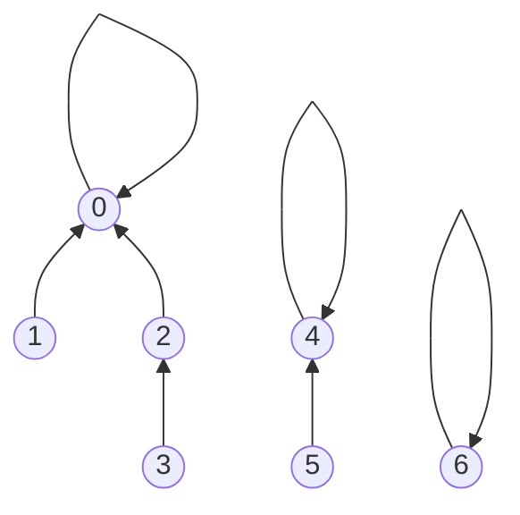
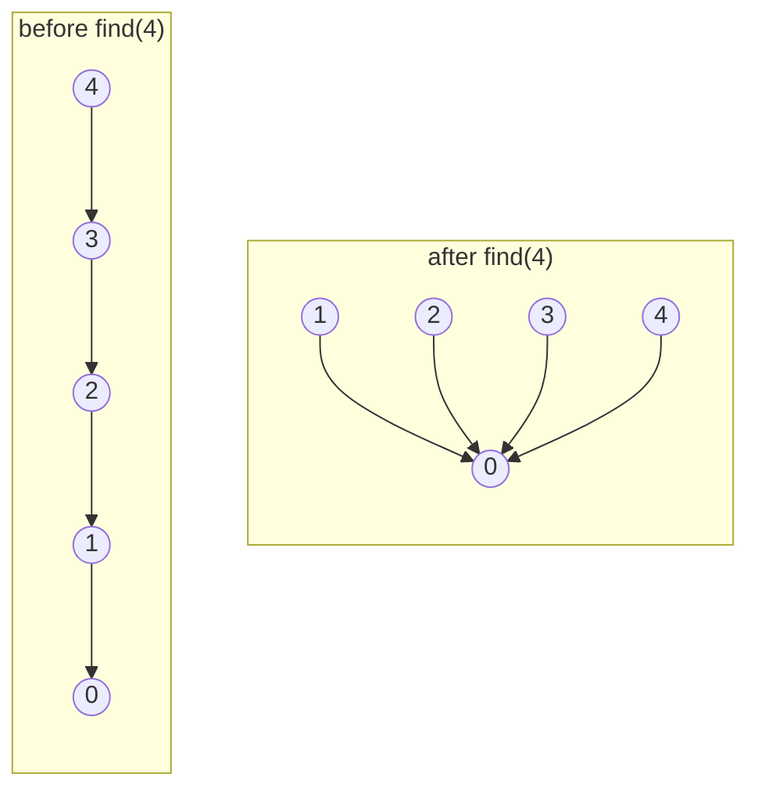
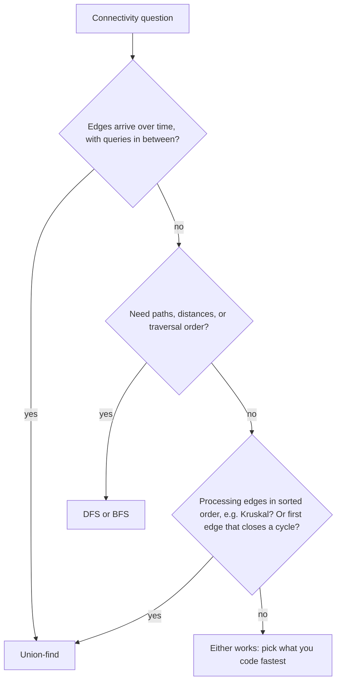

# Union-find (disjoint sets)

## In plain words

**Union-find** keeps track of which things belong to the same group while groups keep merging.
Imagine a party where strangers gradually discover they belong to the same extended family. Each
family picks one **representative**. To check whether two guests are related, ask each "who is your
family's representative?" — the same name means the same family. When two families discover a
connection, one representative agrees to report to the other, and the two families become one.

Why it matters for a job: detecting which computers are on the same network, merging duplicate
customer accounts, grouping pixels into regions in image processing, and building the cheapest
network that connects every site (next module) all rely on this structure. It is short to write and
extremely fast, which makes it a favourite in interviews.

**Before this lesson:** read *Graphs and how to store them* (edges, connected components, cycles) and
*DFS and BFS on grids and adjacency lists* (counting components by traversal — union-find is the
alternative). Python lists and `while` loops are all the code you need.

Words used below: two sets are **disjoint** when they share no element; **amortised** time means the
average cost per operation over a long sequence of operations.

## The problem union-find solves

Imagine edges arriving one at a time — friendships being formed, cables being laid, land cells
appearing in an ocean — and, in between, questions of the form:

> *Are `a` and `b` in the same group right now?*

You could answer each question with a DFS/BFS in $O(n + m)$. But if there are as many questions as
edges, that is $O(m \cdot (n + m))$ — far too slow. Graph traversals are great when the graph is
**static** and you ask once. They are poor at **dynamic connectivity**, where the graph grows and
queries are interleaved with updates.

The **union-find** data structure (also called a *disjoint-set union*, DSU, or in the textbook a
*partition*) is built for exactly this. It maintains a collection of disjoint groups and supports
two operations:

| operation | meaning |
|---|---|
| `find(x)` | return a canonical **representative** (the "leader") of the group containing `x` |
| `union(a, b)` | merge the group containing `a` with the group containing `b` |

Two elements are in the same group iff `find(a) == find(b)`. With two simple optimisations, both
operations run in *effectively constant* amortised time.

The one thing union-find **cannot** do is split a group — edges can be added but never removed.

## Idea: a forest of parent pointers

Each group is stored as a tree. Every element has a `parent` pointer; the root of a tree points to
itself and serves as the group's representative.



Three groups: `{0, 1, 2, 3}` with representative 0, `{4, 5}` with representative 4, and `{6}`.

- `find(x)`: follow parent pointers until you reach a root.
- `union(a, b)`: find both roots; if they differ, make one root the child of the other.

All the data lives in one array: `parent[i]` is the parent of element `i`.

```python-run
class NaiveDSU:
    def __init__(self, n):
        self.parent = list(range(n))        # everyone starts as their own root

    def find(self, x):
        while self.parent[x] != x:
            x = self.parent[x]
        return x

    def union(self, a, b):
        ra, rb = self.find(a), self.find(b)
        if ra == rb:
            return False                    # already together
        self.parent[ra] = rb                # hang one ROOT under the other ROOT
        return True

d = NaiveDSU(7)
for a, b in [(0, 1), (2, 3), (1, 3), (4, 5)]:
    d.union(a, b)
print("parent array:", d.parent)
print("0 and 2 connected?", d.find(0) == d.find(2))
print("0 and 4 connected?", d.find(0) == d.find(4))
```

> [!WARNING]
> `union` must link **roots**, not the elements themselves. Writing `parent[a] = b` when `a` is not a
> root detaches `a` from the rest of its group and silently corrupts the structure.

### The weakness: tall trees

Nothing stops the naive version from building a long chain. `union(0,1), union(1,2), union(2,3), ...`
with the linking rule above can produce a tree that is a path of length $n$, making `find` $O(n)$.

```python-run
def chain_depth(n):
    parent = list(range(n))
    def find(x):
        steps = 0
        while parent[x] != x:
            x = parent[x]; steps += 1
        return x, steps
    for i in range(n - 1):
        ra, _ = find(0)            # root of the growing group
        parent[ra] = i + 1         # ...is hung under the newcomer: the chain grows by one
    return find(0)[1]

print("steps for find(0) after 1000 unions:", chain_depth(1000))
```

Two independent optimisations fix this.

## Optimisation 1 — Union by rank (or size)

When merging two trees, **attach the shorter tree under the root of the taller one**. The combined
height then only grows when the two trees had equal height.

Track for each root either

- its **rank** — an upper bound on the height of its tree, or
- its **size** — the number of elements in its tree (attach the smaller under the larger).

Both give the same guarantee: a tree of height $h$ contains at least $2^h$ elements, so
**height ≤ $\log_2 n$** and `find` is $O(\log n)$ in the worst case.

*Why:* an element's depth increases by one only when its tree is merged into a tree that is at least
as large — so the size of its tree at least doubles each time. A tree can double at most $\log_2 n$
times before it contains everything.

The textbook describes the size variant ("union-by-size"); interview solutions use either. Size has
the bonus that you can report component sizes for free.

## Optimisation 2 — Path compression

`find(x)` walks from `x` up to the root. Having done that work, **don't waste it**: re-point every
vertex on the path directly at the root, so the next `find` on any of them takes a single step.



Two common ways to write it:

```python
# full compression, recursive (two passes: up to find the root, back down re-pointing)
def find(x):
    if parent[x] != x:
        parent[x] = find(parent[x])
    return parent[x]

# path halving, iterative (one pass: every node skips to its grandparent)
def find(x):
    while parent[x] != x:
        parent[x] = parent[parent[x]]
        x = parent[x]
    return x
```

Path halving has the same asymptotic guarantee, needs no recursion (no recursion-limit worries in
Python), and is one line longer than the naive loop. It is the version used in this track's solutions.

## The full structure

```python-run
class DSU:
    def __init__(self, n):
        self.parent = list(range(n))
        self.rank = [0] * n
        self.size = [1] * n
        self.components = n

    def find(self, x):
        while self.parent[x] != x:
            self.parent[x] = self.parent[self.parent[x]]   # path halving
            x = self.parent[x]
        return x

    def union(self, a, b):
        ra, rb = self.find(a), self.find(b)
        if ra == rb:
            return False                    # edge inside one component => it would close a cycle
        if self.rank[ra] < self.rank[rb]:   # make ra the taller root
            ra, rb = rb, ra
        self.parent[rb] = ra
        self.size[ra] += self.size[rb]
        if self.rank[ra] == self.rank[rb]:
            self.rank[ra] += 1
        self.components -= 1
        return True

    def connected(self, a, b):
        return self.find(a) == self.find(b)

d = DSU(8)
for a, b in [(0, 1), (2, 3), (0, 2), (4, 5), (6, 7), (4, 6), (3, 1)]:
    merged = d.union(a, b)
    print(f"union({a},{b}) -> {'merged' if merged else 'already connected (cycle!)':<28} components={d.components}")
print("size of 0's group:", d.size[d.find(0)], "| 0~3:", d.connected(0, 3), "| 0~7:", d.connected(0, 7))
```

Notice the three "free" by-products, each of which is the core of a problem in this module:

| by-product | how | problem |
|---|---|---|
| number of components | start at `n`, decrement on every successful union | *Number of Connected Components* |
| cycle detection | `union` returns `False` | *Redundant Connection*, *Graph Valid Tree* |
| component size | `size[find(x)]` | *Max Area of Island* variants, *Accounts Merge* |

### How fast is it?

With **both** optimisations, any sequence of $k$ operations on $n$ elements takes
$O(k \cdot \alpha(n))$ time, where $\alpha$ is the *inverse Ackermann function* — a function that
grows so slowly that $\alpha(n) \le 4$ for any $n$ you could ever store in a computer. The textbook
states the slightly weaker (and easier to prove) bound $O(k \log^* n)$, where $\log^* n$ is the number
of times you must take a logarithm before the value drops to 1; $\log^*$ of $2^{65536}$ is 5.

In practice: **treat `find` and `union` as $O(1)$ amortised.**

| variant | worst case per operation |
|---|---|
| naive | $O(n)$ |
| union by rank/size only | $O(\log n)$ |
| path compression only | $O(\log n)$ amortised |
| both | $O(\alpha(n))$ amortised ≈ constant |

```python-run
import random, time

def run(n, use_rank, use_compress):
    parent, rank = list(range(n)), [0] * n
    steps = 0
    def find(x):
        nonlocal steps
        while parent[x] != x:
            if use_compress:
                parent[x] = parent[parent[x]]
            x = parent[x]; steps += 1
        return x
    for i in range(n - 1):                 # adversarial-ish: keep attaching to a growing chain
        ra, rb = find(i), find(i + 1)
        if use_rank:
            if rank[ra] < rank[rb]: ra, rb = rb, ra
            parent[rb] = ra
            rank[ra] += rank[ra] == rank[rb]
        else:
            parent[ra] = rb
    rng = random.Random(0)
    for _ in range(n):
        find(rng.randrange(n))
    return steps

n = 3000
for rank_on, comp_on in [(False, False), (True, False), (False, True), (True, True)]:
    print(f"rank={rank_on!s:<5} compression={comp_on!s:<5} pointer steps: {run(n, rank_on, comp_on):>9}")
```

## Worked problems

### Number of connected components

```python-run
def count_components(n, edges):
    parent = list(range(n))
    def find(x):
        while parent[x] != x:
            parent[x] = parent[parent[x]]
            x = parent[x]
        return x
    comps = n
    for a, b in edges:
        ra, rb = find(a), find(b)
        if ra != rb:
            parent[ra] = rb
            comps -= 1
    return comps

print(count_components(5, [[0, 1], [1, 2], [3, 4]]))           # 2
print(count_components(5, [[0, 1], [1, 2], [2, 0], [3, 4]]))   # 2 (the cycle edge changes nothing)
```

(For brevity this version omits union by rank; with path compression alone it is still fast enough
for interview-sized inputs. Add rank when you want the full guarantee.)

### Redundant connection

A tree plus one extra edge. Feed the edges to union-find in order; the first edge whose endpoints
already share a root is the one that closes the cycle — and since every other edge of the cycle came
before it, it is also the *last* cycle edge in the input, which is what the problem asks for.

```python-run
def find_redundant(edges):
    parent = list(range(len(edges) + 1))      # labels are 1..n
    def find(x):
        while parent[x] != x:
            parent[x] = parent[parent[x]]
            x = parent[x]
        return x
    for a, b in edges:
        ra, rb = find(a), find(b)
        if ra == rb:
            return [a, b]
        parent[ra] = rb

print(find_redundant([[1, 2], [1, 3], [2, 3]]))                    # [2, 3]
print(find_redundant([[1, 2], [2, 3], [3, 4], [1, 4], [1, 5]]))    # [1, 4]
```

### Graph valid tree

`n` vertices form a tree iff there are exactly `n - 1` edges and no edge closes a cycle. (Then the
graph is automatically connected: an acyclic graph with $c$ components has $n - c$ edges, so
$n - 1$ edges force $c = 1$.)

```python-run
def valid_tree(n, edges):
    if len(edges) != n - 1:
        return False
    parent = list(range(n))
    def find(x):
        while parent[x] != x:
            parent[x] = parent[parent[x]]
            x = parent[x]
        return x
    for a, b in edges:
        ra, rb = find(a), find(b)
        if ra == rb:
            return False
        parent[ra] = rb
    return True

print(valid_tree(5, [[0, 1], [0, 2], [0, 3], [1, 4]]))            # True
print(valid_tree(5, [[0, 1], [1, 2], [2, 3], [1, 3], [1, 4]]))    # False (5 edges)
print(valid_tree(4, [[0, 1], [2, 3]]))                            # False (disconnected)
```

## Union-find on things that aren't integers

- **Grid cells**: flatten `(r, c)` to `r * C + c`.
- **Strings / arbitrary keys**: use a dict for `parent` and create entries lazily
  (`parent.setdefault(x, x)`).
- **Virtual nodes**: add an extra element to stand for a concept — e.g. one "border" node unioned with
  every border cell in *Surrounded Regions*, or a "water source" node in *Optimize Water Distribution*.
  Then "connected to the border" becomes a single `find` comparison.

```python-run
parent = {}
def find(x):
    parent.setdefault(x, x)
    while parent[x] != x:
        parent[x] = parent[parent[x]]
        x = parent[x]
    return x
def union(a, b):
    parent[find(a)] = find(b)

for a, b in [("alice@x.com", "al@y.org"), ("bob@z.net", "bobby@z.net"), ("al@y.org", "a.smith@w.io")]:
    union(a, b)
print(find("alice@x.com") == find("a.smith@w.io"), find("alice@x.com") == find("bob@z.net"))
```

## Union-find or DFS/BFS?



| | union-find | DFS / BFS |
|---|---|---|
| static components count | ✔ $O(m\,\alpha(n))$ | ✔ $O(n + m)$ |
| incremental edges + queries | ✔ near $O(1)$ each | ✘ re-traverse every time |
| which edge closes a cycle | ✔ natural | awkward |
| shortest path / actual path | ✘ | ✔ BFS |
| directed graphs (cycles, order) | ✘ (union-find ignores direction) | ✔ |
| edge deletions | ✘ | ✔ (run it again) |
| needs adjacency list | no — works straight from the edge list | yes |

> [!INTERVIEW]
> Union-find detects cycles only in **undirected** graphs. For *Course Schedule* (directed) the edge
> `a → b` and `b → c` and `a → c` form no directed cycle, yet union-find would report one. Use
> topological sort there.

## Common pitfalls

1. **Linking non-roots** (`parent[a] = b`).
2. **Comparing `parent[a] == parent[b]`** instead of `find(a) == find(b)` — parents are only roots
   right after compression.
3. **Counting components by `len(set(parent))`** without calling `find` on every element first.
4. **Off-by-one sizing** with 1-indexed labels — allocate `n + 1`.
5. **Recursive `find`** on a long chain before any compression has happened → recursion limit. Use
   the iterative path-halving loop.
6. **Using it for directed reachability.**

## Summary

- Union-find maintains disjoint groups under `find` (who is my representative?) and `union` (merge).
- Stored as a forest in a `parent` array; a root is its own parent.
- **Union by rank/size** keeps trees shallow ($O(\log n)$); **path compression** flattens them as you
  search; together they give $O(\alpha(n))$ ≈ constant amortised time.
- By-products: component count, cycle detection (union returns `False`), component sizes.
- It is the engine of **Kruskal's** minimum-spanning-tree algorithm (lesson 10).

## Glossary

| term | meaning |
|---|---|
| **Disjoint sets** | groups that have no element in common. |
| **Union-find / disjoint-set union (DSU)** | the data structure that maintains such groups under merging. |
| **Representative (root)** | the one element that stands for its whole group. |
| **find(x)** | returns the representative of x's group. |
| **union(a, b)** | merges the groups containing a and b. |
| **Parent array** | `parent[i]` is the element that i points to; a root points to itself. |
| **Union by rank / by size** | attaching the shorter / smaller tree under the other one to keep trees shallow. |
| **Rank** | an upper bound on the height of a tree in the forest. |
| **Path compression** | re-pointing elements closer to the root while performing a find. |
| **Dynamic connectivity** | answering 'are these connected?' while new connections keep being added. |
| **Inverse Ackermann function α(n)** | an extremely slowly growing function; at most 4 for any realistic n. |
| **Amortised time** | average cost per operation across a whole sequence. |

```quiz
[
  {"q": "What does find(x) return?",
   "options": ["The parent of x", "The root (representative) of the tree containing x", "The size of x's group", "True if x is connected"], "answer": 1,
   "explain": "find follows parent pointers up to the root, which identifies the whole group."},
  {"q": "In union(a, b), which nodes are linked?",
   "options": ["a is made a child of b", "The root of one tree is made a child of the root of the other", "All nodes of a's group are re-pointed to b", "b's parent is set to a's parent"], "answer": 1,
   "explain": "Only roots are linked; linking non-root nodes would tear a tree apart."},
  {"q": "With union by rank alone (no path compression), what bounds the cost of find?",
   "options": ["O(1)", "O(log n)", "O(sqrt n)", "O(n)"], "answer": 1,
   "explain": "A tree of height h built with union by rank has at least 2^h nodes, so height is at most log2 n."},
  {"q": "What does path compression do?",
   "options": ["Sorts the parent array", "Re-points nodes visited during find closer to (or directly at) the root", "Removes duplicate edges", "Merges the two smallest groups"], "answer": 1,
   "explain": "It shortens future searches for every node on the traversed path."},
  {"q": "Processing undirected edges in order, union(a, b) discovers find(a) == find(b). What does that tell you?",
   "options": ["a and b are the same vertex", "The edge (a, b) would create a cycle", "The graph is disconnected", "The graph is a tree"], "answer": 1,
   "explain": "a and b are already joined by a path; adding a direct edge closes a cycle."},
  {"q": "You start with n = 10 singleton groups and perform 6 unions, 2 of which return False. How many groups remain?",
   "options": ["4", "6", "8", "10"], "answer": 1,
   "explain": "Only successful unions reduce the count: 10 - 4 = 6."},
  {"q": "Which task is union-find NOT suited for?",
   "options": ["Counting connected components", "Finding the first edge that closes a cycle in an undirected graph", "Finding the shortest path between two vertices", "Kruskal's MST algorithm"], "answer": 2,
   "explain": "Union-find knows whether two vertices are connected, not by what path or at what distance; use BFS/Dijkstra."},
  {"q": "With both union by rank and path compression, the amortised cost per operation is...",
   "options": ["O(log n)", "O(alpha(n)), effectively constant", "O(n)", "O(n log n)"], "answer": 1,
   "explain": "The inverse Ackermann function alpha(n) is at most 4 for all practical n."}
]
```

> **Source:** Goodrich, Tamassia & Goldwasser, *Data Structures and Algorithms in Python*, ch. 14,
> §14.7.3 (Disjoint Partitions and Union-Find Structures: sequence-based partition, tree-based
> partition, union-by-size and path compression, Propositions 14.26–14.27 and Code Fragment 14.19).
