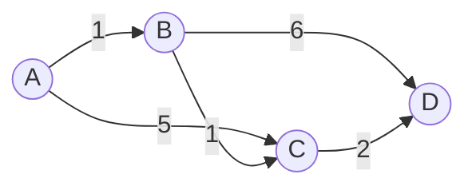
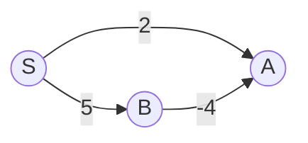
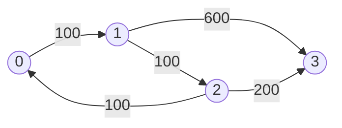
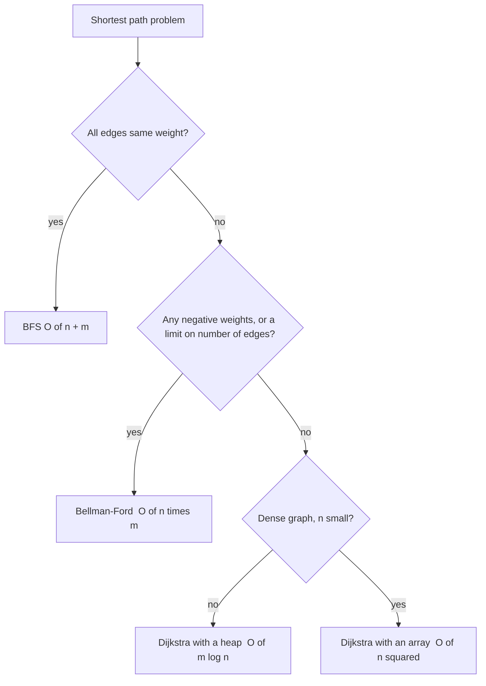

# Shortest paths: Dijkstra and Bellman-Ford

## In plain words

A navigation app does not look for the route with the fewest turns; it looks for the route with the
smallest total travel time. Every road segment has a cost (minutes, kilometres, money), and the goal
is the cheapest total. This lesson covers the two standard methods for that job. **Dijkstra's
algorithm** (pronounced "DYKE-struh") spreads outward from the start like water flowing through
pipes: the nearest places get wet first, then the next nearest. **Bellman-Ford** is the slower but
more tolerant method: it rechecks every road again and again until no improvement is possible, which
lets it cope with unusual situations such as "costs" that are negative (a road that pays you).

Why it matters for a job: maps, network routing (how data crosses the internet), logistics, game
AI pathfinding, and pricing problems such as the cheapest flight itinerary.

**Before this lesson:** read *Binary heaps and Python's heapq* (min-heap, tuples in a heap, lazy
deletion), *Graphs and how to store them* (weighted adjacency lists) and *DFS and BFS on grids and
adjacency lists* (BFS and why it finds the fewest-edges path).

Words used below: the **weight** of an edge is its cost; the **source** is the starting vertex;
**infinity** (`float("inf")` in Python, written ∞) is used as the "not reached yet" distance.

## From hops to weights

BFS finds the path with the **fewest edges**. Real maps are not that simple: one road is 2 km, another
is 40 km; one flight costs \$80, another \$600; one network link adds 1 ms of delay, another 30 ms.
Attach a number $w(u, v)$ to every edge and you have a **weighted graph**. The **length** of a path
is the sum of its edge weights, and the **distance** $d(s, v)$ is the smallest length of any path from
$s$ to $v$ (infinite if none exists).



BFS from A would report D at two hops via `A → B → D` (length 7) or `A → C → D` (length 7). The true
shortest path is `A → B → C → D` — three hops, length 4. **Fewest edges ≠ smallest weight**, so we need
new algorithms.

This lesson covers the two you must know for the **single-source shortest path** problem — distances
from one source `s` to every other vertex:

| | Dijkstra | Bellman-Ford |
|---|---|---|
| strategy | greedy: finalise the closest vertex | relax every edge, repeatedly |
| negative weights | **not allowed** | allowed (detects negative cycles) |
| time | $O((n + m) \log n)$ with a heap | $O(n \cdot m)$ |
| bonus | fast | "at most $k$ edges" comes for free |

## The shared building block: relaxation

Both algorithms keep a table `dist[v]` — the length of the best path to `v` found **so far** — starting
with `dist[s] = 0` and everything else ∞. They improve it with one operation:

```python
def relax(u, v, w):
    if dist[u] + w < dist[v]:
        dist[v] = dist[u] + w      # found a shorter way to v: go to u, then take edge (u, v)
```

"Relaxation" asks: *does going through `u` beat what I already know for `v`?* Estimates only ever
decrease and never drop below the true distance. The two algorithms differ only in the **order** in
which they relax edges.

## Dijkstra's algorithm

### The greedy idea

Maintain a "cloud" of vertices whose distances are final. Initially the cloud is empty. Repeatedly:

1. take the vertex `u` **outside** the cloud with the smallest `dist[u]`;
2. declare `dist[u]` final and pull `u` into the cloud;
3. relax every edge leaving `u`.

It is BFS's "expand in order of distance" idea, with a priority queue replacing the FIFO queue so
that "next" means *closest by weight* rather than *discovered earliest*.

### Why the greedy choice is safe

Claim: when `u` has the smallest tentative distance among vertices outside the cloud, that value is
its true distance.

Suppose a shorter path to `u` existed. It starts at `s` (inside the cloud) and ends at `u` (outside),
so somewhere it must leave the cloud — say it reaches a vertex `y` outside the cloud via an edge from
inside. When that inside vertex was added, the edge to `y` was relaxed, so `dist[y]` is at most the
length of this path up to `y`. The rest of the path, from `y` to `u`, has **non-negative** length. So
this supposedly shorter path has length ≥ `dist[y]` ≥ `dist[u]` (because `u` was the minimum).
Contradiction.

The argument uses non-negativity in exactly one place — "the rest of the path cannot make things
shorter" — and that is exactly where negative edges break the algorithm.

### Implementation with `heapq` and lazy deletion

Textbook Dijkstra updates a vertex's key inside the priority queue (*decrease-key*). `heapq` cannot do
that, so we use **lazy deletion**: push a new `(distance, vertex)` entry every time an estimate
improves, and when popping, **skip entries whose vertex is already finalised**.

```python-run
import heapq

def dijkstra(adj, s):
    dist = {}                               # finalised distances (the "cloud")
    heap = [(0, s)]
    while heap:
        d, u = heapq.heappop(heap)
        if u in dist:
            continue                        # stale entry: u was finalised with a smaller d
        dist[u] = d
        print(f"finalise {u} at distance {d}")
        for v, w in adj[u]:
            if v not in dist:
                heapq.heappush(heap, (d + w, v))
    return dist

adj = {
    "A": [("B", 1), ("C", 5)],
    "B": [("C", 1), ("D", 6)],
    "C": [("D", 2)],
    "D": [],
}
print(dijkstra(adj, "A"))
```

### Dry run

| step | pop | action | heap after (unordered) | finalised |
|---|---|---|---|---|
| 1 | (0, A) | push (1, B), (5, C) | (1,B) (5,C) | A:0 |
| 2 | (1, B) | push (2, C), (7, D) | (2,C) (5,C) (7,D) | B:1 |
| 3 | (2, C) | push (4, D) | (4,D) (5,C) (7,D) | C:2 |
| 4 | (4, D) | no out-edges | (5,C) (7,D) | D:4 |
| 5 | (5, C) | **stale — skip** | (7,D) | |
| 6 | (7, D) | **stale — skip** | – | |

> [!WARNING]
> A vertex is final when it is **popped**, not when it is pushed. C was pushed with 5 first and later
> with 2; marking it done at the first push would lock in the wrong answer. This is the most common
> Dijkstra bug.

### Variant with a `dist` array

Many people prefer to keep tentative distances in an array and push only on improvement, which keeps
the heap smaller:

```python-run
import heapq

def dijkstra_array(n, adj, s):
    INF = float("inf")
    dist = [INF] * n
    dist[s] = 0
    heap = [(0, s)]
    while heap:
        d, u = heapq.heappop(heap)
        if d > dist[u]:
            continue                        # stale
        for v, w in adj[u]:
            nd = d + w
            if nd < dist[v]:                # relax
                dist[v] = nd
                heapq.heappush(heap, (nd, v))
    return dist

adj = [[(1, 1), (2, 5)], [(2, 1), (3, 6)], [(3, 2)], [], []]
print(dijkstra_array(5, adj, 0))            # vertex 4 is unreachable -> inf
```

Both forms are correct; pick one and stick to it.

### Complexity

Each edge causes at most one push, so the heap holds at most $m$ entries: $O(m \log m) = O(m \log n)$
for the heap operations plus $O(n + m)$ for the scans — **$O((n + m) \log n)$** overall.

For **dense** graphs there is an alternative with no heap at all: keep `dist` in an array and find the
minimum by a linear scan each round — $O(n^2)$, which beats $O(m \log n)$ when $m \approx n^2$. The
textbook summarises this as "the better of $O(n^2)$ or $O((n + m) \log n)$".

### Why negative edges break Dijkstra



Dijkstra finalises A at distance 2 (the smallest). Later it reaches B at 5 and discovers the path
S → B → A of length 1 — but A is already sealed. The greedy assumption "nothing found later can be
shorter" is false when an edge can subtract.

### Recovering the path

Store `parent[v] = u` whenever relaxing `(u, v)` succeeds, and walk the parents backwards from the
target, exactly as with BFS.

### Application: Network Delay Time

*A signal starts at node `k`; when has every node received it?* Each node hears the signal at its
shortest-path distance from `k`, so the answer is the **maximum** finalised distance — or −1 if some
node was never reached.

```python-run
import heapq

def network_delay_time(times, n, k):
    adj = [[] for _ in range(n + 1)]              # nodes are 1..n
    for u, v, w in times:
        adj[u].append((v, w))
    dist = {}
    heap = [(0, k)]
    while heap:
        d, u = heapq.heappop(heap)
        if u in dist:
            continue
        dist[u] = d
        for v, w in adj[u]:
            if v not in dist:
                heapq.heappush(heap, (d + w, v))
    return max(dist.values()) if len(dist) == n else -1

print(network_delay_time([[2, 1, 1], [2, 3, 1], [3, 4, 1]], 4, 2))   # 2
print(network_delay_time([[1, 2, 1]], 2, 2))                         # -1
```

## Dijkstra with a different notion of "path cost"

Look again at the correctness argument: it needs only that **extending a path never makes it
cheaper**. Any path-cost function with that property works. A famous example is the **bottleneck**
(minimax) cost — the largest edge or vertex on the path.

*Swim in Rising Water*: reach the bottom-right cell of a grid, minimising the **highest elevation**
on the route. Replace `d + w` with `max(d, height)`:

```python-run
import heapq

def swim_in_water(grid):
    n = len(grid)
    seen = [[False] * n for _ in range(n)]
    heap = [(grid[0][0], 0, 0)]                   # (highest elevation so far, r, c)
    seen[0][0] = True
    while heap:
        t, r, c = heapq.heappop(heap)
        if (r, c) == (n - 1, n - 1):
            return t
        for nr, nc in ((r + 1, c), (r - 1, c), (r, c + 1), (r, c - 1)):
            if 0 <= nr < n and 0 <= nc < n and not seen[nr][nc]:
                seen[nr][nc] = True
                heapq.heappush(heap, (max(t, grid[nr][nc]), nr, nc))   # max instead of +

print(swim_in_water([[0, 2], [1, 3]]))   # 3
print(swim_in_water([[0, 1, 2, 3, 4], [24, 23, 22, 21, 5], [12, 13, 14, 15, 16],
                     [11, 17, 18, 19, 20], [10, 9, 8, 7, 6]]))   # 16
```

> [!TIP]
> When you see "minimise the maximum ... along a path" (or "maximise the minimum"), think: Dijkstra
> with `max`, or binary search on the answer + BFS, or Kruskal-style union-find. All three work.

## Bellman-Ford

### The idea

Forget cleverness about ordering: **relax every edge, and do that $n - 1$ times.**

```python
dist = [inf] * n; dist[s] = 0
for _ in range(n - 1):
    for u, v, w in edges:
        if dist[u] + w < dist[v]:
            dist[v] = dist[u] + w
```

### Why $n - 1$ rounds suffice

**Invariant:** after round $i$, `dist[v]` is no larger than the length of the shortest path to `v`
that uses **at most $i$ edges**.

*Proof sketch.* Round 0: only the source, with 0 edges. If the claim holds after round $i - 1$, take
the best path to `v` with at most $i$ edges and let `u` be its second-to-last vertex. The prefix to
`u` has at most $i - 1$ edges, so `dist[u]` was already good enough before round $i$; relaxing
`(u, v)` in round $i$ makes `dist[v]` good enough too.

A shortest path never needs to repeat a vertex (unless a negative cycle exists), so it has at most
$n - 1$ edges. Hence $n - 1$ rounds reach every true distance. Total time: $O(n \cdot m)$.

### Negative cycles

If a cycle with negative total weight is reachable, you can go around it forever and "shortest" is
undefined. Bellman-Ford detects this: run **one extra round**; if any edge can still be relaxed, a
negative cycle exists.

```python-run
def bellman_ford(n, edges, s):
    INF = float("inf")
    dist = [INF] * n
    dist[s] = 0
    for i in range(n - 1):
        changed = False
        for u, v, w in edges:
            if dist[u] + w < dist[v]:
                dist[v] = dist[u] + w
                changed = True
        print(f"after round {i + 1}: {dist}")
        if not changed:
            break                                   # early exit: already converged
    for u, v, w in edges:
        if dist[u] + w < dist[v]:
            return None                             # negative cycle reachable from s
    return dist

edges = [(0, 1, 2), (0, 2, 5), (2, 1, -4), (1, 3, 3)]
print(bellman_ford(4, edges, 0))                    # handles the negative edge Dijkstra got wrong
print(bellman_ford(3, [(0, 1, 1), (1, 2, -3), (2, 1, 1)], 0))   # None: cycle 1->2->1 has weight -2
```

### The hop-limited version: Cheapest Flights Within K Stops

*Cheapest route from `src` to `dst` using at most `k` stops* — that is, at most `k + 1` flights. The
Bellman-Ford invariant is tailor-made for this: **run exactly `k + 1` rounds.**

There is one trap. In the plain loop above, an improvement made early in a round can be used by a
later edge **in the same round**, so one round may extend paths by several edges. That is harmless
when you only want final distances (it only converges faster), but it breaks the "at most $i$ edges"
guarantee. To enforce the hop limit strictly, read from the previous round's table and write to a copy:

```python-run
def find_cheapest_price(n, flights, src, dst, k):
    INF = float("inf")
    dist = [INF] * n
    dist[src] = 0
    for rnd in range(k + 1):
        nxt = dist[:]                         # snapshot: this round may only extend LAST round's paths
        for u, v, w in flights:
            if dist[u] + w < nxt[v]:
                nxt[v] = dist[u] + w
        dist = nxt
        print(f"at most {rnd + 1} flight(s): {dist}")
    return dist[dst] if dist[dst] < INF else -1

flights = [[0, 1, 100], [1, 2, 100], [2, 0, 100], [1, 3, 600], [2, 3, 200]]
print(find_cheapest_price(4, flights, 0, 3, 1))   # 700, not 400 (that route needs 2 stops)
```



> [!INTERVIEW]
> Why not plain Dijkstra here? Dijkstra finalises each city at its cheapest price, discarding more
> expensive arrivals — but a pricier arrival that used **fewer flights** may be the only one that can
> still continue within the stop limit. A correct Dijkstra variant must treat `(city, flights used)`
> as the state. The Bellman-Ford solution is shorter and harder to get wrong: $O(k \cdot m)$.

## Choosing an algorithm



| situation | algorithm | time |
|---|---|---|
| unweighted | BFS | $O(n + m)$ |
| weights 0 or 1 only | 0-1 BFS with a deque | $O(n + m)$ |
| non-negative weights | Dijkstra (heap) | $O((n + m) \log n)$ |
| negative weights / detect negative cycle | Bellman-Ford | $O(nm)$ |
| at most $k$ edges | Bellman-Ford, $k$ rounds | $O(km)$ |
| DAG (any weights) | relax edges in topological order | $O(n + m)$ |
| all pairs, small $n$ | Floyd–Warshall | $O(n^3)$ |
| minimise the max edge on a path | Dijkstra with `max` / Kruskal | $O(m \log n)$ |

## Common pitfalls

1. **Marking a vertex done when pushed** instead of when popped.
2. **Not skipping stale heap entries** — still correct, but can be much slower.
3. **Running Dijkstra with negative edges.**
4. **Pushing `(vertex, dist)`** instead of `(dist, vertex)` — the heap then orders by vertex id.
5. **Unreachable vertices**: check for ∞ / missing entries before taking a max or returning.
6. **1-indexed vertex labels.**
7. **Bellman-Ford with a hop limit but no snapshot copy.**
8. **`k` stops = `k + 1` edges.**

## Summary

- Both algorithms are built from **relaxation**: `dist[v] = min(dist[v], dist[u] + w)`.
- **Dijkstra** finalises vertices in increasing distance order using a min-heap; correct only when
  extending a path never reduces its cost (non-negative weights). $O((n + m) \log n)$.
- With `heapq`, use lazy deletion: push duplicates, skip stale pops.
- The same greedy handles minimax path costs (*Swim in Rising Water*).
- **Bellman-Ford** relaxes all edges $n - 1$ times; after round $i$ it knows the best paths with at
  most $i$ edges. Handles negative edges, detects negative cycles, and solves hop-limited problems.
  $O(nm)$.

## Glossary

| term | meaning |
|---|---|
| **Weighted graph** | a graph whose edges carry numbers (costs). |
| **Path length** | the sum of the weights on a path. |
| **Distance** | the smallest path length between two vertices. |
| **Source** | the vertex from which distances are measured. |
| **Single-source shortest paths** | distances from one source to every other vertex. |
| **Relaxation** | the update `dist[v] = min(dist[v], dist[u] + w)` for an edge u → v of weight w. |
| **Tentative distance** | the best distance found so far, not yet proven final. |
| **Dijkstra's algorithm** | repeatedly finalise the closest unfinished vertex; needs non-negative weights. |
| **Stale entry** | an outdated heap entry for a vertex that has since been improved or finalised. |
| **Bellman-Ford** | relax every edge n − 1 times; works with negative weights. |
| **Negative cycle** | a cycle whose weights sum to less than zero, making 'shortest' meaningless. |
| **Hop** | one edge of a path; 'k stops' means k + 1 hops. |
| **Bottleneck (minimax) path** | a path whose cost is its largest single edge, to be made as small as possible. |

```quiz
[
  {"q": "Why can't BFS be used for shortest paths in a weighted graph?",
   "options": ["BFS doesn't visit all vertices", "BFS minimises the number of edges, which is not the same as minimising total weight", "BFS only works on trees", "BFS needs a heap"], "answer": 1,
   "explain": "A path with more edges can have a smaller total weight; BFS levels only count edges."},
  {"q": "In heap-based Dijkstra with lazy deletion, when is a vertex's distance final?",
   "options": ["When it is first pushed", "When it is first popped from the heap", "When all its neighbours are pushed", "After n - 1 rounds"], "answer": 1,
   "explain": "The first pop of a vertex carries its smallest tentative distance; later pops of the same vertex are stale and skipped."},
  {"q": "Which requirement makes Dijkstra's greedy choice correct?",
   "options": ["The graph is acyclic", "Edge weights are non-negative", "The graph is undirected", "All weights are distinct"], "answer": 1,
   "explain": "The proof needs that extending a path cannot decrease its length, so nothing found later can undercut the current minimum."},
  {"q": "What is the time complexity of Dijkstra with a binary heap on a graph with n vertices and m edges?",
   "options": ["O(n + m)", "O((n + m) log n)", "O(n m)", "O(n^3)"], "answer": 1,
   "explain": "Each edge leads to at most one push and each push/pop costs O(log n)."},
  {"q": "After i rounds of Bellman-Ford (with per-round snapshots), dist[v] equals...",
   "options": ["The shortest path with exactly i edges", "The shortest path using at most i edges", "The shortest path overall", "The number of edges to v"], "answer": 1,
   "explain": "That is the invariant: each round allows paths one edge longer than the previous round."},
  {"q": "How does Bellman-Ford detect a negative cycle reachable from the source?",
   "options": ["A vertex is popped twice", "After n - 1 rounds, some edge can still be relaxed", "The heap becomes empty", "dist[source] becomes positive"], "answer": 1,
   "explain": "Without negative cycles n - 1 rounds reach all true distances, so any further improvement proves a negative cycle."},
  {"q": "For 'cheapest flight with at most k stops', how many Bellman-Ford rounds are needed and why copy the array each round?",
   "options": ["k rounds; copying saves memory", "k + 1 rounds; the copy prevents chaining several flights within one round", "n - 1 rounds; the copy speeds it up", "k - 1 rounds; the copy detects cycles"], "answer": 1,
   "explain": "k stops means k + 1 flights. Reading only last round's values guarantees each round adds at most one flight to any path."},
  {"q": "Swim in Rising Water minimises the highest cell on a path. How is Dijkstra adapted?",
   "options": ["Use a max-heap", "Replace d + w with max(d, height) as the path cost", "Negate all heights", "Run it from every cell"], "answer": 1,
   "explain": "The bottleneck cost never decreases when a path is extended, which is all the greedy argument needs."}
]
```

> **Source:** Goodrich, Tamassia & Goldwasser, *Data Structures and Algorithms in Python*, ch. 14,
> §14.6 (Shortest Paths: §14.6.1 weighted graphs, §14.6.2 Dijkstra's algorithm — edge relaxation,
> Proposition 14.23 on correctness, Proposition 14.24 on running time, and why it fails for negative
> weights). Bellman-Ford is not covered in that chapter; its treatment here follows the standard
> presentation (e.g. CLRS ch. 24) and the NeetCode 150 "Advanced Graphs" list.
