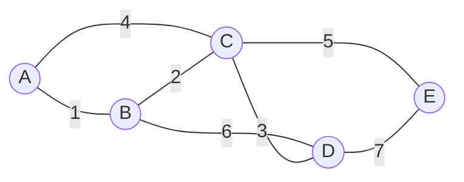
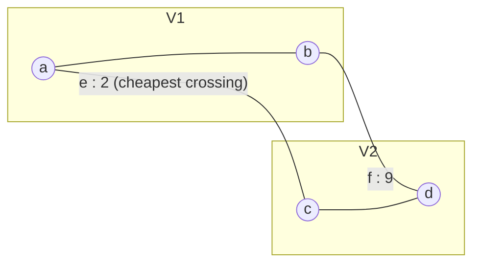
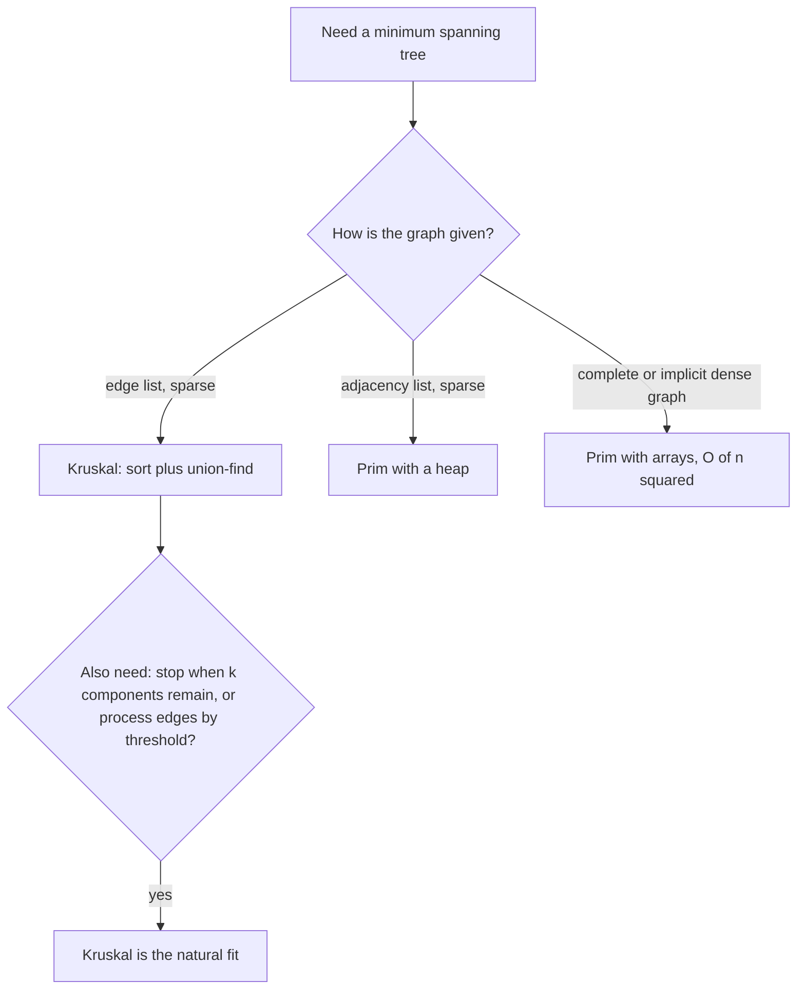

# Minimum spanning trees: Prim and Kruskal

## In plain words

A village wants every house connected to the electricity network. A cable can be laid between certain
pairs of houses, each at a known price. Which cables should be laid so that every house is connected
— directly or through other houses — for the lowest total price? The answer is called a **minimum
spanning tree**: "spanning" because it reaches every house, "tree" because it never contains a
wasteful loop, "minimum" because nothing cheaper exists.

Why it matters for a job: designing computer, road, pipe and power networks; grouping similar data
points (clustering) in data science; and approximating hard routing problems. It is also the classic
example of a **greedy** algorithm — always taking the cheapest available option — being provably
correct, a favourite interview discussion.

**Before this lesson:** read *Union-find (disjoint sets)* (used by Kruskal's algorithm),
*Shortest paths: Dijkstra and Bellman-Ford* (Prim's algorithm is nearly identical to Dijkstra's) and
*Binary heaps and Python's heapq*.

Words used below: a graph is **connected** when every vertex can be reached from every other; a
**tree** is a connected graph with no cycle; the **weight** of an edge is its cost.

## The problem

You must wire up a set of buildings so that every building can reach every other — directly or through
intermediate buildings — and each possible cable has a known cost. Which cables do you lay so the
**total cost is as small as possible**?

Formally: given a connected, undirected, weighted graph $G$, find a subset of edges $T$ that

1. connects **all** vertices (it *spans* the graph),
2. contains **no cycle**, and
3. has minimum total weight $w(T) = \sum_{e \in T} w(e)$.

Conditions 1 and 2 say $T$ is a **spanning tree**; condition 3 makes it a **minimum spanning tree
(MST)**.

Why must the answer be a tree? If the chosen edges contained a cycle, you could delete any edge of
that cycle: everything stays connected and the cost does not go up (it goes down, for positive
weights). So an optimal solution never needs a cycle. And a spanning tree on $n$ vertices always has
exactly **$n - 1$ edges**.



The MST of this graph uses the edges A–B (1), B–C (2), C–D (3) and C–E (5): total **11**. No other
choice of four connecting edges is cheaper.

> [!NOTE]
> **MST ≠ shortest paths.** The MST minimises the *total* weight of the network. It does not promise
> that the tree path between two particular vertices is the shortest route between them. Different
> problem, different algorithms (although Prim looks remarkably like Dijkstra, as we'll see).

## The one theorem behind both algorithms: the cut property

Split the vertices into two non-empty groups $V_1$ and $V_2$ in any way you like. That split is called
a **cut**, and the edges with one endpoint on each side are said to *cross* the cut.

> **Cut property.** Let $e$ be a minimum-weight edge crossing the cut. Then some minimum spanning tree
> contains $e$.

*Why (an exchange argument).* Take any MST $T$. If $e$ is in $T$, done. Otherwise add $e$ to $T$; a
tree plus one edge contains exactly one cycle. That cycle crosses from $V_1$ to $V_2$ along $e$, so
it must cross back along some other edge $f$. Since $e$ is a cheapest crossing edge,
$w(e) \le w(f)$. Remove $f$: the result is again a spanning tree, with weight no greater than $T$'s —
so it is also an MST, and it contains $e$.



This theorem licenses a **greedy** strategy: *any time you can exhibit a cut for which an edge is the
cheapest crossing edge, it is safe to take that edge.* The two classic algorithms differ only in which
cuts they look at.

| | Prim (Prim–Jarník) | Kruskal |
|---|---|---|
| grows | **one tree** from a start vertex | a **forest** that merges into one tree |
| next edge | cheapest edge leaving the current tree | cheapest edge overall that joins two different components |
| cut used | (tree, everything else) | (one of the two components, everything else) |
| data structure | priority queue | sort + union-find |
| time | $O(m \log n)$ heap, or $O(n^2)$ array | $O(m \log m)$ |
| natural input | adjacency list / implicit dense graph | edge list |

## Prim's algorithm

Start with a tree containing a single arbitrary vertex. Repeat until every vertex is in the tree:

> add the **cheapest edge that connects a tree vertex to a non-tree vertex.**

The cut is (tree, rest); the chosen edge is a minimum crossing edge, so the cut property says it is safe.

### Heap version (sparse graphs)

Keep a min-heap of candidate edges `(weight, vertex)` leading out of the tree. As in Dijkstra, we use
lazy deletion: pop the cheapest candidate; if its endpoint is already in the tree, discard it.

```python-run
import heapq

def prim(n, adj, start=0):
    in_tree = [False] * n
    heap = [(0, start, -1)]                   # (edge weight, vertex, vertex it attaches to)
    total, picked = 0, []
    while heap and len(picked) < n:
        w, u, frm = heapq.heappop(heap)
        if in_tree[u]:
            continue                          # stale candidate: both ends already in the tree
        in_tree[u] = True
        total += w
        picked.append((frm, u, w))
        for v, wv in adj[u]:
            if not in_tree[v]:
                heapq.heappush(heap, (wv, v, u))
    return total, picked[1:]                  # drop the dummy edge for the start vertex

#        A  B  C  D  E   =  0..4
edges = [(0, 1, 1), (0, 2, 4), (1, 2, 2), (1, 3, 6), (2, 3, 3), (2, 4, 5), (3, 4, 7)]
adj = [[] for _ in range(5)]
for u, v, w in edges:
    adj[u].append((v, w))
    adj[v].append((u, w))

total, tree = prim(5, adj)
print("MST weight:", total)
for frm, to, w in tree:
    print(f"  {'ABCDE'[frm]} - {'ABCDE'[to]}  ({w})")
```

**Dry run** from A:

| step | tree | candidates in heap | pop | action |
|---|---|---|---|---|
| 1 | {A} | B:1, C:4 | B:1 | add B (cost 1) |
| 2 | {A,B} | C:4, C:2, D:6 | C:2 | add C (cost 2) |
| 3 | {A,B,C} | C:4, D:6, D:3, E:5 | D:3 | add D (cost 3) |
| 4 | {A,B,C,D} | C:4, D:6, E:5, E:7 | C:4 | stale, skip |
| 5 | | D:6, E:5, E:7 | E:5 | add E (cost 5) |

Total 1 + 2 + 3 + 5 = **11**.

Each edge is pushed at most twice (once from each end): $O(m \log m) = O(m \log n)$.

### Prim versus Dijkstra: one line of difference

| | Dijkstra | Prim |
|---|---|---|
| key pushed for neighbour `v` of `u` | `dist[u] + w(u, v)` — distance from the **source** | `w(u, v)` — distance from the **tree** |
| result | shortest-path tree | minimum spanning tree |

If you can write one, you can write the other. Mixing up the keys is a classic bug.

### Array version (dense graphs)

When the graph is **complete** — every pair of vertices is a potential edge — there are
$m \approx n^2/2$ edges and the heap version costs $O(n^2 \log n)$ time and $O(n^2)$ memory. A simpler
variant does better: keep, for every non-tree vertex, `best[v]` = the cheapest edge from `v` to the
tree; each round scan for the minimum and then update `best` using the newly added vertex.

*Min Cost to Connect All Points* is the standard example: points in the plane, edge weight = Manhattan
distance, graph implicit and complete.

```python-run
def min_cost_connect_points(points):
    n = len(points)
    INF = float("inf")
    best = [INF] * n                # cheapest known connection from each point to the tree
    best[0] = 0
    in_tree = [False] * n
    total = 0
    for _ in range(n):
        u = min((i for i in range(n) if not in_tree[i]), key=best.__getitem__)   # O(n) scan
        in_tree[u] = True
        total += best[u]
        ux, uy = points[u]
        for v in range(n):                                                       # O(n) update
            if not in_tree[v]:
                d = abs(ux - points[v][0]) + abs(uy - points[v][1])
                if d < best[v]:
                    best[v] = d
    return total

print(min_cost_connect_points([[0, 0], [2, 2], [3, 10], [5, 2], [7, 0]]))   # 20
print(min_cost_connect_points([[3, 12], [-2, 5], [-4, 1]]))                 # 18
```

$n$ rounds × $O(n)$ work = **$O(n^2)$** time and $O(n)$ space — optimal for a complete graph, since
reading all the edge weights alone takes $\Theta(n^2)$.

## Kruskal's algorithm

Kruskal's algorithm ignores locality altogether:

1. **Sort all edges** by weight.
2. Go through them from cheapest to most expensive. **Take an edge if it connects two different
   components** of what you've built so far; skip it if both endpoints are already connected (it
   would close a cycle).
3. Stop when you have $n - 1$ edges.

Why it is correct: when the algorithm takes edge $(u, v)$, let $V_1$ be $u$'s current component and
$V_2$ everything else. Every edge crossing that cut that is cheaper than $(u, v)$ was examined earlier —
and it can't have been skipped (skipped edges lie *inside* a component) nor taken (then its endpoints
would be in the same component now). So no cheaper crossing edge exists, and the cut property applies.

The "are these two vertices already connected?" test is exactly what **union-find** does in
near-constant time (lesson 8).

```python-run
def kruskal(n, edges):
    parent = list(range(n))
    def find(x):
        while parent[x] != x:
            parent[x] = parent[parent[x]]
            x = parent[x]
        return x

    total, picked = 0, []
    for u, v, w in sorted(edges, key=lambda e: e[2]):
        ru, rv = find(u), find(v)
        if ru == rv:
            print(f"  skip {'ABCDE'[u]}-{'ABCDE'[v]} ({w}): would close a cycle")
            continue
        parent[ru] = rv
        total += w
        picked.append((u, v, w))
        print(f"  take {'ABCDE'[u]}-{'ABCDE'[v]} ({w})")
        if len(picked) == n - 1:
            break                              # tree complete: no need to look at heavier edges
    return total if len(picked) == n - 1 else None    # None: graph was not connected

edges = [(0, 1, 1), (0, 2, 4), (1, 2, 2), (1, 3, 6), (2, 3, 3), (2, 4, 5), (3, 4, 7)]
print("MST weight:", kruskal(5, edges))
```


**Complexity:** sorting dominates — $O(m \log m)$, which equals $O(m \log n)$ since $m \le n^2$. The
union-find work is $O(m\,\alpha(n))$.

### Kruskal on the points problem

It works, but you must materialise all $n(n-1)/2$ edges first:

```python-run
def min_cost_kruskal(points):
    n = len(points)
    edges = sorted(
        (abs(points[i][0] - points[j][0]) + abs(points[i][1] - points[j][1]), i, j)
        for i in range(n) for j in range(i + 1, n)
    )
    parent = list(range(n))
    def find(x):
        while parent[x] != x:
            parent[x] = parent[parent[x]]
            x = parent[x]
        return x
    total = used = 0
    for w, i, j in edges:
        ri, rj = find(i), find(j)
        if ri != rj:
            parent[ri] = rj
            total += w
            used += 1
            if used == n - 1:
                break
    return total

print(min_cost_kruskal([[0, 0], [2, 2], [3, 10], [5, 2], [7, 0]]))   # 20
```

For $n = 1000$ that is half a million edges to create and sort: $O(n^2 \log n)$ time and $O(n^2)$
memory versus $O(n^2)$ / $O(n)$ for array Prim. Either passes typical limits; know why they differ.

## Which one should I use?



- **Kruskal** is usually the fastest to write if you have a union-find template ready, and it
  generalises: stop early to get a *minimum spanning forest with k components* (clustering); feed it
  edges in *decreasing* order for a **maximum** spanning tree; or use its "add elements in sorted order
  until two things become connected" skeleton for bottleneck problems such as *Swim in Rising Water*.
- **Prim** wins on dense or implicit graphs and when you'd rather not build an edge list.

## Useful facts about MSTs

- **Edge count.** Always $n - 1$ edges. If the algorithm ends with fewer, the graph is disconnected
  (no spanning tree exists).
- **Uniqueness.** If all edge weights are **distinct**, the MST is unique. With ties there may be
  several MSTs, but they all have the same total weight.
- **Cycle property** (the mirror image of the cut property): the **heaviest** edge on any cycle is not
  needed by some MST. This is why Kruskal may skip an edge that would close a cycle — it is the
  heaviest edge on that cycle.
- **Negative weights are fine.** Neither algorithm relies on non-negativity (unlike Dijkstra).
- **Minimax paths.** In an MST, the path between any two vertices minimises the *largest edge* on the
  route among all paths in the original graph. That connects MSTs to the bottleneck problems from the
  previous lesson.

```python-run
# Swim in Rising Water, Kruskal-style: add cells in increasing elevation and union with
# already-flooded neighbours; the answer is the elevation at which the two corners connect.
def swim_union_find(grid):
    n = len(grid)
    parent = list(range(n * n))
    def find(x):
        while parent[x] != x:
            parent[x] = parent[parent[x]]
            x = parent[x]
        return x
    cells = sorted((grid[r][c], r, c) for r in range(n) for c in range(n))
    open_ = [[False] * n for _ in range(n)]
    for h, r, c in cells:
        open_[r][c] = True
        for nr, nc in ((r + 1, c), (r - 1, c), (r, c + 1), (r, c - 1)):
            if 0 <= nr < n and 0 <= nc < n and open_[nr][nc]:
                parent[find(r * n + c)] = find(nr * n + nc)
        if find(0) == find(n * n - 1):
            return h

print(swim_union_find([[0, 2], [1, 3]]))   # 3
print(swim_union_find([[0, 1, 2, 3, 4], [24, 23, 22, 21, 5], [12, 13, 14, 15, 16],
                       [11, 17, 18, 19, 20], [10, 9, 8, 7, 6]]))   # 16
```

## Common pitfalls

1. **Using Dijkstra's key in Prim** (`dist[u] + w` instead of `w`) — you get a shortest-path tree,
   which is generally not an MST.
2. **Nearest-neighbour chaining** — always extending from the *last* vertex added builds a path, not
   an MST. Prim extends from *anywhere* in the tree.
3. **Counting a stale heap entry** — check `in_tree` when popping, before adding the weight.
4. **Kruskal without union-find** — testing connectivity by DFS for each edge is $O(m \cdot n)$.
5. **Forgetting disconnected input** — verify you collected $n - 1$ edges.
6. **Applying MST algorithms to directed graphs.** The directed analogue (minimum arborescence) needs
   a different algorithm (Chu–Liu/Edmonds).
7. **Sorting by the wrong tuple field** in Kruskal — put the weight first, or pass a `key`.

## Summary

- An MST connects all $n$ vertices with $n - 1$ edges of minimum total weight.
- The **cut property** — the cheapest edge across any cut is safe — justifies greedy construction.
- **Prim:** grow one tree; repeatedly add the cheapest edge leaving it. Heap: $O(m \log n)$; arrays:
  $O(n^2)$, best for dense/complete graphs.
- **Kruskal:** sort edges; add each one that joins two different components (union-find).
  $O(m \log m)$.
- Prim differs from Dijkstra only in the key: edge weight vs. distance from the source.

## Glossary

| term | meaning |
|---|---|
| **Spanning tree** | a set of edges that connects all vertices and contains no cycle. |
| **Minimum spanning tree (MST)** | a spanning tree with the smallest possible total weight. |
| **Cut** | a division of the vertices into two non-empty groups. |
| **Crossing edge** | an edge with one end in each group of a cut. |
| **Cut property** | the cheapest edge crossing any cut belongs to some MST. |
| **Cycle property** | the most expensive edge on any cycle is not needed by some MST. |
| **Greedy algorithm** | one that repeatedly takes the best-looking option and never reconsiders. |
| **Exchange argument** | a proof technique: swap one edge of a solution for another without making it worse. |
| **Prim's algorithm** | grow one tree, always adding the cheapest edge that leaves it. |
| **Kruskal's algorithm** | consider edges from cheapest to dearest, adding each one that joins two separate groups. |
| **Complete graph** | a graph with an edge between every pair of vertices. |
| **Manhattan distance** | the sum of the horizontal and vertical differences: distance when you can only move along a grid. |

```quiz
[
  {"q": "How many edges does a spanning tree of a connected graph with 12 vertices have?",
   "options": ["10", "11", "12", "It depends on the graph"], "answer": 1,
   "explain": "Any tree on n vertices has exactly n - 1 edges."},
  {"q": "What does the cut property say?",
   "options": ["The heaviest edge of the graph is never in an MST", "For any partition of the vertices into two sets, a minimum-weight edge crossing it belongs to some MST", "An MST contains the shortest path between every pair", "Every cut has exactly one crossing edge"], "answer": 1,
   "explain": "This is the exchange argument that makes both greedy algorithms correct."},
  {"q": "Which edge does Prim's algorithm add at each step?",
   "options": ["The globally cheapest unused edge", "The cheapest edge with exactly one endpoint in the current tree", "The edge out of the most recently added vertex", "A random safe edge"], "answer": 1,
   "explain": "Prim grows a single tree and uses the cut (tree, rest)."},
  {"q": "In Kruskal's algorithm, an edge (u, v) is skipped when...",
   "options": ["Its weight is negative", "find(u) == find(v), i.e. u and v are already connected", "u has degree greater than 2", "It is heavier than the previous edge"], "answer": 1,
   "explain": "Adding an edge inside one component would close a cycle; union-find detects this."},
  {"q": "What is the only difference between heap-based Prim and Dijkstra?",
   "options": ["Prim uses a max-heap", "The key pushed for a neighbour: edge weight alone (Prim) versus distance from the source plus edge weight (Dijkstra)", "Prim doesn't need a visited set", "Dijkstra works on undirected graphs only"], "answer": 1,
   "explain": "Prim cares about the cost of attaching to the tree; Dijkstra cares about total distance from the start."},
  {"q": "For n points where every pair is a potential edge (complete graph), which approach is asymptotically best?",
   "options": ["Kruskal: O(n^2 log n)", "Heap Prim: O(n^2 log n)", "Array-based Prim: O(n^2)", "BFS: O(n)"], "answer": 2,
   "explain": "With about n^2/2 edges, scanning arrays each round avoids both the sort and the heap, matching the input size."},
  {"q": "All edge weights are distinct. How many different minimum spanning trees can the graph have?",
   "options": ["Exactly one", "At most two", "Up to n", "Exponentially many"], "answer": 0,
   "explain": "With distinct weights every cut has a unique cheapest crossing edge, which forces the MST to be unique."},
  {"q": "Kruskal's algorithm finishes having taken only n - 3 edges. What does this indicate?",
   "options": ["A bug in the sort", "The graph is not connected (it has 3 components)", "The graph has negative weights", "The MST is not unique"], "answer": 1,
   "explain": "A spanning forest with c components has n - c edges; n - 3 edges means 3 components."}
]
```

> **Source:** Goodrich, Tamassia & Goldwasser, *Data Structures and Algorithms in Python*, ch. 14,
> §14.7 (Minimum Spanning Trees: Proposition 14.25 — the cut property; §14.7.1 the Prim–Jarník
> algorithm and its analysis; §14.7.2 Kruskal's algorithm; §14.7.3 union-find for Kruskal).
