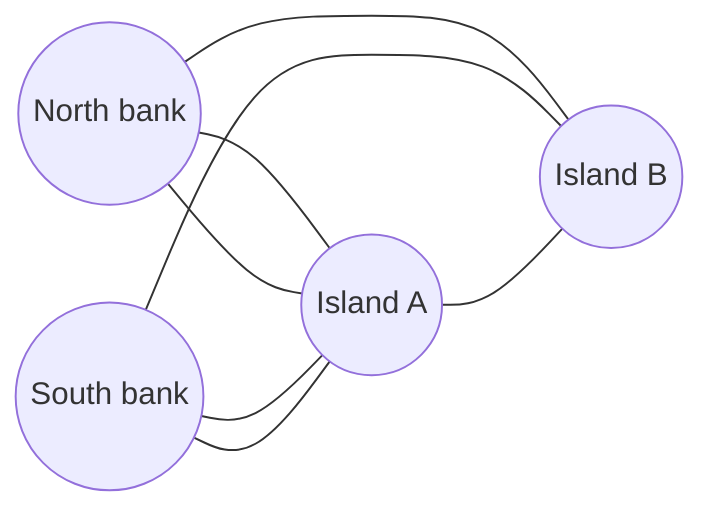
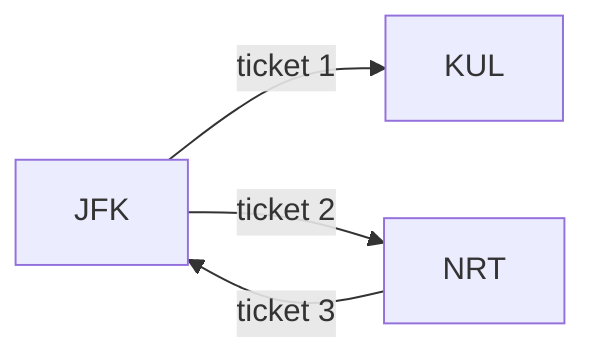
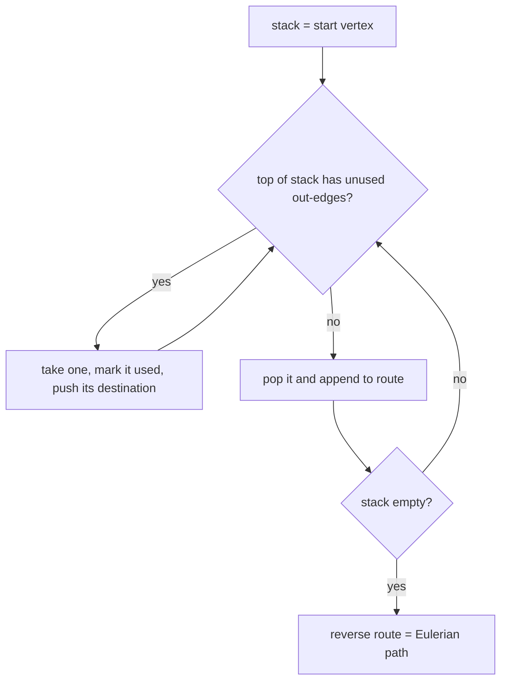
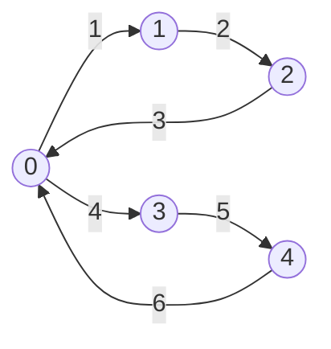

# Eulerian paths and Hierholzer's algorithm

## A puzzle from 1736

The city of Königsberg had seven bridges connecting two river banks and two islands. The townspeople
wondered: *can you take a walk that crosses every bridge exactly once?* Leonhard Euler proved that
you cannot — and in doing so founded graph theory. His insight was that the layout of the land is
irrelevant; only **how many bridges touch each land mass** matters.



Every land mass here touches an odd number of bridges (5, 3, 3, 3). We'll see shortly why that makes
the walk impossible.

The modern interview version is *Reconstruct Itinerary*: you hold a stack of airline tickets and must
order them into one trip that uses **every ticket exactly once**. Airports are vertices, tickets are
directed edges, and the trip is exactly Euler's walk.

## Definitions

- An **Eulerian path** (or *trail*) is a walk that uses **every edge exactly once**. Vertices may be
  visited many times.
- An **Eulerian circuit** (or *cycle*, or *tour*) is an Eulerian path that ends where it started.

Don't confuse this with a **Hamiltonian** path, which visits every *vertex* exactly once. The two
sound alike and could hardly be more different in difficulty:

| | Eulerian path | Hamiltonian path |
|---|---|---|
| visits exactly once | every **edge** | every **vertex** |
| existence test | check degrees: $O(n + m)$ | NP-complete |
| construction | Hierholzer: $O(m)$ | backtracking, exponential |

> [!INTERVIEW]
> When a problem says "use every ticket / pair / domino / edge exactly once", it is Eulerian and has a
> linear-time solution. When it says "visit every city exactly once", it is Hamiltonian and you're in
> backtracking or bitmask-DP territory. Recognising which one you face is most of the battle.

## When does an Eulerian path exist?

The key idea: **every time a walk passes through a vertex, it uses one edge to enter and one edge to
leave.** So at any vertex in the middle of the walk, edges are consumed in pairs.

### Undirected graphs

Assume all edges lie in a single connected component (isolated vertices don't matter).

- **Eulerian circuit** exists ⇔ **every vertex has even degree.**
- **Eulerian path** exists ⇔ **exactly zero or two vertices have odd degree.** If there are two, the
  path must start at one and end at the other.

In Königsberg all four vertices have odd degree — more than two — so no such walk exists.

### Directed graphs

Again assume all edges belong to one connected piece (ignoring direction).

- **Eulerian circuit** ⇔ every vertex has **in-degree = out-degree**.
- **Eulerian path** ⇔ at most one vertex has `out − in = 1` (the **start**), at most one has
  `in − out = 1` (the **end**), and every other vertex is balanced.

```python-run
from collections import defaultdict

def euler_status_directed(edges):
    out, inn = defaultdict(int), defaultdict(int)
    for u, v in edges:
        out[u] += 1
        inn[v] += 1
    starts = [v for v in set(out) | set(inn) if out[v] - inn[v] == 1]
    ends = [v for v in set(out) | set(inn) if inn[v] - out[v] == 1]
    unbalanced = [v for v in set(out) | set(inn) if abs(out[v] - inn[v]) > 1]
    if unbalanced or len(starts) > 1 or len(ends) > 1:
        return "no Eulerian path"
    if not starts and not ends:
        return "Eulerian circuit (start anywhere)"
    return f"Eulerian path from {starts[0]} to {ends[0]}"

print(euler_status_directed([("JFK", "MUC"), ("MUC", "LHR"), ("LHR", "SFO"), ("SFO", "SJC")]))
print(euler_status_directed([("JFK", "ATL"), ("ATL", "JFK")]))
print(euler_status_directed([("A", "B"), ("A", "C"), ("A", "D")]))
```

(The degree test must be combined with a connectivity check in general; in *Reconstruct Itinerary* the
statement guarantees that a valid itinerary exists.)

## Why the obvious greedy fails

Suppose you simply start at JFK and keep taking any unused ticket.



Take ticket 1 first: you land at KUL, which has no outgoing tickets, and tickets 2 and 3 are stranded.
The walk got **stuck too early**.

One fix is backtracking: undo the last choice and try another. That is correct but can take
exponential time when there are many tickets between the same airports. Hierholzer's algorithm fixes
the problem with a single, beautiful observation.

## Hierholzer's algorithm

### The observation

Walk greedily, consuming edges, until you are stuck at some vertex `v` — all its outgoing edges are
used.

**Where can you get stuck?** Every time the walk entered a vertex other than the designated end, the
degree conditions guarantee an unused edge to leave by. So the first place the walk can get stuck is
the **end vertex of the Eulerian path** (or the start vertex, for a circuit).

So the vertex where you're stuck is the **last** vertex of the final answer. Write it down, step back
one vertex, and continue from there: if that vertex still has unused edges, wander off again — that
side trip is a closed loop that returns to the same vertex — and when *it* is stuck, it is the
next-to-last vertex of the answer. And so on.

In other words: **record each vertex when you leave it for the last time (post-order), then reverse.**



### Code

```python-run
from collections import defaultdict

def hierholzer(edges, start):
    adj = defaultdict(list)
    for u, v in edges:
        adj[u].append(v)
    route, stack = [], [start]
    while stack:
        u = stack[-1]
        if adj[u]:
            stack.append(adj[u].pop())     # consume an edge and walk on
        else:
            route.append(stack.pop())      # stuck: u is final at this position (from the END)
        print(f"stack={stack}  route={route}")
    return route[::-1]

print(hierholzer([("JFK", "NRT"), ("JFK", "KUL"), ("NRT", "JFK")], "JFK"))
```

Follow the trace: the walk goes JFK → KUL and gets stuck; KUL is written down as the **last** stop.
Back at JFK there is still a ticket, so the walk continues JFK → NRT → JFK, gets stuck, and those are
written down in reverse. The reversed route is `JFK, NRT, JFK, KUL` — a valid itinerary, even though
the walk made the "wrong" choice first. Hierholzer **never backtracks**: every edge is consumed
exactly once, so the running time is $O(m)$.

### The recursive form

The same algorithm as a DFS whose post-order is the answer:

```python-run
from collections import defaultdict

def euler_path_recursive(edges, start):
    adj = defaultdict(list)
    for u, v in edges:
        adj[u].append(v)
    route = []
    def dfs(u):
        while adj[u]:
            dfs(adj[u].pop())
        route.append(u)                # post-order: after all of u's edges are used
    dfs(start)
    return route[::-1]

edges = [(0, 1), (1, 2), (2, 0), (0, 3), (3, 4), (4, 0)]     # two triangles sharing vertex 0
print(euler_path_recursive(edges, 0))
```

Note the `while adj[u]` loop (not `for v in adj[u]`): the list shrinks as deeper calls consume edges,
and a `while` re-checks it each time. The recursion depth can reach the number of edges, so for large
inputs in Python prefer the iterative version.

### Why splicing works — a picture



Start at 0 and suppose the walk takes edges 1, 2, 3: `0 → 1 → 2 → 0`. You are back at 0 with edges
4–6 unused. A naive walker who had stopped here would have a closed loop that misses half the graph.
Hierholzer keeps going from 0 — `0 → 3 → 4 → 0` — and only then is 0 truly stuck. The second loop is
automatically **spliced** into the first at vertex 0, giving `0 1 2 0 3 4 0`. In general, whenever a
vertex on the current tour still has unused edges, those edges form further closed tours through it,
and post-order recording inserts each one at exactly the right place.

## Reconstruct Itinerary

Two requirements on top of plain Hierholzer:

1. **Start at `"JFK"`.**
2. Among all valid itineraries, return the **lexicographically smallest**.

For the second, always walk to the **smallest** available destination. That makes the route as small
as possible *except* where a smaller choice leads to a dead end — and the post-order trick repairs
exactly those cases by pushing the dead-end branch to the end of the route, where it must go anyway.

Implementation detail: sort each adjacency list in **reverse** order so that the smallest destination
sits at the end, where `list.pop()` removes it in $O(1)$.

```python-run
from collections import defaultdict

def find_itinerary(tickets):
    adj = defaultdict(list)
    for a, b in sorted(tickets, reverse=True):   # reverse sort => smallest destination is LAST
        adj[a].append(b)
    route, stack = [], ["JFK"]
    while stack:
        while adj[stack[-1]]:
            stack.append(adj[stack[-1]].pop())   # pop() takes the smallest remaining destination
        route.append(stack.pop())
    return route[::-1]

print(find_itinerary([["MUC", "LHR"], ["JFK", "MUC"], ["SFO", "SJC"], ["LHR", "SFO"]]))
print(find_itinerary([["JFK", "SFO"], ["JFK", "ATL"], ["SFO", "ATL"], ["ATL", "JFK"], ["ATL", "SFO"]]))
print(find_itinerary([["JFK", "KUL"], ["JFK", "NRT"], ["NRT", "JFK"]]))
```

**Dry run of the third example.** After reverse-sorting: `adj[JFK] = [NRT, KUL]`, `adj[NRT] = [JFK]`.

| stack | action | route |
|---|---|---|
| JFK | pop smallest dest KUL, push | |
| JFK, KUL | KUL stuck → record | KUL |
| JFK | pop NRT, push | KUL |
| JFK, NRT | pop JFK, push | KUL |
| JFK, NRT, JFK | stuck → record | KUL, JFK |
| JFK, NRT | stuck → record | KUL, JFK, NRT |
| JFK | stuck → record | KUL, JFK, NRT, JFK |

Reversed: **JFK, NRT, JFK, KUL**.

**Complexity:** $O(m \log m)$ for the sort and $O(m)$ for the walk; $O(m)$ space.

> [!WARNING]
> Common mistakes: (1) returning the greedy walk without the post-order/reverse step — fails on the
> KUL example; (2) sorting ascending and then calling `pop()`, which takes the *largest* destination;
> (3) `pop(0)` on a list, which is $O(m)$ per call; (4) storing tickets in a `set`, which loses
> duplicate tickets between the same two airports.

### The backtracking alternative

For comparison, here is the brute-force idea Hierholzer replaces: try tickets in sorted order, mark
them used, and undo on dead ends. It returns the same answer and is a fine first explanation in an
interview — but its worst case is exponential.

```python-run
from collections import defaultdict

def find_itinerary_backtracking(tickets):
    adj = defaultdict(list)
    for a, b in sorted(tickets):
        adj[a].append(b)
    used = {a: [False] * len(bs) for a, bs in adj.items()}
    route = ["JFK"]
    def dfs(u):
        if len(route) == len(tickets) + 1:
            return True
        prev = None
        for i, v in enumerate(adj[u]):
            if used[u][i] or v == prev:      # skip used tickets and identical siblings
                continue
            prev = v
            used[u][i] = True; route.append(v)
            if dfs(v):
                return True
            used[u][i] = False; route.pop()  # dead end: un-choose
        return False
    dfs("JFK")
    return route

print(find_itinerary_backtracking([["JFK", "KUL"], ["JFK", "NRT"], ["NRT", "JFK"]]))
```

## Finding the start vertex in general

*Reconstruct Itinerary* tells you to start at JFK. In other Eulerian problems (for example LeetCode
2097, *Valid Arrangement of Pairs*) you must work it out:

- if some vertex has `out − in = 1`, start there;
- otherwise (a circuit) start at any vertex that has an outgoing edge.

```python-run
from collections import defaultdict

def arrange_pairs(pairs):
    adj, balance = defaultdict(list), defaultdict(int)
    for a, b in pairs:
        adj[a].append(b)
        balance[a] += 1          # out-degree
        balance[b] -= 1          # in-degree
    start = next((v for v in balance if balance[v] == 1), pairs[0][0])
    route, stack = [], [start]
    while stack:
        while adj[stack[-1]]:
            stack.append(adj[stack[-1]].pop())
        route.append(stack.pop())
    route.reverse()
    return [[route[i], route[i + 1]] for i in range(len(route) - 1)]

print(arrange_pairs([[5, 1], [4, 5], [11, 9], [9, 4]]))    # [[11, 9], [9, 4], [4, 5], [5, 1]]
```

## Undirected graphs

The algorithm is the same, with one extra chore: each undirected edge appears in **two** adjacency
lists, and using it from one side must remove it from the other. The usual approach is to give every
edge an id and keep a `used[id]` array, skipping used edges as you pop them.

## Where this fits in the track

Hierholzer is "DFS with post-order recording" — the same shape as the DFS topological sort from
lesson 7, with **edges** marked as used instead of vertices:

| | marks as visited | records | result |
|---|---|---|---|
| DFS topological sort | vertices | vertex on finish, then reverse | topological order |
| Hierholzer | edges | vertex on finish, then reverse | Eulerian path |

## Common pitfalls

1. **Confusing Eulerian (edges) with Hamiltonian (vertices).**
2. **Greedy walk without post-order** — gets stranded.
3. **Wrong start vertex** when one vertex has `out − in = 1`.
4. **Forgetting to reverse** the recorded route.
5. **Marking vertices visited** — vertices may and often must be revisited; only edges are consumed.
6. **Deep recursion** — the recursive form can recurse once per edge.

## Summary

- An Eulerian path uses every **edge** exactly once; existence depends only on degrees (plus
  connectivity): undirected — 0 or 2 odd-degree vertices; directed — all balanced, or one start with
  `out − in = 1` and one end with `in − out = 1`.
- **Hierholzer:** walk greedily consuming edges; when stuck, pop the vertex onto the route; reverse at
  the end. $O(m)$ — no backtracking.
- For the lexicographically smallest route, always take the smallest available destination
  (reverse-sorted adjacency lists + `pop()`).
- *Reconstruct Itinerary* is Hierholzer from `"JFK"`.

```quiz
[
  {"q": "What does an Eulerian path visit exactly once?",
   "options": ["Every vertex", "Every edge", "Every vertex and every edge", "Every cycle"], "answer": 1,
   "explain": "Eulerian = edges exactly once (vertices may repeat). Visiting every vertex once is a Hamiltonian path."},
  {"q": "A connected undirected graph has vertex degrees 2, 3, 3, 4. Does it have an Eulerian path or circuit?",
   "options": ["An Eulerian circuit", "An Eulerian path but no circuit, starting and ending at the two degree-3 vertices", "Neither", "Both"], "answer": 1,
   "explain": "Exactly two vertices have odd degree, so a path exists between them; a circuit would need all degrees even."},
  {"q": "In a directed graph with an Eulerian path that is not a circuit, the start vertex satisfies...",
   "options": ["in-degree = out-degree", "out-degree - in-degree = 1", "in-degree - out-degree = 1", "out-degree = 0"], "answer": 1,
   "explain": "The start is left once more than it is entered; the end vertex has the mirror-image imbalance."},
  {"q": "In Hierholzer's algorithm, when is a vertex appended to the route?",
   "options": ["When it is first reached", "When it has no unused outgoing edges left (it is stuck), i.e. in post-order", "When its in-degree reaches zero", "When it is the smallest remaining vertex"], "answer": 1,
   "explain": "A stuck vertex must come last among what remains; recording on exit and reversing assembles the path."},
  {"q": "tickets = [[JFK,KUL],[JFK,NRT],[NRT,JFK]]. Why does the pure greedy 'always fly to the smallest destination and stop when stuck' fail?",
   "options": ["It picks NRT first", "It flies JFK to KUL and is stuck with two tickets unused", "It loops forever", "KUL is not a valid airport"], "answer": 1,
   "explain": "KUL has no outgoing ticket. Hierholzer records KUL as the final stop and continues from JFK."},
  {"q": "Why are the adjacency lists sorted in REVERSE order in the Reconstruct Itinerary solution?",
   "options": ["To get the largest route", "So that list.pop() removes the lexicographically smallest destination in O(1)", "Because Hierholzer requires descending order", "To detect duplicates"], "answer": 1,
   "explain": "pop() takes from the end; with a reverse-sorted list the end holds the smallest remaining destination."},
  {"q": "What is the running time of Hierholzer's algorithm on a graph with m edges (excluding any sorting)?",
   "options": ["O(m)", "O(m log m)", "O(m^2)", "O(2^m)"], "answer": 0,
   "explain": "Each edge is consumed exactly once and each vertex occurrence is pushed and popped once."},
  {"q": "Which problem statement signals a Hamiltonian (hard) rather than Eulerian (easy) problem?",
   "options": ["Use every ticket exactly once", "Cross every bridge exactly once", "Visit every city exactly once", "Arrange dominoes so every domino is used once"], "answer": 2,
   "explain": "Cities are vertices. Tickets, bridges and dominoes are edges."}
]
```

> **Source:** Eulerian tours are not developed for general graphs in Goodrich, Tamassia &
> Goldwasser (the book's "Euler tour" in §8.4.6 is a tree traversal); this lesson builds on the DFS
> machinery of ch. 14 §14.3 and follows the standard presentation of Euler's theorem and Hierholzer's
> algorithm, with the problem selection from the NeetCode 150 "Advanced Graphs" list.
