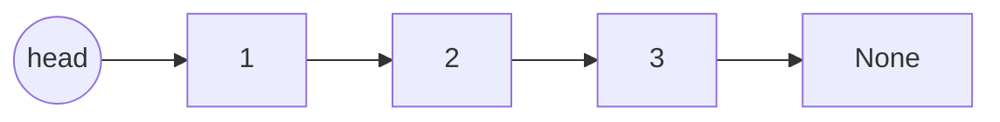
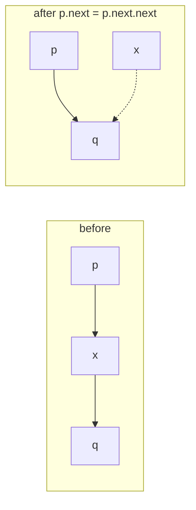
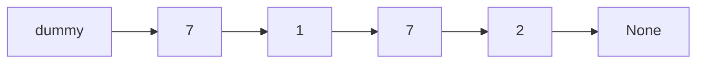
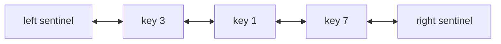

# Nodes, pointers and the dummy-node trick

> **Before this lesson:** you should be able to read small Python programs with classes, loops and `None`, and know what a Python `list` is. It helps to know what "O(n)" means — see [Big-O, Big-Omega and Big-Theta](#/lesson/dsa-foundations/asymptotic-notation). For a slower, textbook-style introduction to linked lists, read [Singly and circularly linked lists](#/lesson/dsa-foundations/singly-circular) first. Nothing else is assumed.

## In plain words

A **linked list** is a way to store a sequence of items where each item knows only one thing about the
sequence: *which item comes next*. Think of a **treasure hunt**. Each clue (an item) sits in a different
place, and written on it is the location of the next clue. You cannot jump straight to clue number 7 — you
have to follow the clues in order — but adding a new clue in the middle is easy: rewrite one clue so it
points to the new one, and make the new one point to where the old clue used to point. Nobody else has to
move.

A few words used throughout this lesson, each defined before it is used:

- A **node** is one item of the list: a small object holding a value and a note saying where the next node is.
- A **pointer** (in Python: a **reference**) is that note — a variable or field that says *where an object
  is*, as opposed to holding a copy of it.
- The **head** is the first node; the **tail** is the last node. The tail's "next" note is `None`, Python's
  word for "nothing here".
- **O(1)**, **O(n)** (read "order one", "order n") describe how the work grows with the number of items `n`:
  O(1) means the same small amount of work no matter how long the list is; O(n) means work proportional to
  the length.

**Why it matters for a job.** Linked lists are a standard interview topic because they test whether you
can change references carefully without losing data. The same skill is needed for real structures built
from linked nodes: caches that forget the least recently used entry (browsers, databases), undo histories,
task queues inside operating systems, and the hash tables behind Python's `dict`.

Arrays put their elements side by side in one block of memory, which makes indexing instant but inserting
in the middle expensive: everything after the insertion point must shift. A **linked list** takes the
opposite trade. Each element lives in its own little object, a **node**, and every node remembers where the
next one is. Nothing ever shifts. To insert, you change a couple of references. The cost is that you lose
random access: to reach the 1,000th element you have to walk past the first 999.

Linked-list interview questions are almost never about *knowing* this trade-off. They are about doing
**pointer surgery** without losing pieces of the list or creating loops. This lesson builds the
mental model and the two habits that prevent nearly all bugs: *draw the arrows before you change them*
and *use a dummy node*.

## 1. The node

In Python (and in the judge for this track) a singly linked node looks like this:

```python
class ListNode:
    def __init__(self, val=0, next=None):
        self.val = val
        self.next = next
```

A list is nothing more than a reference to its first node, the **head**. The last node, the **tail**, has
`next = None`. An empty list is written `head = None`.



A key point that trips up beginners: a variable such as `head` or `cur` **is not the node**; it is a name
that *refers* to a node. Assigning `cur = cur.next` moves the name to a different node and changes nothing
in the list. Assigning `cur.next = something` changes a field *inside* a node and therefore changes the list.
Keep those two kinds of assignment separate in your head:

| statement | what changes |
|---|---|
| `cur = cur.next` | only the local name `cur` (a walk) |
| `cur.next = x` | the structure of the list (a rewire) |
| `cur.val = x` | the data stored in one node |

```python-run
class ListNode:
    def __init__(self, val=0, next=None):
        self.val, self.next = val, next

def build(values):
    head = None
    for v in reversed(values):      # build back to front: each new node points at the old head
        head = ListNode(v, head)
    return head

def show(head):
    out = []
    while head:
        out.append(str(head.val))
        head = head.next
    return " -> ".join(out) + " -> None"

head = build([1, 2, 3])
print(show(head))

cur = head
cur = cur.next          # walk: the list is unchanged
print("after walk:  ", show(head))

cur.next = None         # rewire: node 2 now ends the list
print("after rewire:", show(head))
```

### Singly vs doubly linked

A **doubly linked** node also stores `prev`. That doubles the pointer bookkeeping but lets you remove a
node in O(1) *when you already hold a reference to it*, because you can reach its predecessor directly. With a
singly linked list you can only remove the node *after* one you hold. Goodrich (ch. 7.3) builds the doubly
linked list with two sentinel nodes, a *header* and a *trailer*, so that every real node always has a
real neighbour on each side. You will reuse exactly that design in **LRU Cache**.

| operation | Python list (dynamic array) | singly linked | doubly linked |
|---|---|---|---|
| access k-th element | O(1) | O(k) | O(k) |
| insert/delete at front | O(n) | O(1) | O(1) |
| insert/delete at back | O(1) amortised | O(1) with a tail pointer (insert only) | O(1) |
| delete a node you hold | — | O(n) (need predecessor) | O(1) |
| memory per element | compact | value + 1 reference | value + 2 references |

## 2. The three basic moves

Almost every linked-list algorithm is built from three moves.

**Traverse.**

```python
cur = head
while cur:
    ...            # look at cur.val
    cur = cur.next
```

Use `while cur:` when you need to process every node and `while cur.next:` when you need to stop *on* the
last node (for example, to append after it).

**Insert after a node `p`.** Order matters: first point the new node at the rest of the list, then point
`p` at the new node.

```python
new = ListNode(x)
new.next = p.next   # 1. hold on to the rest
p.next = new        # 2. splice in
```

If you swap the two lines, `p.next` already points at `new`, so `new.next = p.next` makes the node point at
itself and the rest of the list is lost.

**Delete the node after `p`.**

```python
p.next = p.next.next
```

The removed node becomes unreachable and Python's garbage collector frees it.



> [!TIP]
> Before writing any rewiring code, draw three or four boxes on paper, then draw the arrows *after* the
> operation. Every arrow that changes is one assignment. Every node you would lose track of needs a
> temporary variable **before** you overwrite the arrow that leads to it.

## 3. The head is special — so get rid of it

Insert and delete both need the node *before* the position you care about. The head has no node before
it, so naive code fills up with special cases:

```python
def remove_all(head, target):          # without a dummy
    while head and head.val == target:  # special case: removing the head (maybe several times)
        head = head.next
    cur = head
    while cur and cur.next:
        if cur.next.val == target:
            cur.next = cur.next.next
        else:
            cur = cur.next
    return head
```

A **dummy node** (also called a *sentinel*) is a fake node placed in front of the head. Now *every* real
node has a predecessor, so the special case disappears. At the end you return `dummy.next`, which is the
real head, whatever it has become.

```python
def remove_all(head, target):          # with a dummy
    dummy = ListNode(0, head)
    cur = dummy
    while cur.next:
        if cur.next.val == target:
            cur.next = cur.next.next    # stay on cur: the new cur.next may also match
        else:
            cur = cur.next
    return dummy.next
```



Use a dummy node whenever **the head might change**: deleting nodes, merging lists, building a new list one
node at a time, partitioning, reversing a sub-range that may start at the head.

```python-run
class ListNode:
    def __init__(self, val=0, next=None):
        self.val, self.next = val, next

def build(vals):
    dummy = tail = ListNode()        # dummy also makes *building* clean
    for v in vals:
        tail.next = ListNode(v)
        tail = tail.next
    return dummy.next

def to_list(h):
    out = []
    while h:
        out.append(h.val); h = h.next
    return out

def remove_all(head, target):
    dummy = ListNode(0, head)
    cur = dummy
    while cur.next:
        if cur.next.val == target:
            cur.next = cur.next.next
        else:
            cur = cur.next
    return dummy.next

for vals in ([7, 1, 7, 2], [7, 7, 7], [], [1, 2, 3]):
    print(vals, "->", to_list(remove_all(build(vals), 7)))
```

### Dummy + tail: building output lists

Problems such as *Merge Two Sorted Lists* and *Add Two Numbers* build a brand-new chain. The pattern is
always the same:

```python
dummy = tail = ListNode()
for each output node x:
    tail.next = x
    tail = x
return dummy.next
```

`tail` always sits on the last node of the output, so appending is O(1) and you never need to ask whether
the output is still empty.

## 4. Merging: the dummy node in action

Merging two sorted lists is the canonical dummy-node problem. Compare the heads, attach the smaller, advance.
When one list runs out, the rest of the other is already sorted, so attach it in one assignment.

```python
def merge(a, b):
    dummy = tail = ListNode()
    while a and b:
        if a.val <= b.val:
            tail.next, a = a, a.next
        else:
            tail.next, b = b, b.next
        tail = tail.next
    tail.next = a or b
    return dummy.next
```

The `<=` makes the merge **stable**: equal keys from `a` come before those from `b`, which matters when merge
sort is used on records.

## 5. Two pointers that walk together

Many problems need two references moving through one or two lists at once:

- **Gap pointers.** Move `right` forward `n` steps, then move `left` and `right` together. When `right`
  falls off the end, `left` is `n` nodes from the end. That is *Remove Nth Node From End of List* in one pass.
  Starting `left` at a dummy node makes it stop *before* the node to delete.
- **Different speeds.** Move one pointer one step and the other two steps: the next lesson.
- **Two lists in parallel.** Merging, adding digit by digit, or comparing.

```python-run
class ListNode:
    def __init__(self, val=0, next=None):
        self.val, self.next = val, next

def build(vals):
    head = None
    for v in reversed(vals):
        head = ListNode(v, head)
    return head

def to_list(h):
    out = []
    while h:
        out.append(h.val); h = h.next
    return out

def remove_nth_from_end(head, n):
    dummy = ListNode(0, head)
    left, right = dummy, head
    for _ in range(n):          # open a gap of n nodes
        right = right.next
    while right:                # slide the window to the end
        left, right = left.next, right.next
    left.next = left.next.next  # left is right before the target
    return dummy.next

print(to_list(remove_nth_from_end(build([1, 2, 3, 4, 5]), 2)))  # [1, 2, 3, 5]
print(to_list(remove_nth_from_end(build([1]), 1)))              # []  (head removed - no special case!)
```

## 6. Identity vs equality

Two different nodes can hold equal values. When a problem asks whether two lists **share** a node
(*Intersection of Two Linked Lists*) or whether a list **revisits** a node (*Linked List Cycle*), you must
compare node objects with `is`, not values with `==`. Python sets and dicts hash user-defined objects by
identity by default, so `seen = set(); seen.add(node)` stores *nodes*, not values. That is exactly what you
want for "have I been at this node before?" and "map each original node to its copy" (*Copy List with Random
Pointer*).

## 7. Doubly linked lists with sentinels (LRU preview)

An LRU cache must (1) find a key in O(1) and (2) move that key to the "most recently used" end in O(1),
and (3) drop the least recently used key in O(1). A hash map does (1). A doubly linked list does (2) and (3):
given a node, unlink it with two assignments and re-append it at the end with four.



The two sentinels mean that every real node always has a `prev` and a `next`, so `remove` and `append` have no
`if` statements at all:

```python
def remove(node):
    node.prev.next = node.next
    node.next.prev = node.prev

def append(node):               # insert right before the right sentinel
    last = right.prev
    last.next = node
    node.prev, node.next = last, right
    right.prev = node
```

The least recently used node is always `left.next`; the most recent is `right.prev`.

```python-run
class DNode:
    def __init__(self, key=None):
        self.key, self.prev, self.next = key, None, None

left, right = DNode("L"), DNode("R")
left.next, right.prev = right, left

def remove(node):
    node.prev.next, node.next.prev = node.next, node.prev

def append(node):
    last = right.prev
    last.next = node
    node.prev, node.next = last, right
    right.prev = node

def show():
    out, cur = [], left.next
    while cur is not right:
        out.append(cur.key); cur = cur.next
    return out

nodes = {k: DNode(k) for k in "abc"}
for k in "abc":
    append(nodes[k])
print("initial  ", show())
remove(nodes["a"]); append(nodes["a"])      # 'use' a -> most recent
print("use a    ", show())
lru = left.next; remove(lru)                # evict
print("evicted", lru.key, show())
```

## 8. Common bugs checklist

1. **Losing the rest of the list.** You overwrote `cur.next` before saving it.
2. **Creating a cycle.** A node ends up pointing to something earlier — often because the old head's or old
   tail's `next` was never reset to `None`.
3. **Returning the wrong head.** After reversal the old head is the tail; with a dummy, return `dummy.next`.
4. **`AttributeError: 'NoneType' object has no attribute 'next'`.** You dereferenced `cur.next.next` without
   checking `cur.next`. Write loop conditions that guarantee every dereference is safe.
5. **Forgetting to advance.** An infinite loop where `cur` never moves.
6. **Equality instead of identity** when the question is about nodes.

> [!INTERVIEW]
> Say your invariant out loud: "`tail` is always the last node of the output", "`left` is always `n` nodes
> behind `right`". Interviewers reward candidates who state invariants, and it keeps you honest when you
> update pointers.

## Summary

- A linked list is a chain of nodes; variables are only names pointing at nodes.
- Distinguish **walking** (`cur = cur.next`) from **rewiring** (`cur.next = ...`).
- Save references before you overwrite them; draw the arrows first.
- A **dummy node** removes the special case of the head; `dummy + tail` builds output lists.
- Two pointers with a fixed gap find positions relative to the end in one pass.
- Compare nodes with `is`; sets/dicts of nodes work by identity.
- Doubly linked lists with sentinels give O(1) unlink/append — the core of LRU Cache.

## Glossary

- **Node** — one element of a linked list: an object with a value and a reference to the next node.
- **Reference / pointer** — a name or field that says where an object is; copying it does not copy the object.
- **Head / tail** — the first / last node of the list.
- **`None`** — Python's "no object"; the tail's `next` is `None`, and an empty list is `head = None`.
- **Singly linked list** — each node knows only its successor (`next`).
- **Doubly linked list** — each node knows its successor (`next`) and its predecessor (`prev`).
- **Traverse (walk)** — visit the nodes one after another by following `next`.
- **Rewire** — assign to a node's `next` (or `prev`) field, which changes the shape of the list.
- **Dummy node (sentinel)** — an extra node holding no real data, placed before the head (or after the tail) so that every real node has a neighbour and special cases disappear.
- **Predecessor / successor** — the node right before / right after a given node.
- **Invariant** — a statement that stays true every time a loop comes back to its start, such as "`tail` is the last node of the output".
- **Identity vs equality** — `a is b` asks "are these the very same object?"; `a == b` asks "do they hold equal values?".
- **LRU (least recently used) cache** — a fixed-size store that, when full, throws away the entry that has gone unused the longest.
- **Garbage collector** — the part of Python that frees objects nothing refers to any more.

## Check yourself

```quiz
[
  {"q": "Which statement changes the structure of the list?", "options": ["cur = cur.next", "cur.next = cur.next.next", "x = cur.val", "cur = head"], "answer": 1,
   "explain": "Only assignments to a node's field (cur.next = ...) change the list. Assigning to a local variable only moves that name."},
  {"q": "To insert node `new` after node `p`, which order is correct?", "options": ["p.next = new; new.next = p.next", "new.next = p.next; p.next = new", "Either order works", "new.next = p; p.next = new"], "answer": 1,
   "explain": "First keep hold of the rest of the list via new.next, then splice. The other order makes new point to itself."},
  {"q": "Why use a dummy node?", "options": ["It makes the algorithm asymptotically faster", "It gives the head a predecessor so head changes need no special case", "Python requires it", "It saves memory"], "answer": 1,
   "explain": "With a node in front of the head, deleting or replacing the head is the same code as for any other node; return dummy.next at the end."},
  {"q": "In a singly linked list, deleting a node you hold a reference to (and nothing else) costs…", "options": ["O(1) always", "O(n) in general, since you need its predecessor", "O(log n)", "It is impossible"], "answer": 1,
   "explain": "You must find the predecessor by walking from the head. (The trick of copying the next node's value works except for the tail.) A doubly linked list makes it O(1)."},
  {"q": "In the gap technique for 'remove n-th from end', where should `left` start?", "options": ["At head", "At the dummy node", "At the n-th node", "At the tail"], "answer": 1,
   "explain": "Starting at the dummy makes left stop on the node before the target, and lets the head itself be deleted with the same code."},
  {"q": "Two lists both contain a node with value 8. Do they intersect?", "options": ["Yes", "Not necessarily: intersection means sharing the same node object", "Only if 8 is at the tail", "Only if the lists have equal length"], "answer": 1,
   "explain": "Intersection is about identity (`is`), not equal values."},
  {"q": "In an LRU cache built from a doubly linked list with sentinels `left` and `right`, the least recently used entry is…", "options": ["right.prev", "left.next", "left", "the node with the smallest key"], "answer": 1,
   "explain": "New or touched entries are appended before `right`, so the oldest one drifts to right after `left`."}
]
```

> **Source:** Goodrich, Tamassia & Goldwasser, *Data Structures and Algorithms in Python*, ch. 7.1 (singly linked lists), 7.3 (doubly linked lists with header/trailer sentinels), 7.6 (move-to-front / access frequencies) and 7.7 (link-based vs array-based sequences).
