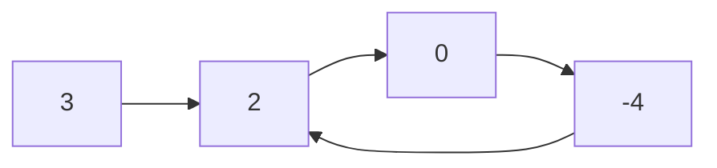
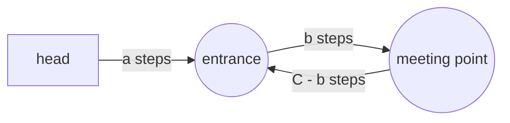

# Fast and slow pointers (with Floyd's proof)

Some linked-list questions are about *where* things are: the middle of the list, the k-th node from the end,
whether the list loops back on itself and, if so, where the loop starts. An array would answer these with
an index. A linked list has no indices — but two pointers moving at **different speeds** can measure
distances for you, in one pass and with O(1) memory. This technique is usually called *fast and slow
pointers* or *tortoise and hare*.

## 1. Finding the middle

Move `slow` one node per step and `fast` two nodes per step. When `fast` reaches the end, `slow` has
covered half the distance.

```python
slow = fast = head
while fast and fast.next:
    slow = slow.next
    fast = fast.next.next
return slow
```

Trace it on lists of length 5 and 6 (positions numbered from 1):

| step | slow (n=5) | fast (n=5) | slow (n=6) | fast (n=6) |
|---|---|---|---|---|
| 0 | 1 | 1 | 1 | 1 |
| 1 | 2 | 3 | 2 | 3 |
| 2 | 3 | 5 | 3 | 5 |
| 3 | — stop (fast.next is None) | | 4 | None → stop |

For odd n, `slow` lands on the exact middle. For even n it lands on the **second** of the two middles.
If you want the **first** middle (useful when you are about to *cut* the list into two halves), start
`fast` one step ahead:

```python
slow, fast = head, head.next
while fast and fast.next:
    slow, fast = slow.next, fast.next.next
# slow is the last node of the first half
```

> [!TIP]
> Do not memorise which variant gives which middle. Trace lists of length 1, 2, 3 and 4 on paper — it
> takes thirty seconds and is foolproof.

```python-run
class ListNode:
    def __init__(self, val=0, next=None):
        self.val, self.next = val, next

def build(n):
    head = None
    for v in range(n, 0, -1):
        head = ListNode(v, head)
    return head

def second_middle(head):
    slow = fast = head
    while fast and fast.next:
        slow, fast = slow.next, fast.next.next
    return slow.val

def first_middle(head):
    slow, fast = head, head.next
    while fast and fast.next:
        slow, fast = slow.next, fast.next.next
    return slow.val

for n in range(1, 8):
    print(f"n={n}: second middle={second_middle(build(n))}, first middle={first_middle(build(n))}")
```

## 2. Detecting a cycle

A list has a **cycle** if following `next` never reaches `None` because some node points back to an
earlier node. The picture is the Greek letter ρ (rho): a straight *tail* leading into a *loop*.



**Hash-set solution.** Walk the list storing every node you see in a set; a repeat means a cycle. O(n) time
and O(n) memory. Remember to store *nodes*, not values — values can repeat in a perfectly acyclic list.

**Floyd's algorithm** gets O(1) memory:

```python
slow = fast = head
while fast and fast.next:
    slow = slow.next
    fast = fast.next.next
    if slow is fast:
        return True
return False
```

If there is no cycle, `fast` hits `None` and the loop ends. If there is a cycle, the two pointers are
guaranteed to meet. Why?

### Proof that they meet

Let the loop have length $C$. Once `slow` enters the loop (after at most the tail length steps), `fast` is
already somewhere in the loop. Measure the distance $d$ from `slow` forward to `fast` along the loop,
$0 \le d < C$. Each step, `slow` moves 1 and `fast` moves 2, so the distance from `fast` *back* to `slow` —
equivalently the gap that `fast` must close — shrinks by exactly **one**. A non-negative integer that
decreases by exactly 1 per step reaches 0; it cannot jump over it. So within at most $C$ steps after `slow`
enters the loop, they stand on the same node.

That is also why speed 2 vs speed 1 is chosen: with speeds 3 vs 1 the gap shrinks by 2 per step and could
skip over 0: if the gap is odd and $C$ is even, the gap stays odd forever and the pointers never land on the
same node. Relative speed 1 can never skip.

**Running time:** `slow` makes at most (tail length + $C$) steps, which is at most $n$, so the algorithm is
O(n) time and O(1) space.

```python-run
class ListNode:
    def __init__(self, val=0, next=None):
        self.val, self.next = val, next

def make(values, pos):
    nodes = [ListNode(v) for v in values]
    for a, b in zip(nodes, nodes[1:]):
        a.next = b
    if pos >= 0:
        nodes[-1].next = nodes[pos]
    return nodes[0] if nodes else None

def has_cycle(head, verbose=False):
    slow = fast = head
    step = 0
    while fast and fast.next:
        slow, fast = slow.next, fast.next.next
        step += 1
        if verbose:
            print(f"  step {step}: slow={slow.val} fast={fast.val}")
        if slow is fast:
            return True
    return False

print(has_cycle(make([3, 2, 0, -4], 1), verbose=True))
print(has_cycle(make([1, 1, 1, 1], -1)))   # equal values, no cycle -> False
```

## 3. Finding where the cycle starts

Floyd's algorithm has a beautiful second phase. After `slow` and `fast` meet, put a new pointer at `head`
and move it and `slow` **one step at a time**. They meet exactly at the first node of the loop.

```python
# phase 1: find a meeting point inside the cycle (as above)
# phase 2:
p = head
while p is not slow:
    p = p.next
    slow = slow.next
return p      # entrance of the cycle
```

### Proof of phase 2

Let

- $a$ = number of steps from `head` to the cycle entrance (tail length),
- $b$ = number of steps from the entrance to the meeting point, going around the loop,
- $C$ = loop length.

When they meet, `slow` has walked $a + b$ steps. `fast` has walked twice as far, $2(a + b)$, and it is at
the same node, so the extra distance it travelled is a whole number of laps:

$$2(a + b) = a + b + kC \quad\Longrightarrow\quad a + b = kC \quad\Longrightarrow\quad a = kC - b.$$

Now start `p` at the head and keep `slow` at the meeting point. After $a$ steps, `p` is at the entrance.
`slow`, starting $b$ steps past the entrance, has walked $a = kC - b$ more steps, so it is
$b + kC - b = kC$ steps past the entrance — that is, exactly **at** the entrance (whole laps change nothing).
They meet there, and not earlier, because before step $a$ the pointer `p` is still on the tail, where
`slow` never is.



## 4. Arrays in disguise: *Find the Duplicate Number*

Here is a surprising application. An array `nums` of length $n+1$ contains values in $1..n$. Think of each
index $i$ as a node and draw an edge $i \to nums[i]$. Every node has exactly one outgoing edge, so walking
from any start must eventually repeat — it forms a ρ-shape.

Two facts make this useful:

1. Index 0 is never a target (all values are ≥ 1), so starting from 0 we are on a genuine *tail*.
2. The entrance of the loop is a node with **two** incoming edges: one from the tail, one from inside the
   loop. Two indices $i \ne j$ with $nums[i] = nums[j]$ means that value is the duplicate.

So the duplicate is the cycle entrance, and Floyd's two phases find it without modifying the array and in
O(1) extra space:

```python-run
def find_duplicate(nums):
    slow = fast = 0
    while True:
        slow = nums[slow]
        fast = nums[nums[fast]]
        if slow == fast:
            break
    p = 0
    while p != slow:
        p, slow = nums[p], nums[slow]
    return p

for nums in ([1, 3, 4, 2, 2], [3, 1, 3, 4, 2], [3, 3, 3, 3, 3], [2, 5, 9, 6, 9, 3, 8, 9, 7, 1]):
    print(nums, "->", find_duplicate(nums))
```

> [!NOTE]
> Here "pointers" are indices and "next" is `nums[i]`. Whenever a problem defines a function from a finite
> set to itself (`x -> f(x)`), Floyd's algorithm applies — it is also used for detecting cycles in
> pseudo-random number generators and in Pollard's rho factoring algorithm. *Happy Number* (LeetCode 202) is
> another example: `f(x)` = sum of squares of digits.

## 5. Gap pointers: k-th from the end

A different two-pointer flavour keeps the **same speed** but a **fixed distance**. Advance `right` by `k`
nodes, then move both until `right` runs off the end; now `left` is `k` nodes behind the end. This finds the
k-th node from the end, removes the n-th node from the end, or rotates a list by k — all in one pass.

## 6. Two lists, one trick: intersection

Two acyclic lists may merge into a shared tail (a Y shape). Pointer `a` walks list A and then continues at
the head of B; pointer `b` walks B and then continues at the head of A. Both travel `len(A) + len(B)` steps,
so they reach the junction simultaneously — or both reach `None` at the same time if there is no junction.

```python
a, b = headA, headB
while a is not b:
    a = a.next if a else headB
    b = b.next if b else headA
return a
```

Why does it terminate when there is no intersection? After $m + n$ steps both are `None`, and
`None is None` ends the loop. The switch happens when the pointer *is* `None` (not when `next` is `None`)
precisely so that this shared `None` state exists.

## 7. Choosing the right variant

| goal | pointers | stop condition |
|---|---|---|
| middle (second) | slow 1, fast 2, both from head | `fast` or `fast.next` is None |
| end of first half | slow 1, fast 2, fast from `head.next` | same |
| cycle? | slow 1, fast 2 | meet (`is`) or fast hits None |
| cycle start | phase 2: head and meeting point, both speed 1 | they meet |
| k-th from end | same speed, gap k | front pointer is None |
| intersection | same speed, switch lists | `a is b` |

## Pitfalls

- Testing `slow is fast` **before** the first move — they start equal.
- `while fast.next and fast:` evaluates `fast.next` first and crashes when `fast` is None. Order matters.
- Comparing values instead of identities for cycles.
- In *Find the Duplicate Number*, starting phase 2 from anything other than index 0.

> [!INTERVIEW]
> If asked "why does Floyd's work?", give the two-sentence version: inside the loop the gap shrinks by one
> per step so it must hit zero; and for the entrance, $2(a+b) = a+b+kC$ gives $a = kC - b$.

## Summary

- Different speeds measure *proportions* (middle); equal speeds with a gap measure *offsets* (k-th from end).
- Floyd's algorithm detects a cycle in O(n) time, O(1) space; phase 2 finds the cycle entrance.
- Any "function from a finite set to itself" is a linked list in disguise — including *Find the Duplicate Number*.

```quiz
[
  {"q": "With `slow = fast = head` and the loop `while fast and fast.next`, which node does slow end on for a list of 6 nodes?", "options": ["Node 3", "Node 4", "Node 6", "Node 2"], "answer": 1,
   "explain": "slow: 1→2→3→4 while fast: 1→3→5→None. It returns the second of the two middles."},
  {"q": "Why must Floyd's pointers eventually meet inside a cycle?", "options": ["Because fast is twice as fast, it skips over slow", "Because the gap between them shrinks by exactly 1 each step", "Because the cycle has even length", "They don't always meet"], "answer": 1,
   "explain": "Relative speed 1 means the gap decreases by 1 per step and must reach 0."},
  {"q": "After the meeting point, how do you find the cycle entrance?", "options": ["Move fast one more lap", "Start a pointer at head and move it and slow one step at a time until they meet", "Reverse the list", "Count the cycle length and divide by 2"], "answer": 1,
   "explain": "From a = kC - b, walking a steps from head and from the meeting point lands both on the entrance."},
  {"q": "In 'Find the Duplicate Number', why start at index 0?", "options": ["It's the smallest index", "No value equals 0, so index 0 has no incoming edge and lies on the tail, outside every cycle", "The duplicate is always at index 0", "Any start works equally"], "answer": 1,
   "explain": "Starting on the tail guarantees the cycle entrance (with two incoming edges) is the duplicate value."},
  {"q": "A list's values are [1,1,1,1] with no cycle. A solution that stores seen VALUES in a set returns…", "options": ["False (correct)", "True (wrong)", "It crashes", "It loops forever"], "answer": 1,
   "explain": "Equal values are not the same node. Use node identity."},
  {"q": "In the intersection trick, why switch heads when the pointer becomes None rather than when pointer.next is None?", "options": ["It's faster", "So both pointers reach None together when there is no intersection, ending the loop", "To avoid AttributeError", "No reason"], "answer": 1,
   "explain": "Both travel m + n steps then both are None; `None is None` stops the loop."}
]
```

> **Source:** Goodrich, Tamassia & Goldwasser, *Data Structures and Algorithms in Python*, ch. 7 (linked lists; circularly linked lists in 7.2). Floyd's cycle-finding algorithm is classical (attributed to R. W. Floyd; see also Knuth, *TAOCP* vol. 2, exercise 3.1-6).
