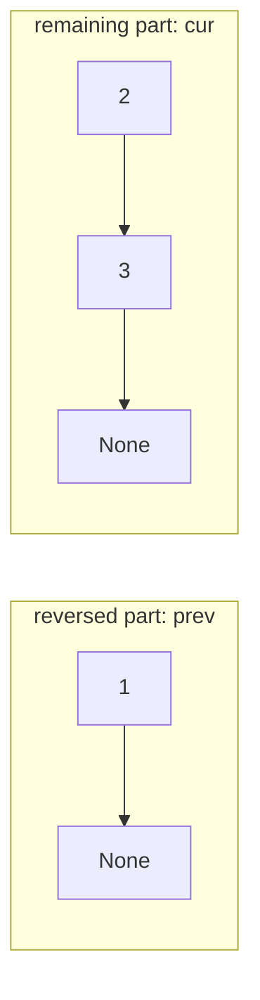
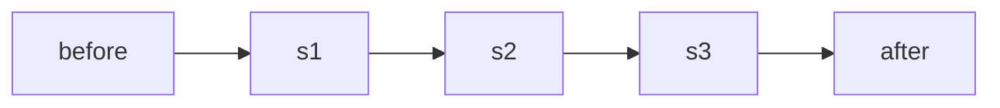
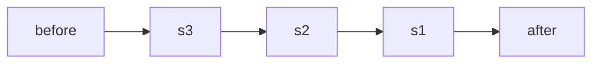
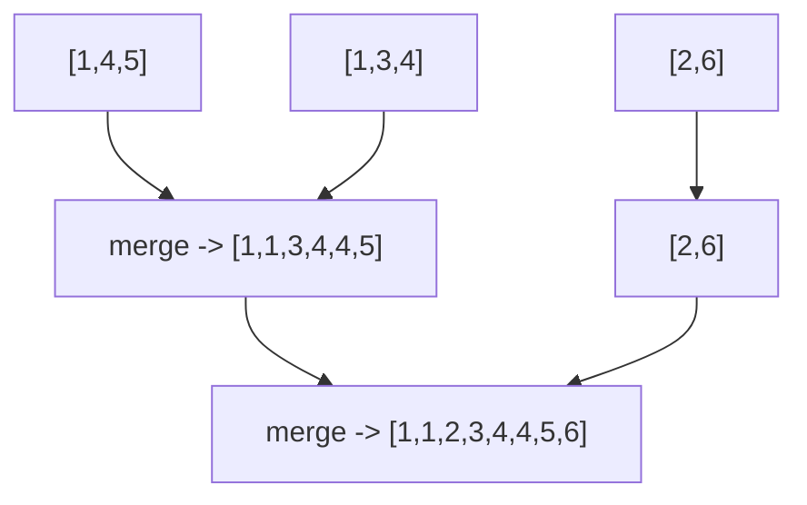
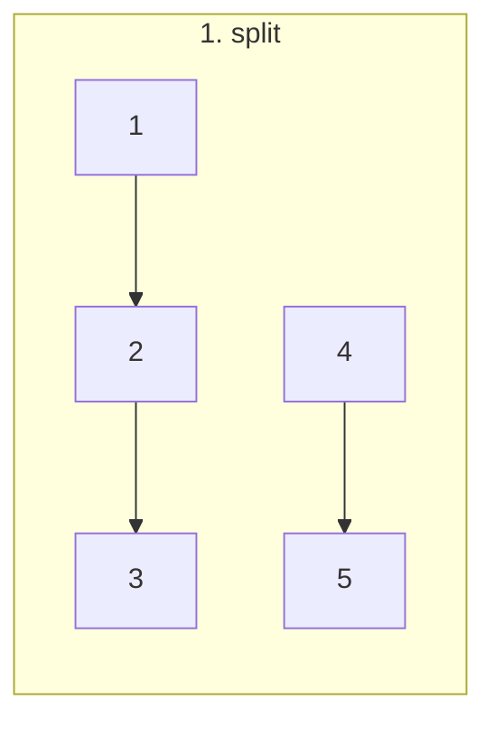
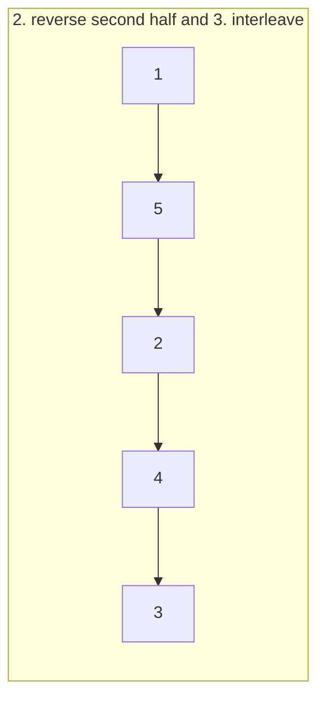

# Reversal, merging and in-place rearrangement

The previous two lessons gave you the vocabulary (nodes, dummies, rewiring) and the measuring tools
(fast/slow and gap pointers). This lesson covers the moves that *transform* lists: reversing all or part of a
list, merging sorted lists (two or k of them), and combining these pieces into in-place rearrangements such
as *Reorder List*, *Palindrome Linked List* and *Reverse Nodes in k-Group*. Most medium and hard
linked-list problems are a short composition of these building blocks.

## 1. Reversing a whole list (iterative)

The arrows must all turn around. Walk the list once, and at each node point its `next` backwards to the
node you just came from. Three names are enough:

- `prev` — the already-reversed part (initially `None`),
- `cur` — the node being processed,
- `nxt` — the rest of the original list, saved before we overwrite `cur.next`.

```python
def reverse(head):
    prev, cur = None, head
    while cur:
        nxt = cur.next     # 1. save the rest
        cur.next = prev    # 2. turn the arrow
        prev = cur         # 3. grow the reversed part
        cur = nxt          # 4. move on
    return prev            # new head
```



A cleaner way to visualise it: the list is split into two lists that trade nodes one at a time.

| step | reversed part (`prev`) | remaining (`cur`) |
|---|---|---|
| 0 | `None` | `1 → 2 → 3` |
| 1 | `1` | `2 → 3` |
| 2 | `2 → 1` | `3` |
| 3 | `3 → 2 → 1` | `None` |

That table *is* the invariant: "`prev` is the reverse of the nodes processed so far, and `cur` is the
untouched remainder". Python's tuple assignment can do the four steps in one line —
`cur.next, prev, cur = prev, cur, cur.next` — because the right-hand side is evaluated completely before
anything is assigned. Be careful with that style: the *targets* are assigned left to right, and `cur.next`
must be assigned while `cur` still refers to the old node, which is why `cur.next` comes first.

```python-run
class ListNode:
    def __init__(self, val=0, next=None):
        self.val, self.next = val, next

def build(vals):
    head = None
    for v in reversed(vals):
        head = ListNode(v, head)
    return head

def to_list(h):
    out = []
    while h:
        out.append(h.val); h = h.next
    return out

def reverse(head):
    prev, cur = None, head
    while cur:
        print("  reversed:", to_list(prev), " remaining:", to_list(cur))
        cur.next, prev, cur = prev, cur, cur.next
    return prev

print(to_list(reverse(build([1, 2, 3, 4]))))
```

## 2. Reversing recursively

The recursive version reverses everything after the head, then fixes up two pointers:

```python
def reverse_rec(head):
    if head is None or head.next is None:
        return head
    new_head = reverse_rec(head.next)   # head.next is now the TAIL of the reversed rest
    head.next.next = head               # hang head after it
    head.next = None                    # head becomes the new tail
    return new_head
```

It is elegant and worth knowing, but it uses one stack frame per node. Python's default recursion limit is
around 1,000, so for lists of thousands of nodes prefer the iterative version.

## 3. Reversing a segment

Many problems reverse only part of a list. The general recipe:

1. Use a dummy node, and walk to `before`, the node **just before** the segment.
2. Reverse the segment's nodes with the usual loop — but initialise `prev` to `after`, the node **just after**
   the segment, instead of `None`. Then the old first node of the segment automatically points to the rest
   of the list when it becomes the segment's last node.
3. Reconnect: `before.next` = the old last node of the segment (the new first).



After reversing:



### Reverse Nodes in k-Group

Apply the segment recipe repeatedly. Before each group, walk k steps from `group_prev` to find the k-th node;
if you run out of nodes, stop — the last partial group stays as is.

```python
def reverse_k_group(head, k):
    dummy = ListNode(0, head)
    group_prev = dummy
    while True:
        kth = group_prev
        for _ in range(k):                 # is there a full group?
            kth = kth.next
            if kth is None:
                return dummy.next
        group_next = kth.next
        prev, cur = group_next, group_prev.next
        while cur is not group_next:       # reverse the group
            cur.next, prev, cur = prev, cur, cur.next
        first = group_prev.next            # old first = new last of the group
        group_prev.next = kth
        group_prev = first
```

```python-run
class ListNode:
    def __init__(self, val=0, next=None):
        self.val, self.next = val, next

def build(vals):
    head = None
    for v in reversed(vals):
        head = ListNode(v, head)
    return head

def to_list(h):
    out = []
    while h:
        out.append(h.val); h = h.next
    return out

def reverse_k_group(head, k):
    dummy = ListNode(0, head)
    group_prev = dummy
    while True:
        kth = group_prev
        for _ in range(k):
            kth = kth.next
            if kth is None:
                return dummy.next
        group_next = kth.next
        prev, cur = group_next, group_prev.next
        while cur is not group_next:
            cur.next, prev, cur = prev, cur, cur.next
        first = group_prev.next
        group_prev.next = kth
        group_prev = first

for k in (1, 2, 3, 5, 6):
    print(k, to_list(reverse_k_group(build([1, 2, 3, 4, 5]), k)))
```

Each node is touched a constant number of times (once while counting, once while reversing), so the whole
thing is O(n) time and O(1) extra space.

## 4. Merging two sorted lists

You saw this in lesson 1. It is worth restating as a building block because many algorithms reuse it:

```python
def merge(a, b):
    dummy = tail = ListNode()
    while a and b:
        if a.val <= b.val:
            tail.next, a = a, a.next
        else:
            tail.next, b = b, b.next
        tail = tail.next
    tail.next = a or b
    return dummy.next
```

O(m + n) time, O(1) extra space, and no nodes are created — the existing nodes are re-threaded.

### Merge sort for linked lists

Linked lists are the natural home of merge sort: splitting at the middle uses fast/slow pointers, merging needs
no extra array. That gives O(n log n) sorting with only O(log n) recursion stack, which is why LeetCode's
*Sort List* expects it.

## 5. Merging k sorted lists

With k lists and N nodes in total there are three standard answers:

| approach | time | extra space | idea |
|---|---|---|---|
| merge one at a time into an accumulator | O(k · N) | O(1) | the accumulator grows; early nodes get re-scanned k times |
| **min-heap of heads** | O(N log k) | O(k) | always pop the globally smallest head |
| **divide & conquer** (pairwise) | O(N log k) | O(1) (iterative) | log k rounds of merges, each round touches N nodes |

The heap version in Python needs one detail: `heapq` compares tuples element by element, and `ListNode`
objects are not comparable, so a tie on value would raise `TypeError`. Add the list index as a tie-breaker:

```python
heap = [(node.val, i, node) for i, node in enumerate(lists) if node]
heapq.heapify(heap)
dummy = tail = ListNode()
while heap:
    _, i, node = heapq.heappop(heap)
    tail.next = tail = node          # careful: assigns tail.next first, then tail
    if node.next:
        heapq.heappush(heap, (node.next.val, i, node.next))
return dummy.next
```

> [!WARNING]
> `tail.next = tail = node` works because chained assignment assigns the targets **left to right** with the
> same value: first `tail.next = node` (on the old tail), then `tail = node`. Writing `tail = tail.next = node`
> also works. If that feels too clever, use two lines.



## 6. Composite moves: split, reverse, merge

Several popular problems are three building blocks glued together.

### Reorder List

Target: $L_0, L_{n-1}, L_1, L_{n-2}, \dots$ That is the front half interleaved with the back half *read
backwards*. So:

1. **Split** at the middle (first-middle variant), cutting the link: `second = slow.next; slow.next = None`.
2. **Reverse** the second half.
3. **Interleave** the two halves, alternating nodes.





```python-run
class ListNode:
    def __init__(self, val=0, next=None):
        self.val, self.next = val, next

def build(vals):
    head = None
    for v in reversed(vals):
        head = ListNode(v, head)
    return head

def to_list(h):
    out = []
    while h:
        out.append(h.val); h = h.next
    return out

def reorder(head):
    slow, fast = head, head.next
    while fast and fast.next:
        slow, fast = slow.next, fast.next.next
    second, slow.next = slow.next, None      # split
    prev = None
    while second:                            # reverse
        second.next, prev, second = prev, second, second.next
    first, second = head, prev
    while second:                            # interleave
        n1, n2 = first.next, second.next
        first.next, second.next = second, n1
        first, second = n1, n2
    return head

for n in range(1, 8):
    print(n, to_list(reorder(build(list(range(1, n + 1))))))
```

### Palindrome Linked List

1. Find the middle. 2. Reverse the second half. 3. Walk both halves comparing values. (Optionally reverse the
second half back to restore the input.) O(n) time, O(1) space — the follow-up interviewers ask for after the
easy "copy to an array" answer.

### Add Two Numbers

Not a reversal problem — but its *forward-order* follow-up (LeetCode 445) is: reverse both lists, add with the
usual carry loop, reverse the result (or use two stacks).

## 7. Deep copies with extra pointers

*Copy List with Random Pointer* adds a twist: each node has a `random` pointer to any node. The general
technique for cloning *any* pointer structure is a map from **old node → new node**:

1. First pass: create a copy of every node, `clone[old] = Node(old.val)`.
2. Second pass: wire the copies, `clone[old].next = clone[old.next]`, `clone[old].random = clone[old.random]`.

Seeding `clone[None] = None` removes all null checks. The same recipe clones graphs (*Clone Graph*). There is
also an O(1)-extra-space trick: weave each copy right after its original (`A → A' → B → B'`), set
`A'.random = A.random.next`, then unweave.

## 8. Debugging pointer code

- **Print the list after every step** with a small helper (as in the demos). Guard against cycles by
  limiting the number of nodes you print.
- **Test the tiny cases**: empty list, one node, two nodes, and both parities of length. Most bugs surface
  at n = 0, 1 or 2.
- **Check that the list is terminated**: the new tail must point to `None`. A missing cut is the classic
  source of infinite loops in *Reorder List* and merge sort.

> [!INTERVIEW]
> For hard list problems, narrate the decomposition first: "I'll find the middle with fast/slow, reverse the
> back half in place, then interleave." Then write each piece as a tiny helper. Interviewers grade the
> decomposition at least as much as the code.

## Summary

- Iterative reversal: `prev`, `cur`, `nxt`; the invariant is "prev is reversed, cur is the rest".
- Segment reversal: initialise `prev` to the node after the segment, then reconnect the node before it.
- Merge two sorted lists with dummy + tail; merge k with a heap (`(val, index, node)`) or pairwise.
- Many problems are compositions: split (fast/slow) → reverse → merge/compare.
- Deep copies use an old→new map built in two passes.

```quiz
[
  {"q": "In iterative reversal, what does `prev` hold after processing the first i nodes?", "options": ["The original head", "The reversed list of those i nodes", "The (i+1)-th node", "None"], "answer": 1,
   "explain": "That is the loop invariant: prev is the head of the reversed prefix; cur is the head of the untouched remainder."},
  {"q": "Why is the recursive reversal risky in Python for long lists?", "options": ["It's O(n^2)", "It uses one stack frame per node and can exceed the recursion limit (~1000)", "It mutates values", "It cannot handle empty lists"], "answer": 1,
   "explain": "Each node adds a frame; thousands of nodes trigger RecursionError."},
  {"q": "When reversing a segment, initialising prev to the node after the segment achieves…", "options": ["Nothing useful", "The segment's old first node ends up pointing at the rest of the list automatically", "It reverses the rest of the list too", "It creates a cycle"], "answer": 1,
   "explain": "The first node processed gets next = prev = the node after the segment."},
  {"q": "Merging k sorted lists one at a time into an accumulator costs…", "options": ["O(N log k)", "O(k · N)", "O(N)", "O(k log N)"], "answer": 1,
   "explain": "The accumulator grows, and early nodes are re-scanned in each of the k merges."},
  {"q": "Why push (val, i, node) instead of (val, node) into heapq?", "options": ["Speed", "If two vals tie, Python would compare ListNode objects and raise TypeError; i breaks ties", "heapq needs 3-tuples", "To keep the merge stable only"], "answer": 1,
   "explain": "Tuples compare element by element; the unique index guarantees nodes are never compared."},
  {"q": "In Reorder List, what goes wrong if you forget `slow.next = None` after splitting?", "options": ["Nothing", "The first half still links into the (now reversed) second half, creating a cycle", "The list gets shorter", "The reversal fails to run"], "answer": 1,
   "explain": "Without the cut, the last node of the first half points into the second half, and after interleaving you get a loop."},
  {"q": "The general recipe for deep-copying a pointer structure is…", "options": ["copy.copy", "Map old node → new node, then wire copies through the map", "Reverse then copy", "Sort the nodes"], "answer": 1,
   "explain": "Two passes: create all copies, then set next/random (or neighbors) via the map."}
]
```

> **Source:** Goodrich, Tamassia & Goldwasser, *Data Structures and Algorithms in Python*, ch. 7.1–7.5 (singly and doubly linked lists, positional lists, sorting a positional list) and ch. 12 for merge sort on sequences.
