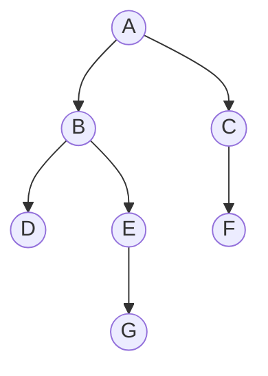
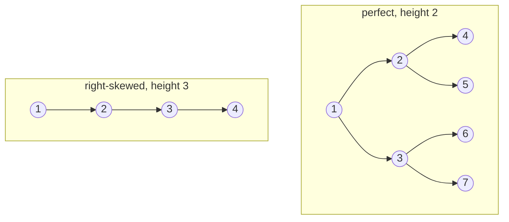
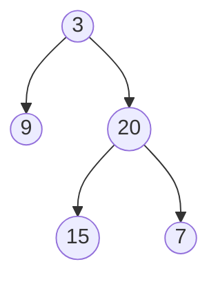

# Tree vocabulary, shapes and representations

> **Before this lesson:** you should know what a node and a reference are — see [Nodes, pointers and the dummy-node trick](#/lesson/neet-linked-trees/ll-pointers) — and be able to read a function that calls itself (recursion); if recursion is new, read [Thinking recursively: four classic examples](#/lesson/dsa-foundations/recursion-examples) first. The logarithm `log₂ n` is used once and is explained where it appears.

## In plain words

A **tree** stores things that are organised in **levels, with each thing belonging to exactly one thing
above it**. A family tree drawn from one ancestor downward is the classic picture; so are the folders on your
computer (every folder sits inside exactly one parent folder) and a company chart (everyone has one manager,
except the boss at the top).

Computer scientists draw trees upside down: the starting point, called the **root**, is at the top, and the
structure grows downward. Each item is again called a **node**. A node directly below another is its
**child**; the one directly above is its **parent**. A node with no children is a **leaf**. A **binary
tree** is the special case where every node has at most two children, called the *left* child and the
*right* child.

One number will come up again and again: `log₂ n` ("log base two of n") is the number of times you can halve
n before reaching 1 — about 10 for a thousand, 20 for a million. A well-shaped tree with n nodes is only
about `log₂ n` levels deep, which is why trees make searching fast.

**Why it matters for a job.** Trees are everywhere in software: the structure of a web page (the DOM),
JSON documents, file systems, database indexes, the syntax of a program inside a compiler. Tree questions
are among the most common in coding interviews because one short pattern — "solve it for the children,
combine the answers" — solves a remarkable number of them.

Linked lists are one-dimensional: every node has at most one successor. Allow a node to have **several**
successors and forbid loops, and you get a **tree** — the most important non-linear structure in computer
science. File systems, HTML documents, organisation charts, the call stack of a recursive function, decision
trees in machine learning, the indexes inside every database: all trees.

For interviews, trees matter because a huge family of problems reduces to "visit every node and combine what
the children tell you". This lesson gives you the vocabulary and the facts you need to talk precisely about
trees, and the exact input format the judge uses, so that the next three lessons can focus on algorithms.

## 1. Definitions

A **tree** is a set of nodes with a parent–child relationship such that:

- one special node, the **root**, has no parent;
- every other node has exactly one parent;
- following parents from any node eventually reaches the root (so there are no cycles).

Goodrich (ch. 8.1) also allows the empty tree, and so does LeetCode: `root = None` is a valid tree with zero
nodes. Handle it first in every function.



Using the tree above:

| term | meaning | example |
|---|---|---|
| root | the node without a parent | A |
| parent / child | direct link, parent above | B is the parent of D and E |
| siblings | children of the same parent | D and E |
| leaf (external node) | node with no children | D, G, F |
| internal node | node with at least one child | A, B, C, E |
| ancestor | parent, grandparent, … (a node counts as its own ancestor in many definitions, including LCA problems) | A and B are ancestors of E |
| descendant | child, grandchild, … | G is a descendant of B |
| subtree rooted at v | v together with all its descendants | subtree at B = {B, D, E, G} |
| edge | a parent–child pair | (B, E) |
| path | a sequence of nodes joined by edges | D–B–E–G |

### Depth and height

- The **depth** of a node is the number of its ancestors excluding itself — equivalently, the number of
  edges from the root to it. The root has depth 0. (D has depth 2, G has depth 3.)
- The **height** of a node is the number of edges on the longest downward path from it to a leaf. Leaves
  have height 0. The **height of a tree** is the height of its root, which equals the maximum depth of any
  node (here 3).

> [!WARNING]
> LeetCode's *Maximum Depth of Binary Tree* counts **nodes** on the longest root-to-leaf path, not edges,
> so its answer is height + 1 (here 4), and 0 for the empty tree. *Diameter of Binary Tree* counts **edges**.
> Always check which one a problem means; off-by-one errors here are the most common tree bug.

Goodrich gives two ways to compute depth and height that are worth comparing. Depth is computed by walking
*up* to the root: O(depth). Height is computed *recursively downward*: `height(v) = 0` for a leaf, else
`1 + max(height(child))`. Computing the height of the root by trying every leaf's depth costs O(n²) in the
worst case, while the recursive definition costs O(n) — your first taste of the "return values up the tree"
pattern.

## 2. Binary trees

A **binary tree** is a tree in which every node has at most two children, called the **left** and **right**
child — and the distinction matters: a single left child and a single right child are *different* trees.

```python
class TreeNode:
    def __init__(self, val=0, left=None, right=None):
        self.val = val
        self.left = left
        self.right = right
```

Special shapes you should be able to name:

- **Proper (full)** binary tree: every node has 0 or 2 children.
- **Complete** binary tree: every level is full except possibly the last, which is filled from the left.
  Heaps are complete binary trees.
- **Perfect** binary tree: all internal nodes have 2 children and all leaves have the same depth.
- **Skewed (degenerate)** tree: every node has at most one child — effectively a linked list.
- **Balanced** (height-balanced): at every node the heights of the two subtrees differ by at most 1.



### Counting facts (Goodrich, Prop. 8.8)

Level $d$ of a binary tree holds at most $2^d$ nodes. Summing levels $0..h$ gives, for a non-empty binary tree
with $n$ nodes and height $h$:

$$h + 1 \le n \le 2^{h+1} - 1 \qquad\Longleftrightarrow\qquad \log_2(n + 1) - 1 \le h \le n - 1.$$

So the height of a binary tree with $n$ nodes is somewhere between about $\log_2 n$ (perfectly balanced) and
$n - 1$ (a chain). **This range drives almost every complexity statement about trees.** A DFS uses O(h) stack
space: O(log n) on balanced trees, O(n) on skewed ones. A BST search is O(h): fast when balanced, as slow as
a linked list when skewed.

Another useful fact for proper binary trees: the number of leaves is exactly one more than the number of
internal nodes ($n_E = n_I + 1$). In any binary tree with $n$ nodes there are $n - 1$ edges (every node but
the root has exactly one parent edge) and $n + 1$ `None` child slots — which is why a serialisation with null
markers has $2n + 1$ tokens.

## 3. Representations

### Linked structure

The `TreeNode` class above is the *linked* representation (Goodrich §8.3.1): each node stores its value and
references to its children (some implementations also store a `parent` reference). Space O(n), flexible
shapes, and it is what LeetCode uses.

### Array-based (level numbering)

Number the positions level by level: root at index 0, and for a node at index $i$, its children are at
$2i + 1$ and $2i + 2$ and its parent at $(i - 1) // 2$. A **complete** tree fits in an array with no gaps,
which is why heaps are stored this way. For sparse trees the array is wasteful — a skewed tree of $n$ nodes
needs up to $2^n - 1$ slots.

```python-run
# array representation of a complete binary tree
tree = ["A", "B", "C", "D", "E", "F"]
for i, v in enumerate(tree):
    kids = [tree[j] for j in (2 * i + 1, 2 * i + 2) if j < len(tree)]
    parent = tree[(i - 1) // 2] if i else None
    print(f"{v}: parent={parent}, children={kids}")
```

### General trees

When nodes can have any number of children, store a list: `self.children = []`. File systems and tries
(module 3) work this way. Everything in the traversal lesson still applies; you loop over `children` instead
of looking at `left` and `right`.

## 4. The judge's format: LeetCode level order

Every tree problem in this track gives trees as a **level-order list with `None` placeholders**. Read it like
this:

1. The first value is the root.
2. Keep a queue of nodes that still need children. For each node taken from the queue, the next two values
   in the list are its left and right child; `None` means "no child here".
3. `None` children are **not** queued, so they get no placeholder slots of their own below them.
4. Trailing `None`s are dropped.

Example: `[3, 9, 20, None, None, 15, 7]`



- 3 is the root; its children are 9 and 20.
- 9's children are `None, None`.
- 20's children are 15 and 7.

Notice rule 3: a right-skewed chain 1 → 2 → 3 is written `[1, None, 2, None, 3]`, *not*
`[1, None, 2, None, None, None, 3]`. This is different from the array numbering of §3.

The judge converts that list to `TreeNode`s before calling your method, and converts a returned `TreeNode`
back to the same format. You can reproduce both conversions yourself — doing so is a great exercise in BFS:

```python-run
from collections import deque

class TreeNode:
    def __init__(self, val=0, left=None, right=None):
        self.val, self.left, self.right = val, left, right

def to_tree(arr):
    if not arr or arr[0] is None:
        return None
    it = iter(arr)
    root = TreeNode(next(it))
    q = deque([root])
    while q:
        node = q.popleft()
        for side in ("left", "right"):
            v = next(it, "END")
            if v == "END":
                return root
            if v is not None:
                child = TreeNode(v)
                setattr(node, side, child)
                q.append(child)
    return root

def to_list(root):
    out, q = [], deque([root])
    while q:
        n = q.popleft()
        out.append(None if n is None else n.val)
        if n:
            q.extend([n.left, n.right])
    while out and out[-1] is None:
        out.pop()
    return out

def draw(node, indent=""):
    """sideways drawing: right subtree on top"""
    if node:
        draw(node.right, indent + "    ")
        print(indent + str(node.val))
        draw(node.left, indent + "    ")

root = to_tree([3, 9, 20, None, None, 15, 7])
draw(root)
print(to_list(root))
print(to_list(to_tree([1, None, 2, None, 3])))
```

> [!TIP]
> When a test fails, paste the input into a demo like the one above and `draw` it. Seeing the shape is
> usually enough to spot the case you forgot (a node with only a right child, a skewed tree, an empty tree).

## 5. Thinking recursively about trees

The most useful single idea about trees: **a tree is a root plus two smaller trees.** Any question about a
tree can be asked about the two subtrees, and the answers combined. Template:

```python
def solve(node):
    if node is None:
        return BASE_CASE            # answer for the empty tree
    left = solve(node.left)
    right = solve(node.right)
    return COMBINE(node.val, left, right)
```

Examples:

| question | base case | combine |
|---|---|---|
| number of nodes | 0 | `1 + left + right` |
| sum of values | 0 | `node.val + left + right` |
| height (in nodes) | 0 | `1 + max(left, right)` |
| is every value positive? | True | `node.val > 0 and left and right` |
| maximum value | `-inf` | `max(node.val, left, right)` |

```python-run
class TreeNode:
    def __init__(self, val=0, left=None, right=None):
        self.val, self.left, self.right = val, left, right

#        5
#      /   \
#     3     8
#    / \     \
#   1   4     9
root = TreeNode(5, TreeNode(3, TreeNode(1), TreeNode(4)), TreeNode(8, None, TreeNode(9)))

def count(n):  return 0 if n is None else 1 + count(n.left) + count(n.right)
def total(n):  return 0 if n is None else n.val + total(n.left) + total(n.right)
def depth(n):  return 0 if n is None else 1 + max(depth(n.left), depth(n.right))
def leaves(n):
    if n is None: return 0
    if n.left is None and n.right is None: return 1
    return leaves(n.left) + leaves(n.right)

print("nodes", count(root), "sum", total(root), "max depth", depth(root), "leaves", leaves(root))
```

Every node is visited once, so all of these are O(n) time and O(h) space for the recursion stack.

> [!WARNING]
> Python's default recursion limit is about 1,000 frames. Recursive solutions are fine for balanced trees
> (height ≈ 14 for 10,000 nodes) but a chain of a few thousand nodes overflows. The tests in this track keep
> skewed trees ≤ 500 deep so recursion is safe, but you will also learn iterative versions with an explicit
> stack in the next lesson.

## 6. Trees vs graphs

A tree is a connected graph with no cycles; with $n$ nodes it has exactly $n - 1$ edges. Rooting it gives
the parent/child direction. Because there are no cycles, tree traversals never need a `visited` set — you
cannot reach a node twice by following child pointers. Graph traversals (module on graphs) are the same
algorithms *plus* a visited set.

## Summary

- Root, parent/child, leaf/internal, ancestor/descendant, subtree, depth (from the top) and height (from the bottom).
- Binary trees: left/right children matter; complete, perfect, proper, skewed and balanced shapes.
- $\log_2(n+1) - 1 \le h \le n - 1$: tree algorithms cost O(h) per root-to-leaf walk, which ranges from O(log n) to O(n).
- LeetCode level order: queue-based, `None` children get no slots, trailing `None`s dropped.
- Think recursively: base case for `None`, combine the children's answers.

## Glossary

- **Tree** — nodes connected by parent–child links, with one root and no cycles.
- **Root** — the only node without a parent; the top of the tree.
- **Parent / child / sibling** — the node directly above / directly below / sharing the same parent.
- **Leaf (external node)** — a node with no children. **Internal node** — a node with at least one child.
- **Ancestor / descendant** — any node on the way up to the root / anywhere below.
- **Subtree** — a node together with everything below it; itself a tree.
- **Edge** — one parent–child link. **Path** — a sequence of nodes joined by edges.
- **Depth** — the number of edges from the root down to a node (the root has depth 0).
- **Height** — the number of edges on the longest path from a node down to a leaf; the height of the tree is the height of its root.
- **Level** — all nodes with the same depth.
- **Binary tree** — a tree where every node has at most a left child and a right child.
- **Complete / perfect / proper (full)** — shapes defined in §2: filled level by level from the left / every level completely full / every node has 0 or 2 children.
- **Skewed (degenerate) tree** — every node has at most one child, so the tree is really a chain.
- **Balanced tree** — at every node the two subtrees' heights differ by at most 1.
- **`log₂ n`** — how many times n can be halved before reaching 1; the height of a well-balanced tree with n nodes.
- **Level-order list** — the judge's way of writing a tree: values level by level with `None` for a missing child.
- **Base case** — the input small enough to answer directly in a recursive function (for trees, usually the empty tree `None`).

## Check yourself

```quiz
[
  {"q": "In the level-order list [1, None, 2, 3], what is node 3?", "options": ["Right child of 1", "Left child of 2", "Right child of 2", "Left child of 1"], "answer": 1,
   "explain": "1 has children (None, 2). Only 2 is queued, so the next values (3, …) are 2's left and right; 3 is 2's left child."},
  {"q": "A leaf has height…", "options": ["1", "0", "-1", "Depends on its depth"], "answer": 1,
   "explain": "Height counts edges on the longest downward path; a leaf has none. (LeetCode's 'max depth' counts nodes, giving 1.)"},
  {"q": "What is the minimum possible height of a binary tree with 15 nodes?", "options": ["3", "4", "7", "14"], "answer": 0,
   "explain": "A perfect tree of height 3 holds 2^4 - 1 = 15 nodes."},
  {"q": "What is the maximum height of a binary tree with n nodes?", "options": ["log2 n", "n - 1", "n", "n/2"], "answer": 1,
   "explain": "A chain (skewed tree) has n - 1 edges from root to the single leaf."},
  {"q": "Why does a tree DFS not need a visited set?", "options": ["Trees are small", "Following child pointers can never return to a node, because trees have no cycles and each node has one parent", "Python handles it", "It does need one"], "answer": 1,
   "explain": "Each node is reachable along exactly one path from the root."},
  {"q": "In the array representation, the children of index i are at…", "options": ["i+1 and i+2", "2i and 2i+1 (0-based)", "2i+1 and 2i+2 (0-based)", "i/2"], "answer": 2,
   "explain": "With 0-based indexing, children are 2i+1 and 2i+2 and the parent is (i-1)//2."},
  {"q": "How many None child slots does a binary tree with n nodes have?", "options": ["n - 1", "n", "n + 1", "2n"], "answer": 2,
   "explain": "2n child slots in total, n - 1 of them used by edges, leaving n + 1 empty ones."}
]
```

> **Source:** Goodrich, Tamassia & Goldwasser, *Data Structures and Algorithms in Python*, ch. 8.1 (general trees, depth and height), 8.2 (binary trees and Proposition 8.8) and 8.3 (linked and array-based representations).
