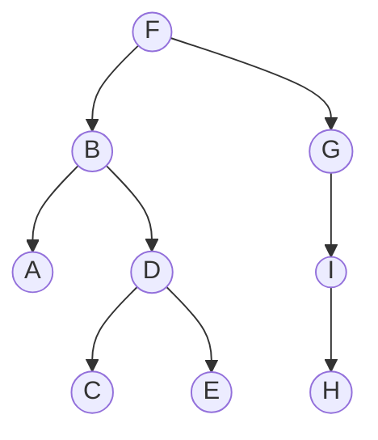
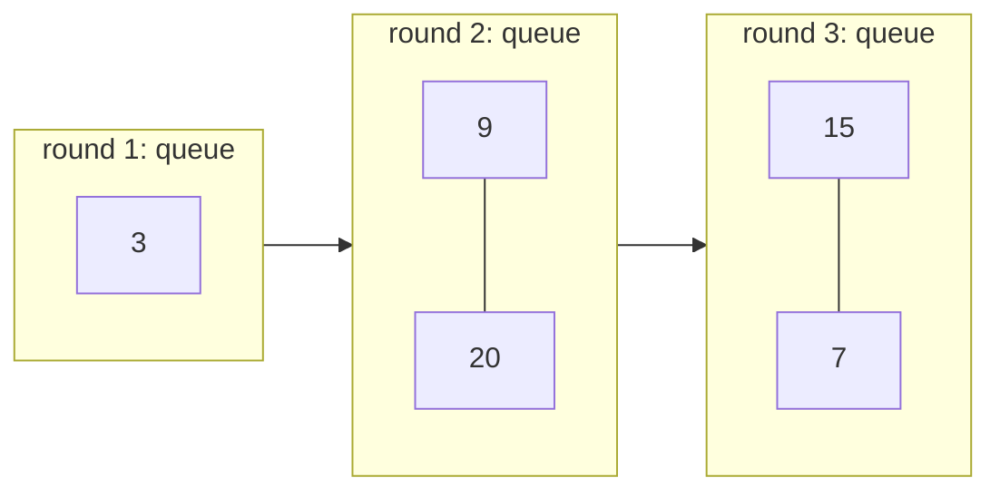

# Traversals: DFS (pre/in/post) and BFS

A **traversal** visits every node of a tree exactly once. That sounds trivial, but the *order* of the visits
is what makes a traversal useful: printing a table of contents needs parents before children, deleting a
directory needs children before parents, reading a binary search tree in sorted order needs left before node
before right, and finding the shallowest leaf needs level by level. This lesson covers the four orders that
matter — **preorder, inorder, postorder** (the depth-first family) and **level order** (breadth-first) — in
both recursive and iterative form.

## 1. The depth-first family

Depth-first search (DFS) goes as deep as possible along one branch before backing up. For a binary tree the
recursion has three slots where you could "visit" the node:

```python
def dfs(node):
    if node is None:
        return
    # (1) PREORDER: visit here — before the children
    dfs(node.left)
    # (2) INORDER: visit here — between the children
    dfs(node.right)
    # (3) POSTORDER: visit here — after the children
```

Take this tree:



(`G` has only a right child `I`; `I` has only a left child `H`.)

| order | rule | result |
|---|---|---|
| preorder | node, left, right | F B A D C E G I H |
| inorder | left, node, right | A B C D E F G H I |
| postorder | left, right, node | A C E D B H I G F |

Notice that the inorder result is alphabetical: this tree is a binary search tree, and inorder traversal of
a BST always produces the keys in sorted order. That fact powers several problems in this module.

```python-run
class TreeNode:
    def __init__(self, val=0, left=None, right=None):
        self.val, self.left, self.right = val, left, right

T = TreeNode
root = T("F", T("B", T("A"), T("D", T("C"), T("E"))), T("G", None, T("I", T("H"))))

def pre(n):  return [n.val] + pre(n.left) + pre(n.right) if n else []
def ino(n):  return ino(n.left) + [n.val] + ino(n.right) if n else []
def post(n): return post(n.left) + post(n.right) + [n.val] if n else []

print("pre ", " ".join(pre(root)))
print("in  ", " ".join(ino(root)))
print("post", " ".join(post(root)))
```

> [!NOTE]
> The list-concatenation style above is short and great for understanding, but each `+` copies lists, making
> it O(n·h). In real solutions pass an output list down and `append` to it, which is O(n).

### When to use which

- **Preorder** — the parent must be handled before its children: copying or serialising a tree, printing an
  indented outline, passing information *down* (the running sum in *Path Sum*, the max-so-far in *Count Good
  Nodes*).
- **Inorder** — only for binary trees; sorted order of a BST (*Validate BST*, *Kth Smallest*).
- **Postorder** — the parent needs results from its children: heights, sizes, *Diameter*, *Balanced*,
  *Maximum Path Sum*, freeing memory, evaluating an expression tree. This is the "return values up the tree"
  pattern of the next lesson.

Goodrich (§8.4.6) unifies all three as an **Euler tour**: walk around the tree keeping it on your left. You
pass each node three times — on the left (pre), underneath (in), on the right (post). Each traversal is just
"which of the three passes do you record?".

## 2. Recursion and the call stack

Every recursive DFS uses the call stack to remember where to come back to. The stack depth equals the depth of
the current node, so the space cost is O(h): O(log n) for balanced trees and O(n) for skewed ones. Python's
default recursion limit (about 1,000) is therefore a real constraint for deep trees, and interviewers like to
ask how you would traverse *without* recursion. The answer is to manage the stack yourself.

## 3. Iterative preorder

Push the root. Repeatedly pop a node, visit it, then push its children — **right first** so that the left
child is on top and processed next.

```python
def preorder(root):
    out, stack = [], [root]
    while stack:
        node = stack.pop()
        if node:
            out.append(node.val)
            stack.append(node.right)
            stack.append(node.left)
    return out
```

This is the simplest iterative traversal and is usually all you need when the order of visiting does not
matter (counting, inverting, searching): any problem where each node is handled independently of its
children's results.

## 4. Iterative inorder

Inorder needs a node to wait until its whole left subtree is finished. Use a `cur` pointer: slide left,
pushing every node you pass; when you cannot go further left, pop — that node is next in inorder — and then
continue from its right child.

```python
def inorder(root):
    out, stack, cur = [], [], root
    while stack or cur:
        while cur:                 # go as far left as possible
            stack.append(cur)
            cur = cur.left
        cur = stack.pop()          # leftmost unvisited node
        out.append(cur.val)
        cur = cur.right            # then its right subtree
    return out
```

The stack always holds the chain of ancestors whose left subtrees are in progress. A nice property: you can
**stop early**. *Kth Smallest Element in a BST* pops k times and returns — O(h + k) instead of O(n).

```python-run
class TreeNode:
    def __init__(self, val=0, left=None, right=None):
        self.val, self.left, self.right = val, left, right

T = TreeNode
root = T(5, T(3, T(2, T(1)), T(4)), T(6))

def inorder_verbose(root):
    out, stack, cur = [], [], root
    while stack or cur:
        while cur:
            stack.append(cur)
            cur = cur.left
        cur = stack.pop()
        out.append(cur.val)
        print(f"visit {cur.val}  stack now {[n.val for n in stack]}")
        cur = cur.right
    return out

print(inorder_verbose(root))
```

## 5. Iterative postorder

Two common approaches:

**Reverse trick.** A "node, right, left" preorder is exactly the reverse of postorder. So run a preorder that
pushes left before right, and reverse the result.

```python
def postorder(root):
    out, stack = [], [root]
    while stack:
        node = stack.pop()
        if node:
            out.append(node.val)
            stack.append(node.left)
            stack.append(node.right)
    return out[::-1]
```

**Visited flag.** Push `(node, False)`; when popped with `False`, push it back as `(node, True)` and then its
children; when popped with `True`, visit it. This generalises to any order and is the cleanest way to
compute bottom-up values iteratively (store each child's result in a dict keyed by node).

```python
def postorder_flags(root):
    out, stack = [], [(root, False)]
    while stack:
        node, done = stack.pop()
        if not node:
            continue
        if done:
            out.append(node.val)
        else:
            stack.append((node, True))      # visit after the children
            stack.append((node.right, False))
            stack.append((node.left, False))
    return out
```

> [!TIP]
> With the flag version you get inorder by pushing `right, (node, True), left` and preorder by pushing
> `right, left, (node, True)`. One template, three orders.

## 6. Breadth-first search: level order

BFS visits nodes in order of their depth: the root, then all nodes at depth 1 from left to right, then
depth 2, and so on. It uses a **queue** (first in, first out) instead of a stack:

```python
from collections import deque

def level_order(root):
    if not root:
        return []
    res, q = [], deque([root])
    while q:
        level = []
        for _ in range(len(q)):        # exactly the nodes of the current level
            node = q.popleft()
            level.append(node.val)
            if node.left:
                q.append(node.left)
            if node.right:
                q.append(node.right)
        res.append(level)
    return res
```

The `for _ in range(len(q))` line is the key idiom: at the start of each iteration of the outer loop, the
queue contains *exactly one level*. Freezing its length lets you process that level as a group while the
next level is being appended behind it.



```python-run
from collections import deque

class TreeNode:
    def __init__(self, val=0, left=None, right=None):
        self.val, self.left, self.right = val, left, right

T = TreeNode
root = T(1, T(2, T(4), T(5, T(7))), T(3, None, T(6)))

def levels(root):
    res, q = [], deque([root] if root else [])
    while q:
        level = []
        for _ in range(len(q)):
            n = q.popleft()
            level.append(n.val)
            q.extend(c for c in (n.left, n.right) if c)
        res.append(level)
    return res

L = levels(root)
print("levels          ", L)
print("right side view ", [lvl[-1] for lvl in L])
print("left side view  ", [lvl[0] for lvl in L])
print("zigzag          ", [lvl if i % 2 == 0 else lvl[::-1] for i, lvl in enumerate(L)])
print("max depth       ", len(L))
```

Many problems are one-line variations once you have the levels: right side view, averages per level, zigzag
order, maximum width, minimum depth (stop at the first leaf).

> [!WARNING]
> Use `collections.deque`. `list.pop(0)` shifts every remaining element and turns BFS into O(n²).

### DFS can do levels too

Pass the depth down and use it as an index:

```python
def level_order_dfs(root):
    res = []
    def dfs(node, depth):
        if not node:
            return
        if depth == len(res):
            res.append([])
        res[depth].append(node.val)
        dfs(node.left, depth + 1)
        dfs(node.right, depth + 1)
    dfs(root, 0)
    return res
```

Because DFS visits left before right, values within each level still come out left to right. The *right side
view* with DFS visits right first and records a node when `depth == len(res)` — the first node seen at each
depth is the rightmost.

## 7. DFS vs BFS: choosing

| | DFS (stack/recursion) | BFS (queue) |
|---|---|---|
| memory | O(h) | O(w), w = max width (up to ~n/2) |
| natural for | subtree computations, paths from root, sorted BST order | anything "per level", shortest distance from the root |
| finds first | some deep leaf | the shallowest node satisfying a condition |
| deep skewed tree | stack depth n | queue size 1 |
| full balanced tree | stack depth log n | queue size n/2 |

For a balanced tree DFS uses much less memory; for a skewed tree BFS does. In interviews, pick the one whose
order matches the question and mention the trade-off.

## 8. Complexity of traversals

Every traversal visits each node once and does O(1) work per visit, so time is **O(n)**. Space is the size
of the stack or queue: O(h) for DFS, O(w) for BFS. Neither needs a visited set because trees have no cycles.

A more exotic option, **Morris traversal**, achieves inorder in O(1) extra space by temporarily making each
node's inorder predecessor point back to it (a "thread"), then removing the thread on the second visit. It is
rarely required but makes a strong follow-up answer.

## 9. Practice mapping

| problem | traversal |
|---|---|
| Invert Binary Tree | any (preorder with a stack is simplest) |
| Maximum Depth | postorder recursion, or BFS counting levels |
| Binary Tree Inorder Traversal | inorder, iterative |
| Same Tree / Subtree | simultaneous preorder on two trees |
| Path Sum, Count Good Nodes | preorder, passing state down |
| Level Order, Right Side View | BFS |
| Kth Smallest in BST, Validate BST | inorder (or bounds passed down) |
| Diameter, Balanced, Max Path Sum | postorder (return values up) |

## Summary

- Preorder (node first), inorder (node between), postorder (node last); BFS goes level by level.
- Recursive DFS uses O(h) call-stack space; iterative versions use an explicit stack.
- Iterative inorder: slide left pushing nodes, pop, go right. Iterative postorder: reversed modified preorder, or the visited-flag template.
- BFS: `deque` + `for _ in range(len(q))` to process exactly one level per round.
- Choose by the order the problem needs; mention O(h) vs O(w) memory.

```quiz
[
  {"q": "Which traversal of a BST outputs the keys in sorted order?", "options": ["Preorder", "Inorder", "Postorder", "Level order"], "answer": 1,
   "explain": "Left subtree (smaller keys), node, right subtree (larger keys)."},
  {"q": "To compute the height of every node you should use…", "options": ["Preorder", "Postorder", "Inorder", "Any order works equally naturally"], "answer": 1,
   "explain": "A node's height depends on its children's heights, so children must be finished first."},
  {"q": "In iterative preorder with a stack, why push the right child before the left?", "options": ["It's arbitrary", "The stack is LIFO, so the left child ends up on top and is processed first", "To save memory", "To get inorder"], "answer": 1,
   "explain": "Last in, first out: pushing left last makes it the next node popped."},
  {"q": "What does `for _ in range(len(q))` achieve in BFS?", "options": ["It speeds up popleft", "It processes exactly the nodes of the current level, even though children are appended during the loop", "It avoids None children", "It sorts the level"], "answer": 1,
   "explain": "len(q) is evaluated once, at the start of the level."},
  {"q": "Preorder of a tree is A B D E C. What is the reversed order of a 'node, right, left' traversal?", "options": ["The inorder", "The postorder", "The level order", "The preorder"], "answer": 1,
   "explain": "Reversing node-right-left gives left-right-node, i.e. postorder."},
  {"q": "For a perfectly balanced tree with a million nodes, which uses less memory?", "options": ["BFS", "DFS", "They are equal", "Neither: both need O(n)"], "answer": 1,
   "explain": "DFS needs O(h) ≈ 20 frames; BFS holds a whole level, up to ~500,000 nodes."},
  {"q": "Why does a tree traversal not need a `visited` set?", "options": ["Because we use recursion", "Because no node is reachable along two different paths from the root", "Because values are unique", "It does need one"], "answer": 1,
   "explain": "Trees have no cycles and each node has a single parent."}
]
```

> **Source:** Goodrich, Tamassia & Goldwasser, *Data Structures and Algorithms in Python*, ch. 8.4 (preorder, postorder, breadth-first and inorder traversals; implementing traversals with generators; Euler tours and the template method pattern).
