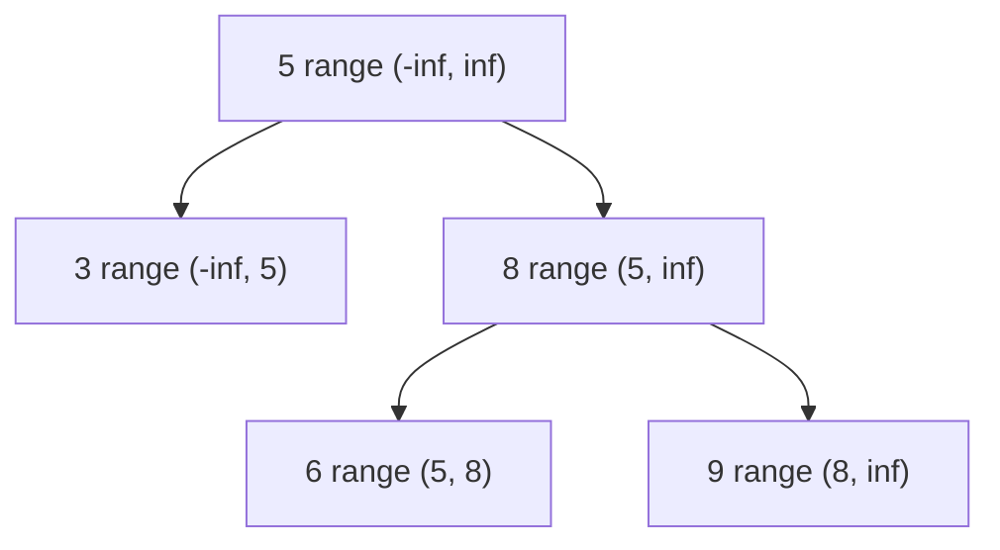
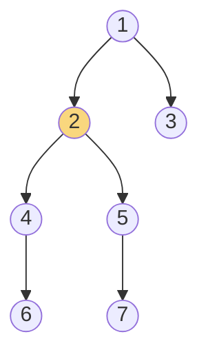

# Returning values up the tree

Most medium and hard tree problems look different on the surface — diameters, balance checks, path sums,
"good" nodes, maximum path sums — yet they are solved by the same two ideas:

1. **Pass information down** (preorder): each node receives what it needs to know about its ancestors —
   a running sum, the maximum value seen so far, an allowed range of values.
2. **Return information up** (postorder): each node asks its children for a small summary of their subtrees,
   combines the summaries, and returns its own summary to its parent.

Getting fluent with these two directions is the single biggest step in tree problem solving. This lesson
works through both, with the key subtlety of the "up" direction: **what you return to your parent is often
not the same thing as the answer to the problem.**

## 1. Passing state down

Some questions are about a node's relationship to its **ancestors**. The node cannot look upward (there are
no parent pointers), so the ancestors must hand the information down as a parameter.

```python
def dfs(node, state):
    if node is None:
        return
    # use `state` (which describes the path from the root to node's parent)
    new_state = update(state, node)
    dfs(node.left, new_state)
    dfs(node.right, new_state)
```

Because each recursive call gets its *own* copy of `state` (integers and tuples are immutable), siblings
never see each other's updates — each root-to-node path has its own state automatically.

### Example: Count Good Nodes

A node is good if no ancestor has a larger value. The state is "the maximum on the path so far":

```python
def good_nodes(root):
    def dfs(node, best):
        if not node:
            return 0
        good = 1 if node.val >= best else 0
        best = max(best, node.val)
        return good + dfs(node.left, best) + dfs(node.right, best)
    return dfs(root, float("-inf"))
```

(This one passes state down *and* returns a count up — the two directions combine freely.)

### Example: Path Sum

The state is "how much of the target remains". A path succeeds at a **leaf** where the remainder hits zero:

```python
def has_path_sum(node, remaining):
    if not node:
        return False
    remaining -= node.val
    if not node.left and not node.right:
        return remaining == 0
    return has_path_sum(node.left, remaining) or has_path_sum(node.right, remaining)
```

### Example: Validate BST with bounds

The state is an open interval `(low, high)` that the node's key must lie in. Going left narrows `high` to the
parent's key; going right narrows `low`.



> [!WARNING]
> If the state is a *mutable* object (a list for the current path, a set), all calls share it. Then you must
> undo your change after the recursive calls — `path.append(x); dfs(...); path.pop()` — which is
> backtracking. With immutable values there is nothing to undo.

## 2. Returning values up

Now the opposite: a node's answer depends on its **descendants**. Ask the children first, then combine.

```python
def dfs(node):
    if node is None:
        return BASE
    L = dfs(node.left)
    R = dfs(node.right)
    return combine(node, L, R)
```

The design question is always: **"What does my parent need to know about my subtree?"** Choose the smallest
summary that lets the parent compute its own summary. Height, size, sum, min/max, "is it valid" — or a tuple
of several of these.

### Height, size, sum

```python
def height(n):  return 0 if n is None else 1 + max(height(n.left), height(n.right))
def size(n):    return 0 if n is None else 1 + size(n.left) + size(n.right)
```

### Returning a tuple

Sometimes the parent needs two facts. *Is this a BST, and what are its min and max?* *Is it balanced, and how
tall is it?* Return a tuple:

```python
def check(node):           # returns (is_balanced, height)
    if node is None:
        return True, 0
    lb, lh = check(node.left)
    rb, rh = check(node.right)
    return lb and rb and abs(lh - rh) <= 1, 1 + max(lh, rh)
```

A common shortcut encodes "invalid" inside the number itself, for example returning `-1` as the height of an
unbalanced subtree. That lets ancestors fail fast:

```python
def h(node):
    if node is None:
        return 0
    l = h(node.left)
    if l < 0: return -1
    r = h(node.right)
    if r < 0 or abs(l - r) > 1: return -1
    return 1 + max(l, r)
```

> [!NOTE]
> The naive alternative — call a separate `height()` at every node — recomputes subtrees over and over and
> costs O(n²) on a skewed tree. Returning the height alongside the answer makes it O(n). Whenever you see a
> helper called inside a recursion over the same tree, ask whether its result could be returned instead.

## 3. Record vs return: the diameter pattern

Here is the crucial twist. The **diameter** is the longest path between any two nodes. Every such path has
one highest node where it "bends", going down-left on one side and down-right on the other:



The longest path here is 6–4–2–5–7 (4 edges), bending at node 2 — not at the root.

At each node `v`:

- the longest path **bending at v** has `height(left) + height(right)` edges (heights counted in nodes, with
  `height(None) = 0`);
- but the parent of `v` cannot use a path that bends at `v` — a path can only enter `v` from above and
  continue down **one** side. So `v` must return `1 + max(height(left), height(right))`.

So the function **returns** one thing (the height, for the parent's use) and **records** another (the best
bend, for the final answer) in an outer variable:

```python
def diameter(root):
    best = 0
    def height(node):
        nonlocal best
        if not node:
            return 0
        l, r = height(node.left), height(node.right)
        best = max(best, l + r)           # RECORD: path bending here
        return 1 + max(l, r)              # RETURN: path continuing upward
    height(root)
    return best
```

```python-run
class TreeNode:
    def __init__(self, val=0, left=None, right=None):
        self.val, self.left, self.right = val, left, right

T = TreeNode
root = T(1, T(2, T(4, T(6)), T(5, None, T(7))), T(3))

def diameter(root):
    best = 0
    def height(node):
        nonlocal best
        if not node:
            return 0
        l, r = height(node.left), height(node.right)
        if l + r > best:
            print(f"new best {l + r} edges, bending at node {node.val}")
        best = max(best, l + r)
        return 1 + max(l, r)
    height(root)
    return best

print("diameter:", diameter(root))
```

> [!TIP]
> If your recursive function needs to remember a global best, use `nonlocal best` in a nested function (or
> `self.best` on the Solution object). Do not try to squeeze the global answer into the return value; keep
> "what the parent needs" and "what the problem asks" separate.

## 4. Binary Tree Maximum Path Sum

Same pattern, now with weights that can be negative. Define `gain(v)` = the best sum of a path that **starts
at v and goes down** (possibly just `v` itself).

- A child's gain can be negative; then it is better not to extend into that child at all. Clamp:
  `l = max(gain(left), 0)`, `r = max(gain(right), 0)`.
- **Record** the best path bending at v: `v.val + l + r`.
- **Return** a path that continues upward through one side: `v.val + max(l, r)`.

```python
def max_path_sum(root):
    best = root.val                     # not 0! all values might be negative
    def gain(node):
        nonlocal best
        if not node:
            return 0
        l = max(gain(node.left), 0)
        r = max(gain(node.right), 0)
        best = max(best, node.val + l + r)
        return node.val + max(l, r)
    gain(root)
    return best
```

Trace on `[-10, 9, 20, None, None, 15, 7]`:

| node | l | r | recorded `val + l + r` | returned `val + max(l, r)` |
|---|---|---|---|---|
| 9 | 0 | 0 | 9 | 9 |
| 15 | 0 | 0 | 15 | 15 |
| 7 | 0 | 0 | 7 | 7 |
| 20 | 15 | 7 | **42** | 35 |
| -10 | 9 | 35 | 34 | 25 |

Answer 42.

```python-run
class TreeNode:
    def __init__(self, val=0, left=None, right=None):
        self.val, self.left, self.right = val, left, right

T = TreeNode
def max_path_sum(root):
    best = root.val
    def gain(node):
        nonlocal best
        if not node:
            return 0
        l = max(gain(node.left), 0)
        r = max(gain(node.right), 0)
        best = max(best, node.val + l + r)
        return node.val + max(l, r)
    gain(root)
    return best

print(max_path_sum(T(-10, T(9), T(20, T(15), T(7)))))   # 42
print(max_path_sum(T(-3)))                               # -3
print(max_path_sum(T(-2, T(-1))))                        # -1
```

## 5. Two trees at once

*Same Tree* and *Subtree of Another Tree* walk two trees in lock-step. The recursion takes a **pair** of nodes
and returns a boolean up:

```python
def same(a, b):
    if a is None and b is None: return True
    if a is None or b is None or a.val != b.val: return False
    return same(a.left, b.left) and same(a.right, b.right)
```

*Subtree* then asks, for every node of the big tree, `same(node, sub)`. That is O(n·m) in the worst case; the
O(n + m) improvement serialises both trees (with null markers and separators) and searches for one string
inside the other, or hashes each subtree bottom-up — returning a hash value up the tree!

## 6. Lowest common ancestor (general binary tree)

The LCA of two nodes `p` and `q` in a general binary tree is a beautiful "return up" problem. Each call
returns:

- `None` if neither `p` nor `q` is in this subtree,
- the node `p` or `q` itself if exactly one was found (or the current node is one of them),
- the LCA once both have been found.

```python
def lca(node, p, q):
    if node is None or node is p or node is q:
        return node
    L = lca(node.left, p, q)
    R = lca(node.right, p, q)
    if L and R:            # p and q found in different subtrees -> node is the split point
        return node
    return L or R          # pass up whichever side found something
```

In a **binary search tree** you do not need any of this: compare values and walk down one path (*Lowest
Common Ancestor of a BST*, next lesson), O(h) instead of O(n).

## 7. A checklist for designing the recursion

1. **What is the answer for an empty tree?** (base case — often 0, `True`, `-inf` or `None`)
2. **What does a node need from above?** → parameters (pass down).
3. **What does a node need from its children?** → return value (pass up). Keep it minimal; use a tuple if
   needed.
4. **Is the problem's answer the same as the return value?** If not, keep a separate `best` and update it at
   every node.
5. **Are leaves special?** (Path Sum: the check happens at leaves; a `None` child of a one-child node is not a
   leaf.)
6. **Complexity:** each node does O(1) work → O(n) time, O(h) space. If you call a helper that walks a
   subtree at every node, you are probably at O(n²).

| problem | down | up | record separately? |
|---|---|---|---|
| Maximum Depth | — | height | no |
| Balanced | — | height or -1 | no |
| Diameter | — | height | yes: `l + r` |
| Max Path Sum | — | best downward gain | yes: `val + l + r` |
| Path Sum | remaining sum | found? | no |
| Count Good Nodes | max so far | count | no |
| Validate BST | (low, high) | valid? | no |
| LCA (general) | — | p / q / LCA / None | no |

> [!INTERVIEW]
> State the contract of your helper before coding: "`gain(node)` returns the maximum sum of a path that starts
> at `node` and goes downward." A precise one-sentence contract makes the combine step obvious and lets the
> interviewer follow along.

## Summary

- Pass **down** what a node needs to know about its ancestors (parameters).
- Return **up** what a parent needs to know about a subtree (return values), combining children's answers in postorder.
- When the problem's answer differs from what the parent needs (diameter, max path sum), **record** the answer in an outer variable while **returning** the parent's summary.
- Returning extra information (height with balance, sentinel -1) turns O(n²) solutions into O(n).

```quiz
[
  {"q": "In Count Good Nodes, what is passed down to each child?", "options": ["The number of good nodes so far", "The maximum value on the path from the root", "The child's height", "The parent's value only"], "answer": 1,
   "explain": "A node is good iff its value is ≥ every ancestor value, i.e. ≥ the path maximum."},
  {"q": "In the diameter algorithm, what does the helper return to its parent?", "options": ["left + right", "1 + max(left, right)", "The diameter so far", "left * right"], "answer": 1,
   "explain": "The parent can only extend a path that goes down one side. The bend l + r is recorded, not returned."},
  {"q": "Why clamp child gains with max(gain, 0) in Maximum Path Sum?", "options": ["To avoid recursion errors", "Because extending into a subtree with negative gain only lowers the sum — better to stop", "Because values are non-negative", "To make it O(n)"], "answer": 1,
   "explain": "A path need not include a child at all; a negative contribution is simply dropped."},
  {"q": "Why initialise `best = root.val` rather than 0 in Maximum Path Sum?", "options": ["Style", "If every value is negative, the answer is negative, and 0 is not achievable", "0 would overflow", "root.val is always the answer"], "answer": 1,
   "explain": "A path must contain at least one node; for [-3] the answer is -3."},
  {"q": "Calling a separate height() function at every node to check balance costs, on a skewed tree…", "options": ["O(n)", "O(n log n)", "O(n^2)", "O(log n)"], "answer": 2,
   "explain": "Each call walks the whole subtree below; summed over a chain that's quadratic. Return heights up instead."},
  {"q": "When state passed down is a mutable list (the current path), you must…", "options": ["Copy it into a set", "Undo your change after the recursive calls (backtrack)", "Use a global variable", "Nothing special"], "answer": 1,
   "explain": "All calls share the same list object; append before and pop after the recursive calls."},
  {"q": "In the general-tree LCA recursion, if both the left and right calls return non-None, the answer is…", "options": ["The left result", "The current node", "None", "The right result"], "answer": 1,
   "explain": "p and q are in different subtrees, so this node is the lowest point where their paths meet."}
]
```

> **Source:** Goodrich, Tamassia & Goldwasser, *Data Structures and Algorithms in Python*, ch. 8.1.3 (computing depth and height, and why the recursive height is O(n)), 8.4.5–8.4.6 (applications of traversals; the Euler-tour template method with pre/post hooks and returned values).
