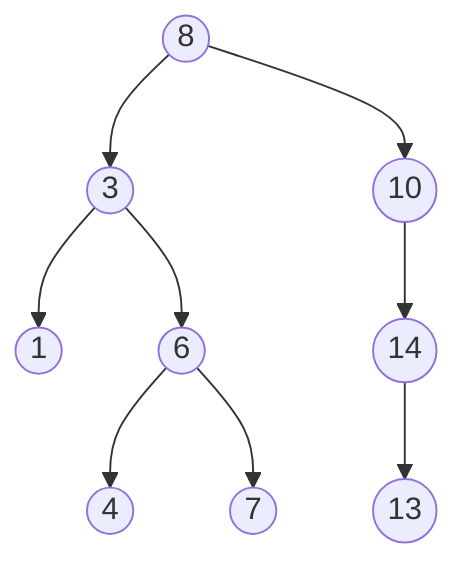
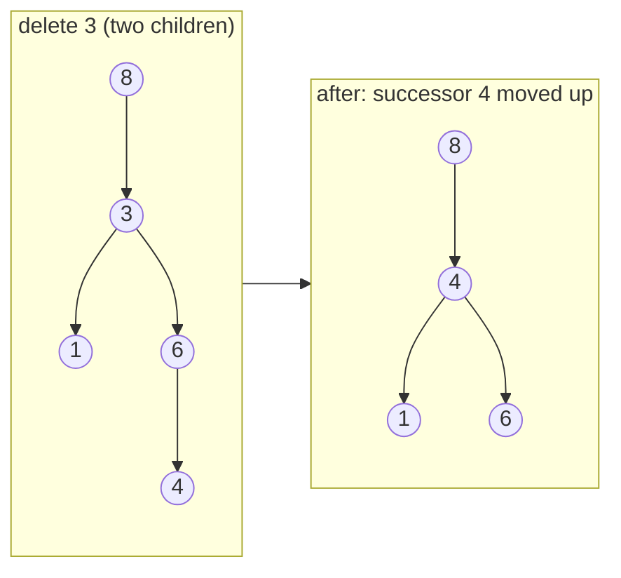
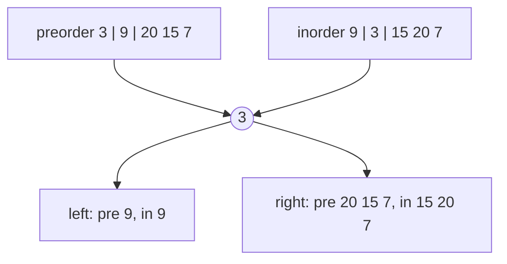

# Binary search trees, construction and serialization

> **Before this lesson:** read [Traversals: DFS (pre/in/post) and BFS](#/lesson/neet-linked-trees/tree-traversals) (you must know preorder and inorder) and [Returning values up the tree](#/lesson/neet-linked-trees/tree-return-up) (passing bounds down). Binary search on a sorted list is a helpful comparison but is not required. For the textbook treatment, including balanced trees, see [Binary search trees](#/lesson/dsa-foundations/bst) and [Rotations and AVL trees](#/lesson/dsa-foundations/avl).

## In plain words

A **binary search tree** (abbreviated **BST**) is a binary tree kept in order so that you can find things
quickly. It works like looking up a word in a paper dictionary: open somewhere, and if your word comes
earlier in the alphabet, ignore everything to the right; if later, ignore everything to the left. Each step
throws away about half of what is left. A BST builds that rule into its shape: at every node, **smaller
values are in the left subtree and larger values are in the right subtree**.

A **key** is the value a node is ordered by. Searching, adding and removing a key each follow a single path
from the root downward, so they take a number of steps equal to the tree's height — about `log₂ n` for a
well-shaped tree with n keys (20 steps for a million keys).

The second half of the lesson answers two practical questions:

- **Construction:** if someone gives you only *lists* of a tree's values in certain traversal orders, can
  you rebuild the exact tree?
- **Serialization:** how do you turn a tree into a piece of text (a **string**) so it can be saved to a file
  or sent over a network, and then rebuild it from that text (**deserialization**)?

**Why it matters for a job.** Ordered trees are the reason databases answer "find this row" or "all orders
between two dates" quickly, and why sorted maps and sets exist in most languages. Serialization is how any
structured data — JSON, HTML, saved game states — travels between programs.

A plain binary tree has no rule about where values go, so finding a value means searching everywhere: O(n).
A **binary search tree** (BST) adds one rule that turns every search into a single walk from the root to a
leaf. This lesson covers the BST property and its operations (search, insert, delete), the problems that
lean on it (validation, k-th smallest, LCA), and then two closely related skills: **building** a tree from
traversal sequences and **serialising** a tree to a string and back.

## 1. The BST property

A binary tree is a **binary search tree** if for every node `v`:

- every key in `v`'s **left** subtree is **less than** `v.key`, and
- every key in `v`'s **right** subtree is **greater than** `v.key`.

(LeetCode's BSTs use distinct keys; some textbooks allow duplicates on one designated side.)



Note the word **every**. The node 4 is fine relative to its parent 6, but it must also be greater than 3 (it
is in 3's right subtree) and less than 8 (it is in 8's left subtree). The most common BST bug is checking
only parent–child pairs.

**Key consequence:** an inorder traversal of a BST visits keys in increasing order (Goodrich, Prop. 11.1).
Above: 1 3 4 6 7 8 10 13 14.

## 2. Search

At each node compare the target with the key and discard half of the remaining tree:

```python
def search(node, target):
    while node and node.val != target:
        node = node.left if target < node.val else node.right
    return node          # the node, or None if absent
```

Each step goes one level deeper, so search costs **O(h)**. If the tree is balanced, h ≈ log₂ n and a search
in a million keys takes about 20 comparisons. If keys were inserted in sorted order, the tree is a chain
(h = n − 1) and search degrades to a linear scan. That is why production systems use **self-balancing**
BSTs — AVL trees, red–black trees, splay trees, B-trees — which perform rotations to keep h = O(log n)
(Goodrich ch. 11.2–11.6). In interviews you rarely implement them, but you should know they exist and that
they guarantee O(log n) operations.

## 3. Insert

Search for the key; the search falls off the tree at exactly the `None` slot where the key belongs. Attach
a new node there.

```python
def insert(root, val):
    if root is None:
        return TreeNode(val)
    cur = root
    while True:
        if val < cur.val:
            if cur.left is None:
                cur.left = TreeNode(val); return root
            cur = cur.left
        else:
            if cur.right is None:
                cur.right = TreeNode(val); return root
            cur = cur.right
```

The recursive version is a classic one-liner per branch: `root.left = insert(root.left, val)`. That
"assign the result of the recursive call back to the child pointer" idiom is also the cleanest way to write
deletion.

## 4. Delete

Find the node, then three cases:

1. **Leaf** — remove it (return `None` to the parent).
2. **One child** — replace the node with its only child.
3. **Two children** — the node must be replaced by a key that keeps the BST property on both sides: its
   **inorder successor** (the smallest key in the right subtree) or its **inorder predecessor** (the largest
   key in the left subtree). Copy that key into the node, then delete the successor from the right subtree —
   and the successor has no left child, so that deletion is case 1 or 2.

```python
def delete(root, key):
    if root is None:
        return None
    if key < root.val:
        root.left = delete(root.left, key)
    elif key > root.val:
        root.right = delete(root.right, key)
    else:
        if root.left is None:
            return root.right
        if root.right is None:
            return root.left
        succ = root.right
        while succ.left:
            succ = succ.left
        root.val = succ.val
        root.right = delete(root.right, succ.val)
    return root
```



All three operations are O(h). Because using the predecessor instead of the successor gives a different but
equally valid tree, the judge for *Delete Node in a BST* and *Insert into a BST* accepts **any** valid BST
with the right keys.

```python-run
class TreeNode:
    def __init__(self, val=0, left=None, right=None):
        self.val, self.left, self.right = val, left, right

def insert(root, v):
    if not root: return TreeNode(v)
    if v < root.val: root.left = insert(root.left, v)
    else: root.right = insert(root.right, v)
    return root

def delete(root, key):
    if not root: return None
    if key < root.val: root.left = delete(root.left, key)
    elif key > root.val: root.right = delete(root.right, key)
    else:
        if not root.left: return root.right
        if not root.right: return root.left
        s = root.right
        while s.left: s = s.left
        root.val = s.val
        root.right = delete(root.right, s.val)
    return root

def inorder(n): return inorder(n.left) + [n.val] + inorder(n.right) if n else []
def height(n):  return 0 if not n else 1 + max(height(n.left), height(n.right))

root = None
for k in [8, 3, 10, 1, 6, 14, 4, 7, 13]:
    root = insert(root, k)
print("inorder", inorder(root), "height", height(root))
for k in (3, 8, 99):
    root = delete(root, k)
    print(f"after delete {k}:", inorder(root))

chain = None
for k in range(1, 9):              # sorted insertions -> degenerate tree
    chain = insert(chain, k)
print("height after sorted inserts:", height(chain))
```

## 5. Problems that use the BST property

### Validate BST

Two equivalent solutions:

- **Bounds passed down**: every node must lie in an open interval `(low, high)`; going left sets
  `high = node.val`, going right sets `low = node.val`. Start with `(-inf, +inf)`.
- **Inorder is strictly increasing**: run an inorder traversal and check each key is greater than the
  previous one.

Both are O(n). Use `float('inf')` rather than sentinels like `2**31 - 1`, which can collide with real keys.

### Kth smallest

Inorder visits keys in sorted order, so the k-th node visited is the answer. The iterative inorder can stop
after k pops: O(h + k).

> [!TIP]
> Follow-up: "the tree changes often and we query often". Store in every node the size of its subtree. Then
> from the root: if `k <= size(left)` go left; if `k == size(left) + 1` this node is the answer; otherwise
> go right with `k -= size(left) + 1`. Each query is O(h). This is an *order-statistic tree*.

### Lowest common ancestor in a BST

Walk from the root. If both `p` and `q` are smaller than the current key, the LCA is on the left; if both are
larger, on the right; otherwise (they split, or one equals the current key) the current node is the LCA.
O(h), no recursion needed.

```python-run
class TreeNode:
    def __init__(self, val=0, left=None, right=None):
        self.val, self.left, self.right = val, left, right

def insert(root, v):
    if not root: return TreeNode(v)
    if v < root.val: root.left = insert(root.left, v)
    else: root.right = insert(root.right, v)
    return root

root = None
for k in [6, 2, 8, 0, 4, 7, 9, 3, 5]:
    root = insert(root, k)

def lca(root, p, q):
    cur = root
    while cur:
        if p < cur.val and q < cur.val: cur = cur.left
        elif p > cur.val and q > cur.val: cur = cur.right
        else: return cur.val

for p, q in [(2, 8), (2, 4), (3, 5), (0, 5), (7, 9)]:
    print(p, q, "->", lca(root, p, q))
```

## 6. Building a tree from traversals

Can you reconstruct a binary tree from its traversals? It depends which ones:

| given | unique tree? (distinct values) |
|---|---|
| preorder + inorder | yes |
| postorder + inorder | yes |
| preorder + postorder | not in general (a single child could be left or right) |
| level order with null markers | yes |
| preorder with null markers | yes |
| preorder alone **of a BST** | yes (the BST property supplies the inorder: it is the sorted keys) |

### Preorder + inorder

- `preorder[0]` is the root.
- Find the root in `inorder`; the elements to its left form the left subtree, those to its right the right
  subtree. If the left part has `m` elements, then `preorder[1 : 1 + m]` is the left subtree's preorder and the
  rest is the right subtree's.
- Recurse.



The direct slicing implementation is O(n²) (slices plus `index()` calls). Two improvements make it O(n):
a dictionary `value → inorder index`, and consuming preorder with a single moving pointer instead of slicing
(the next unused preorder value is always the root of the subtree being built, provided you build the left
subtree before the right).

```python-run
from collections import deque

class TreeNode:
    def __init__(self, val=0, left=None, right=None):
        self.val, self.left, self.right = val, left, right

def build(preorder, inorder):
    where = {v: i for i, v in enumerate(inorder)}
    it = iter(preorder)
    def go(lo, hi):                    # inorder slice [lo, hi)
        if lo >= hi:
            return None
        val = next(it)
        node = TreeNode(val)
        node.left = go(lo, where[val])
        node.right = go(where[val] + 1, hi)
        return node
    return go(0, len(inorder))

def level(root):
    out, q = [], deque([root])
    while q:
        n = q.popleft()
        out.append(n.val if n else None)
        if n: q.extend([n.left, n.right])
    while out and out[-1] is None: out.pop()
    return out

print(level(build([3, 9, 20, 15, 7], [9, 3, 15, 20, 7])))
print(level(build([1, 2, 4, 5, 3, 6, 7], [4, 2, 5, 1, 6, 3, 7])))
```

For **inorder + postorder** do the mirror image: the root is the *last* postorder value; consume postorder
from the end and build the **right** subtree before the left.

## 7. Serialisation

To store a tree in a file or send it over a network you need to turn it into a string (**serialise**) and back
(**deserialise**). The key insight: a single traversal is ambiguous, but a traversal that also records every
**empty child** is not.

### Preorder with null markers

Write the value at each node and `#` at each `None`, separated by commas:

```
    1
   / \
  2   3        ->  "1,2,#,#,3,4,#,#,5,#,#"
     / \
    4   5
```

Deserialisation mirrors serialisation: read a token; if it is `#`, return `None`; otherwise create a node,
build its left subtree from the following tokens, then its right subtree. Because each node is followed by
exactly the tokens of its left subtree and then those of its right subtree, the parse is unambiguous. A tree of
n nodes produces exactly 2n + 1 tokens (n values and n + 1 nulls).

```python-run
class TreeNode:
    def __init__(self, val=0, left=None, right=None):
        self.val, self.left, self.right = val, left, right

def serialize(root):
    out = []
    def go(n):
        if not n:
            out.append("#"); return
        out.append(str(n.val)); go(n.left); go(n.right)
    go(root)
    return ",".join(out)

def deserialize(data):
    tokens = iter(data.split(","))
    def go():
        t = next(tokens)
        if t == "#":
            return None
        n = TreeNode(int(t))
        n.left = go()
        n.right = go()
        return n
    return go()

T = TreeNode
root = T(1, T(2), T(3, T(4), T(-50)))
s = serialize(root)
print(s)
print(serialize(deserialize(s)) == s)
```

> [!WARNING]
> Always use a **delimiter**. Without one, the values 1 and 2 serialise to `12`, indistinguishable from the
> single value 12. Negative numbers need it too.

### Level order with nulls

LeetCode's own format (lesson *Tree vocabulary*) is the BFS equivalent: write nodes level by level and a null
for each missing child of a real node. It is equally valid and avoids recursion entirely, which matters for
very deep trees.

### Special case: BST

For a BST, preorder alone (no nulls) suffices: when deserialising, a value goes into the left subtree while it
is smaller than the current node and fits the bounds `(low, high)` — the same bounds idea as validation. This
saves the n + 1 null tokens.

## 8. Complexity summary

| operation | balanced BST | skewed BST |
|---|---|---|
| search / insert / delete | O(log n) | O(n) |
| min / max / successor | O(log n) | O(n) |
| inorder traversal (sorted order) | O(n) | O(n) |
| k-th smallest (stopping early) | O(log n + k) | O(n) |
| build from pre + in (with dict) | O(n) | O(n) |
| serialise / deserialise | O(n) | O(n) |

> [!INTERVIEW]
> When an interviewer says "BST", immediately think: *inorder is sorted*, *I can discard half the tree at each
> step*, and *the cost is O(h), which is O(log n) only if balanced*. Mentioning the balance caveat
> unprompted is a strong signal.

## Summary

- BST property: all left-subtree keys < node < all right-subtree keys — at every node, not only against the parent.
- Search, insert and delete walk one root-to-leaf path: O(h). Two-child delete uses the inorder successor (or predecessor).
- Inorder of a BST is sorted: validation, k-th smallest, range queries.
- Preorder + inorder (or postorder + inorder) determines a tree; build in O(n) with a value→index map.
- Serialise with null markers and delimiters; preorder with `#` is the simplest round-trippable format.

## Glossary

- **Key** — the value a node is ordered by.
- **Binary search tree (BST)** — a binary tree where, at every node, all keys in the left subtree are smaller and all keys in the right subtree are larger.
- **BST property (invariant)** — that ordering rule; it must hold for whole subtrees, not only for a node and its children.
- **Search / insert / delete** — find a key, add a key, remove a key; each walks one root-to-leaf path, O(h).
- **Inorder successor** — the next larger key: the smallest key in a node's right subtree.
- **Inorder predecessor** — the next smaller key: the largest key in a node's left subtree.
- **Balanced BST** — a BST whose height stays about `log₂ n`. **Self-balancing** trees (AVL, red–black) reshape themselves to stay that way.
- **Rotation** — a small local rearrangement of nodes that changes heights while keeping the BST order.
- **Degenerate (skewed) BST** — a BST that has become a chain, with height n − 1.
- **Bounds `(low, high)`** — the open range of keys a node may hold, given its ancestors.
- **Order-statistic tree** — a BST whose nodes also store subtree sizes, so the k-th smallest key is found in O(h).
- **Construction** — rebuilding a tree from traversal sequences.
- **Serialize / deserialize** — convert a tree to a string / rebuild the tree from that string.
- **Null marker** — a symbol such as `#` written where a child is missing.
- **Delimiter** — a separator character such as `,` between values.
- **Token** — one piece of the string between delimiters (a value or a null marker).
- **Round trip** — serialize then deserialize; it must give back an identical tree.

## Check yourself

```quiz
[
  {"q": "Which tree is NOT a valid BST?", "options": ["[2,1,3]", "[5,3,8,1,4]", "[5,4,6,null,null,3,7]", "[1,null,2]"], "answer": 2,
   "explain": "3 is in the right subtree of 5 but is smaller than 5, even though it is correctly placed relative to its parent 6."},
  {"q": "Searching a BST with n nodes takes…", "options": ["O(log n) always", "O(h): O(log n) if balanced, O(n) if skewed", "O(n log n)", "O(1)"], "answer": 1,
   "explain": "One comparison per level along a single path."},
  {"q": "When deleting a node with two children, which key can replace it?", "options": ["Its parent's key", "The smallest key in its right subtree (or largest in its left)", "Any leaf's key", "The root's key"], "answer": 1,
   "explain": "The inorder successor (or predecessor) keeps every left key smaller and every right key larger."},
  {"q": "Inserting the keys 1, 2, 3, …, n in this order into an empty BST produces a tree of height…", "options": ["log n", "n − 1", "n/2", "1"], "answer": 1,
   "explain": "Each key becomes the right child of the previous one: a chain."},
  {"q": "Which pair of traversals does NOT in general determine a binary tree with distinct values?", "options": ["preorder + inorder", "postorder + inorder", "preorder + postorder", "preorder with null markers alone"], "answer": 2,
   "explain": "If a node has one child, preorder and postorder cannot tell whether it is the left or right child."},
  {"q": "Why does the O(n) construction from preorder + inorder build the left subtree before the right?", "options": ["Style", "Because it consumes preorder sequentially, and in preorder the left subtree's values come before the right's", "Inorder requires it", "To avoid recursion"], "answer": 1,
   "explain": "The next unused preorder value must be the root of the subtree being built."},
  {"q": "How many tokens does preorder-with-nulls produce for a tree of n nodes?", "options": ["n", "2n", "2n + 1", "n + 1"], "answer": 2,
   "explain": "n values plus n + 1 empty-child markers."}
]
```

> **Source:** Goodrich, Tamassia & Goldwasser, *Data Structures and Algorithms in Python*, ch. 11.1 (binary search trees: navigation, searches, insertions and deletions, performance) and 11.2–11.6 (balanced search trees: AVL, splay, (2,4) and red–black trees); ch. 8.4 for traversals used in reconstruction.
