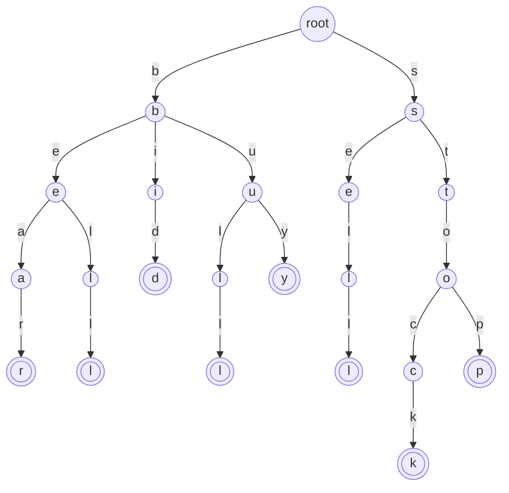

# Tries: prefix trees from scratch

> **Before this lesson:** read [Tree vocabulary, shapes and representations](#/lesson/neet-linked-trees/tree-basics) — a trie is a tree, so you need root, child, leaf and path — and know how to use a Python `dict` (a table that looks up a value by a key) and how to loop over the characters of a string. Nothing else is assumed.

## In plain words

A **trie** (say "try") is a tree for storing **words**, built so that words beginning with the same letters
share the same starting path. Think of how a phone suggests words as you type. After `c`, `a`, `r` it
offers *car, card, care, careful*: it is as if all words were arranged along branching roads, where every
letter you type takes you one junction further, and everything reachable from where you now stand is a
possible completion.

Some words used below:

- A **string** is a piece of text, a sequence of **characters** (letters, digits, symbols).
- A **prefix** of a string is any beginning of it: the prefixes of `card` are `c`, `ca`, `car`, `card`.
- The **alphabet** is the set of characters allowed, for example the 26 lowercase letters; its size is
  written $|\Sigma|$ (read "size of sigma") in formulas.
- A **hash set** is Python's `set`: it tells you very quickly whether an exact item is stored, but knows
  nothing about beginnings of items.

In a trie, each step from a node to a child is labelled with one character. Spelling a word means walking
from the root, one character per step. A word is stored if its walk exists **and** the node where it ends
is marked as "a word ends here".

**Why it matters for a job.** Autocomplete boxes, spell checkers, the routing tables that decide where
internet traffic goes (matching address prefixes), and search features in editors all use tries or close
relatives. In interviews, "implement a trie" is a standard design question, and tries are the key to several
hard word-search problems.

Hash sets answer "is this exact word stored?" in O(L) time for a word of length L. But they cannot answer
"is any stored word *starting with* `pre`?" without scanning every word. Autocomplete, spell checkers, IP
routing tables, word games and search engines all need prefix questions. The data structure built for them is
the **trie** (from re*trie*val, usually pronounced "try"), also called a **prefix tree**.

## 1. The idea

A trie stores strings as **paths** from the root. Each edge is labelled with one character; the path from the
root to a node spells a prefix. Words that share a prefix share the nodes of that prefix. A flag on a node
marks "a complete word ends here".

Words: `bear, bell, bid, bull, buy, sell, stock, stop` (the example from Goodrich §13.5):



(Double circles mark word ends.) The prefix `st` is stored once and shared by `stock` and `stop`.

Two properties that Goodrich proves for a standard trie of $s$ strings with total length $n$ over an alphabet
$\Sigma$:

- the height equals the length of the longest string;
- every node has at most $|\Sigma|$ children;
- there are at most $n + 1$ nodes (the worst case is when no two strings share a first character).

## 2. The node

```python
class TrieNode:
    def __init__(self):
        self.children = {}     # char -> TrieNode
        self.end = False       # does a word end here?
```

Two common child representations:

| representation | lookup | memory | notes |
|---|---|---|---|
| `dict` (hash map) | expected O(1) | proportional to actual children | idiomatic in Python; handles any alphabet |
| array of 26 slots | O(1) | 26 references per node | classic in C++/Java for lowercase letters |
| sorted list | O(log Σ) | compact | rarely used in interviews |

In Python prefer the dict. A slick alternative is to use nested plain dicts with a special key such as `"$"`
for the end marker: `node = node.setdefault(ch, {})`. It is compact and fast, and it is what the reference
solutions for *Design Add and Search Words* and *Word Search II* use.

> [!NOTE]
> Why do we need the `end` flag at all? Because a stored word can be a prefix of another stored word
> (`app` and `apple`). Goodrich's textbook definition avoids that by assuming no string is a prefix of
> another (or by appending a terminator character); the flag is the practical equivalent.

## 3. Operations

### insert(word)

Walk from the root, following the child for each character and creating it if it is missing; mark the last
node as a word end.

```python
def insert(self, word):
    node = self.root
    for ch in word:
        if ch not in node.children:
            node.children[ch] = TrieNode()
        node = node.children[ch]
    node.end = True
```

### search(word) and startsWith(prefix)

Both walk the path for the given string. If at some point the required child is missing, the answer is no.
They differ only at the end: `search` needs `end` to be True; `startsWith` is satisfied by the path existing.

```python
def _walk(self, s):
    node = self.root
    for ch in s:
        node = node.children.get(ch)
        if node is None:
            return None
    return node

def search(self, word):
    node = self._walk(word)
    return node is not None and node.end

def startsWith(self, prefix):
    return self._walk(prefix) is not None
```

```python-run
class TrieNode:
    def __init__(self):
        self.children, self.end = {}, False

class Trie:
    def __init__(self):
        self.root = TrieNode()
    def insert(self, word):
        node = self.root
        for ch in word:
            node = node.children.setdefault(ch, TrieNode())
        node.end = True
    def _walk(self, s):
        node = self.root
        for ch in s:
            node = node.children.get(ch)
            if node is None:
                return None
        return node
    def search(self, word):
        n = self._walk(word); return n is not None and n.end
    def startsWith(self, p):
        return self._walk(p) is not None

t = Trie()
for w in ["apple", "app", "bear", "bell"]:
    t.insert(w)
for q in ["app", "appl", "apple", "be", "bell", "bells"]:
    print(f"{q:6} search={t.search(q)!s:5} startsWith={t.startsWith(q)}")
```

### Complexity

For a string of length $L$, each operation follows at most $L$ edges with expected O(1) work per edge, so
**O(L)** — independent of how many words are stored. Compare with a sorted list of words, where a prefix
query costs O(L log N) via binary search, or a hash set, where `startsWith` costs O(N·L).

Space is O(total characters inserted) in the worst case, often much less thanks to shared prefixes. In
practice tries are memory-hungry: each node is a Python object with a dict, roughly 100+ bytes. That is the
main trade-off against a hash set.

## 4. Beyond yes/no: augmenting the nodes

Store extra information at each node and many questions become one walk:

- **Count words with a prefix**: keep `count` = number of words passing through the node; increment along the
  path on insert. `countPrefix(p)` returns the count at the end of p's path.
- **Autocomplete**: walk to the prefix node, then DFS below it collecting words (store the full word at its
  end node to avoid rebuilding strings). To return the top-k most frequent completions, store frequencies and
  use a heap, or cache the top-k at every node.
- **Delete**: walk the path, unset `end`, then on the way back up remove nodes that have no children and are not
  word ends (decrement counts if you keep them).
- **Longest common prefix** of all words: walk from the root while the node has exactly one child and is not
  a word end.

```python-run
class Node:
    def __init__(self):
        self.kids, self.count, self.word = {}, 0, None

root = Node()
def insert(w):
    n = root
    for ch in w:
        n = n.kids.setdefault(ch, Node())
        n.count += 1
    n.word = w

def complete(prefix):
    n = root
    for ch in prefix:
        n = n.kids.get(ch)
        if n is None:
            return 0, []
    out, stack = [], [n]
    while stack:
        cur = stack.pop()
        if cur.word: out.append(cur.word)
        stack.extend(cur.kids.values())
    return n.count, sorted(out)

for w in ["car", "card", "care", "cared", "cat", "dog"]:
    insert(w)
print(complete("car"))
print(complete("ca"))
print(complete("x"))
```

## 5. Compressed tries and other variants

- **Compressed trie (radix tree / Patricia trie)**: chains of single-child nodes are merged into one edge
  labelled with a whole substring. The number of nodes becomes O(s) for s strings instead of O(n) characters.
  Used in routers (longest-prefix IP matching) and in many key–value stores.
- **Suffix trie / suffix tree**: insert every suffix of a text; then *any* substring query is a prefix query.
  Suffix trees support pattern matching in O(m) for a pattern of length m after O(n) preprocessing.
- **Bitwise tries**: the alphabet is {0, 1}; each integer is a path of bits. *Maximum XOR of Two Numbers*
  (LeetCode 421) walks such a trie greedily, preferring the opposite bit at each level.

## 6. When to reach for a trie

| signal in the problem | trie? |
|---|---|
| "prefix", "starts with", autocomplete | yes |
| many words searched against the same structure | yes |
| wildcard single-character matching (`.`) | yes — DFS over children at the wildcard |
| searching many words in a grid | yes — *Word Search II* |
| only exact membership | no — a `set` is simpler |
| longest common prefix of a few strings | optional — simple scanning works |

> [!INTERVIEW]
> Interviewers expect you to implement a trie from scratch in about ten minutes. Practise the three methods
> until they are automatic, and be ready to discuss the dict-vs-array choice and the memory cost.

## Summary

- A trie stores strings as root-to-node paths; shared prefixes share nodes; an end flag marks complete words.
- `insert`, `search`, `startsWith` are O(L) for a string of length L, regardless of how many words are stored.
- Use dict children in Python; add counts or stored words for prefix counting and autocomplete.
- Variants: compressed (radix) tries, suffix tries, bitwise tries.

## Glossary

- **String / character** — a piece of text / one symbol of it.
- **Prefix** — a beginning of a string (including the whole string).
- **Alphabet ($\Sigma$)** — the set of allowed characters; $|\Sigma|$ is how many there are.
- **Trie (prefix tree)** — a tree in which each root-to-node path spells a prefix of the stored words.
- **Edge label** — the single character attached to a parent–child link.
- **End-of-word flag (marker)** — a mark on a node saying that the path to it is a complete stored word.
- **`insert`** — add a word by walking its characters and creating missing nodes.
- **`search`** — is this exact word stored? **`startsWith`** — is any stored word beginning with this prefix?
- **L** — the length of the word or prefix; trie operations cost O(L).
- **Hash set** — Python's `set`; fast exact membership, no prefix queries.
- **Augmenting a node** — storing extra data in each node (a counter, the whole word) to answer more kinds of question.
- **Autocomplete** — listing the stored words that start with what has been typed.
- **Compressed trie (radix tree, Patricia trie)** — a trie where chains of single-child nodes are merged into one edge.
- **Suffix** — an ending of a string; a **suffix trie** stores all of them.
- **Bitwise trie** — a trie over the alphabet {0, 1}, storing numbers bit by bit.

## Check yourself

```quiz
[
  {"q": "After inserting 'apple' only, what does search('app') return?", "options": ["True", "False", "Error", "None"], "answer": 1,
   "explain": "The path exists but the node for the second 'p' is not marked as a word end."},
  {"q": "...and startsWith('app')?", "options": ["True", "False", "Error", "Depends on insertion order"], "answer": 0,
   "explain": "startsWith only needs the path to exist."},
  {"q": "Time to search a word of length L in a trie holding N words?", "options": ["O(N)", "O(L)", "O(N·L)", "O(log N)"], "answer": 1,
   "explain": "One step per character; N does not matter."},
  {"q": "What is the maximum number of nodes in a standard trie of strings with total length n (counting the root)?", "options": ["n", "n + 1", "2n", "26n"], "answer": 1,
   "explain": "Each character creates at most one new node, plus the root (Goodrich, Prop. 13.6)."},
  {"q": "Why is the end-of-word flag necessary?", "options": ["To speed up insert", "Because a stored word can be a prefix of another stored word", "To count children", "It is optional for search"], "answer": 1,
   "explain": "Without it, 'app' would look stored as soon as 'apple' is inserted."},
  {"q": "To count how many stored words start with a prefix in O(L), you should…", "options": ["DFS below the prefix node each time", "Store at each node how many words pass through it", "Use a hash set", "Sort the words"], "answer": 1,
   "explain": "Increment a counter along the insertion path; the answer is the counter at the prefix's node."},
  {"q": "A compressed (radix) trie improves on a standard trie by…", "options": ["Faster hashing", "Merging chains of single-child nodes into single edges labelled with substrings", "Sorting children", "Storing words in leaves only"], "answer": 1,
   "explain": "This brings the node count down to O(number of strings)."}
]
```

> **Source:** Goodrich, Tamassia & Goldwasser, *Data Structures and Algorithms in Python*, ch. 13.5 (standard tries and Proposition 13.6, compressed tries, suffix tries, search engine indexing).
