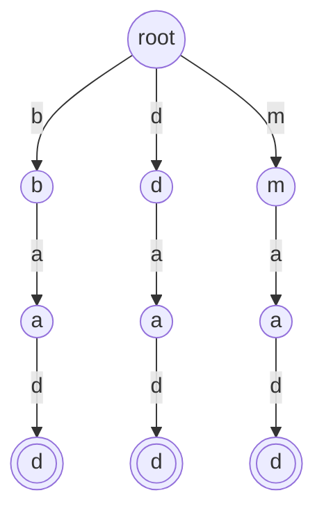
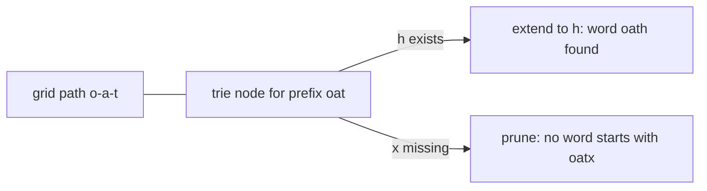

# Wildcards and trie-guided grid search

> **Before this lesson:** read [Tries: prefix trees from scratch](#/lesson/neet-linked-trees/trie-basics) — you should be able to write `insert` and `search` yourself — and [Traversals: DFS (pre/in/post) and BFS](#/lesson/neet-linked-trees/tree-traversals) for depth-first search. A grid here is a Python list of lists, `board[row][column]`.

## In plain words

So far a trie lookup followed **one** road: each letter of the word picked exactly one child. This lesson
covers two situations where there are **several roads to try**.

1. **Wildcards.** A **wildcard** is a placeholder that can stand for any character. Searching a crossword
   dictionary for `c.t` ("c, any letter, t") should find *cat*, *cot* and *cut*. At the unknown letter you
   have to try every branch of the trie.
2. **Word-search puzzles.** You are given a square of letters and a long list of words, and must find which
   words can be traced by moving between neighbouring squares. Here the trie is used the other way round:
   while you trace a path through the letters, the trie tells you immediately whether any word at all starts
   with the letters so far — and if none does, you stop and try another direction.

The method for "try an option, and if it leads nowhere, undo it and try the next" is called
**backtracking**. It is a depth-first search (DFS, explained in the traversal lesson) over choices rather
than over tree nodes. Cutting off a hopeless option early is called **pruning**, like cutting dead
branches off a plant.

**Why it matters for a job.** Pattern search with unknown parts, "did you mean…?" suggestions, and solvers
for puzzles and games all combine a dictionary structure with a search that gives up early. The general
lesson — organise your data so that a search can stop as soon as success is impossible — applies far beyond
tries.

The basic trie walks a single path: one character, one child. Two of the most common trie interview problems
break that simplicity. In *Design Add and Search Words*, a `.` in the query can match **any** character, so the
walk must branch. In *Word Search II*, the "query" is not a string at all but every path through a grid of
letters, and the trie is used to **prune** a backtracking search. Both are combinations of a trie with DFS, and
both reward a clear picture of what the recursion is exploring.

## 1. Wildcard search: branching at the dots

Store words in an ordinary trie. To search a pattern, recurse on `(node, i)` = "can the rest of the pattern
from position i be matched starting at this trie node?"

- If `i == len(pattern)`: succeed iff `node` marks a word end.
- If `pattern[i]` is a letter: follow that single child (fail if missing).
- If `pattern[i] == '.'`: try **every** child; succeed if any branch succeeds.

```python
def search(self, pattern):
    def dfs(node, i):
        if i == len(pattern):
            return node.end
        ch = pattern[i]
        if ch == ".":
            return any(dfs(child, i + 1) for child in node.children.values())
        child = node.children.get(ch)
        return child is not None and dfs(child, i + 1)
    return dfs(self.root, 0)
```

`any(...)` with a generator short-circuits: as soon as one branch succeeds, the others are not explored.



Searching `.ad` branches into `b`, `d` and `m` at the first level, then follows single paths. Searching `b..`
follows `b` and then branches over the (single) children twice.

```python-run
class WordDictionary:
    def __init__(self):
        self.root = {}
    def addWord(self, word):
        node = self.root
        for ch in word:
            node = node.setdefault(ch, {})
        node["$"] = True
    def search(self, pattern, trace=False):
        calls = 0
        def dfs(node, i):
            nonlocal calls
            calls += 1
            if i == len(pattern):
                return "$" in node
            ch = pattern[i]
            if ch == ".":
                return any(dfs(c, i + 1) for k, c in node.items() if k != "$")
            return ch in node and dfs(node[ch], i + 1)
        ok = dfs(self.root, 0)
        print(f"{pattern!r:8} -> {ok}  ({calls} calls)")
        return ok

wd = WordDictionary()
for w in ["bad", "dad", "mad", "bat", "batch"]:
    wd.addWord(w)
for p in ["pad", "bad", ".ad", "b..", "...", "....", ".....", "ba"]:
    wd.search(p)
```

### Cost

Without dots, a search is O(L). Each dot multiplies the number of explored branches by up to the alphabet
size, so the worst case is O(26^d · L) for d dots. LeetCode limits patterns to at most two dots, so that is a
constant factor. A pattern made entirely of dots degenerates into exploring every word of that length — still
bounded by the trie's size.

> [!TIP]
> If patterns are mostly dots, an alternative is to bucket words **by length** and compare the pattern against
> each word of the right length. Mentioning this trade-off shows you think about the input distribution, not
> only the asymptotic worst case.

### Pitfalls

- When children and the end marker live in the same dict (the `"$"` trick), skip the marker while branching
  on `.`.
- A pattern like `ba` must not match `bad`: check the end marker when the pattern is exhausted.
- Do not create nodes while searching (no `setdefault` in `search`).

## 2. Grid backtracking refresher (Word Search I)

Before *Word Search II*, recall the single-word version: is `word` traceable in a grid by moving between
horizontally/vertically adjacent cells without reusing a cell?

```python
def exist(board, word):
    R, C = len(board), len(board[0])
    def dfs(r, c, i):
        if i == len(word):
            return True
        if not (0 <= r < R and 0 <= c < C) or board[r][c] != word[i]:
            return False
        board[r][c] = "#"                        # mark as used on this path
        found = any(dfs(r + dr, c + dc, i + 1) for dr, dc in ((1,0),(-1,0),(0,1),(0,-1)))
        board[r][c] = word[i]                    # unmark (backtrack)
        return found
    return any(dfs(r, c, 0) for r in range(R) for c in range(C))
```

The **mark / recurse / unmark** pattern is the essence of backtracking: the board itself serves as the visited
set, and restoring the cell lets other paths use it.

Cost: from each of the R·C start cells, the first step has 4 directions and later steps at most 3 (you never
go back to the cell you came from), so O(R·C · 4 · 3^(L−1)) for a word of length L.

## 3. Word Search II: many words, one search

Now find **all** words of a list that appear in the grid. Running Word Search I once per word costs
O(W · R·C · 3^L) — with tens of thousands of words, far too slow. Most of that work is repeated: the words
`oath`, `oat`, `oak` and `oar` all start by looking for `o` then `a`.

The fix: put **all words in a trie** and run **one** backtracking search from every cell, walking the trie in
parallel with the grid. A path in the grid is extended only while it spells a prefix that exists in the trie.



Algorithm:

1. Build a trie; at each word's end node store the **word itself** (so you do not need to rebuild strings
   from the path).
2. For each cell whose letter is a child of the root, DFS with `(r, c, parent_trie_node)`.
3. In the DFS: move to the trie child for `board[r][c]`. If it stores a word, add it to the result and
   **remove** it from the node (so it is not reported twice). Mark the cell, recurse into neighbours whose
   letters are children of the current trie node, unmark.
4. **Prune**: when a trie node has no children and no word left, delete it from its parent. Later searches
   never enter exhausted branches.

```python
def find_words(board, words):
    root = {}
    for w in words:
        node = root
        for ch in w:
            node = node.setdefault(ch, {})
        node["$"] = w
    R, C = len(board), len(board[0])
    found = []

    def dfs(r, c, parent):
        ch = board[r][c]
        node = parent[ch]
        word = node.pop("$", None)
        if word:
            found.append(word)
        board[r][c] = "#"
        for dr, dc in ((1, 0), (-1, 0), (0, 1), (0, -1)):
            nr, nc = r + dr, c + dc
            if 0 <= nr < R and 0 <= nc < C and board[nr][nc] in node:
                dfs(nr, nc, node)
        board[r][c] = ch
        if not node:                 # nothing left below: prune
            parent.pop(ch)

    for r in range(R):
        for c in range(C):
            if board[r][c] in root:
                dfs(r, c, root)
    return found
```

Note that `"#"` can never be a trie key, so a marked cell automatically fails the `board[nr][nc] in node`
test — the visited check comes for free.

```python-run
def find_words(board, words, verbose=True):
    root = {}
    for w in words:
        node = root
        for ch in w:
            node = node.setdefault(ch, {})
        node["$"] = w
    R, C = len(board), len(board[0])
    found, calls = [], 0

    def dfs(r, c, parent):
        nonlocal calls
        calls += 1
        ch = board[r][c]
        node = parent[ch]
        word = node.pop("$", None)
        if word:
            found.append(word)
            if verbose:
                print(f"found {word!r} ending at {(r, c)}")
        board[r][c] = "#"
        for dr, dc in ((1, 0), (-1, 0), (0, 1), (0, -1)):
            nr, nc = r + dr, c + dc
            if 0 <= nr < R and 0 <= nc < C and board[nr][nc] in node:
                dfs(nr, nc, node)
        board[r][c] = ch
        if not node:
            parent.pop(ch)

    for r in range(R):
        for c in range(C):
            if board[r][c] in root:
                dfs(r, c, root)
    print("dfs calls:", calls, "| trie left:", root)
    return found

board = [list("oaan"), list("etae"), list("ihkr"), list("iflv")]
print(sorted(find_words(board, ["oath", "pea", "eat", "rain", "oat"])))
```

Watch the final "trie left" output: after the search, every found word and every exhausted branch has been
removed, and only prefixes of unfound words (like `pea`, `rain`) remain.

### Complexity

Worst case O(R·C · 4 · 3^(L−1)) where L is the longest word length (≤ 10 on LeetCode) — the same bound as one
Word Search I — plus O(total characters) to build the trie. The crucial difference is that the bound no longer
multiplies by the number of words W, and pruning makes typical runs much faster than the bound.

### Pitfalls

- **Duplicates**: a word can be traceable along several paths; removing its end marker after the first find
  (or collecting into a set) prevents reporting it twice.
- **Forgetting to unmark** the cell: later starting points see a corrupted board.
- **Pruning the wrong node**: prune the child (`parent.pop(ch)`) only after the recursion below it has finished
  and only when it is empty.
- Starting the DFS from cells whose letters are not in the root wastes time — check first.

## 4. The general lesson

Both problems use the trie as a **set of prefixes** that tells a search when to stop:

- In the wildcard dictionary, the search explores *the trie*, guided by the pattern.
- In Word Search II, the search explores *the grid*, and the trie says which extensions are still worth
  trying.

The same pairing appears in Boggle solvers, in spell checkers that suggest corrections within edit distance k
(walk the trie while maintaining one DP row of the edit-distance table per node), and in *Concatenated Words*
and *Word Break II*, where a trie lists every dictionary word that starts at a given position.

> [!INTERVIEW]
> For Word Search II, say the bottleneck out loud: "Searching each word separately repeats work on shared
> prefixes, so I'll merge all words into a trie and do one backtracking pass that prunes as soon as the
> current path is not a prefix." That one sentence is most of what the interviewer wants to hear.

## Summary

- Wildcard search = trie walk that branches over all children at each `.`; check the end marker at the end.
- Grid backtracking: mark, recurse into neighbours, unmark.
- Word Search II: one DFS from each cell, guided by a trie of all words; store words at end nodes, remove found words, prune empty branches.
- Tries turn "search for many strings" into "search once, prune by prefix".

## Glossary

- **Wildcard** — a pattern character (here `.`) that matches any single letter.
- **Pattern** — the string being searched for, possibly containing wildcards.
- **Branching** — exploring more than one child of a node.
- **DFS (depth-first search)** — explore one option fully before trying the next.
- **Backtracking** — make a choice, explore, then undo the choice so other options can be explored.
- **Mark / unmark** — temporarily overwrite a grid cell (for example with `#`) so the current path cannot reuse it, then restore it.
- **Pruning** — abandoning a branch of the search as soon as it cannot lead to an answer.
- **Grid (board)** — a table of cells addressed as `board[r][c]` (row, then column).
- **Adjacent cells** — cells sharing a side: up, down, left or right.
- **Short-circuit** — `any(...)` stops at the first `True` it sees, skipping the remaining work.
- **End marker (`"$"`)** — the special dictionary key used in the nested-dict trie to mark (or store) a complete word.
- **Shared prefix** — a beginning that several words have in common; the trie stores it once.
- **W, L, R, C** — number of words, longest word length, and the grid's rows and columns in complexity formulas.

## Check yourself

```quiz
[
  {"q": "In wildcard search, what happens at a '.' character?", "options": ["It is skipped", "The DFS tries every child of the current node", "It matches only vowels", "The search fails"], "answer": 1,
   "explain": "A dot matches any single letter, so every child is a candidate."},
  {"q": "Words {bad, batch}. Does pattern 'ba.' match?", "options": ["Yes, via 'bad'", "No", "Only via 'batch'", "Error"], "answer": 0,
   "explain": "b-a-d ends at a word-end node after exactly three characters."},
  {"q": "Why is running Word Search I once per word too slow for Word Search II?", "options": ["Recursion depth", "It repeats the same grid exploration for every shared prefix, multiplying the cost by the number of words", "It cannot find duplicates", "It uses too much memory"], "answer": 1,
   "explain": "A trie lets one search serve all words that share a prefix."},
  {"q": "In the trie-guided DFS, why store the whole word at its end node?", "options": ["To save memory", "So the word can be reported directly without rebuilding it from the path", "To sort the output", "It's required by Python"], "answer": 1,
   "explain": "It also gives an easy way to remove it after finding it (pop the stored word)."},
  {"q": "What does pruning (deleting empty trie nodes) achieve?", "options": ["Correctness", "Later searches skip branches whose words were all found", "It sorts the results", "It prevents infinite recursion"], "answer": 1,
   "explain": "It is a pure speed-up: exhausted prefixes are no longer explored."},
  {"q": "Why must the cell be restored after exploring from it?", "options": ["To print the board", "So other paths (and other start cells) can use that letter", "To avoid duplicates", "It doesn't matter"], "answer": 1,
   "explain": "The mark only means 'used on the current path'. Backtracking undoes it."}
]
```

> **Source:** Goodrich, Tamassia & Goldwasser, *Data Structures and Algorithms in Python*, ch. 13.5 (tries, word matching and prefix matching with a standard trie); backtracking search as in ch. 4 (recursion).
